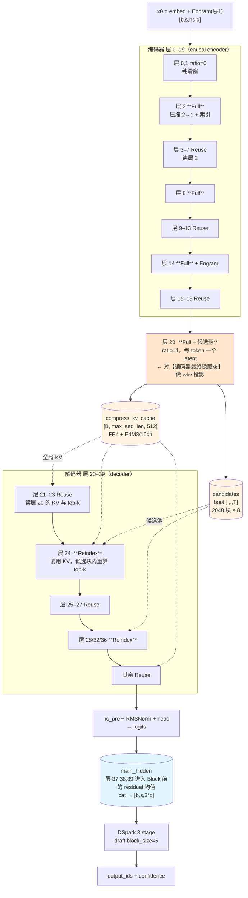
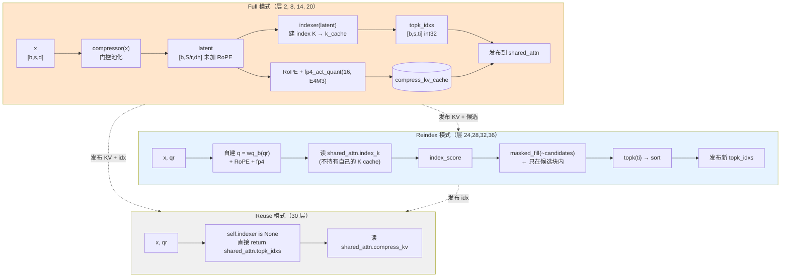
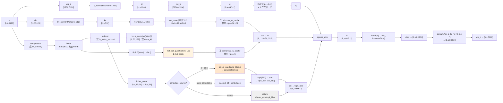

# DeepSeek-V4.1-Flash 架构与代码分析

> **2026-10-07 本机复核更新**：核心结构、参数/缓存口径与 CPU 边界用例见 [本机核验与更正](DeepSeek-V4-V4.1-本机核验与更正.md)。旧文中的 `[未检出]` 是写作时的检出状态；当前可用路径以新报告为准。GPU 性能、训练与完整模型质量未在本机复现。

> DeepSeek-V4.1（2026-09-10 开源）**不是 V4 的小版本迭代**，而是一次大改：
> 引入 Causal Encoder-Decoder、CSA2 跨层共享、Engram 条件记忆、DSpark 投机解码与视觉塔。
> 本文档以**官方参考实现**（`inference/model.py`，1309 行）为准，
> 逐模块分析并给出与 V4 的差异；vLLM / SGLang 的适配见 §7。
>
> 配套：[DeepSeek-V4-代码调用结构分析.md](DeepSeek-V4-代码调用结构分析.md)、
> [DeepSeek-V4-张量数据流详解.md](DeepSeek-V4-张量数据流详解.md)

## 目录

| 节 | 内容 |
|---|---|
| [§0](#0-数据来源) | 数据来源与规模核对 |
| [§1](#1-配置层v4-vs-v41-全字段对照) | 配置层：V4 vs V4.1 全字段对照、`compress_ratios` 语义变化 |
| [§2](#2-五大架构增量逐个详解) | **五大架构增量**：CED / CSA2 / 分层索引器 / Single-Pass mHC / Engram / DSpark / ViT / FP4 KV |
| [§3](#3-kv-cache-布局与-890-btoken-核算) | KV cache 布局与 **890 B/token** 精确核算 |
| [§4](#4-官方参考实现调用图) | 官方参考实现调用图（逐行号） |
| [§5](#5-相对-v4-的差异汇总) | 相对 V4 的差异汇总（含"消失清单"） |
| [§6](#6-相关文件) | 相关文件与未覆盖范围 |
| [§7](#7-张量形状与数据流逐步) | **张量形状与数据流**：<br>7.1 逐参数形状 · 7.2 逐步张量表 · **7.3 张量级计算流程图** · **7.4 Engram 逐步** · **7.5 DSpark 逐步** · **7.6 prefill/decode 时序** · 7.7 显存 · 7.8 自检 · 7.9 消失清单 |
| [§8](#8-vllm--sglang-适配要点) | vLLM / SGLang 适配要点 |

### 图表清单

| # | 类型 | 位置 | 内容 |
|---|---|---|---|
| 1 | Mermaid `flowchart TD` | §2.1 | **CED 编码器-解码器**：层 0–19 编码、层 20 边界、层 20–39 解码、KV/候选发布关系 |
| 2 | Mermaid `flowchart TB` | §2.2 | **CSA2 三模式**：Full / Reindex / Reuse 各自的算子链与张量 |
| 3 | Mermaid `flowchart LR` | §7.3 | **注意力内部张量级计算图**：Q 路径 / KV 路径 / Compressor / Indexer / 候选块 / sparse_attn / O 投影，每个节点标注形状 |
| 4 | ASCII（§4） | §4 | 官方参考实现完整调用树（逐行号） |
| 5 | ASCII（§3.2） | §3.2 | 890 B/token 的分解算式 |

---

## 0. 数据来源

| 来源 | 版本 | 本地路径 |
|---|---|---|
| HF `deepseek-ai/DeepSeek-V4.1-Flash` | main（2026-09-10 创建，76.7 万下载） | [configs/v41/](../configs/v41/) |
| 官方参考实现 | `inference/model.py` 1309 行、`kernel.py`、`engram.py`、`vision.py`、`image_processor.py` | [configs/v41/](../configs/v41/) |
| vLLM | commit `c91dccc0`，`vllm/models/deepseek_v41/` **19,322 行** | [repos/vllm/](../repos/vllm/) |
| SGLang | commit `bb9a820f`，`dsv41_sparse.py` / `v41_indexer/` 等 | [repos/sglang/](../repos/sglang/) |

**未下载权重**。抓取的文件：`config.json`、`README.md`、`chat_template.jinja`、
`inference/{config.json,generate.py,convert.py,model.py,kernel.py,engram.py,vision.py,image_processor.py}`。

官方给出的规模（README 表格）：

| | V4-Flash-Base | V4-Pro-Base | **V4.1-Flash** |
|---|---|---|---|
| 骨干参数 | 284B | 1.6T | **552B** |
| 激活参数 | 13B | 49B | **8B（prefill）/ 16B（decode）** |
| 模态 | 文本 | 文本 | **图文** |
| 全局 KV / token | — | — | **890 B** |

> **交叉验证**：我在 V4 文档里按形状估算的 V4-Flash 骨干为 **284.3 G**，
> 与官方公布的 **284B** 一致；V4-Pro 估算 ≈1.6T 亦吻合。估算方法可靠。

---

## 1. 配置层：V4 vs V4.1 全字段对照

V4.1 的 HF config 是**嵌套结构**（`text_config` + `vision_config`），
V4 是扁平结构 —— 这本身就是多模态化的标志。

### 1.1 关键字段差异

| 字段 | V4-Flash | **V4.1-Flash** | 影响 |
|---|---|---|---|
| `architectures` | `DeepseekV4ForCausalLM` | **`DeepseekV41ForCausalLM`** | 注册键不同 |
| `model_type` | `deepseek_v4` | **`deepseek_v41`** | 分派键不同 |
| `hidden_size` | 4096 | **5120** | 主干变宽 |
| `num_hidden_layers` | 43 | **40** | 层数减少 |
| `moe_intermediate_size` | 2048 | **2304** | — |
| `q_lora_rank` | 1024 | **1280** | — |
| `n_routed_experts` | 256 | **384** | 专家更多 |
| `num_experts_per_tok` | 6 | 6 | 不变 |
| `index_n_heads` | 64 | **32** | 索引器头数减半 |
| `index_head_dim` / `index_topk` | 128 / 512 | 128 / 512 | 不变 |
| **`compress_ratios`** | `{0, 4, 128}` | **`{0, 2, 1}`** | **压缩方案整体更换** |
| `rms_norm_eps` | 1e-06 | **1e-20** | 极小 eps |
| `quantization_config.weight_block_size` | `[128,128]` | **`[32,32]`** | 更细的量化粒度 |
| `num_nextn_predict_layers` | 1 | **3** | MTP 扩到 3 层 |
| `o_groups` / `o_lora_rank` / `hc_mult` / `sliding_window` | 8 / 1024 / 4 / 128 | 同 | 不变 |
| `scoring_func` / `route_scale` | `sqrtsoftplus` / 1.5 | 同 | 不变 |
| `kv_source_layer_ids` | — | **[2, 8, 14, 20]** | **新增：KV 共享源** |
| `index_source_layer_ids` | — | **[2,8,14,20,24,28,32,36]** | **新增：索引源** |
| `candidate_source_layer_id` | — | **20** | **新增：候选块源** |
| `candidate_topk_blocks` / `candidate_block_size` | — | **2048 / 8** | **新增：分层索引** |
| `engram_*`（8 个字段） | — | **有** | **新增：条件记忆** |
| `dspark_*`（7 个字段） | — | **有** | **新增：投机解码** |
| `vision_config` | — | **32 层 / 1024 维** | **新增：视觉塔** |

### 1.2 `compress_ratios`：从 `{0,4,128}` 到 `{0,2,1}`

V4.1 的 `compress_ratios`（43 项）：

```
索引   0  1 | 2 ................... 19 | 20 .................. 39 | 40 41 42
ratio  0  0 | 2  2  2  2 ... 2   2  2  |  1  1  1 ... 1   1   1  |  0  0  0
            └──── 18 层 ratio=2 ────────┘└──── 20 层 ratio=1 ─────┘ └ 3 个 MTP ┘
```

**`len(compress_ratios) = 43 = n_layers(40) + n_mtp_layers(3)`**。

> **这独立验证了 V4 分析中的一个关键结论**：
> V4-Flash `43+1=44`、V4-Pro `61+1=62`、V4.1-Flash **`40+3=43`** ——
> 三者都满足 `len = n_layers + n_mtp_layers`。
> 官方参考实现的注释也明确了这一点（`inference_model.py:80-81`）：
> *"one entry per layer, **MTP layers included**: 0 = sliding window only, r = KV compressed r-to-1"*。
> 即 `compress_ratios` **不是"主干层数+1"，而是"主干层数 + MTP 层数"**。

`ratio` 的语义在 V4.1 也变了：

| ratio | V4 语义 | **V4.1 语义** |
|---|---|---|
| 0 | 纯滑窗 | 纯滑窗 |
| 1 | —（不存在） | **不压缩**：每 token 一个 latent，纯投影，无 gate、无 fp32（`:461-462`） |
| 2 | —（不存在） | 2 个 token 池化成 1 个 latent |
| 4 | 重叠窗口压缩 | —（V4.1 无重叠机制，`Compressor` 里没有 `ape` / `overlap_transform`） |
| 128 | 非重叠强压缩 | — |

**V4.1 的 `Compressor` 比 V4 简单得多**（`:429-485`，57 行 vs V4 的 100 行）：
没有 `ape` 位置偏置、没有 `overlap_transform`、没有 `coff` 双序列。

### 1.3 nested config 的字段名映射

| V4.1 `text_config` | 官方推理脚本 `inference/config.json` |
|---|---|
| `hidden_size` | `dim` |
| `num_hidden_layers` | `n_layers` |
| `num_attention_heads` | `n_heads` |
| `moe_intermediate_size` | `moe_inter_dim` |
| `num_experts_per_tok` | `n_activated_experts` |
| `scoring_func` | `score_func` |
| `routed_scaling_factor` | `route_scale` |
| `qk_rope_head_dim` | `rope_head_dim` |
| `sliding_window` | `window_size` |
| `kv_source_layer_ids` | `kv_source_layers` |
| `index_source_layer_ids` | `index_source_layers` |
| `candidate_source_layer_id` | `candidate_source_layer` |
| `num_nextn_predict_layers` | `n_mtp_layers` |
| `engram_pad_token_id` | `engram_pad_id` |
| `dspark_num_experts_per_tok` | `dspark_n_activated_experts` |
| `rms_norm_eps` | `norm_eps` |
| `vision_max_image_tokens` | `vision_max_n_token` |

---

## 2. 架构增量逐个详解（共 9 项）

> 本节按**机制**讲解；逐参数与逐步张量的完整形状见 [§7](#7-张量形状与数据流逐步)。
> 每节末尾给出该机制的**张量契约**（输入/输出形状），便于快速对拍。

### 2.1 CED：Causal Encoder-Decoder（40 层 = 20 编码 + 20 解码）



**关键点**：编码器与解码器**不是两个类**，而是由 `kv_source_layer_ids` 自然切分 ——
层 20 是唯一 ratio=1 的 `kv_source`，它对编码器最终隐藏态做投影，
层 21–39 全部读取这一份 cache。这就是 CED。

> ⚠ **CED 没有对应的代码标识符**。全仓（含官方参考实现与 vLLM）grep
> `encoder_layers` / `decoder_layers` / `kv_from_encoder` / `causal_encoder`
> **零命中**。20+20 的分割完全由 `compress_ratios` 的 **2→1 交界（层 20）**隐式表达；
> 「解码器全局 KV 由编码器末端隐状态投影」对应
> **层 20 的 compressor 池化「进入层 20 的」hidden states**，
> 再被层 20–39 通过 `kv_source_layer_id = max(s ≤ layer_id)` 共享
> （vLLM: `attention.py:343-345,588-592,1137-1144`）。
> README 所说的 "first Full Mode layer" 即 `candidate_source_layer_id = 20`，与此边界一致。

**官方描述**（README:47）：
> *"a 40-layer Transformer organized as a 20-layer causal encoder followed by a 20-layer decoder.
> With CED, the decoder's global KV cache is **projected from the final encoder hidden states**
> rather than derived from each decoder layer's own hidden states."*

**代码实现机制**：

```python
# inference_model.py:669-679  —— 只有 kv_source 层才有压缩 KV cache
if self.is_kv_source:
    self.register_buffer("compress_kv_cache",
        torch.zeros(max_batch_size, max_seq_len // self.compress_ratio, head_dim))

# :739-763  —— 非 source 层直接读共享 cache
if self.is_kv_source:
    latent = self.compressor(x, start_pos)
    shared_attn.compress_kv = self.compress_kv_cache
...
return shared_attn.compress_kv[:bsz, :compress_len], idxs
```

| 分区 | 层号 | ratio | 全局 KV 来源 |
|---|---|---|---|
| **编码器** | 0–19 | 0,0,2×18 | 层 2/8/14 各自压缩 |
| **解码器** | 20–39 | 1×20 | **全部来自层 20**（层 20 的输入 = 编码器最终输出） |

层 20 是 ratio=1 的 `kv_source`：它对**编码器的最终隐藏态**做一次 `wkv` 投影
（ratio=1 → `norm(wkv(x))`，每 token 一个 latent），存入 `compress_kv_cache`
（大小 `max_seq_len // 1 = max_seq_len`），层 21–39 全部读取这一份。
这就是"decoder 的全局 KV 由 encoder 最终隐藏态投影而来"。

#### 张量契约：CED 边界（层 20）

| 张量 | 形状 | dtype | 说明 |
|---|---|---|---|
| 层 19 residual 输出经层 20 hc_pre / attn_norm 后的 compressor 输入 | `[b, s, 5120]` | bf16 | **编码器最终隐藏态**（`hc_pre` 收缩后） |
| 层 20 `wkv(x)` | `[b, s, 512]` | bf16 | ratio=1 → `[512, 5120]` 权重，**无 gate、无 fp32** |
| `norm(...)` → latent | `[b, s, 512]` | bf16 | — |
| `compress_kv_cache`（层 20 私有） | `[B, max_seq_len, 512]` | bf16 | ratio=1 ⇒ 每 token 一槽 |
| 层 21–39 读到的 | `[b, S, 512]`（`S = start_pos+seqlen`） | bf16 | 经 `shared_attn.compress_kv[:bsz, :compress_len]` |
| 对比：层 2/8/14 的 cache | `[B, max_seq_len//2, 512]` | bf16 | ratio=2 ⇒ 每 2 token 一槽 |

#### 与其它实现的一致性

| 实现 | 层 20 的角色 | 依据 |
|---|---|---|
| 官方参考 | `is_kv_source` + `is_index_source` + `is_candidate_source` | `inference_model.py:654-655, 502` |
| vLLM | `kv_source_layer_id = max(s ≤ layer_id)` 归到层 20 | `attention.py:343-345, 588-592, 1137-1144` |
| SGLang | `source_layer_of` + `compress_layer_id` 映射表 | `deepseek_v4_memory_pool.py:1661-1688` |

**收益**（README:47）：prefill **8B** / decode **16B** 是官方报告口径。少计算 decoder global KV 只是条件之一；prefill 还需启用 decoder bounded replay，仅对末尾窗口运行后半层。官方参考 `Transformer.forward` 仍对整段运行 40 层，未实现这项省算。

### 2.2 CSA2：Full / Reindex / Reuse 三模式 + `SharedAttentionRuntime`

这是 V4.1 最核心的机制，也是"KV cache 压到 890 B/token"的主因。

#### 共享运行时（`:1166-1180`）

```python
class SharedAttentionRuntime:
    """Layers run in order and every source writes before its consumers read,
    so one slot each is enough and nothing needs resetting between forwards."""
    def __init__(self):
        self.compress_kv: torch.Tensor | None = None   # 由 kv_source_layers 写
        self.index_k:     torch.Tensor | None = None   # 由 index_source_layers 写
        self.topk_idxs:   torch.Tensor | None = None   # 由 index_source_layers 写（供复用）
        self.candidates:  torch.Tensor | None = None   # 由 candidate_source_layer 写

shared_attn = SharedAttentionRuntime()   # 进程级单例
```

**关键设计**：层是**顺序执行**的，每个 source 在消费者读取前就已写入，
所以每个槽位只需一份、forward 之间无需重置。

#### 三模式判定（`:653-661`）

```python
is_backbone   = layer_id < args.n_layers          # MTP 层永不作为 source
self.is_kv_source    = is_backbone and layer_id in args.kv_source_layers
self.is_index_source = is_backbone and layer_id in args.index_source_layers
if self.is_kv_source:    self.compressor = Compressor(args, layer_id)
if self.is_index_source: self.indexer    = Indexer(args, layer_id)
```

| 模式 | 条件 | 行为 | 代码 |
|---|---|---|---|
| **Full** | `is_kv_source` **且** `is_index_source` | 自建 Compressor（写 `compress_kv_cache`）**+** 自建 Indexer（发 `topk_idxs`） | `:658-661`, `:746-748`, `:736` |
| **Reindex** | `is_index_source` 但**非** `is_kv_source` | 复用上游压缩 KV，但**重算** top-k（只在候选块内） | `:725-737`, `:573-575` |
| **Reuse** | 两者皆非 | **直接复用** `shared_attn.topk_idxs`，不建 indexer | `:725-726` |

> ⚠ **Full / Reindex / Reuse 是 README 的命名，不是代码标识符**。
> 全仓 grep `Reindex` / `Reuse` 零命中。
> 代码里的实际判定是三元组
> **`(compress_ratio, is_index_source, uses_candidates)`**：
> * Full = `is_index_source` 的层（2/8/14/20）
> * Reindex = 且 `uses_candidates` 为真的层（24/28/32/36）
> * Reuse = 其余 `ratio > 0` 的层（`indexer is None`，vLLM `attention.py:431`，
>   读 vLLM `nvidia/model.py:661-666` 的共享 `topk_indices_buffer`）
>
> 本文档用这三个词是为了对应官方 README 的描述，便于沟通。

Reuse 的证据（`:722-726`）：

```python
def _compress_topk_idxs(self, x, qr, latent, start_pos, offset, compress_len):
    """Index sources run their own indexer; the layers in between reuse the result
    their source published."""
    if not self.is_index_source:
        return shared_attn.topk_idxs      # ← Reuse：零成本
```

#### 三模式的数据流对比



**三种模式的张量开销对比**（`T = S/ratio` 压缩位置数）：

| 模式 | Compressor | Indexer | 自己的 K cache | 每 token KV 贡献 |
|---|---|---|---|---|
| Full | ✅ 跑 | ✅ 跑 | ✅ 有 | **有** |
| Reindex | ❌ | ✅ 跑（限候选池） | ❌ 复用 | 无 |
| Reuse | ❌ | ❌ 零成本 | ❌ 复用 | 无 |

#### 逐层模式表（V4.1-Flash，40 层 + 3 MTP）

| 层号 | ratio | kv_source | index_source | **模式** | 该层做什么 |
|---|---|---|---|---|---|
| 0, 1 | 0 | ✗ | ✗ | 滑窗 | 无压缩 KV |
| **2** | 2 | ✓ | ✓ | **Full** | 压缩 2→1 + 自建索引 |
| 3–7 | 2 | ✗ | ✗ | **Reuse** | 复用层 2 |
| **8** | 2 | ✓ | ✓ | **Full** | 同上 |
| 9–13 | 2 | ✗ | ✗ | **Reuse** | 复用层 8 |
| **14** | 2 | ✓ | ✓ | **Full** | 同上 |
| 15–19 | 2 | ✗ | ✗ | **Reuse** | 复用层 14 |
| **20** | 1 | ✓ | ✓ | **Full** + **候选源** | CED 边界；每 token 一个 latent；建立候选块池 |
| 21–23 | 1 | ✗ | ✗ | **Reuse** | 复用层 20 |
| **24** | 1 | ✗ | ✓ | **Reindex** | 复用 KV，但在候选块内重算 top-k |
| 25–27 | 1 | ✗ | ✗ | **Reuse** | 复用层 24 的 top-k |
| **28 / 32 / 36** | 1 | ✗ | ✓ | **Reindex** | 同上 |
| 29–31 / 33–35 / 37–39 | 1 | ✗ | ✗ | **Reuse** | 同上 |
| 40, 41, 42 | 0 | ✗ | ✗ | MTP/DSpark | 滑窗 only |

**统计**：Full = 4 层、Reindex = 4 层、Reuse = 30 层、滑窗 = 2 层。
即 **40 层里只有 4 层产生压缩 KV、只有 8 层跑索引器** —— 这是 KV 压缩的核心手段。

### 2.3 分层稀疏索引器（Hierarchical Sparse Indexer / candidate blocks）
> **本机补充**：参考 `Indexer.forward` 先计算覆盖全部历史位置的 dense einsum，再屏蔽候选，候选池并未使这份参考实现的打分复杂度独立于上下文。生产稀疏算子须另行核查。默认 BF16 输入下 score 是 BF16；层 20 ratio=1，因此候选维为 S；top-k 宽度为 min(index_topk, floor(S/r))。


**官方描述**（README:49）：
> *"In the decoder, a Hierarchical Sparse Indexer further restricts later indexing layers
> to a candidate pool constructed by the first Full Mode layer, bounding deeper indexer cost
> independently of context length."*

**两级 top-k**：

```
第 1 级（层 20，is_candidate_source）      第 2 级（层 24/28/32/36，uses_candidates）
┌──────────────────────────────┐          ┌──────────────────────────────┐
│ index_score [., ., T]        │          │ index_score [., ., T]        │
│   ↓ select_candidate_blocks  │          │   ↓ masked_fill(~candidates) │
│ 按 block_size=8 分块取 amax   │          │ 只在候选块内保留分数           │
│   ↓ topk_blocks=2048         │          │   ↓ index_topk=512           │
│ candidates: bool [., ., T]   │ ───────► │ 稀疏 top-k                   │
└──────────────────────────────┘          └──────────────────────────────┘
```

`select_candidate_blocks`（`:583-610`）的实现要点：

```python
scores = F.pad(logits, (0, -width % block_size), value=-inf)   # 补齐到 block_size 整数倍
scores = scores.unflatten(-1, (-1, block_size)).amax(dim=-1)   # 每块取最大分
# 本 query 最新位置所在的那块只填了一半，强制保留（否则会被更老但更满的块压过）
last = (compress_lens - 1) // block_size
scores = scores.masked_fill(arange(num_blocks) == last, inf)
top = scores.topk(min(topk_blocks, num_blocks), dim=-1)
keep = zeros_like(scores, bool).scatter_(-1, top.indices, top.values > -inf)
return keep.repeat_interleave(block_size, dim=-1)[..., :width]   # 展开回位置掩码
```

索引器侧（`:502-505, 569-575`）：

```python
self.is_candidate_source = layer_id == args.candidate_source_layer
self.uses_candidates     = 0 <= args.candidate_source_layer < layer_id

if self.is_candidate_source:
    shared_attn.candidates = select_candidate_blocks(index_score, compress_lens,
                                                     candidate_topk_blocks, candidate_block_size)
elif self.uses_candidates:
    index_score = index_score.masked_fill(~shared_attn.candidates, -inf)   # 第 2 级
```

#### 张量契约：两级 top-k 的逐级收缩

设 `T = S/ratio` 为压缩位置数，`bs = candidate_block_size = 8`，`bk = candidate_topk_blocks = 2048`，
候选跨度 `span = bk × bs = 16384`。

| 阶段 | 张量 | 形状 | dtype | 代码 |
|---|---|---|---|---|
| ① 原始分数 | `index_score` | `[b, s, T]` | fp32 | `:557` |
| ② 分块取 max | `scores` | `[b, s, ⌈T/8⌉]` | fp32 | `:598-599` |
| ③ 钉住最新块 | `scores` | 同上（`==last` 处置 `+inf`） | fp32 | `:604-605` |
| ④ 块级 top-k | `top.indices` | `[b, s, min(2048, ⌈T/8⌉)]` | int64 | `:607` |
| ⑤ 展开回位置 | `keep` → `candidates` | `[b, s, ⌈T/8⌉×8] → [b, s, T]` | **bool** | `:609-610` |
| ⑥ 第 2 级屏蔽 | `index_score` | `[b, s, T]`（非候选置 `-inf`） | fp32 | `:575` |
| ⑦ 逐 query top-k | `idxs` | `[b, s, min(512, T)]` | int64 | `:578-579` |
| ⑧ 排序 + 越界置 -1 | `topk_idxs` | `[b, s, 512]` | **int32** | `:579-580` |

> **成本上界**：第 2 级只在 `16384` 个候选位置里做 top-k，
> 而非全部 `T` 个压缩位置。这是"与上下文长度无关地限制深层索引成本"的机制本体。
> 当 `T ≤ 16384` 时（短上下文），候选过滤实际不裁剪任何东西
> —— SGLang 侧对此有 identity-skip 判定（`low_ratio_backend_hip.py:132-137`：
> `cdiv(512, 8) = 64 ≤ 2048` 即直接跳过）。

> ⚠ **为什么能"与上下文长度无关"地限制深层索引成本**：
> 第 2 级只在 2048×8 = 16384 个候选位置里做 top-k，
> 而不是在全部 `S/ratio` 个压缩位置上做。层数越深，节省越明显。

**索引器还引入了 `owns_k`**（`:500`）：

```python
self.owns_k = layer_id in args.kv_source_layers   # 只有 kv_source 才有 wk/k_norm/k_cache
```

即消费层**不持有自己的 index K cache**，直接读 `shared_attn.index_k`
（`:554` `index_k = shared_attn.index_k[:bsz, :end_pos // ratio]`）。
8 个 index source 里只有 4 个（= kv source）真正持有 K cache。

### 2.4 Single-Pass mHC（残差混合的流水线化）

V4 的 `hc_pre`/`hc_post` 是**每个子层各自算、各自用**：

```
V4:   hc_pre(attn) → attn → hc_post(attn) → hc_pre(ffn) → ffn → hc_post(ffn)
```

V4.1 改成**"本子层算出的系数给下一个子层用"**（`:968-994`）：

```python
def forward(self, x, start_pos, pre_mix, image_mask, *attn_args):
    residual = x
    attn_pre, attn_post, attn_comb = self.hc_mixes(x, self.hc_attn_fn, ...)   # ① 算 attn 的系数
    x = self.hc_pre(x, pre_mix)        # ② 用【上一层传进来的】pre_mix 收缩！
    x = self.attn_norm(x); x = self.attn(x, start_pos, *attn_args)
    x = self.hc_post(x, residual, attn_post, attn_comb)

    residual = x
    ffn_pre, ffn_post, ffn_comb = self.hc_mixes(x, self.hc_ffn_fn, ...)       # ③ 算 ffn 的系数
    x = self.hc_pre(x, attn_pre)       # ④ 用【本层 attention 算出的】attn_pre
    x = self.ffn_norm(x); x = self.ffn(x, image_mask)
    x = self.hc_post(x, residual, ffn_post, ffn_comb)
    return x, ffn_pre                  # ⑤ 把 ffn_pre 交给【下一层】
```

主循环（`:1259-1268`）：

```python
pre_mix = make_identity_pre_mix(h, self.hc_mult)     # 首层：one-hot on copy 0
for i, layer in enumerate(self.layers):
    ...
    h, pre_mix = layer(h, start_pos, pre_mix, image_mask)
h = layer.hc_pre(h, pre_mix)                          # 末尾用最后一层的 ffn_pre 收缩
```

#### 张量契约：mHC 的系数与流

| 张量 | 形状 | dtype | 产生/消费 |
|---|---|---|---|
| `x`（hc 流） | `[b, s, 4, 5120]` | bf16 | 层输入 |
| `x.flatten(2).float()` | `[b, s, 20480]` | fp32 | `hc_mixes:952` |
| `rsqrt` | `[b, s, 1]` | fp32 | `:953`（**整个 `hc*d` 流一个统计量**） |
| `mixes = F.linear(x, hc_fn) × rsqrt` | `[b, s, 24]` | fp32 | `:954`（`hc_fn [24, 20480]`） |
| `pre` / `post` | `[b, s, 4]` ×2 | fp32 | `hc_split_sinkhorn` 输出 |
| `comb` | `[b, s, 4, 4]` | fp32 | Sinkhorn × 20 → 双随机 |
| `hc_pre(x, pre_mix)` | `[b, s, 5120]` | bf16 | `:959` |
| `hc_post(out, residual, post, comb)` | `[b, s, 4, 5120]` | bf16 | `:965` |
| `pre_mix`（跨层传递） | `[b, s, 4]` | fp32 | 首层 one-hot；此后由**上一层**的 `ffn_pre` 提供 |
| `make_identity_pre_mix` | `[b, s, 4]`，`[:,:,0]=1` | fp32 | `:1159-1163` |

**系数归属表**（这是 Single-Pass 的核心，容易记错）：

| 收缩动作 | 使用哪组 `pre` |
|---|---|
| 层 L 的 **attention** 输入收缩 | 层 **L−1** 的 `ffn_pre`（首层用 one-hot） |
| 层 L 的 **FFN** 输入收缩 | 层 **L** 的 `attn_pre` |
| 模型末尾的最终收缩 | **最后一层**的 `ffn_pre` |

> 因为层 L−1 的 `ffn_pre` 是在"层 L−1 的 attn+post 之后"的张量上算的，
> 而那个张量**就是层 L 的输入** —— 所以这一组系数本可以局部重算。
> Single-Pass 把它**跨层传递**，省掉每层一次 `hc_mixes` GEMM。

**为什么等价且更快**：
第 L 层 `ffn_pre` 是在"attn+post 之后"的 `x` 上算的，而那个 `x` **正好就是第 L+1 层的输入**。
第 L+1 层又恰好要对它的输入做 `hc_pre`。所以**一次投影被上下游共用**，
每层省掉一次 `hc_mixes` GEMM（`[mix_hc=24, hc*dim]` 的投影）。

`hc_pre`/`hc_post` 本身与 V4 数学一致（`:957-966`），
`hc_mixes` 仍是 `[24] ← F.linear([b,s,hc*d]) × rsqrt` + Sinkhorn（`:948-955`）。

> ⚠ **一个需要修正的常见表述**：说成"V4 每层重算、V4.1 单次流水线"**过于粗糙**。
> vLLM 的适配代码显示 **V4 已经**用 `mhc_fused_post_pre_tilelang`
> 把 post+pre 融合了（`deepseek_v4/nvidia/model.py:1374,1406`）。
> V4.1 真正新增的是：
>
> | 增量 | vLLM 符号 | 位置 |
> |---|---|---|
> | shifted post+pre 分派器 | `mhc_shifted_post_pre` | `ops/mhc.py:191` |
> | DeepGEMM **Mega-MHC**（shifted-post + next-pre + BF16 RMSNorm 一次 launch） | `mega_mhc` | `ops/mega_mhc.py:47-95` |
> | 系数计算的 side-stream 重叠 | — | `ops/mhc.py:98-188` |
> | TP all-reduce 与 MoE top-k finalize 融合 | `AllReduceMHC` | `cute_dsl/all_reduce_mhc.py:853,992,1027` |
> | **carried `pre_mix` 状态机** | — | 官方 `:1260,1267-1268` |
> | **移除可学习的 `hc_head`** | `hc_collapse_triton` | `nvidia/model.py:1006` |
>
> 即 "Single-Pass mHC" 的**语义**是「系数跨子层/跨层流水线复用」（carried `pre_mix`），
> 而它的**性能**来自上述一系列内核融合，后者才是工程主体。

### 2.5 Engram：条件记忆（196B 稀疏参数）

**官方描述**（README:51）：*"Engram conditional memory (196B parameters, sparsely accessed via token-based lookup)"*

#### 2.5.1 Hash id 生成（`engram.py:129-184`）

```python
class NgramHashState(nn.Module):
    """Maps each position to the hash ids of the n-grams ending there."""
    DEAD = -1
```

| 步骤 | 代码 | 说明 |
|---|---|---|
| 1. token → 压缩词表 | `compressed = self.token_map[input_ids]`（`:164`） | 129280 → **99092**（`engram_compressed_vocab_size`） |
| 2. 屏蔽图像 span | `torch.where(token_mask, compressed, DEAD)`（`:166`） | 图像位置记为 DEAD |
| 3. 写 cache | `self.cache[:batch, start_pos:start_pos+seqlen] = compressed`（`:167`） | 跨 prefill/decode 保持 |
| 4. 取近 4 个 token | `for shift in range(max_ngram_size)`（`:171-175`） | `max_ngram_size = 4` |
| 5. 乘积 | `tokens.unsqueeze(2) * self.multipliers`（`:179`） | `multipliers` 由压缩词表大小推导（`:143-146`） |
| 6. XOR 累积 | `rolling = bitwise_xor(rolling, products[..., i])`（`:182`） | 得到 2/3/4-gram 的滚动 hash |
| 7. 分桶取模 | `hashes.append(rolling.unsqueeze(-1) % self.primes[:, i-1])`（`:183`） | 每个 (n-gram, head) 用自己的**素数**桶 |
| 8. 加偏移 | `+ self.offsets`（`:184`） | `offsets = cumsum(prime sizes)` → 各 n-gram 落在不重叠区间 |

输出形状 **`[B, L, n_engram_layers=2, n_hash_cols=24]`**
（`n_hash_cols = (max_ngram_size - 1) × n_heads = 3 × 8 = 24`，`:344`）。

#### 2.5.2 查表与写入残差（`inference_model.py:296-365`）

`ParallelEngramEmbedding`（`:296`）：

| 参数 | 形状 | dtype |
|---|---|---|
| `weight` | `[ceil(num_embeddings/world), head_dim=256]` | **fp8_e4m3fn** |
| `scale` | `[ceil(...), head_dim // block_size]` | `float8_e8m0fnu` |

*"the table stays fp8 as stored: rows are dequantized with `scale` on lookup"*（`:308`）。
forward：查 value + scale → `values.float().unflatten(-1,(-1,block_size)) * scales` → 反量化 →
`all_reduce`（`:312-325`）。

`Engram`（`:328`）：

```python
n_hash_cols = (layout.max_ngram_size - 1) * layout.n_heads      # 24
self.embed = ParallelEngramEmbedding(layout.num_embeddings[i], layout.head_dim)   # [rows, 256] fp8
self.wkv   = Linear(n_hash_cols * head_dim, dim * (hc_mult + 1))  # Linear(24*256, 5120*5)
self.q_weight = nn.Parameter(ones(hc_mult, dim))                  # [4, 5120]
self.k_weight = nn.Parameter(ones(hc_mult, dim))                  # [4, 5120]
```

forward（`:350-365`）：

| # | 张量 | 形状 | 说明 |
|---|---|---|---|
| 1 | `embed(hash_ids)` | `[B,L,24,256]` | 24 行查表 |
| 2 | `.flatten(-2)` → `wkv` | `[B,L,24*256=6144]` → `[B,L,5120*(4+1)=25600]` | 一次投影 |
| 3 | `key, value = split([hc*dim, dim])` | `key [B,L,20480]`, `value [B,L,5120]` | — |
| 4 | `key.unflatten(-1,(hc,dim))` | `[B,L,4,5120]` | 每 hc 副本一个 key |
| 5 | `weight = q_weight * k_weight` | `[4,5120]` | 只以**乘积**形式使用（`:356`） |
| 6 | `rstd = rsqrt(mean(h²)+eps) * rsqrt(mean(key²)+eps)` | `[B,L,4,1]` | **按 (token, hc 副本) 归一化，不跨副本**（`:358`） |
| 7 | `dot = (h*weight*key).sum(-1) * rstd * dim**-0.5` | `[B,L,4]` | 归一化点积 |
| 8 | `gate = sigmoid(copysign(sqrt(\|dot\|), dot))` | `[B,L,4]` | **带符号平方根再 sigmoid**（`:362`），匹配训练 kernel |
| 9 | mask 图像位置 | `gate.masked_fill(~token_mask, 0)` | 图像不吃 Engram |
| 10 | `h + gate.unsqueeze(-1) * value.unsqueeze(-2)` | `[B,L,4,5120]` | **写入残差流** |

**规模核算**：`engram_num_embeddings = [384006168, 384016682]`，`head_dim = 256`：

```
(384,006,168 + 384,016,682) × 256 ≈ 1.966e11 = 196.6 G 参数
```

与 README 的 **196B** 完全吻合（fp8 存储 ≈ 196 GB）。
注意这是**稀疏访问**的：每个 token 只取 `24` 行 × 2 层 = 48 行。

**挂载位置**：`engram_layer_ids = [1, 14]`（层 1 在编码器前部，层 14 在编码器后部）。
`Transformer.forward` 中（`:1262-1263`）：

```python
if layer.engram is not None:
    h = layer.engram(h, engram_hashes[:, :, layer.engram.layer_hash_index, :], engram_mask)
```

即 Engram 在**该层的 attention 之前**直接改写残差流。

### 2.6 DSpark：半自回归投机解码

**官方描述**（README:51）：*"DSpark speculative decoding (semi-autoregressive draft generation with confidence-scheduled verification)"*

配置：`dspark_block_size=5`、`dspark_target_layer_ids=[37,38,39]`、
`dspark_markov_rank=256`、`dspark_n_routed_experts=128`、`dspark_num_experts_per_tok=3`、
`dspark_noise_token_id=128799`、`n_mtp_layers=3`。

`DSparkBlock(Block)`（`:1100-1156`）：3 个 stage（`layer_id = 40, 41, 42`），
`stage_id = layer_id - args.n_layers`。

| stage | 角色 | 参数 | 代码 |
|---|---|---|---|
| **stage 0** | 把主干隐藏态投影到 draft 空间 | `main_proj = Linear(dim × 3, dim)`（3 = `len(target_layer_ids)`）、`main_norm` | `:1111-1114` |
| **stage 1** | 普通 Block | 继承 | — |
| **stage 2（末）** | 出 logits + Markov + 置信度 | `norm`、`markov_head`、`confidence_head = DSparkConfidenceHead(dim + markov_rank)` | `:1115-1118` |

#### `forward_embed`（`:1128-1135`）

```python
main_x = self.main_norm(self.main_proj(main_hidden))            # 主干信息
draft_input_ids = full([b, block_size], noise_token_id)          # 全部填 noise=128799
draft_input_ids[:, 0] = input_ids                                # 第 0 位是真实 token
x = self.embed(draft_input_ids)
x = x.unsqueeze(2).repeat(1, 1, self.hc_mult, 1)                 # HC 展开
```

即**一次前向并行产生 `block_size=5` 个草稿位置**，"第 0 位已知、其余用噪声占位"。

#### `forward_head`（`:1137-1156`）—— 半自回归 + Markov 偏置 + 置信度

```python
x = self.hc_pre(x, pre_mix)
logits = self.head(self.norm(x), full_logits=True)       # [b, block_size, V] 一次全出
output_ids[:, 0] = input_ids
for i in range(self.block_size):
    logits_bias, markov_embed = self.markov_head(output_ids[:, i])   # 低秩转移偏置
    logits[:, i].add_(logits_bias)
    markov_embeds.append(markov_embed)
    output_ids[:, i+1] = sample(logits[:, i], self.temperature)      # Gumbel-max
confidence = self.confidence_head(x, stacked_markov_embed)           # [b, block_size]
```

**"半自回归"的含义**：草稿的隐藏态是**一次并行**算出的（非自回归），
但 token **选择**是串行的 —— 第 i 位的采样依赖第 i-1 位的 `markov_head` 偏置。
`DSparkConfidenceHead`（`:1089-1097`）`proj = Linear(dim + rank, 1)` fp32，
给每个草稿位置一个置信度，用于**confidence-scheduled verification**（决定验证多少位）。

Markov head 使 draft 具备一阶转移能力，弥补并行草稿缺乏 token 间依赖的缺陷。

#### 张量契约：DSpark

| 张量 | 形状 | dtype | 代码 |
|---|---|---|---|
| `main_hidden`（3 个 target 层的 attn 输入拼接） | `[b, s, 15360]` | bf16 | `:1271` |
| `main_x = main_norm(main_proj(main_hidden))` | `[b, s, 5120]` | bf16 | `:1130`（`main_proj [5120,15360]`） |
| `draft_input_ids` | `[b, 5]` | int64 | `:1131-1132`（`[:,0]=input_ids`，其余 `noise=128799`） |
| `x = embed(draft)` → HC 展开 | `[b,5,5120]` → `[b,5,4,5120]` | bf16 | `:1133-1134` |
| `logits = head(norm(hc_pre(x,pre_mix)), full_logits=True)` | `[b, 5, 129280]` | fp32 | `:1144-1145` |
| `logits_bias` / `markov_embed` | `[b, V]` / `[b, 256]` | fp32 | `:1150`（`markov_head.embed [129280,256]`、`.head [129280,256]`） |
| `markov_embeds` 堆叠 | `[b, 5, 256]` | fp32 | `:1154` |
| `confidence` | `[b, 5]` | fp32 | `:1155`（`proj [1, 5376]`） |

> 逐步流程（含 DSparkAttention 的下标构造）见 §7.5。

#### 主干侧的准备（`:1208-1213, 1264-1271`）

```python
self.target_layer_ids = args.dspark_target_layer_ids
if args.dspark_block_size:
    for layer_id in range(args.n_mtp_layers):
        self.mtp.append(DSparkBlock(args.n_layers + layer_id, args))
...
# 循环中：the MTP head reads the ATTENTION INPUT of its target layers, not their output
if i in self.target_layer_ids:
    main_hiddens.append(h.mean(dim=2))
...
main_hidden = torch.cat(main_hiddens, dim=-1)     # [b, s, 3*dim]
```

**一个不寻常的设计**：抓取的是 target 层的 **attention 输入**（`h.mean(dim=2)`，把 hc 副本平均），
而不是层输出。且 `main_hidden` 是**在 forward 中就返回**的（`:1272`），
供 `forward_spec`（`:1275-1282`）使用。

> 官方参考实现只实现了 `forward_spec` 的**前向**，
> 注释明确说明 *"nothing calls forward_spec, so these are read but the speculative-decoding
> loop itself is out of scope for this repo"*（`:129-130`）。

### 2.7 视觉塔（多模态）

`vision_config`：32 层、`hidden_size=1024`、16 头、`intermediate_size=2816`、
`patch_size=14`、`downsample_ratio=3`、`max_image_tokens=1024`。
README 说明 DeepSeek-ViT 用 **2D-RoPE** + **3×3 pixel-unshuffle** 下采样。

`Transformer` 中的挂载（`:1215-1239`）：

```python
if args.vision_enabled:
    self.vision  = ViT(args)
    self.aligner = Aligner(args)
    self.image_start   = nn.Parameter(empty(dim))     # 图像 span 定界符（可学习）
    self.image_end     = nn.Parameter(empty(dim))
    self.image_newline = nn.Parameter(empty(dim))

def encode_image(self, patches, n_vit_h, n_vit_w):
    return self.aligner(self.vision(patches, n_vit_h, n_vit_w), n_vit_h, n_vit_w)

def merge_image_embeddings(self, images, h):
    """Overwrite each image's token span in h with its ViT/aligner features."""
    for i, sample in enumerate(images):
        for img in sample or ():
            span = h[i, img.start : img.start + types.numel()]
            span[types == IMAGE_START]   = self.image_start
            span[types == IMAGE_END]     = self.image_end
            span[types == IMAGE_NEW_LINE] = self.image_newline
            span[types == IMAGE]         = self.encode_image(img.patches, ...)
```

要点：
- 图像 span **原地覆盖** embedding（`h` 是 `embed(input_ids)` 的结果）；
- 四种 token 类型：`IMAGE_START` / `IMAGE_END` / `IMAGE_NEW_LINE` / `IMAGE`；
- `image_token_id = 129264`，图像 span 内每个位置在 `input_ids` 里都携带该 id；
- **图像 span 必须整块 prefill**：`assert start_pos == 0`（`:1255`）；
- 图像位置**不参与 Engram**（`engram_mask = ~image_mask`，`:1250-1251`）。

#### 张量契约：视觉塔

| 张量 | 形状 | dtype | 来源 |
|---|---|---|---|
| `patches` | `[n_img, 3, 14, 14]`（patch_size=14） | bf16 | `image_processor` |
| `n_vit_h` / `n_vit_w` | int | — | 网格尺寸（`downsample_ratio=3`） |
| `ViT(patches, n_vit_h, n_vit_w)` | `[n_img, n_tok, 1024]` | bf16 | `:1226`；32 层、16 头、`inter_dim=2816`、2D-RoPE |
| `Aligner(vit_out, n_vit_h, n_vit_w)` | `[n_img, n_tok', 5120]` | bf16 | `:1226`（**两层 MLP**，投影到 `dim=5120`） |
| 图像 token 上限 | `≤ 1024`（`vision_max_n_token`） | — | `vision_config` |
| `image_start` / `image_end` / `image_newline` | `[5120]` ×3 | bf16 | `:1220-1222` 可学习 |
| `h`（被覆盖后） | `[b, s, 5120]` | bf16 | `:1254-1256` |

`merge_image_embeddings` 的语义（`:1228-1239`）：

```
对每个样本的每张图：
  span = h[i, img.start : img.start + types.numel()]
  span[types == IMAGE_START]    = self.image_start      ← 定界符用可学习向量
  span[types == IMAGE_END]      = self.image_end
  span[types == IMAGE_NEW_LINE] = self.image_newline
  span[types == IMAGE]          = encode_image(...)     ← 按 row-major 填 aligner 输出
```

#### 视觉侧的两处配置差异

| 项 | 主干 | **视觉塔** |
|---|---|---|
| `rms_norm_eps` | **1e-20** | **1e-6**（`deepseek_v41_vit.py:17-19` **硬编码**） |
| `rope_theta` | 10000（主）/ 160000（压缩） | 10000（`vision_rope_theta`） |

> 即 **ViT 不受主干那个极端 `eps=1e-20` 影响** —— 对拍时不要把两处的 eps 混用。

### 2.8 FP4 主 KV + SWA 有界重放

#### FP4 主 KV 缓存（README:49）

> *"FP4 main KV caching (E2M1 format, one E4M3 scale per 16 channels)"*

代码（`:759-760`）：

```python
# Compressed KV uses groups of 16 with E4M3 scales; the indexer uses 32 with E8M0.
fp4_act_quant(latent, 16, True, scale_dtype=torch.float8_e4m3fn)
```

对比全局默认（`:27-30`）：`fp8_block_size = 32`、`fp4_block_size = 32`、
`scale_fmt = "ue8m0"`、`scale_dtype = float8_e8m0fnu`。
压缩 KV **特例化为 block=16 + E4M3 scale**，索引器仍用 block=32 + E8M0。

#### 滑窗 K 的量化策略变化

V4 只量化 `kv[..., :-rd]`（NoPE 部分），RoPE 尾段保持 bf16（`flash_model.py:506`）。
**V4.1 量化整个 post-RoPE 向量**（`:701-707`）：

```python
def _window_kv(self, x, freqs_cis, start_pos):
    """The K stays fp8, quantized over the whole post-RoPE vector, RoPE tail included."""
    kv = self.kv_norm(self.wkv(x))
    apply_rotary_emb(kv[..., -self.rope_head_dim:], freqs_cis)
    act_quant(kv, fp8_block_size, scale_fmt, scale_dtype, True)   # ← 整体量化
```

#### SWA 有界重放

README:47：*"SWA Bounded Replay reconstructs missing SWA KV states by replaying only the most
recent n_win tokens, avoiding the need to persist SWA KV to SSD and reducing the persistent
KV cache footprint to roughly 1/8."*

即滑窗 KV **不进持久化预算**：需要时用最近 `window_size=128` 个 token 重放重建。
官方参考实现里 `window_kv_cache` 仍是普通 ring buffer（`:663-668`），
重放逻辑在服务框架侧（vLLM 的 `decoder_replay_layers.py`、SGLang 的 `dsv41_request_window.py`）。

#### 张量契约：两种 KV 记录的精度与字节

V4.1 有**两种并存**的 KV 记录（这是最容易搞混的地方）：

| 记录 | 张量 | 形状 | 量化 | 字节/K 向量 |
|---|---|---|---|---|
| **滑窗主 cache** | `window_kv_cache` | `[B, 128, 512]` | **fp8 整段**（`act_quant(kv, 32, ue8m0)`） | `512 + 512/32 = 528` |
| **压缩 cache** | `compress_kv_cache` | `[B, max_seq//r, 512]` | **fp4 整段 + E4M3/16ch** | `512/2 + 512/16 = 288` |
| **索引 K cache** | `k_cache`（仅 `owns_k`） | `[B, max_seq//r, 128]` | **fp4 + E8M0/32** | `128/2 + 128/32 = 68` |

逐字节拆解：

```
滑窗主 cache:  512 个 fp8          + 16 个 ue8m0 scale (每 32 通道一个)  = 528 B
压缩 cache:    256 B(e2m1 打包)     + 32 个 e4m3 scale (每 16 通道一个)  = 288 B
索引 K cache:   64 B(fp4 打包)      +  4 个 ue8m0 scale (每 32 通道一个) =  68 B
```

> ⚠ **README 的 "FP4 main KV caching (E2M1 format, one E4M3 scale per 16 channels)"
> 措辞不够精确**：实测**滑窗主 cache 仍是 FP8（528 B）且整段量化**，
> 只有**压缩** cache 是 NVFP4（288 B）。两种宽度在同一处选定
> （vLLM 侧 `attention.py:512-522`；三种布局常量见 SGLang `kv_layout.py:16-56`：
> `V4=584 / V41=528 / V41_FP4=288`）。

### 2.9 MoE：移除 hash 路由，改为 VL 双偏置

V4 的前 3 层用 `tid2eid[input_ids]` 查表路由（`flash_model.py:556-579`）。
**V4.1 完全移除了 hash 路由** —— grep `tid2eid` / `n_hash_layers` 在 V4.1 官方实现中无任何匹配，
config 里也没有对应字段。

V4.1 的 `Gate`（`:792-827`）改为：

| 特性 | V4 | **V4.1** |
|---|---|---|
| hash 路由 | 前 `n_hash_layers=3` 层 | **无** |
| `gate_temp` | 无 | **有**（`:811` `scores / gate_temp`） |
| 专家选择偏置 | `bias` | `bias` **+ `bias_vl`**（图像 span 专用，`:807,819-820`） |
| 归一化 | `weights.sum()` | `weights.sum() + 1e-20`（**用 1e-20 而非 `norm_eps`**，注释说明"matches training"，`:825`） |
| 图像 token 路由 | — | 训练态 `noaux_tc_for_vl` 的双偏置（`:794`） |

```python
bias = self.bias
if image_mask is not None and self.bias_vl is not None:
    bias = torch.where(image_mask.unsqueeze(-1), self.bias_vl, bias)   # 图像位置换偏置
indices = (scores + bias).topk(self.topk, dim=-1)[1]                   # 偏置只影响选择
weights = scores.gather(1, indices)                                    # 权重用原始分
```

`Expert`（`:830-851`）与 `MoE`（`:854-904`）的逻辑与 V4 一致
（fp32 SwiGLU、`swiglu_limit` 截断、`bincount` 分桶、`all_reduce`、共享专家）。

> **`Gate.weight` 的形状随层变化**：走 `args.get_moe_config(layer_id)`（`:142-149`）——
> 主干层 `[384, 5120]`，而 **DSpark 层用 `[128, 5120]`**
> （`dspark_n_routed_experts=128`、`dspark_n_activated_experts=3`）。

---

## 3. KV cache 布局与 890 B/token 核算

### 3.1 只有 `kv_source` / `index_source` 持有 cache

```python
# :669-679   只有 kv_source 有压缩 KV cache
if self.is_kv_source:
    self.register_buffer("compress_kv_cache",
        torch.zeros(max_batch_size, max_seq_len // compress_ratio, head_dim))
# :517-525   只有 owns_k（= kv_source）有 indexer K cache
if self.owns_k:
    self.register_buffer("k_cache",
        torch.zeros(max_batch_size, max_seq_len // compress_ratio, index_head_dim))
```

### 3.2 推导 890 B/token

**压缩 KV**（`head_dim = 512`，FP4 E2M1 + 每 16 通道一个 E4M3 scale）：

```
每个 latent 字节 = 512/2 (fp4 打包)      = 256 B
                 + (512/16) × 1 (E4M3)  =  32 B
                 ─────────────────────────────
                 = 288 B / latent
```

| 源层 | ratio | latent/token | B/token |
|---|---|---|---|
| 2, 8, 14 | 2 | 1/2 | `288/2 × 3 = 432` |
| 20 | 1 | 1 | `288 × 1 = 288` |
| | | | **压缩 KV 小计 = 720 B** |

**索引器 K**（`index_head_dim = 128`，FP4 block=32 + E8M0）：

```
每个 index K 字节 = 128/2 (fp4)      = 64 B
                  + (128/32) × 1     =  4 B
                  ─────────────────────────
                  = 68 B / 压缩位置
```

| 源层 | ratio | B/token |
|---|---|---|
| 2, 8, 14 | 2 | `68/2 × 3 = 102` |
| 20 | 1 | `68 × 1 = 68` |
| | | **索引器 K 小计 = 170 B** |

```
全局 KV / token = 720 + 170 = 890 B   ✓ 与官方 README 完全一致
```

### ✅ 该结果已被 vLLM 侧独立复算验证

vLLM 的适配代码（[parts/07-vllm-v41.md](parts/07-vllm-v41.md)）按同一分解算出了同一数字：

```
3 × (288/2 + 68/2) + (288 + 68) = 3 × 178 + 356 = 890 B/token
      └ 3 个 ratio=2 kv source ┘   └ 1 个 ratio=1 ┘
```

其中 `288 = 256 B(e2m1 打包 512 维) + 32 B(e4m3 scale, 每 16 通道一个)`
（`common/ops/cache_utils.py:48-50`），
`68 = 128/2 + 128/32`（`attention.py:92-100`）。两条独立路径结果完全一致。

> ⚠ **硬件/后端前提**：890 B/token 依赖 288B main-KV 与 68B index-K 的打包格式。本文 vLLM NVIDIA mega 路径有 SM100-family 限制，不能外推为所有框架只能在 SM100 达到该 payload；SGLang ratio-1/2 cache 也支持 FP4。改变格式后须按实际布局重算。

> ⚠ **README 的 "FP4 main KV caching" 措辞不够精确**：
> 实测 **SWA 记录仍是 MXFP8（528 B）**，只有**压缩** cache 是 NVFP4（288 B）。
> 两种宽度在同一个地方选定（vLLM `attention.py:512-522`）。

> **滑窗 KV 不在其中**（由 SWA Bounded Replay 重建）。vLLM 侧 SWA 记录为 528 B/token × 窗口 128 = 恒定。
> 且注意：**Reuse 层（30 层）与滑窗层（2 层）完全不产生 per-token KV 开销** ——
> 40 层里只有 4 层贡献持久化 KV。

### 3.3 与 V4-Flash 的对比口径

README 称 V4.1 相对 V4-Flash 减少约 **4×**（即 V4-Flash ≈ 3560 B/token）。
我按 **bf16** 估算的 V4-Flash 持久 KV 约为 **6880 B/token**（见 V4 文档 §7.2 的 447 MiB/64K），
比值 ≈ 7.7×，与该口径不符。

**可能的口径差异**：若 V4-Flash 的 KV 以 **FP8** 存储（vLLM 的 `fp8_ds_mla` 路径，
`state_content_bytes=584`、`tokens_per_state=4`），则：

```
m=4  层: 584/4 × 21 = 3066 B/token
m=128层: 584/128 × 20 =   91 B/token
indexer: 132/4 × 21  =  693 B/token
               合计  ≈ 3850 B/token  →  3850/890 ≈ 4.3×  ✓ 接近官方口径
```

### ✅ 该口径已被 SGLang 实际池化预算独立验证

SGLang 的 KV 池按同样的口径分配（[parts/06-sglang-tensors.md](parts/06-sglang-tensors.md) §9），
且把页对齐开销也算了出来：

| 项 | SGLang 算式 | B/token |
|---|---|---|
| c4 压缩 KV（21 层） | `21 × 585/4` | 3,071 |
| c128 压缩 KV（20 层） | `20 × 864/128` | 135 |
| indexer K（21 层） | `21 × 132/4` | 693 |
| **合计** | | **3,899**（含页填充）/ **3,850**（纯 payload） |

与我从 vLLM 侧推出的 **3850 B/token** 吻合到个位数。
另外 SGLang 侧还发现 **c128 的 KV 页只装 2 个 slot，576 B 对齐把 584 B/slot 抬到 864 B/slot（+48%）**
—— 这是纯实现开销，官方口径里没有。

→ **更正**：3850.25 B/token 是 FP8 index-K（132B）的分支，不能断言它就是官方基准。采用 FP4 index-K（68B）时，V4-Flash global payload 为 `584×(21/4+20/128)+68×21/4 = 3514.25 B/token`，约为 890 的 3.9486 倍。不同页大小还有 padding。447 MiB 包含 BF16 cache 和 state，也不能全当作持久 global KV 相除。

---

## 4. 官方参考实现调用图

```
Transformer.forward(input_ids, start_pos, images, token_types)          inference_model.py:1242
├─ engram_mask = ~(token_types >= 0)                                    :1249-1251
├─ engram_hashes = self.engram_hash(input_ids, start_pos, engram_mask)  :1252 → engram.py:160
│   ├─ compressed = token_map[input_ids]                                engram.py:164
│   ├─ cache[...] = compressed                                          :167
│   ├─ for shift in range(max_ngram_size): gather/clamp/DEAD           :171-175
│   ├─ products = tokens * multipliers                                  :179
│   ├─ rolling = XOR(products[..., i])                                  :181-182
│   └─ hashes = rolling % primes[:, i-1] + offsets                      :183-184
├─ h = self.embed(input_ids)                                            :1253
├─ [VL] merge_image_embeddings(images, h)                               :1256 → :1228
│   └─ encode_image → Aligner(ViT(patches))                             :1226
├─ h = h.unsqueeze(2).repeat(1,1,hc_mult,1)                             :1258
├─ pre_mix = make_identity_pre_mix(h, hc_mult)                          :1260
├─ for i, layer in enumerate(self.layers):                              :1261
│   ├─ [Engram] h = layer.engram(h, engram_hashes[:,:,idx,:], mask)     :1262-1263 → :350
│   ├─ [DSpark] if i in target_layer_ids: main_hiddens.append(h.mean(2)) :1265-1266
│   └─ h, pre_mix = layer(h, start_pos, pre_mix, image_mask)            :1267 → Block:968
│       ├─ attn_pre, attn_post, attn_comb = hc_mixes(x, hc_attn_fn,...) :982 → :948
│       │   └─ hc_split_sinkhorn(mixes, ...)                            kernel.py:465
│       ├─ x = hc_pre(x, pre_mix)                                       :983 → :957
│       ├─ x = attn_norm(x)                                             :984
│       ├─ x = self.attn(x, start_pos)                                  :985 → :765
│       │   ├─ qr = q_norm(wq_a(x)); q = wq_b(qr); RoPE(q[...,-64:])    :770-772
│       │   ├─ kv, topk = _window_kv(x, freqs, start_pos)               :774 → :700
│       │   │   ├─ kv = kv_norm(wkv(x)); RoPE(kv[...,-64:])             :705-706
│       │   │   ├─ act_quant(kv, 32, ..., True)   ← 整体量化            :707
│       │   │   └─ 写 window_kv_cache[start_pos % 128]                  :708-719
│       │   ├─ if compress_ratio:                                       :775
│       │   │   ├─ compress_kv, idxs = _compress_kv(x, qr, ...)         :776 → :739
│       │   │   │   ├─ [kv_source] latent = compressor(x, start_pos)    :746-747 → :458
│       │   │   │   │   ├─ ratio==1: return norm(wkv(x))                :461-462
│       │   │   │   │   └─ softmax 门控池化 + kv_state/score_state      :464-485
│       │   │   │   ├─ idxs = _compress_topk_idxs(...)                  :750 → :722
│       │   │   │   │   ├─ [非 index_source] return shared_attn.topk_idxs  :725-726
│       │   │   │   │   └─ idner = indexer(x, qr, latent, ...)          :735 → :527
│       │   │   │   │       ├─ [owns_k] k = k_norm(wk(latent)); RoPE; fp4 :544-548
│       │   │   │   │       ├─ index_k = shared_attn.index_k[:S/r]      :554
│       │   │   │   │       ├─ index_score = einsum(q, index_k)         :556
│       │   │   │   │       ├─ [candidate_source] select_candidate_blocks :569-572 → :583
│       │   │   │   │       ├─ [uses_candidates] masked_fill            :573-575
│       │   │   │   │       └─ topk(...).sort → where(<lens, +offset, -1) :578-580
│       │   │   │   ├─ RoPE(latent); fp4_act_quant(latent, 16, E4M3)    :758-760
│       │   │   │   └─ 写 compress_kv_cache                             :761
│       │   │   └─ kv = cat([kv, compress_kv]); topk = cat([...])       :777-778
│       │   ├─ o = sparse_attn(q, kv, attn_sink, topk_idxs, scale)      :780 → kernel.py:392
│       │   ├─ RoPE(o[...,-64:], inverse=True)                          :781
│       │   ├─ o.view(b,s,g,-1); einsum("bsgd,grd->bsgr")               :785-787
│       │   └─ wo_b(o.flatten(2))                                       :788
│       ├─ x = hc_post(x, residual, attn_post, attn_comb)               :986 → :962
│       ├─ ffn_pre, ffn_post, ffn_comb = hc_mixes(x, hc_ffn_fn, ...)    :989
│       ├─ x = hc_pre(x, attn_pre)                                      :990
│       ├─ x = ffn_norm(x); x = self.ffn(x, image_mask)                 :991-992 → MoE:854
│       └─ x = hc_post(x, residual, ffn_post, ffn_comb); return x, ffn_pre :993-994
├─ h = layer.hc_pre(h, pre_mix)                                         :1268
├─ logits = self.head(self.norm(h))                                     :1269
├─ output_ids = sample(logits, temperature)                             :1270 → :1285
└─ return output_ids, logits, main_hidden                               :1272

Transformer.forward_spec(input_ids, main_hidden, start_pos)             :1275
├─ h, main_x = self.mtp[0].forward_embed(main_hidden, input_ids)        :1276 → DSparkBlock:1128
│   ├─ main_x = main_norm(main_proj(main_hidden))                       :1130
│   ├─ draft_input_ids = noise_token_id, [:,0] = input_ids              :1131-1132
│   └─ x = embed(draft); HC 展开                                        :1133-1134
├─ for layer in self.mtp: h, pre_mix = layer(h, ..., main_x)            :1278-1279
└─ self.mtp[-1].forward_head(h, pre_mix, input_ids)                     :1282 → :1137
    ├─ logits = head(norm(hc_pre(x, pre_mix)), full_logits=True)        :1144-1145
    ├─ for i in range(block_size): markov_head → logits_bias + embed    :1149-1153
    └─ confidence = confidence_head(x, markov_embed)                    :1155
```

---

## 5. 相对 V4 的差异汇总

| 维度 | V4 | **V4.1** |
|---|---|---|
| 架构类型 | 纯解码器 | **CED（20 编码 + 20 解码）** |
| 模态 | 文本 | **图文（32 层 ViT）** |
| 压缩比取值 | `{0, 4, 128}` | **`{0, 2, 1}`** |
| 压缩器复杂度 | `ape` + `overlap_transform` + `coff` 双序列 | **无 ape / 无 overlap**，ratio=1 退化为纯投影 |
| 跨层共享 | 无 | **CSA2 Full/Reindex/Reuse + `SharedAttentionRuntime`** |
| 索引器 | 每层独立（`m=4` 才有） | **8 个 index source + 4 个 owns_k**，其余复用 |
| 候选机制 | 无 | **两级 top-k（`candidate_*`）** |
| 残差混合 | 每子层各自 `hc_pre` | **Single-Pass：系数流水线给下一子层** |
| 条件记忆 | 无 | **Engram（196B 稀疏，2 层）** |
| 投机解码 | MTPBlock（1 层） | **DSpark（3 stage + Markov + 置信度）** |
| 滑窗 K 量化 | 仅 NoPE 段（448/512） | **整段量化（512/512）** |
| 压缩 KV 精度 | bf16 | **FP4 E2M1 + E4M3/16ch** |
| 索引器 K 精度 | bf16 | **FP4 + E8M0/32** |
| 滑窗 KV 持久化 | 常驻 | **不持久化（SWA Bounded Replay 重建）** |
| `norm_eps` | 1e-06 | **1e-20** |
| 量化 block | `[128,128]` | **`[32,32]`** |
| `index_n_heads` | 64 | **32** |
| MTP 层数 | 1 | **3** |
| 持久 KV / token | ~6880 B（bf16 口径） | **890 B** |

### 5.1 仍然相同的部分

`hc_mult=4`、`hc_sinkhorn_iters=20`、`sliding_window=128`、`index_head_dim=128`、
`index_topk=512`、`o_groups=8`、`o_lora_rank=1024`、`num_experts_per_tok=6`、
`scoring_func=sqrtsoftplus`、`topk_method=noaux_tc`、`route_scale=1.5`、
`swiglu_limit=10.0`、`head_dim=512`、`qk_rope_head_dim=64`、
`compress_rope_theta=160000`、YaRN(factor 16)、`max_position_embeddings=1048576`。

### 5.2 V4.1 中消失的东西

| V4 机制 | 状态 |
|---|---|
| `Compressor.ape`（窗口内位置偏置） | **移除** |
| `Compressor.overlap_transform` / `coff` 双序列 | **移除** |
| `Attention` 里显式的 `q *= rsqrt(mean(q²)+eps)` | **移除**（V4.1 `:770-772` 只做 `wq_b` + RoPE） |
| `get_compress_topk_idxs`（固定全量下标） | **移除**（改为「复用 source 的 topk_idxs」） |

---

## 6. 相关文件

```
~/Desktop/deepseek-v4-analysis/
├── configs/v41/                       # V4.1 官方配置 + 参考实现
│   ├── config.json                    # HF 嵌套配置（text_config + vision_config）
│   ├── inference_config.json          # 官方推理脚本短名配置
│   ├── README.md                      # 官方模型卡（含 890 B/token 与规模表）
│   ├── inference_model.py             # 1309 行，权威架构定义
│   ├── inference_kernel.py            # tilelang 内核
│   ├── inference_engram.py            # Engram hash（184 行）
│   ├── inference_vision.py            # ViT + Aligner
│   ├── inference_image_processor.py   # 图像预处理
│   ├── inference_generate.py / convert.py
│   └── chat_template.jinja
├── repos/vllm/vllm/models/deepseek_v41/    # 19,322 行
└── repos/sglang/python/sglang/srt/...      # dsv41_sparse / v41_indexer / vit
    └── analysis/parts/
        ├── 07-vllm-v41.md             # vLLM V4.1 逐符号分析
        └── 08-sglang-v41.md           # SGLang V4.1 逐符号分析
```

### 未覆盖范围

- **权重文件**按用户要求未下载；所有形状由代码推断。
- `vllm/v1/**`、`vllm/models/common/**` 不在 sparse 检出内 → 相关 spec/页大小公式标 `[未检出]`。
- SGLang 的 `srt/model_executor/`、`srt/utils/`、`srt/speculative/` 未检出。
- **官方参考实现只实现了 DSpark 的前向**，投机循环本身不在仓库内（`:129-130` 明确说明），
  因此"confidence-scheduled verification"的调度策略只能从 README 得知，代码层面未验证。
- 官方技术报告 `DeepSeek_V41_Tech_Report.pdf` 未下载（HF `resolve` 响应异常，仅返回 132 B），
  本文档未引用技术报告内容，全部结论来自代码与模型卡 README。

---

## 7. 张量形状与数据流（逐步）

配置基准：`dim=5120`、`n_layers=40`、`n_heads=64`、`head_dim=512`、`rope_head_dim=64`、
`q_lora_rank=1280`、`o_groups=8`、`o_lora_rank=1024`、`n_routed_experts=384`、
`num_experts_per_tok=6`、`moe_inter_dim=2304`、`hc_mult=4`、`window_size=128`、
`index_n_heads=32`、`index_head_dim=128`、`index_topk=512`、`vocab=129280`。

### 7.1 参数形状（单层）

**Attention（全部 40 层通用）**

| 参数 | 形状 | dtype | 与 V4-Flash 对比 |
|---|---|---|---|
| `attn_sink` | `[64]` | fp32 | 同 |
| `wq_a.weight` | `[1280, 5120]` | fp8 | V4: `[1024, 4096]` |
| `q_norm.weight` | `[1280]` | fp32 | V4: `[1024]` |
| `wq_b.weight` | `[32768, 1280]` | fp8 | V4: `[32768, 1024]` |
| `wkv.weight` | `[512, 5120]` | fp8 | V4: `[512, 4096]` |
| `kv_norm.weight` | `[512]` | fp32 | 同 |
| `wo_a.weight` | `[8192, 4096]` | **bf16** | 同（`h*dh/g = 4096` 不变） |
| `wo_b.weight` | `[5120, 8192]` | fp8 | V4: `[4096, 8192]` |

**Hyper-Connection / Norm（全部 40 层）**

| 参数 | 形状 | dtype |
|---|---|---|
| `hc_attn_fn` / `hc_ffn_fn` | `[24, 20480]` ×2 | fp32 |
| `hc_attn_base` / `hc_ffn_base` | `[24]` ×2 | fp32 |
| `hc_attn_scale` / `hc_ffn_scale` | `[3]` ×2 | fp32 |
| `attn_norm.weight` / `ffn_norm.weight` | `[5120]` ×2 | fp32 |

（`mix_hc = (2+4)×4 = 24`；`hc_dim = 4×5120 = 20480`）

**Compressor（仅 4 个 kv_source 层）**

| 参数 | 层 2/8/14（ratio=2） | 层 20（ratio=1） |
|---|---|---|
| `wkv.weight` | `[512, 5120]` **fp32** | `[512, 5120]` **bf16** |
| `wgate.weight` | `[512, 5120]` **fp32** | **不存在** |
| `norm.weight` | `[512]` | `[512]` |
| `kv_state` | `[B, 2, 512]` fp32 | **不存在** |
| `score_state` | `[B, 2, 512]` fp32 | **不存在** |
| `compress_kv_cache` | `[B, max_seq_len//2, 512]` | `[B, max_seq_len, 512]` |

> ratio=1 走 `:461-462` 的短路：`return self.norm(self.wkv(x))` —— 无 gate、无 fp32、无状态。

**Indexer（8 个 index_source 层；其中只有 4 个 `owns_k`）**

| 参数 | 形状 | dtype | 条件 |
|---|---|---|---|
| `wq_b.weight` | `[32×128=4096, 1280]` | fp8 | 全部 8 层 |
| `weights_proj.weight` | `[32, 5120]` | bf16 | 全部 8 层 |
| `wk.weight` | `[128, 512]` | bf16 | **仅 owns_k（2,8,14,20）** |
| `k_norm.weight` | `[128]` | fp32 | 仅 owns_k |
| `k_cache` | `[B, max_seq_len//ratio, 128]` | fp8 | 仅 owns_k |

> **V4.1 的 Indexer 没有自己的 Compressor**（V4 有，在 `flash_model.py:398`）——
> 它用 `wk` 从**主压缩器的 latent** 变换出 index K（`:544` `k_norm(wk(latent))`）。

**MoE（40 个主干层）**

| 参数 | 形状 | 备注 |
|---|---|---|
| `gate.weight` | `[384, 5120]` | bf16 |
| `gate.bias` | `[384]` | fp32 |
| `gate.bias_vl` | `[384]` | fp32，仅视觉模型（`:807`） |
| 专家 ×384 | `w1 [2304,5120]` / `w2 [5120,2304]` / `w3 [2304,5120]` | **fp4** |
| 共享专家 ×1 | 同上 | bf16 |

**Engram（仅层 1 与层 14）**

| 参数 | 形状 | dtype |
|---|---|---|
| `embed.weight` | `[384006168 或 384016682, 256]` | **fp8_e4m3fn** |
| `embed.scale` | `[rows, 256 // block_size]` | `float8_e8m0fnu` |
| `wkv.weight` | `[25600, 6144]` | — |
| `q_weight` / `k_weight` | `[4, 5120]` ×2 | fp32 |

（`n_hash_cols × head_dim = 24 × 256 = 6144`；`dim × (hc_mult+1) = 5120 × 5 = 25600`）

**模型级与 DSpark**

| 参数 | 形状 | dtype |
|---|---|---|
| `embed.weight` | `[129280, 5120]` | bf16 |
| `head.weight` | `[129280, 5120]` | **fp32**（`:1006`） |
| DSpark stage0 `main_proj` | `[5120, 3×5120=15360]` | — |
| DSpark stage2 `markov_head.embed` | `[129280, 256]` | — |
| DSpark stage2 `markov_head.head.weight` | `[129280, 256]` | fp32 |
| DSpark stage2 `confidence_head.proj` | `[1, 5120+256=5376]` | fp32 |
| DSpark 每 stage | 完整 attn + MoE（MoE 为 `[128, 5120]` gate） | — |

> **注意 `ParallelHead` 已简化**：V4.1 的 `ParallelHead.forward(x, full_logits=False)`
> （`:1008-1017`）**不再含 HC 逻辑，也没有 `hc_head_fn`/`hc_head_base`/`hc_head_scale` 参数**。
> 最终收缩由 `Transformer.forward` 外部调用 `layer.hc_pre(h, pre_mix)` 完成（`:1268`），
> 即**复用最后一个 Block 的 `hc_pre`**。

### 7.2 运行时数据流（张量级）

| # | 张量 | 形状 | dtype | 来自 | 语义 |
|---|---|---|---|---|---|
| 1 | `input_ids` | `[b, s]` | int64 | 输入 | — |
| 2 | `token_types` | `[b, s]` | int32 | 输入 | `TEXT=-1`，其余为图像类型 |
| 3 | `image_mask` | `[b, s]` | bool | `:1249` | `token_types >= 0` |
| 4 | `engram_mask` | `[b, s]` | bool | `:1251` | `~image_mask` |
| 5 | `engram_hashes` | `[b, s, 2, 24]` | int64 | `:1252` | n-gram 哈希 id |
| 6 | `h = embed(input_ids)` | `[b, s, 5120]` | bf16 | `:1253` | — |
| 7 | `h`（VL） | 同上（图像 span 被覆盖） | bf16 | `:1256` | `merge_image_embeddings` |
| 8 | `h` | `[b, s, 4, 5120]` | bf16 | `:1258` | **HC 展开** |
| 9 | `pre_mix` | `[b, s, 4]` | fp32 | `:1260` | one-hot on copy 0 |
| 10 | `h`（Engram 层） | `[b, s, 4, 5120]` | bf16 | `:1263` | `h + gate ⊙ value` |
| 11 | `x = hc_pre(x, pre_mix)` | `[b, s, 5120]` | bf16 | `:983` | 收缩，**用上游 pre_mix** |
| 12 | `qr = q_norm(wq_a(x))` | `[b, s, 1280]` | bf16 | `:770` | — |
| 13 | `q = wq_b(qr)` | `[b, s, 64, 512]` | bf16 | `:771` | **无二次 Q 归一化**（V4 有） |
| 14 | `kv = kv_norm(wkv(x))` | `[b, s, 512]` | bf16 | `:705` | 单头 KV |
| 15 | `kv`（量化后） | `[b, s, 512]` | bf16（模拟 fp8） | `:707` | **整段量化** |
| 16 | `window_kv` | `[b, 128, 512]`（decode） | bf16 | `:719` | ring buffer 全窗 |
| 17 | `latent = compressor(x)` | `[b, S/2, 512]` 或 `[b, 1, 512]` | bf16 | `:747` | **未加 RoPE** |
| 18 | `k = k_norm(wk(latent))` | `[b, S/r, 128]` | bf16 | `:544` | index K（仅 owns_k） |
| 19 | `index_score` | `[b, s, 32, S/r]` | bf16（默认 BF16 输入） | `:556` | 逐头打分 |
| 20 | `index_score`（合并） | `[b, s, S/r]` | bf16（默认 BF16 输入） | `:557` | ReLU 后按头加权求和 |
| 21 | `candidates`（层 20） | `[b, s, S]` bool | bool | `:570` | 2048 块 × 8 |
| 22 | `topk_idxs` | `[b, s, 512]` | int32 | `:580` | 降序→**位置序**（`.sort`） |
| 23 | `latent`（RoPE+FP4 后） | `[b, S/2, 512]` | bf16（模拟 fp4） | `:758-760` | block=16 + E4M3 |
| 24 | `kv = cat([window_kv, compress_kv])` | `[b, 128+S/2, 512]` | bf16 | `:777` | 两来源拼接 |
| 25 | `topk_idxs`（拼接） | `[b, s, 128+512]` | int32 | `:778` | 窗口 ∪ 压缩 |
| 26 | `o` | `[b, s, 64, 512]` | bf16 | `:780` | `sparse_attn` |
| 27 | `o`（逆 RoPE 后） | `[b, s, 64, 512]` | bf16 | `:781` | — |
| 28 | `o.view(b,s,8,-1)` | `[b, s, 8, 4096]` | bf16 | `:785` | 分组 |
| 29 | `einsum("bsgd,grd->bsgr")` | `[b, s, 8, 1024]` | bf16 | `:787` | 分组低秩 |
| 30 | `wo_b(...)` | `[b, s, 5120]` | bf16 | `:788` | — |
| 31 | `hc_post` | `[b, s, 4, 5120]` | bf16 | `:986` | 混回 4 条流 |
| 32 | `attn_pre`（from `hc_mixes`） | `[b, s, 4]` | fp32 | `:982` | 给本层 FFN 用 |
| 33 | `ffn_pre` | `[b, s, 4]` | fp32 | `:989` | **给下一层用** |
| 34 | `MoE` 输出 | `[b, s, 5120]` | bf16 | `:992` | — |
| 35 | `h`（循环后） | `[b, s, 4, 5120]` | bf16 | `:1268` | 最后一次 `hc_pre` |
| 36 | `logits` | `[b, 129280]` | fp32 | `:1269` | 只取最后位置 |
| 37 | `main_hidden` | `[b, s, 15360]` | bf16 | `:1271` | 层 37/38/39 的 residual 均值拼接 |
| 38 | `main_x` | `[b, s, 5120]` | bf16 | `:1130` | `main_norm(main_proj(main_hidden))` |
| 39 | `draft_input_ids` | `[b, 5]` | int64 | `:1131-1132` | 第 0 位真实，其余 noise |
| 40 | `logits`（draft） | `[b, 5, 129280]` | fp32 | `:1145` | `full_logits=True` |
| 41 | `confidence` | `[b, 5]` | fp32 | `:1155` | 逐草稿位置置信度 |

### 7.3 张量级计算流程图（注意力内部）



### 7.4 Engram 张量逐步流程

层 1 与层 14 各挂一个 Engram，在**该层 attention 之前**改写残差流（`:1262-1263`）。

| # | 张量 | 形状 | dtype | 来自 | 语义 |
|---|---|---|---|---|---|
| 1 | `input_ids` | `[b, s]` | int64 | 输入 | — |
| 2 | `token_map[input_ids]` | `[b, s]` | int64 | `engram.py:164` | 129280 → **99092** 压缩词表 |
| 3 | `compressed`（masked） | `[b, s]` | int64 | `:166` | 图像位置置 `DEAD=-1` |
| 4 | `cache[:, start:start+s]` | `[b, max_seq]` | int64 | `:167` | 跨 prefill/decode 持久 |
| 5 | `tokens`（4 个 shift 的 gather） | `[b, s, 4]` | int64 | `:171-175` | 最近 4 个 token；遇 DEAD/序列头则填 `pad_id` |
| 6 | `products` | `[b, s, 2, 4]` | int64 | `:179` | `tokens × multipliers` |
| 7 | `rolling`（XOR 累积） | `[b, s, 2]` | int64 | `:181-182` | 2-gram → 3-gram → 4-gram 的滚动 hash |
| 8 | `hashes` | `[b, s, 2, 3]` | int64 | `:183-184` | 每个 (n-gram, 层) 对**素数**取模 |
| 9 | `+ offsets` → `hash_ids` | `[b, s, 2, 24]` | int64 | `:184` | 落到互不重叠的桶区间（`3 n-gram × 8 heads = 24`） |
| 10 | `embed(hash_ids)` | `[b, s, 24, 256]` | fp8→bf16 | `:317-320` | 查表 + 反量化（scale 同查） |
| 11 | `.flatten(-2)` → `wkv` | `[b,s,6144]` → `[b,s,25600]` | bf16 | `:353` | `wkv: [25600, 6144]` |
| 12 | `key` / `value` = `split` | `[b,s,20480]` / `[b,s,5120]` | fp32/bf16 | `:354` | 每 hc 副本一个 key + 一个共享 value |
| 13 | `key.unflatten(-1,(4,5120))` | `[b, s, 4, 5120]` | fp32 | `:355` | 按 hc 副本拆开 |
| 14 | `weight = q_weight * k_weight` | `[4, 5120]` | fp32 | `:356` | 两参数**只以乘积形式使用** |
| 15 | `rstd` | `[b, s, 4, 1]` | fp32 | `:359` | `rsqrt(mean(h²)+eps) × rsqrt(mean(key²)+eps)`，**按 (token, hc) 归一化，不跨副本** |
| 16 | `dot` | `[b, s, 4]` | fp32 | `:360` | `(h*weight*key).sum(-1) × rstd × dim**-0.5` |
| 17 | `gate` | `[b, s, 4]` | fp32 | `:362` | `sigmoid(copysign(sqrt(\|dot\|), dot))` ← **带符号平方根** |
| 18 | `gate`（masked） | `[b, s, 4]` | fp32 | `:363-364` | 非 Engram 位置（图像）gate 置 0 |
| 19 | `h_out` | `[b, s, 4, 5120]` | bf16 | `:365` | `h + gate.unsqueeze(-1) * value.unsqueeze(-2)` |

> **稀疏性**：196.9 G 参数的表，每 token 只查 `24 行 × 2 层 = 48 行`
> （每行 264 B → 每 token 约 12.7 KB 的读放大，但只读不写）。

### 7.5 DSpark 张量逐步流程

#### 7.5.1 主干侧准备（`Transformer.forward` 内）

| # | 张量 | 形状 | 来自 | 语义 |
|---|---|---|---|---|
| 1 | `h`（层 37/38/39 进入 Block 前的 residual stream） | `[b, s, 4, 5120]` | `:1265-1266` | **抓的是进入 Block 前的 residual stream；不是 hc_pre / attn_norm 后的 attention 输入** |
| 2 | `h.mean(dim=2)` | `[b, s, 5120]` | `:1266` | 把 4 条 hc 流平均 |
| 3 | `main_hiddens`（3 个） | 列表 | — | 逐层收集 |
| 4 | `main_hidden` = `cat(dim=-1)` | `[b, s, 15360]` | `:1271` | `3 × 5120` |

#### 7.5.2 Draft 侧（`forward_spec` → 3 个 DSparkBlock）

| # | 张量 | 形状 | 来自 | 语义 |
|---|---|---|---|---|
| 1 | `main_x = main_norm(main_proj(main_hidden))` | `[b, s, 5120]` | `:1130` | `main_proj: [5120, 15360]` |
| 2 | `draft_input_ids` | `[b, 5]` | `:1131-1132` | 全填 `noise_token_id=128799`，`[:,0] = input_ids` |
| 3 | `x = embed(draft)` | `[b, 5, 5120]` | `:1133` | — |
| 4 | `x` | `[b, 5, 4, 5120]` | `:1134` | HC 展开 |
| 5 | `x`（3 个 stage 后） | `[b, 5, 4, 5120]` | `:1278-1279` | stage 0/1/2 依次过 DSparkBlock |
| 6 | `logits` = `head(norm(hc_pre(x, pre_mix)), full_logits=True)` | `[b, 5, 129280]` | `:1144-1145` | **一次全出 5 个位置** |
| 7 | `markov_head(output_ids[:,i])` | `logits_bias [b,V]`, `markov_embed [b,256]` | `:1150` | `embed [129280,256]` + `head [129280,256]` fp32 |
| 8 | `logits[:,i] += logits_bias` | `[b, V]` | `:1151` | 一阶转移偏置 |
| 9 | `output_ids[:,i+1] = sample(logits[:,i])` | `[b]` | `:1153` | Gumbel-max 采样 |
| 10 | `markov_embeds` 堆叠 | `[b, 5, 256]` | `:1154` | — |
| 11 | `confidence = confidence_head(x, markov_embed)` | `[b, 5]` | `:1155` | `proj: [1, 5376]`（`5120+256`）fp32 |

> **"半自回归"的两层含义**：
> - **隐藏态**：5 个草稿位置**一次并行**算出（第 6 行，`full_logits=True`）；
> - **token 选择**：串行（第 7-9 行），第 i 位的采样**依赖第 i-1 位的 Markov 偏置**，
>   这弥补了并行草稿缺乏 token 间依赖的缺陷。

#### 7.5.3 DSparkAttention 的稀疏下标（decode）

`get_dspark_topk_idxs(win=128, bsz, block_size=5, start_pos)`（`:1021-1029`）：

```python
matrix = cat([ arange(min(128, start_pos + 1)),      # ① 主模型 KV 的窗口
               128 + arange(block_size) ])           # ② 本 block 内 5 个草稿位置
# → [bsz, 5, min(128, start_pos+1) + 5]
```

| # | 张量 | 形状 | 来自 | 语义 |
|---|---|---|---|---|
| 1 | `main_kv = kv_norm(wkv(main_x))` | `[b, 1, 512]` | `:1040` | 主模型当前步的 KV |
| 2 | `window_kv_cache[bsz, start_pos % 128] = main_kv` | — | `:1065` | **把主模型 KV 写进草稿的环形窗** |
| 3 | `q`（从草稿 x） | `[b, 5, 64, 512]` | `:1057-1059` | — |
| 4 | `kv`（从草稿 x） | `[b, 5, 512]` | `:1060-1062` | — |
| 5 | `kv = cat([window_kv_cache, kv], dim=1)` | `[b, 133, 512]` | `:1066` | 历史窗 + 块内草稿 |
| 6 | `sparse_attn(q, kv, attn_sink, topk_idxs, scale)` | `[b, 5, 64, 512]` | `:1067` | — |
| 7 | `einsum` → `wo_b` | `[b, 5, 5120]` | `:1070-1073` | — |

即每个草稿位置同时看三样：**当前主模型 KV + 历史窗口 + 块内其他草稿（因果）**。

### 7.6 prefill 与 decode 的张量时序对照

| 环节 | **prefill**（`start_pos = 0`） | **decode**（`start_pos > 0`） |
|---|---|---|
| 输入 | `s = prompt 长度`（含图像则必须整块） | `s = 1`（DSpark 时为 `block_size = 5`） |
| `window_kv_cache` | 一次写满（`s > 128` 时环形对齐，`:708-716`） | 写 1 槽 `start_pos % 128`（`:718`） |
| `compressor` | **一次处理整段**：前 `cutoff` 个压成 `cutoff/r` 块，余数存 `kv_state`（`:466-475`） | **每 r 步才池化一次**：`should_compress = (start_pos+1) % r == 0`（`:477`），否则 `return None`（`:483-484`） |
| `compress_kv_cache` | 写 `[:s//r]`（`:761`） | 写 1 槽 `start_pos//r`（`:761`） |
| `candidates` | 层 20 建立（`compress_lens` 按 `arange(1,s+1)//r` 计算，`:563-565`） | 层 20 建立（`compress_lens = end_pos//r`，标量，`:567`） |
| `topk_idxs` | `sort` 成位置序（`:579`） | 同 |
| `image spans` | **必须在 chunk 0**（`assert start_pos == 0`，`:1255`） | 不允许 |
| Engram `cache` | 写 `[start:start+s]`（`engram.py:167`） | 追加 1 个位置 |
| DSpark | 只**预热** `window_kv_cache`（`:1123-1125` 直接 return） | 完整跑 3 个 stage + Markov + confidence |

> **一个不对称**：DSpark 在 prefill 阶段**只写 cache 不产出草稿**（`:1124` `self.attn(x, start_pos, main_x)` 内部 `start_pos==0` 分支直接 `return x`，`:1044-1052`）。

### 7.7 显存估算（V4.1-Flash）

> **新增报告证据**：V4.1 技术报告已于 2026-10-07 取得并核查相关章节（51 页）。§3.2.2 / p20 明确 encoder / decoder bounded replay 均为近似状态；§4.2.2 / p22 公开优化器与训练 schedule。见新报告的来源快照。

**持久 KV（精确推导，见 §3.2）**

| 项 | 算式 | 字节/原始 token |
|---|---|---|
| 压缩 KV（ratio=2 × 3 层） | `288/2 × 3` | 432 |
| 压缩 KV（ratio=1 × 1 层） | `288 × 1` | 288 |
| 索引 K（ratio=2 × 3 层） | `68/2 × 3` | 102 |
| 索引 K（ratio=1 × 1 层） | `68 × 1` | 68 |
| **合计** | | **890 B** |

滑窗 KV（每层 `[B, 128, 512]`）**不进持久预算**，由 SWA Bounded Replay 重建。

**参数与权重（本机原始构造器 meta 统计，world_size=1）**

| 口径 | 逻辑参数 | 构造器存储（含量化 scale） |
|---|---:|---:|
| 主干 + Engram + ViT / aligner / embed / head，不含 DSpark | 748.979953264B | 505.049432528 GB |
| Engram 整个模块（两层，含投影和 gate 参数） | 196.928504320B | 203.073076240 GB |
| 其中 Engram lookup 表 | 196.613849600B | 202.758032400 GB |
| 扣掉整个 Engram 的部分 | 552.051448944B | — |
| ViT | 0.411842560B | 0.823818240 GB |
| Aligner | 0.073410560B | 0.146821120 GB |
| DSpark 三个完整 stage（共享 embed/head 不重复计） | 14.225362530B | 8.099641736 GB |
| 全部独立参数（含 DSpark） | 763.205315794B | 513.149074264 GB |

旧表的 DSpark `0.54G` 与 ViT `0.32G` 均不成立；DSpark 有三层完整 Block，每层 128 个路由专家。旧存储总计 `489GB` 还漏计专家量化 scale。
552B 与约 196B 的分拆在量级上吻合官方声明，不能据此宣称所有细项精确正确；扣 lookup 表或扣整个 Engram 模块得到不同口径。
`8B/16B` 是官方生产 prefill/decode 声明，不能用全 40 层的 `6/384×543.58B≈8.49B` 专家参数证明 prefill 8B；这条算式仅是全主干 routed-expert 的计数，尚未计 shared experts 和其他投影，也未体现 bounded replay 省算。
890 B/token 是 packed global KV payload。参考实现的 cache 为 BF16 fake quant，global KV 实际为 3200 B/token，主干 SWA 为固定 5 MiB/序列；它没有实现生产 replay 的持久化机制。

### 7.8 形状自检清单

```python
# V4.1-Flash 关键形状
assert wq_a.weight.shape == (1280, 5120)
assert wq_b.weight.shape == (64*512, 1280)          # (32768, 1280)
assert wkv.weight.shape  == (512, 5120)
assert wo_a.weight.shape == (8*1024, 64*512//8)     # (8192, 4096)
assert wo_b.weight.shape == (5120, 8*1024)          # (5120, 8192)

mix_hc = (2 + 4) * 4                                 # 24
assert hc_attn_fn.shape == (24, 4*5120)             # (24, 20480)

# 压缩器：ratio>1 才有 gate/state 且为 fp32
assert compressor_r2.wkv.weight.dtype == torch.float32
assert compressor_r2.wgate.weight.shape == (512, 5120)
assert compressor_r2.kv_state.shape == (B, 2, 512)
assert compressor_r1.wkv.weight.dtype == torch.bfloat16
assert not hasattr(compressor_r1, "wgate")

# 索引器：只有 owns_k（= kv_source_layers）才有 wk / k_cache
assert indexer_r2.wq_b.weight.shape == (32*128, 1280)   # (4096, 1280)
assert indexer_r2.weights_proj.weight.shape == (32, 5120)
assert hasattr(indexer_r2, "wk")        # 层 2  ∈ kv_source_layers → True
assert not hasattr(indexer_24_ref, "wk")  # 层 24 ∉ kv_source_layers → Reindex 模式，无 wk
assert indexer_r2.k_cache.shape[-1] == 128

# Engram
assert engram.wkv.weight.shape == (5120*5, 24*256)   # (25600, 6144)
assert engram.q_weight.shape == (4, 5120)

# MoE：主干 vs DSpark 层
assert backbone_gate.weight.shape == (384, 5120)
assert dspark_gate.weight.shape  == (128, 5120)

# 层类型分布
cr = cfg["text_config"]["compress_ratios"]
assert len(cr) == 40 + 3                             # n_layers + n_mtp_layers = 43
assert cr[:2] == [0, 0]
assert all(r == 2 for r in cr[2:20])                 # 18 层
assert all(r == 1 for r in cr[20:40])                # 20 层
assert cr[40:] == [0, 0, 0]                          # 3 个 MTP
```

### 7.9 V4.1 相对 V4 的"消失清单"（迁移时最容易踩）

| V4 有 | V4.1 状态 | 验证 |
|---|---|---|
| `Compressor.ape`（窗口位置偏置） | **移除** | grep `self.ape` 无匹配 |
| `Compressor.overlap_transform` / `coff` | **移除** | grep 无匹配 |
| `get_compress_topk_idxs`（固定全量下标） | **移除** | grep 无匹配 |
| `Attention` 的 `q *= rsqrt(mean(q²)+eps)` | **移除** | grep `rsqrt(q` 无匹配 |
| hash 路由（`tid2eid` / `n_hash_layers`） | **移除** | grep 无匹配 |
| `Transformer.hc_head_fn/base/scale`、`ParallelHead.hc_head` | **移除** | grep `hc_head` 无匹配 |
| `Indexer` 内嵌的 `Compressor` | **移除**（改用 `wk` 从主 latent 变换） | `:544` |
| 独立的 indexer `kv_cache` | **改为 `k_cache` + `shared_attn.index_k`** | `:520-525` |
| `Expert`/`MoE` 结构 | **保留**（同构） | `:830-904` |
| `sparse_attn` / `hc_split_sinkhorn` / `act_quant` / `fp4_act_quant` | **保留**（内核复用） | `kernel.py` |

---

## 8. vLLM / SGLang 适配要点

### 8.1 vLLM（`vllm/models/deepseek_v41/`，19,322 行）

> 完整逐符号分析见 [parts/07-vllm-v41.md](parts/07-vllm-v41.md)（698 行）。

#### 注册链：V4.1 在 vLLM 里是「多模态优先」

```
vllm/model_executor/models/registry.py:369-372
    "DeepseekV41ForCausalLM"  ∈ _MULTIMODAL_MODELS
      → vllm.models.deepseek_v41.DeepseekV41ForCausalLM
      → 实际是 VL wrapper：nvidia/vl_model.py:117 / amd/vl_model.py:118

vllm/model_executor/models/registry.py:638-641
    "DSparkV41DraftModel"     ∈ _SPECULATIVE_DECODING_MODELS
      → DSparkDeepseekV4ForCausalLM

vllm/models/deepseek_v41/__init__.py:8-13    import 期平台分支（nvidia/amd）
vllm/transformers_utils/configs/deepseek_v41.py:10   DeepseekV41Config
```

**注意**：纯文本类 `DeepseekV41LLMForCausalLM`（`nvidia/model.py:1485`）
**从不被直接注册**，只能经 `nvidia/vl_model.py:173` 抵达。
即 vLLM 把 `DeepseekV41ForCausalLM` 当作**图文模型**处理 —— 与 HF config 的
`pipeline_tag: image-text-to-text` 一致。

#### 视觉塔复用 V4 的实现

`vllm/models/deepseek_v41/common/vision.py` **不存在**（尽管 config docstring 提到它）；
V4.1 直接复用 `vllm/models/deepseek_v4/common/vision.py:202,341,396`
（该路径在本次 sparse 检出内，可完整引用）。

#### 一处 `[未检出]` 的实证

`dspark_block_size`（=5）与 `dspark_noise_token_id`（=128799）
在本检出内 **grep 零消费者** —— 不是漏读，而是它们位于未检出的
`vllm/v1/spec_decode/**`。`num_nextn_predict_layers` 则在 `nvidia/dspark.py:87-91` 被消费。

### 8.2 SGLang

> 完整逐符号分析见 [parts/08-sglang-v41.md](parts/08-sglang-v41.md)（897 行，~216 处引用，已机器校验行号范围）。

SGLang 侧的 V4.1 代码（**已全部检出**）：

| 文件 | 行数 | 作用 |
|---|---|---|
| `configs/deepseek_v41.py` | 88 | `DeepseekV41Config(DeepseekV3Config)` |
| `layers/attention/dsv4/dsv41_sparse.py` | 291 | `DeepseekV41Compressor:112` / `DeepseekV41Indexer:184` |
| `layers/attention/dsv4/v41_indexer/` | 1,623 | 分层候选索引器（6 文件） |
| `mem_cache/dsv41_request_window.py` | 269 | **SWA Bounded Replay** 的请求窗口 |
| `layers/engram.py` | ~965 | **Engram**（注意：不在 `deepseek_v4.py` 里） |
| `models/deepseek_v41_vit.py` | 151 | 视觉塔（`PatchEmbed:38`/`Attention:53`/`Block:93`/`ViT:112`/`Aligner:138`） |
| `multimodal/deepseek_v41_image_processing.py` | 200 | 图像预处理（`plan_image_grid:70`、`image_token_types:124`） |
| `multimodal/dsv41/vl_routing.py` | 106 | VL MoE 路由（`:23-106`） |
| `models/deepseek_v4.py` | 6,022 | V4.1 分支**内联在 V4 模型文件里** |

> ⚠ 两处路径澄清：**`multimodal/processors/deepseek_v41.py` 不存在**（该目录下无 `processors/`，
> 实际文件是 `deepseek_v41_image_processing.py`）；override 文件在
> `arg_groups/model_overrides/deepseek_v4.py`（不是 `srt/model_overrides/`）。

#### 关键技巧：扁平化 + 改名，以复用 V4 的整条路径

`configs/deepseek_v41.py` 只做三件事（`:23-40` 的 `normalize_deepseek_v41_config`，
由 `DeepseekV41Config.__init__:63-66` 调用）：

```python
def normalize_deepseek_v41_config(values):
    text   = values.pop("text_config", None)      # ① 拆掉嵌套
    vision = values.pop("vision_config", None)
    if text is not None:
        text.pop("model_type", None)
        values = {**text, **values}                # text 字段提升到顶层
    if vision is not None:
        for source, target in _VISION_FIELDS.items():   # ② vision_* 改名（:5-16）
            if source in vision:
                values.setdefault(target, vision[source])
    if values.get("architectures") == ["DeepseekV41ForCausalLM"]:
        values["architectures"] = ["DeepseekV4ForCausalLM"]   # ③ 改名复用
    return values
```

**注册链的关键事实**：**全部仓库里没有 `DeepseekV41ForCausalLM` 这个类**。
架构名→类的解析是 `models/registry.py:118-150` 对 `EntryClass` 的 pkgutil 扫描
（按 `cls.__name__` 建键），`:93-114` 用 `architectures[0]` 精确串查表。
所以第 ③ 步的改名让 V4.1 直接落到 `models/deepseek_v4.py:4947` 的 `DeepseekV4ForCausalLM`。

> **注意改写位置**：架构改名在**配置类插件**里，**不是**在 `model_config.py`。
> `model_config.py:869-889` 只改写 **draft**（草稿）架构为 NextN/DSpark。

#### ⚠ 一个容易看错的继承关系：继承的是 **V3**，不是 V4

```python
# :43-45
class DeepseekV41Config(DeepseekV3Config):
    # V3 accepts the V4.1 compression ratios; the native V4 config rejects 1/2.
    model_type = "deepseek_v41"
```

**"native V4 config rejects 1/2" 指的是 Transformers 的 `DeepseekV4Config`**，
其 `__post_init__` 会做整数到层类型的查表：

```python
# transformers/models/deepseek_v4/configuration_deepseek_v4.py:269
self.layer_types = [_COMPRESS_RATIO_TO_LAYER_TYPE[r] for r in legacy_compress_ratios]
# _COMPRESS_RATIO_TO_LAYER_TYPE = {0: ..., 4: ..., 128: ...}   ← 只有 3 个键（:28-32）
```

即 `r ∈ {1,2}` 会直接 **`KeyError`**。而 `DeepseekV3Config` 不做这个断言，
所以 V4.1 的 config 选择继承 V3。
（另注：SGLang **自己**的 V4 模型文件其实**是支持 1/2 的** ——
`models/deepseek_v4.py:817-825` 断言 `compress_ratio ∈ (0,1,2,4,128)`；
只有 V4 的 `Compressor` 路径限定 `(4,128)`，`layers/attention/dsv4/compressor.py:78-81`，
ratio 1/2 走另一条 backend 分支 `forward_low_ratio_sources`。）

#### 两个 V4.1 专属默认值（可佐证正文结论）

| 字段 | 默认 | 对应正文 |
|---|---|---|
| `q_head_norm` | **`False`**（`:48`） | 印证 §2 ／ §7.6：**V4.1 移除了 Q 侧二次归一化**（V4 为 `True`） |
| `hc_pre_from_prev_sublayer` | **`True`**（`:47`） | 印证 §2.4：**Single-Pass mHC 的「pre 来自上一子层」是一个配置开关** |

#### CED 在 SGLang 的实现：一次池化映射，不是新算子

层 20 是唯一的 ratio-1 `kv_source`，而**它的输入正是层 19 的输出** ——
所以解码器的全局 KV 由编码器最终隐藏态**恰好投影一次**。
跨层共享靠内存池的两张映射表：

| 机制 | 符号 | 位置 |
|---|---|---|
| 源层归属 | `source_layer_of` | `mem_cache/deepseek_v4_memory_pool.py:1661-1667` |
| 压缩层映射 | `compress_layer_id` | `:1669-1688` |
| ratio-1 池 | size = `full/1`，`layer_num = 1` | `:1430-1471` |
| ratio-2 池 | size = `full/2`，`layer_num = 3`（源 {2,8,14}） | `:81-102` |

编码器分组：`3-7 → 2`、`9-13 → 8`、`15-19 → 14`。

#### CSA2 三模式在 SGLang 的判定

判定依据是 `dsv41_sparse.py:203-207` 的三个布尔量
（`owns_k` / `is_candidate_source` / `uses_candidates`）：

| 模式 | 层 | SGLang 行为 |
|---|---|---|
| **Full** | {2,8,14,20} | `owns_k=True`；层 20 同时是 candidate source |
| **Reindex** | {24,28,32,36} | `index_source` 但 `owns_k=False` → **无 `wk`**（`:233-237`），改用层 20 的共享 index-K 重新打分 |
| **Reuse** | 其余 30 个 ratio>0 层 | **既无 compressor 也无 indexer** → `deepseek_v4.py:2082-2084` 直接跳过 low-ratio source 调用，消费 ratio 级的 selection buffer（`backend:2042-2052` `fill_all_compressed_indices`） |

模式分派：`deepseek_v4_backend.py:3082-3130`
（candidate source 在 `:3113/3124` publish，`uses_candidates` 在 `:3116/3127` consume，
否则走 `full_topk_indexer:3119/3130`）；index-K 写入以 `owns_k` 为门（`:2932`、`:3042`）。

#### 分层候选索引器：跨度 16384

```
候选跨度 = candidate_topk_blocks × candidate_block_size = 2048 × 8 = 16384
```

- 块大小被断言等于 `CANDIDATE_BLOCK_SIZE=8`（`v41_indexer/sparse_table.py:111`）
- backend 断言 prefill 捕获宽度 ≤ 跨度（`deepseek_v4_backend.py:3144-3146`）
- backend 选择（`v41_indexer/__init__.py:88-134`）：
  SM100 + DeepGEMM paged sparse → `SparseTableBackend`，否则 `DenseBlocksBackend`；
  DeepGEMM 缺算子时 `RuntimeError`（`:116-120`）

#### ⭐ 890 B/token 的第三次独立验证

SGLang 用**另一个等价算式**得到同一数字：

```
(V41_FP4 288 + index-K fp4 68) × (1 + 3×½) = 356 × 2.5 = 890 B/token
        └ main KV ┘   └ index K ┘     └ 1 个 ratio-1 + 3 个 ratio-2 ┘
                            = 720 main KV + 170 index K
```

三种 `KVLayout`（`kernels/ops/attention/dsv4/kv_layout.py:16-56`）：

| Layout | 字节/token | 构成 | 用途 |
|---|---|---|---|
| `V4` | 584 | 448 fp8 + 128 bf16 + 8 scale | V4 的 DS-MLA |
| `V41` | 528 | 512 fp8 + 16 ue8m0(/32) | **V4.1 的 SWA 主 cache** |
| `V41_FP4` | 288 | 256 e2m1 + 32 e4m3(/16) | **V4.1 的压缩 cache**（ratio 1/2 默认） |

ratio 1/2 的压缩 cache 默认走 `V41_FP4`（`memory_pool.py:136-159`）；
low-ratio index 池**强制 fp4**（`:1487-1499`、`:1562-1576`），页大小 128（DeepGEMM）否则 64（`:488-498`）。

> **SWA 主 cache 不在 890 之内**：它是 528 B/token/层 × 40 层 × 128 token 窗口
> （`memory_pool.py:1142-1152`），与 README 的 "global KV cache" 措辞一致。

#### SWA Bounded Replay = **两个独立开关**

定义在 `arg_groups/fields/exec_.py:92-100`：

| 开关 | 作用范围 | 实现 |
|---|---|---|
| **encoder replay** | 编码器 | `RequestWindow` 取代分页 SWA 池：`memory_pool.py:1067-1107`；`dsv41_request_window.py:56-122`（`window_layout`）、`:225`（buffer）、`:254`（commit）；消费点 `backend:3877-3898,3953-3956,2333-2336,3273-3279,3236-3243`；HIP 镜像 `hip_radix:1627-1629,2219-2229,2818-2820,3321-3378` |
| **decoder replay** | 解码器 | `late_layer_start = max(kv_source_layer_ids) + 1 = 21`（`deepseek_v4.py:4391-4403`）；tail 在 `backend:1511-1596` 用 `late_layer_tail_layout` 构建（`SWA_WINDOW=128` 于 `backend:138`）；进出点 `deepseek_v4.py:4519-4536` / `:4661-4663`；约束 `:4444-4464`；行回收 `:4931-4939` |

> **一个纠正**：本检出内**没有 `_forward_layers` 方法** ——
> late-layer 逻辑在 `_forward_layers_hc_pre_from_prev`（`deepseek_v4.py:4466`）里。

#### Single-Pass mHC 的 SGLang 实现

配置差异就是 `hc_pre_from_prev_sublayer=True`（`deepseek_v41.py:47` vs `deepseek_v4.py:135`）。
语义在 `DeepseekV4DecoderLayer.forward_hc_pre_from_prev`（`deepseek_v4.py:3595-3611`），
`prev_pre` 跨层传递（`:4643-4656`），头部收缩走 `hc_combine`（`:4919-4924`）。

内核：`mhc_pre`/`mhc_post`（`kernels/ops/layernorm/mhc.py:1101/1360`）、
`mhc_pre_big_fuse`（+tilelang `:515`）、`mhc_fused_post_pre`（`:1631`）/`_fma_tilelang`（`:1391`）、
`mhc_post_split_h`、`hc_combine_norm(_mxfp8)`、`hc_norm_prefill`、`fused_hc_head`（`:4425-4427`）、
AMD `apply_mhc_post_pre_boundary`/`is_cross_layer_mhc_fusion_enabled`
（`deepseek_common/amd/deepseek_v4_fused_mhc.py:380/81`）。

> ⚠ **"Mega-MHC" 在本检出内没有对应标识符**（README 用语）。
> SGLang 侧最接近的是 `mhc_pre_big_fuse*` / `mhc_fused_post_pre*` / AMD 的 `try_fused_hc_post_pre`。

#### Engram 在 SGLang 的实现

位于 **`srt/layers/engram.py`**（**不在** `deepseek_v4.py`）。
形状与官方参考实现完全一致：

| 张量 | 形状 | 位置 |
|---|---|---|
| `EngramEmbedding.weight` | `[num_embeddings, 256]` fp8 + e8m0 scale | `engram.py:896-943` |
| `wkv` | `6144 → 25600`（= `5120×(4+1)`） | `engram.py:671-720` |
| `q_weight` / `k_weight` | `[4, 5120]` | `engram.py:913-922` |
| hash cols | `(4-1)×8 = 24` | — |

查表路径：`Engram.forward:924` → `EngramEmbedding.forward:740`
（`engram_gather` / CP all-gather / DP sharded）→ `engram_gate:860`。
Hasher：压缩词表 `:98-133`（含对 `engram_compressed_vocab_size` 的断言 `:227-230`）、
primes `:161-188`、multipliers `:136-150`、hash `:191-211`、host 表 `:551-668`。

#### DSpark：block_size 5 → 6 个 draft token

```
dspark_block_size = 5  →  gamma = 5  →  speculative_num_draft_tokens = 6
```

依据：`dspark.py:823-827`、`spec.py:77-80`、`speculative_hook.py:727-737`；
backend 断言 `dspark_block_size == num_draft_tokens - 1`（`backend:3899-3908`、`hip_radix:3344-3348`）。

- `target_layer_ids` [37,38,39] → `num_stages=3`、`num_target_features=3`；stage0 `main_proj 15360→5120`（`dspark.py:828-841,634-646`）
- 捕获：`DeepseekV4ForCausalLM.set_dspark_layers_to_capture`（`deepseek_v4.py:5141-5149`），`aux = mean(dim=1)`（`:4558-4563`、`:4900-4907`）
- Markov rank 256：`markov_w1 (129280→256)`、`markov_w2 (256→129280)`（`dspark.py:885-889,395-407`）
- 128 routed / 3 per tok 由 `_dspark_stage_config` 决定（`dspark.py:591-604`）

> **当前检出更正**：SGLang `speculative/dspark_components/dspark_config.py:214-219` 已存在，分别消费 `dspark_block_size` 与 `dspark_noise_token_id`。vLLM 的 `v1/spec_decode` 当前仍未检出，不能把两者混为同一状态。

#### `rms_norm_eps = 1e-20` 与 `weight_block_size [32,32]`

- **1e-20 没有任何特判**（grep `"1e-20"` 零命中），它从 `config.rms_norm_eps`
  直接流入所有 norm/compressor/indexer（`deepseek_v4.py:808,1182,2731-2734,4355`；
  `dsv41_sparse.py:237`；`engram.py:907`），而 V4 默认是 `1e-6`（`configs/deepseek_v4.py:84`）。
  `dsv41_sparse.RMSNorm` 显式用 fp32 统计量（`dsv41_sparse.py:48-70`）——
  在 1e-20 这种极端 eps 下是必要的。
- **视觉塔的 RMSNorm 硬编码 `eps=1e-6`**（`deepseek_v41_vit.py:17-19`），
  即 **ViT 不受 1e-20 影响**。
- **`[32,32]` 走 MXFP8 路线**（`arg_groups/model_overrides/deepseek_v4.py:36-41`）；
  而 `wo_a` 的 fp8 absorb GEMM **要求 [128,128]**（`deepseek_v4.py:269-276`），
  所以 V4.1 的 `[32,32]` 会在加载期把 `wo_a` 反量化，块大小由形状推导：
  `bn = weight.shape[0] // scale.shape[0]`（`deepseek_v4.py:5913-5915`，
  注释直书 *"V4 128x128, V4.1 32x32"*）。

#### 与 vLLM 的策略对比

| | vLLM | SGLang |
|---|---|---|
| V4.1 落地方式 | **独立实现** `vllm/models/deepseek_v41/`（19,322 行） | **参数化复用** V4 路径 + config 改名 |
| 新增模型类 | 有（`DeepseekV41LLMForCausalLM` 等） | **无**（全仓无 `DeepseekV41ForCausalLM` 类） |
| 视觉塔 | 复用 `deepseek_v4/common/vision.py` | 独立 `deepseek_v41_vit.py` |
| 代价 | 更易做硬件特化 | 更易维护同构逻辑，但分支内联在 6,022 行的 `deepseek_v4.py` 里 |

> 两种策略各有取舍：vLLM 更易做硬件特化，SGLang 更易维护同构逻辑。
