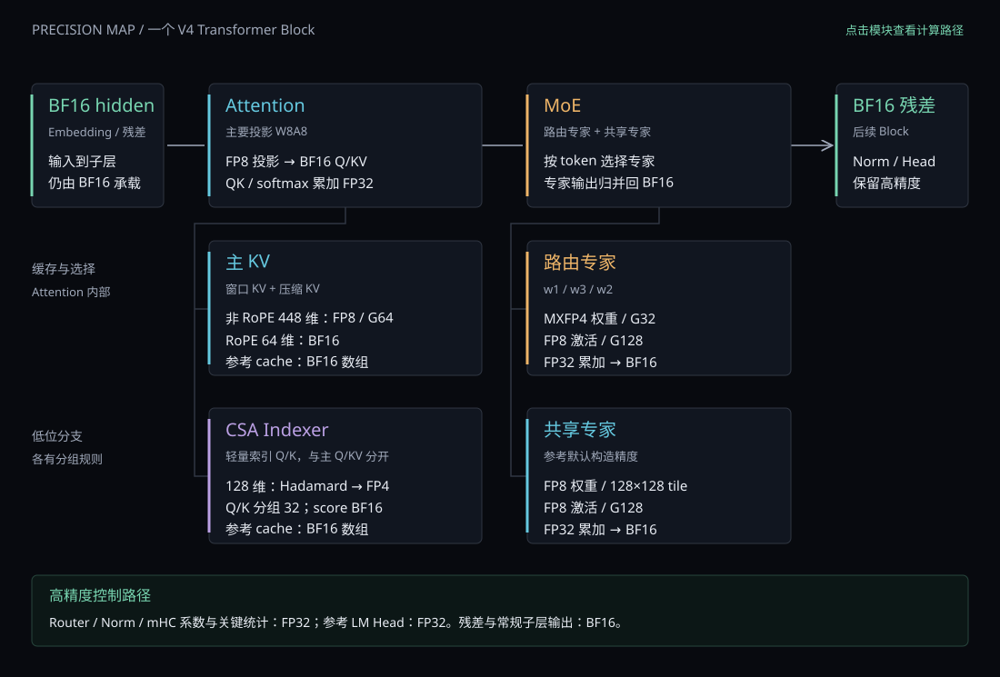
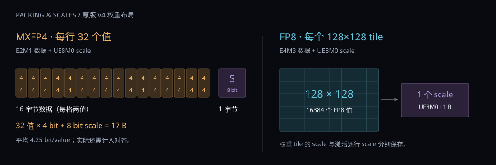
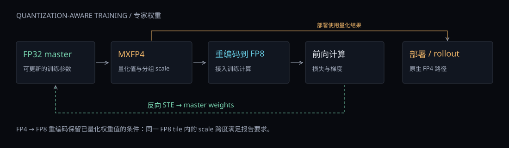

# DeepSeek V4：量化组件与官方选择

适用范围：DeepSeek V4 Flash / Pro。以原版官方技术报告和参考推理代码解释组件精度，另列 Flash-0731 / Pro-0813 官方模型卡的服务选项。资料日期：2026-10-13。

## 1. 从整模型看量化

DeepSeek V4 使用混合精度。后训练 Flash / Pro 的主要低位部分是 **MXFP4 路由专家权重、FP8 线性投影与激活、FP4 Indexer Q/K，以及 FP8/BF16 混合主 KV**。残差主干通常为 BF16；归一化、路由、mHC 系数等敏感计算使用 FP32。Flash 与 Pro 的宽度和规模不同，本章讨论的原版量化规则相同。



**读图。** 沿横向主干读一个 Transformer Block：BF16 hidden 进入 Attention，随后进入 MoE，最后回到 BF16 残差。Attention 下方展开主 KV 与 CSA Indexer；MoE 下方展开路由专家与共享专家。无箭头分支表示组件归属，两个专家分支各自接收输入。图里的“FP8 权重”只规定投影矩阵，主 Attention 的 QK、softmax 和聚合有自己的运算精度。

**解析。** 量化应给出对象：权重 W、激活 A、缓存 KV、索引分数和累加器分别讨论。专家的典型组合是 **W4A8**；Indexer 的 Q/K 才都经过 FP4 量化。FP4 专家不意味着 hidden、路由分数、共享专家和词表输出也都是 FP4。[官方模型说明](https://huggingface.co/deepseek-ai/DeepSeek-V4-Flash#model-downloads)、[官方报告 §5.2.1](https://arxiv.org/html/2606.19348#S5.SS2.SSS1)、[官方参考模型](https://huggingface.co/deepseek-ai/DeepSeek-V4-Flash/blob/main/inference/model.py)

## 2. 哪些组件用了量化

### 2.1 权重与线性层

下表的默认参考配置为 `dtype="fp8"`、`expert_dtype="fp4"`、`scale_fmt="ue8m0"`。权重的保存格式与加载后的运算格式分别列出。

| 组件 | 权重格式或来源 | 默认参考前向的实际路径 |
|---|---|---|
| 主 Attention：`wq_a / wq_b / wkv / wo_b` | FP8 E4M3，权重块 scale 为 UE8M0 | 输入动态转 FP8，FP8 Linear，FP32 累加，BF16 输出 |
| 分组输出投影 `wo_a` | 源码注明 checkpoint 为 FP8 | 官方 converter 乘回 scale 后转 BF16；参考前向使用 BF16 einsum |
| 路由专家 `w1 / w3 / w2` | MXFP4：E2M1 数据，每行 32 个元素一组 | FP8 激活 × FP4 权重所代表的数值，FP32 累加，BF16 输出；参考内核解包权重到 FP8 后执行乘法 |
| 共享专家 `w1 / w3 / w2` | 参考构造器跟随默认 FP8 Linear | FP8 激活与 FP8 权重；`expert_dtype="fp4"` 只覆盖路由专家 |
| Indexer 的 Q 投影 `wq_b` | 默认 FP8 Linear | FP8 Linear 输出 BF16，后续做 RoPE、Hadamard、FP4 量化 |
| Indexer 的 head 权重投影 `weights_proj` | BF16 | BF16 Linear，为各索引 head 的分数提供权重 |
| 两类 Compressor 的 `wkv / wgate` | 源码注明 checkpoint 为 BF16 | 参考实现转成 FP32 参数，压缩池化后回到输入 dtype，再做各自缓存的量化模拟 |
| MTP 的 `e_proj / h_proj` | 默认 FP8 Linear | 辅助 Block 沿用主模型的 Attention / MoE 精度；共享 embedding 和 head |

专家中的 SwiGLU、clamp 和路由权重乘法使用 FP32 中间值，随后转回 BF16，作为 down projection 动态 FP8 量化的输入。MoE 最后也存在 FP32 归并缓冲；计算结果回到 BF16 主干。共享专家的 FP8 结论来自参考构造器；本章没有逐张量加载整份 checkpoint 来核对其物理字节。[Linear 与 Expert 源码](https://huggingface.co/deepseek-ai/DeepSeek-V4-Flash/blob/main/inference/model.py)、[官方 converter](https://huggingface.co/deepseek-ai/DeepSeek-V4-Flash/blob/main/inference/convert.py)

### 2.2 Attention、KV 与 Indexer

| 对象 | 官方设计或精度规则 | 官方参考实现怎样表达 |
|---|---|---|
| 主 Attention 的 Q | BF16 数值路径 | FP8 投影后回 BF16，归一化并做 RoPE；不做 Indexer 的 FP4 Q 量化 |
| 主 KV 的非 RoPE 部分 | 512 维 latent 中的 448 维为 FP8；参考分组长度 64 | FP8 quant→dequant 后回 BF16，写入 BF16 cache 数组 |
| 主 KV 的 RoPE 部分 | 64 维保留 BF16 | 旋转后的尾部不参与上述 FP8 量化 |
| CSA Indexer Q/K | 128 维向量按 32 个值一组做 MXFP4 | RoPE 后做归一化 Hadamard，FP4 quant→dequant 后由 BF16 承载；参考 K cache 仍为 BF16 数组 |
| Indexer score | 报告说明从 FP32 降到 BF16 | 参考 BF16 einsum / head weighting / head 求和产生 score，再进行 top-k；没有额外的统一 FP32 score 转换步骤 |
| 主稀疏 Attention | Q/KV 输入及输出为 BF16；关键内部累加为 FP32 | QK、softmax 统计量、value 累加使用 FP32；概率送入 value 乘法前转 BF16 |

**为什么 KV 的 RoPE 部分保留 BF16？** 官方报告在降低缓存存储的同时保留位置旋转维度的精度。它是主 KV 的设计选择；Indexer 会先对整个索引向量做 Hadamard 再量化，因此 Indexer 的 128 维 FP4 规则不能套到主 Attention 的 512 维 Q/KV 上。[官方报告 §2.3.4](https://arxiv.org/html/2606.19348#S2.SS3.SSS4)、[§5.2.1](https://arxiv.org/html/2606.19348#S5.SS2.SSS1)

**Hadamard 与量化的关系。** 归一化 Hadamard 是正交变换；量化前对 Q/K 使用同一个 H，有 `(qH)(kH)ᵀ=qkᵀ`。它重新分布坐标，使低位量化更容易处理集中在少数维度上的大值；量化后点积仍可能有误差，需要 QAT 适应。参考函数使用固定归一化变换，不在每个 token 上重新采样随机符号。

**怎样理解量化模拟？** `inplace=True` 把值量化到低位网格，再反量化写回原 dtype；它表达舍入误差，却没有长期保存 packed 数据。参考主 KV 每条仍占 `512×2=1024` 字节，参考 Indexer K 每条仍占 `128×2=256` 字节。生产打包缓存和参考 BF16 数组应使用各自的内存口径。[官方量化与 Attention kernel](https://huggingface.co/deepseek-ai/DeepSeek-V4-Flash/blob/main/inference/kernel.py)

### 2.3 保留较高精度的组件

| 组件 | 默认参考实现 |
|---|---|
| Embedding、四路残差、子层输出 | 常规官方启动将 PyTorch 默认 dtype 设置为 BF16；这些状态主要以 BF16 承载 |
| Router/Gate | 权重通常为 BF16，前向将输入和权重转 FP32 计算；correction bias 为 FP32 |
| RMSNorm | 源码注明 checkpoint 参数 BF16；参考参数、统计量和乘法为 FP32，返回输入 dtype |
| mHC、Sinkhorn、HC head 收缩 | 系数参数与关键计算为 FP32，残差状态回 BF16 |
| LM Head | 源码注明 checkpoint 为 BF16；参考 head 转 FP32，输出 logits 为 FP32 |
| token ID、专家 ID、hash 表、top-k 索引 | 整数元数据；它们的整数 dtype 不代表 INT8/INT4 权重量化 |

这些例外解释了“FP8 Mixed”“FP4 + FP8 Mixed”中的 Mixed。低位数据、FP32 累加和 BF16 输出可以同时出现在一次算子调用中。[官方参考模型](https://huggingface.co/deepseek-ai/DeepSeek-V4-Flash/blob/main/inference/model.py)

## 3. FP4、FP8 和 scale 怎么组织

### 3.1 数据格式与分组

V4 的 MXFP4 是 **4 位 E2M1 数据 + 8 位 UE8M0 共享 scale**。E2M1 可表示的非负有限数值为 `0, 0.5, 1, 1.5, 2, 3, 4, 6`，再附带符号；最大幅值为 6。FP8 数据使用 E4M3，最大有限幅值为 448。UE8M0 用于保存二的整数次幂 scale。[官方量化 kernel](https://huggingface.co/deepseek-ai/DeepSeek-V4-Flash/blob/main/inference/kernel.py)



**读图。** 左侧一行是 32 个 FP4 权重：两值打包一字节，数据共 16 字节，另有 1 字节 scale。右侧是通用 FP8 权重的 128×128 tile：整块共享一个 scale。FP8 激活的分组又不同，是每个 token 沿特征 K 每 128 个值一组。

设权重逻辑形状为 `W[N,K]`，线性输入展平为 `X[M,K]`：

| 对象 | 数据物理形状 | scale 形状 | 分组范围 |
|---|---|---|---|
| FP4 路由权重 | `[N,K/2]` 字节容器，两个值一字节 | `[N,K/32]`，UE8M0 | 每行 1×32 |
| 通用 FP8 权重 | `[N,K]`，每值一字节 | `[ceil(N/128),ceil(K/128)]`，UE8M0 | 每个 128×128 tile |
| Linear FP8 激活 | `[M,K]` | `[M,K/128]` | 每 token 沿 K 分组 128 |
| 主 KV 非 RoPE | 每位置 448 个 FP8 值的设计 | 每位置 7 个 scale 的逻辑分组 | 分组 64 |
| Indexer Q/K | 每 head / 位置 128 个 FP4 值的设计 | 每向量 4 个 scale | 分组 32 |

表中 K 使用满足对应分组要求的形状；末尾不足整组的处理和实际 padding 由实现决定。`weight_scale_inv` 在转换后改名为 `scale`，重建数值时做 **乘 scale**。[Linear 布局](https://huggingface.co/deepseek-ai/DeepSeek-V4-Flash/blob/main/inference/model.py)、[转换脚本](https://huggingface.co/deepseek-ai/DeepSeek-V4-Flash/blob/main/inference/convert.py)

### 3.2 动态量化公式

每组先取最大绝对值，用幂次 scale 覆盖该组范围。默认参考公式如下，`cast` 包含对应浮点格式的舍入：

```text
FP8（Linear 激活默认组长 128，主 KV 非 RoPE 组长 64）
a = max(max_i |x_i|, 10^-4)
s = 2^ceil(log2(a / 448))
q_i = cast_E4M3(clamp(x_i / s, -448, 448))
x̂_i = float(q_i) × s

FP4（组长 32）
a = max(max_i |x_i|, 6 × 2^-126)
s = 2^ceil(log2(a / 6))
q_i = cast_E2M1(clamp(x_i / s, -6, 6))
x̂_i = float(q_i) × s
```

**例子。** 若组内最大幅值为 3，FP4 的 scale 为 `2^ceil(log2(3/6))=0.5`；原值 0.9 经除 scale 得到 1.8，舍入为 E2M1 的 2，重建为 1.0。FP8 对同一组最大值使用 scale `1/128`，把最大值映射为 384。scale 越粗、格式有效精度越低，重建值与原值的差别通常越明显；QAT 让模型在训练时适应这类误差。

FP8 的 `10^-4` 是 **amax 的下限**；FP4 使用另一条极小值规则。参考 `scale_dtype="fp8"` 指的是 E8M0 scale 存储，和 E4M3 数据的“FP8”不是同一格式。[公式对应 kernel](https://huggingface.co/deepseek-ai/DeepSeek-V4-Flash/blob/main/inference/kernel.py)

## 4. 计算与 QAT 的精度路径

### 4.1 Linear 和专家计算

```text
普通 FP8 Linear：
BF16 输入 → 动态 FP8 → FP8 激活 × FP8 权重 → FP32 累加 → BF16 输出

默认 FP4 路由专家的逻辑组合：
BF16 输入 → 动态 FP8 → FP8 激活 × FP4 权重 → FP32 累加 → BF16 输出

参考 fp4_gemm 的内部实现：
加载 packed FP4 → 解包并转 FP8 → FP8 乘法 → 按组乘回 scale、FP32 累加
```

**解析。** W4A8 描述权重和激活的数值/存储组合。官方教学参考 kernel 的 FP4 权重转 FP8 后参与乘法；生产使用支持原生低位执行的后端。上一份 MegaMoE 动画展示的是特定 SM100 / NVLink 的 `fp8xfp4` 执行路径，不能据参考模型的 dtype 字段推导任意 GPU 都会发同样指令。[官方参考 kernel](https://huggingface.co/deepseek-ai/DeepSeek-V4-Flash/blob/main/inference/kernel.py)、[MegaMoE 通信与计算动画](mega-moe-full.html)

### 4.2 后训练的 MXFP4 QAT



**读图。** 专家训练保留 FP32 master weights。前向先产生 MXFP4 量化权重，再转成 FP8 接入既有训练计算路径；反向用 STE 思路把梯度传回 master weights。部署及 RL rollout 使用原生 FP4 路径。[官方报告 §5.2.1](https://arxiv.org/html/2606.19348#S5.SS2.SSS1)

**Indexer 也参与 QAT。** 它训练的是索引 Q/K 在 FP4 网格上的行为；同时将 index score 精度降到 BF16。专家权重 QAT、Indexer 激活 QAT 和主 KV FP8 缓存是不同对象。

**FP4→FP8 的“无损”指什么？** 它指已经量化的 FP4 权重值能在满足块内 scale 跨度条件时被 FP8 重编码，官方报告说明其权重满足该条件。它没有恢复 FP4 量化前的 FP32 master，也不保证任意第三方 FP4 张量都满足同样条件。训练系统中的 BF16 优化器矩阵乘和梯度通信精度属于训练工程，不是可下载的 checkpoint 档位。[官方报告 §5.2.1](https://arxiv.org/html/2606.19348#S5.SS2.SSS1)、[§3.4.1](https://arxiv.org/html/2606.19348#S3.SS4.SSS1)

## 5. 官方发布了哪些量化格式

| 官方模型 | 权重精度类别 | HF 配置 `expert_dtype` | 说明 |
|---|---|---|---|
| [V4-Flash-Base](https://huggingface.co/deepseek-ai/DeepSeek-V4-Flash-Base) | FP8 Mixed | `fp8` | 预训练 Base |
| [V4-Pro-Base](https://huggingface.co/deepseek-ai/DeepSeek-V4-Pro-Base) | FP8 Mixed | `fp8` | 预训练 Base |
| [V4-Flash](https://huggingface.co/deepseek-ai/DeepSeek-V4-Flash) | FP4 + FP8 Mixed | `fp4` | 原版后训练模型 |
| [V4-Pro](https://huggingface.co/deepseek-ai/DeepSeek-V4-Pro) | FP4 + FP8 Mixed | `fp4` | 原版后训练模型 |
| [V4-Flash-0731](https://huggingface.co/deepseek-ai/DeepSeek-V4-Flash-0731) | 配置仍为 FP4 专家 + 通用 FP8 | `fp4` | 当前模型卡另给出服务后端示例 |
| [V4-Pro-0813](https://huggingface.co/deepseek-ai/DeepSeek-V4-Pro-0813) | 配置仍为 FP4 专家 + 通用 FP8 | `fp4` | 当前模型卡另给出服务后端示例 |

原版四种发布类别来自[官方 Model Downloads 表](https://huggingface.co/deepseek-ai/DeepSeek-V4-Flash/blob/main/README.md#model-downloads)；更新版本字段来自 [0731 config](https://huggingface.co/deepseek-ai/DeepSeek-V4-Flash-0731/blob/main/config.json) 和 [0813 config](https://huggingface.co/deepseek-ai/DeepSeek-V4-Pro-0813/blob/main/config.json)。Base 与后训练模型的训练阶段和行为不同，不能把 Base 当作同一聊天模型的 FP8 替代文件。

这些配置的通用量化元数据同时包含 `quant_method="fp8"`、`fmt="e4m3"`、`activation_scheme="dynamic"`、`scale_fmt="ue8m0"`、`weight_block_size=[128,128]`。解释时还要看专门的 `expert_dtype`。同样，`torch_dtype="bfloat16"` 主要给常规张量和例外组件提供基础 dtype，并没有把专门的低位权重变成 BF16。

## 6. 官方推理有哪些可选配置

### 6.1 官方默认与 FP8 专家转换

原版后训练模型的默认参考配置如下：

```json
{
  "dtype": "fp8",
  "expert_dtype": "fp4",
  "scale_fmt": "ue8m0"
}
```

官方明确说明了一条 FP8 专家推理路径：在参考配置中移除 `"expert_dtype":"fp4"`，并在转换 checkpoint 时添加 `--expert-dtype fp8`。`ModelArgs.expert_dtype` 省略后默认为 `None`，路由专家跟随默认 FP8 Linear。这里调整的是 **参考推理 config**，不是直接改 HF checkpoint 的通用配置。下方命令在官方 `inference` 目录执行；随后用转换输出和删去 `expert_dtype` 的参考 config 启动模型。

```bash
# Flash：n_experts=256；Pro：n_experts=384
# MP 需要整除专家数，并与后续参考启动的 world_size 一致。
python convert.py \
  --hf-ckpt-path "$V4_HF_CKPT" \
  --save-path "$V4_FP8_CKPT" \
  --n-experts 256 \
  --model-parallel "$V4_MP" \
  --expert-dtype fp8
```

上述路径需要先设置三个路径/并行变量；命令是配置示例，本机没有运行整模型转换。converter 的 `--expert-dtype` 接受 `fp8 / fp4`；默认或 `fp4` 保留已有 packed FP4 专家的解释，`fp8` 对检测到的 FP4 专家做重编码。它没有实现一个通用“把任意 BF16/FP8 权重再量化成 FP4”的分支。[官方推理说明](https://huggingface.co/deepseek-ai/DeepSeek-V4-Flash/blob/main/inference/README.md)、[转换参数与分支](https://huggingface.co/deepseek-ai/DeepSeek-V4-Flash/blob/main/inference/convert.py)

### 6.2 参考代码提供的字段

| 字段 | 源码允许的值 | 精确作用与使用边界 |
|---|---|---|
| `dtype` | `bf16 / fp8` | 构造未显式覆盖精度的 Linear；改字段不会自动反量化已有 checkpoint，也不会关闭 KV/Indexer 的显式量化模拟 |
| `expert_dtype` | `None / fp4` | 参考 ModelArgs 的接口；`None` 跟随默认 Linear。HF config 里的 `fp8` 与参考接口属于不同配置语境 |
| `scale_fmt` | `None / ue8m0` | 激活 scale 可不做幂次取整或做幂次取整；默认 E8M0 路径强制使用 `ue8m0` |
| `scale_dtype` | `fp32 / fp8` | 控制量化 scale 的接口 dtype；`fp8` 此处指 E8M0。默认权重 scale 固定为 E8M0，改成 FP32 还需同步权重 scale 与 GEMM 接口 |

这些是代码接口能力。官方材料在本章范围内明确给出的可部署权重路径是默认 FP4+FP8，以及 FP4 路由专家转换到 FP8；没有据这些字段发布一个自动可用的整模 BF16 转换方案。这里也不把 INT8、INT4、AWQ、GPTQ、GGUF 或 NVFP4 列为 DeepSeek V4 官方发布格式。[ModelArgs 与 Linear](https://huggingface.co/deepseek-ai/DeepSeek-V4-Flash/blob/main/inference/model.py)

### 6.3 0731 / 0813 官方模型卡的服务选项

| 官方示例参数 | 选择的对象 |
|---|---|
| vLLM：`--kv-cache-dtype fp8` | 主 Attention 缓存的 FP8 服务路径，内部混合维度和布局由对应实现处理 |
| vLLM：`--attention-config '{"use_fp4_indexer_cache": true}'` | FP4 Indexer cache 路径 |
| vLLM：`--moe-backend deep_gemm_mega_moe` | MegaMoE 专家计算与通信后端 |
| SGLang：`--moe-runner-backend flashinfer_mxfp4` | MXFP4 专家执行后端 |

这些选项来自 [Flash-0731 官方运行示例](https://huggingface.co/deepseek-ai/DeepSeek-V4-Flash-0731#how-to-run-with-vllm) 和 [Pro-0813 官方运行示例](https://huggingface.co/deepseek-ai/DeepSeek-V4-Pro-0813#how-to-run-with-vllm)。它们选择缓存或执行后端，不会重新量化整个 checkpoint。使用时需遵循对应模型卡的版本、硬件和并行布局；本章没有把这些服务字段当作原版 Python ModelArgs 的字段。

## 7. 量化能节省多少存储

下面仅计算 **数据与 scale 的理想 payload**，忽略对齐、分页和额外状态。权重项使用完整分组，缓存项按原版参考分组推算打包方案；缓存打包值不是生产 allocator 的实测 stride。

| 对象 | 算式 | 理想字节量 |
|---|---|---|
| BF16 权重 | 2 B/value | 2 B/value |
| MXFP4 权重 | 32×0.5 B + 1 B scale | 17 B/组，即 0.53125 B/value、4.25 bit/value |
| 通用 FP8 权重 | 128×128 B + 1 B scale | 16385 B/tile，约 1.000061 B/value |
| FP8 Linear 激活 | 128 B + 1 B scale | 129 B/组，约 1.0078125 B/value |
| 主 KV 打包方案 | 448 B 非 RoPE + 64×2 B RoPE + 7 B scale | 583 B/entry |
| Indexer K 打包方案 | 128×0.5 B + 4 B scale | 68 B/entry |
| 参考 BF16 主 KV / Indexer K 数组 | 512×2 / 128×2 | 1024 / 256 B/entry |

MXFP4 的专家矩阵 payload 约为 BF16 的 26.56%；实际整模节省比例还取决于路由专家占比、其他精度组件、scale、文件元数据与布局。KV 的 `entry` 是一个窗口 token 或压缩槽；请求级总量还要乘层数、batch，并考虑窗口和压缩倍率。checkpoint 文件大小、GPU 常驻权重、工作 buffer 和 KV 内存需要分别估算。

总文档第 7.2 节列出的 V4 主 KV 后端布局为 **584 B/entry**，其中 scale 区域补齐到 8 字节；上表的 583 B 使用 7 个 scale、没有这 1 字节补齐。两者使用的布局口径不同，整页分配还可能继续增加容量。[总文档缓存布局](deepseek-v4-framework.html#section-36)

## 8. 资料入口与适用范围

本章依据官方公开材料与本机保存的官方源码编写，并在本机复核分组、dtype 分支和算术。数值样本覆盖零值、极小值、scale 边界、分组独立性与打包：FP8 cast 在 CPU 执行，FP4 使用有限码表软件模拟。没有执行完整模型、CUDA kernel 或硬件性能测量。本文解释的是 V4 原版低位规则；V4.1 的缓存和权重分组应查其独立文档。

| 内容 | 官方入口 | 本机源码定位 |
|---|---|---|
| 发布精度、运行方式 | [Flash 模型卡](https://huggingface.co/deepseek-ai/DeepSeek-V4-Flash)、[Pro 模型卡](https://huggingface.co/deepseek-ai/DeepSeek-V4-Pro) | [本地配置目录]([本地源码路径]) |
| Linear、Indexer、MoE、mHC、Head | [model.py](https://huggingface.co/deepseek-ai/DeepSeek-V4-Flash/blob/main/inference/model.py) | [flash_model.py]([本地源码路径]) |
| FP8/FP4 quant、GEMM、sparse Attention | [kernel.py](https://huggingface.co/deepseek-ai/DeepSeek-V4-Flash/blob/main/inference/kernel.py) | [flash_kernel.py]([本地源码路径]) |
| FP4 专家转 FP8、`wo_a` 反量化 | [convert.py](https://huggingface.co/deepseek-ai/DeepSeek-V4-Flash/blob/main/inference/convert.py) | [flash_convert.py]([本地源码路径]) |
| KV 混合精度、MXFP4 QAT | [技术报告](https://arxiv.org/html/2606.19348) | [本地报告]([本地源码路径]) |

原版参考模型本地快照对应官方 Flash revision `60d8d70770c6776ff598c94bb586a859a38244f1`；当前 0731 / 0813 服务示例按 2026-10-13 官方页面阅读。在线页面后续可能更新。[返回总文档的量化章节](deepseek-v4-framework.html#v4-quantization)
