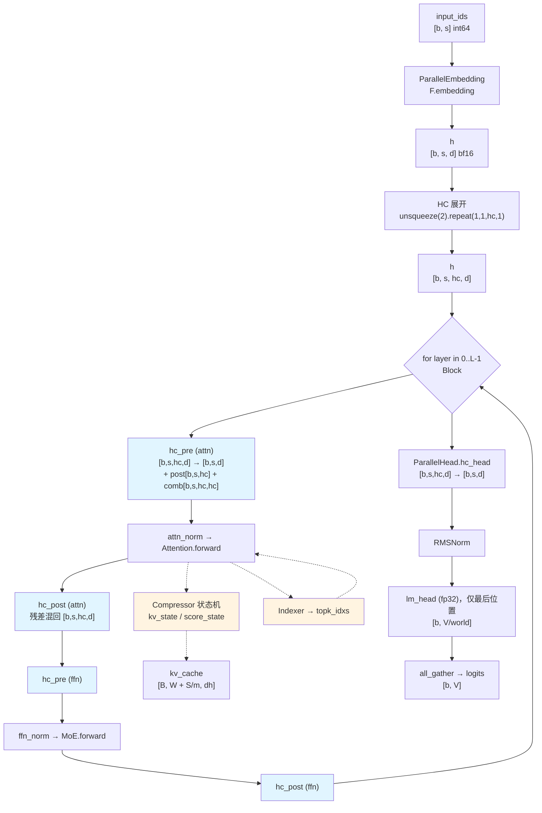
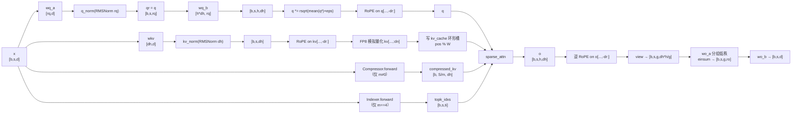

# DeepSeek-V4 张量数据流详解

> **2026-10-07 本机复核更新**：核心结构、参数/缓存口径与 CPU 边界用例见 [本机核验与更正](DeepSeek-V4-V4.1-%E6%9C%AC%E6%9C%BA%E6%A0%B8%E9%AA%8C%E4%B8%8E%E6%9B%B4%E6%AD%A3.md)。旧文中的 `[未检出]` 是写作时的检出状态；当前可用路径以新报告为准。GPU 性能、训练与完整模型质量未在本机复现。

> 本文档精确到**每一步的张量输入/输出**：形状、dtype、语义、由哪个算子产生、在做什么。
> 以**官方参考实现**（`inference/model.py`，四份实现的权威定义）为骨架，
> 并在 §4/§7/§8 给出 Transformers / vLLM / SGLang 的形状语义差异。
>
> 配套文档：[DeepSeek-V4-代码调用结构分析.md](DeepSeek-V4-%E4%BB%A3%E7%A0%81%E8%B0%83%E7%94%A8%E7%BB%93%E6%9E%84%E5%88%86%E6%9E%90.md)（调用关系与注册链）
> 引用格式 `flash_model.py:453` = 官方参考实现第 453 行；`flash_kernel.py:277` = 官方内核文件。

## 目录

| 节 | 内容 |
|---|---|
| [§0](#0-阅读约定) | 阅读约定：符号表、三种层类型、batch 语义、TP/EP 切分 |
| [§1](#1-端到端数据流总图) | 端到端数据流总图（Mermaid） |
| [§2](#2-逐阶段张量详解官方参考实现) | **逐阶段张量详解**（官方参考实现，12 个子阶段） |
| [§3](#3-三种层类型的数据流对照) | 三种层类型（`m=0/4/128`）的数据流对照 |
| [§4](#4-状态与-kv-cache-布局逐-buffer) | 状态与 KV cache 布局（四实现逐 buffer） |
| [§5](#5-逐层参数形状表) | 逐层参数形状表（官方 Flash/Pro + Transformers） |
| [§6](#6-prefill-与-decode-的张量时序对照) | prefill 与 decode 的张量时序对照 |
| [§7](#7-显存字节估算flashmax_seq_len--65536) | 显存字节估算 |
| [§8](#8-四实现的形状语义差异对照) | 四实现形状语义差异对照（迁移/对拍必读） |
| [§9](#9-形状自检清单) | 形状自检清单 + 常见误判提醒 |

---

## 0. 阅读约定

### 0.1 符号

| 符号 | 含义 | Flash | Pro |
|---|---|---|---|
| `b` | batch size（并发序列数） | 运行时 | 运行时 |
| `s` | 本步送入的 token 数（prefill=prompt 长度；decode=1） | 运行时 | 运行时 |
| `S` | 该序列的**历史总长**（`start_pos + s`） | 运行时 | 运行时 |
| `L` | 主干层数 | 43 | 61 |
| `d` | `hidden_size` | 4096 | 7168 |
| `h` | `num_attention_heads` | 64 | 128 |
| `dh` | `head_dim` | 512 | 512 |
| `dr` | `qk_rope_head_dim`（RoPE 维） | 64 | 64 |
| `dn` | `dh - dr`（NoPE 维） | 448 | 448 |
| `rq` | `q_lora_rank` | 1024 | 1536 |
| `g` | `o_groups` | 8 | 16 |
| `ro` | `o_lora_rank` | 1024 | 1024 |
| `E` | `n_routed_experts` | 256 | 384 |
| `K` | `num_experts_per_tok` | 6 | 6 |
| `I` | `moe_intermediate_size` | 2048 | 3072 |
| `hc` | `hc_mult` | 4 | 4 |
| `W` | `window_size`（滑窗） | 128 | 128 |
| `hi` | `index_n_heads` | 64 | 64 |
| `di` | `index_head_dim` | 128 | 128 |
| `ti` | `index_topk` | 512 | 1024 |
| `m` | 该层的 `compress_ratio` ∈ {0,4,128} | 逐层 | 逐层 |
| `V` | `vocab_size` | 129280 | 129280 |

### 0.2 三种层类型（`m` 的取值决定整条数据流分支）

| `m` | 名称 | compressor | indexer | RoPE | KV cache 槽数 |
|---|---|---|---|---|---|
| **0** | `sliding_attention` | ❌ | ❌ | `rope_theta=10000`，**无 YaRN** | `W` = 128 |
| **4** | `compressed_sparse_attention` (CSA) | ✅ 重叠窗口 | ✅ 学习式 top-k | `compress_rope_theta=160000` + YaRN(16) | `W + S/4` |
| **128** | `heavily_compressed_attention` (HCA) | ✅ 非重叠窗口 | ❌ 固定全量下标 | 同上 | `W + S/128` |

依据：`flash_model.py:453`（`m` 取值）、`:466-471`（是否建 compressor/indexer）、
`:473`（cache 槽数）、`:475-479`（RoPE 分支）、`:290`（overlap = `m==4`）。

### 0.3 batch 语义 —— 四份实现最大的一处形状差异

| 实现 | 张量布局 | 例子（隐藏态） |
|---|---|---|
| **官方** | `[b, s, ...]` 显式 batch 维 | `[b, s, hc, d]` |
| **Transformers** | `[B, S, ...]` 显式 batch 维 | `[B, S, hc, d]` |
| **vLLM** | `[T, ...]` **token-major 扁平**，`T = 本步 token 总数` | `[T, hc, d]` |
| **SGLang** | `[T, ...]` token-major 扁平 | `[T, hc, d]` |

> 后续 §2 用 `[b, s, ...]`；服务框架的等价物见 §8。

### 0.4 TP/EP 切分（官方参考实现）

| 张量 | 切分方式 | 代码 |
|---|---|---|
| `embed.weight` | 按 vocab 切（`V/world_size`） | `:91-94`，`all_reduce` 于 `:104` |
| `wq_b.weight` | **列并行**（按输出切 → 按头切） | `ColumnParallelLinear:155` |
| `wo_b.weight` | **行并行**（按输入切） | `RowParallelLinear:166` |
| `wo_a.weight` | 列并行（按 group 切） | `:462` |
| `experts[i]` | 专家按 rank 切分（`E/world_size`） | `:618-625`，`all_reduce` 于 `:642` |
| `head.weight` | 按 vocab 切 | `:711-713`，`all_gather` 于 `:722-725` |
| indexer `wq_b` / `weights_proj` | 列并行 + 分数 `all_reduce` | `:393-394`，`:422-423` |

---

## 1. 端到端数据流总图



**注意力内部数据流**（`Attention.forward`，`flash_model.py:484`）：



---

## 2. 逐阶段张量详解（官方参考实现）

### 2.1 Embedding 与 HC 展开

| # | 张量 | 形状 | dtype | 算子 / 代码 | 在做什么 |
|---|---|---|---|---|---|
| 1 | `input_ids` | `[b, s]` | int64 | 输入 | token id |
| 2 | `h` | `[b, s, d]` | bf16 | `ParallelEmbedding.forward:96` → `F.embedding:101` | 查表；TP>1 时先 `x - vocab_start_idx` 并 mask 越界（`:98-100`），`all_reduce` 前把越界位置置 0（`:103-104`） |
| 3 | `h` | `[b, s, hc, d]` | bf16 | `Transformer.forward:805` `h.unsqueeze(2).repeat(1,1,hc_mult,1)` | **HC 展开**：把单条残差流复制成 `hc=4` 条并行流 |

> **为什么这样做**：V4 用 Manifold-constrained Hyper-Connections 取代普通残差，
> 残差从 1 条变 `hc` 条；`repeat` 而非 `expand` 是因为后续 `hc_post` 会写回。

### 2.2 Block 内的 HC 混合：`hc_pre` / `hc_post`

`Block.forward`（`:688`）对 attention 与 FFN 各做一次「pre → 子层 → post」。

#### `hc_pre`（`:673`）—— 把 `hc` 条流压成 1 条，并算出三个混合系数

| # | 张量 | 形状 | dtype | 代码 | 在做什么 |
|---|---|---|---|---|---|
| 1 | `x`（入） | `[b, s, hc, d]` | bf16 | 入参 | `hc` 条残差流 |
| 2 | 保存 `shape` | `(b,s,hc,d)` | — | `:675` | 供最后 reshape |
| 3 | `x` | `[b, s, hc*d]` | **fp32** | `:676` `x.flatten(2).float()` | 4 条流拼成 16384 维 |
| 4 | `rsqrt` | `[b, s, 1]` | fp32 | `:677` `torch.rsqrt(x.square().mean(-1,keepdim=True)+norm_eps)` | **无权重 RMSNorm 的倒数尺度**（注意没有可学习 weight） |
| 5 | `mixes` | `[b, s, 24]` | fp32 | `:678` `F.linear(x, hc_fn) * rsqrt` | 一次 GEMM 得到 `mix_hc=(2+hc)*hc=24` 个混合系数 |
| 6 | `pre` | `[b, s, hc]` | fp32 | `:679` → `hc_split_sinkhorn` | 收缩权重（每条流的权重） |
| 7 | `post` | `[b, s, hc]` | fp32 | 同上 | 扩张权重 |
| 8 | `comb` | `[b, s, hc, hc]` | fp32 | 同上 | **双随机矩阵**，`hc×hc` 残差混合矩阵 |
| 9 | `y` | `[b, s, d]` | bf16 | `:680-681` `sum(pre.unsqueeze(-1) * x.view(shape), dim=2)` | 加权求和把 4 条流压成 1 条 |
| 10 | 返回 | `y, post, comb` | — | `:681` | `post`/`comb` 透传给 `hc_post` |

`hc_split_sinkhorn` 内部（`flash_kernel.py:430`）：

```
入: mixes[b,s,24] fp32, hc_scale[3], hc_base[24]
出: pre[b,s,4], post[b,s,4], comb[b,s,4,4]      ← 全部 fp32
```

其中 `comb` 由 **Sinkhorn-Knopp 迭代 20 次**（`hc_sinkhorn_iters`）投影到双随机矩阵
（kernel `flash_kernel.py:372`，迭代体 `:415-423`）。
`pre` / `post` 是逐流标量（`sigmoid` 型），`comb` 是矩阵。

#### `hc_post`（`:683`）—— 把子层输出混回 `hc` 条流

| # | 张量 | 形状 | dtype | 代码 | 语义 |
|---|---|---|---|---|---|
| 1 | `x`（子层输出） | `[b, s, d]` | bf16 | 入参 | attention 或 MoE 的输出 |
| 2 | `residual` | `[b, s, hc, d]` | bf16 | 入参 | `hc_pre` 之前的流 |
| 3 | `post` | `[b, s, hc]` | fp32 | `:684` 注释 | 扩张权重 |
| 4 | `comb` | `[b, s, hc, hc]` | fp32 | 同上 | 流间混合矩阵 |
| 5 | `y` | `[b, s, hc, d]` | bf16 | `:685` | `y = post.unsqueeze(-1)*x.unsqueeze(-2) + Σ_j comb[:,:,j,k]*residual[:,:,j,:]` |

逐项广播拆解（`hc=4, d=4096`）：

```
post.unsqueeze(-1)      [b, s, 4, 1]
x.unsqueeze(-2)         [b, s, 1, 4096]
  → 相乘               [b, s, 4, 4096]        （扩张项）
comb.unsqueeze(-1)      [b, s, 4, 4, 1]
residual.unsqueeze(-2)  [b, s, 1, 4, 4096]
  → 相乘               [b, s, 4, 4, 4096]
  → sum(dim=2)         [b, s, 4, 4096]        （混合项）
  → 相加               [b, s, 4, 4096]        （新残差流）
```

### 2.3 Attention：Q 路径

`Attention.forward:495-499`

| # | 张量 | 形状 (Flash) | 形状 (Pro) | dtype | 代码 | 在做什么 |
|---|---|---|---|---|---|---|
| 1 | `x` | `[b,s,4096]` | `[b,s,7168]` | bf16 | 入参 | `hc_pre` 压扁 + `attn_norm` 之后 |
| 2 | `wq_a(x)` | `[b,s,1024]` | `[b,s,1536]` | bf16 | `:496` | 低秩 Q 压缩（`[rq,d]` 权重） |
| 3 | `qr = q` | `[b,s,1024]` | `[b,s,1536]` | bf16 | `:496` | **`qr` 是压缩后的潜在 Q，要留给 Indexer 用** |
| 4 | `q_norm(qr)` | 同上 | 同上 | bf16 | `:496` | 对 `rq` 维做 RMSNorm |
| 5 | `wq_b(q)` | `[b,s,32768]` | `[b,s,65536]` | bf16 | `:497` | 上投影到 `h*dh` |
| 6 | `q` | `[b,s,64,512]` | `[b,s,128,512]` | bf16 | `:497` `.unflatten(-1,(h_local,dh))` | 拆成头 |
| 7 | `q` | 同上 | 同上 | bf16 | `:498` `q *= torch.rsqrt(q.square().mean(-1,keepdim=True)+eps)` | **Q 侧再做一次无权重 RMSNorm**（稳定 Q 尺度） |
| 8 | `q[..., -64:]` | `[b,s,h,64]` | 同 | bf16 | `:499` `apply_rotary_emb(..., freqs_cis)` | **原地** RoPE，只作用于最后 `dr=64` 维 |

`apply_rotary_emb`（`:232`）的机制：把最后 64 维按 `(32, 2)` 视为复数
（`view_as_complex`，`:235`），乘以预计算的 `freqs_cis`
（复数 `[S, 32]`，来自 `precompute_freqs_cis:200` 的 `torch.polar`），
再 `view_as_real().flatten(-2)` 写回（`:242-243`）。
`inverse=True` 时用共轭（`:237`）实现**逆旋转**。

### 2.4 Attention：KV 路径（滑窗分支）

| # | 张量 | 形状 | dtype | 代码 | 在做什么 |
|---|---|---|---|---|---|
| 1 | `wkv(x)` | `[b,s,512]` | bf16 | `:502` | **单头 KV**：`dim → head_dim`，不按头拆分（MQA/MLA） |
| 2 | `kv` | `[b,s,512]` | bf16 | `:503` `kv_norm(kv)` | RMSNorm(512) |
| 3 | `kv[..., -64:]` | `[b,s,64]` | bf16 | `:504` | 原地 RoPE |
| 4 | `kv[..., :-448]` | `[b,s,448]` | bf16 | `:506` `act_quant(..., 64, ..., inplace=True)` | **FP8 模拟量化**（QAT 对齐）：`inplace=True` 表示量化→反量化回 bf16，只引入量化误差。block=64 |
| 5 | `kv_cache` | `[B, 128, 512]`（补丁） | bf16 | `:473-474` `torch.zeros(max_batch_size, kv_cache_size, dh)` | 环形缓冲，`[0:128]` 段 |
| 6 | 写入 | — | — | `:520-523`（prefill） / `:530`（decode） | decode 写 `kv_cache[:bsz, start_pos % W]` |

**KV cache 槽位布局**（`kv_cache_size = W + S/m`，`:473`）：

```
kv_cache[b] 形状 [W + S/m, 512]
┌──────────────────────────┬──────────────────────────────────────┐
│  [0 : 128]               │  [128 : 128 + S/m]                   │
│  原始 KV 环形缓冲         │  压缩 KV（每 m 个 token 一个条目）      │
│  写槽位 = pos % 128       │  写槽位 = pos // m                    │
│  由 Attention 直接读写    │  由 Compressor 写（:374/:376）        │
└──────────────────────────┴──────────────────────────────────────┘
   · m == 0 时右段长度为 0，整个 cache 只有 128 槽
```

`Compressor` 拿到的是**右段的视图**：`self.compressor.kv_cache = self.kv_cache[:, win:]`（`:491`）。

### 2.5 Compressor：门控池化 + 显式状态机

`Compressor`（`:279`）把每 `m` 个连续 token 的 KV 池化成 **1 个**压缩条目。

#### 参数形状

| 参数 | `m=4`（重叠） | `m=128`（非重叠） | dtype | 代码 |
|---|---|---|---|---|
| `ape` | `[4, 1024]` | `[128, 512]` | fp32 | `:294`（`coff*dh`，`coff=1+overlap`） |
| `wkv.weight` | `[1024, 4096]` | `[512, 4096]` | fp32 | `:297` |
| `wgate.weight` | `[1024, 4096]` | `[512, 4096]` | fp32 | `:298` |
| `norm` | RMSNorm(512) | RMSNorm(512) | — | `:299` |
| `kv_state` | `[B, 8, 1024]` | `[B, 128, 512]` | fp32 | `:303`（`coff*m` × `coff*dh`） |
| `score_state` | `[B, 8, 1024]` | `[B, 128, 512]` | fp32 | `:304`，**初值 `-inf`** |

#### prefill 路径（`start_pos == 0`，`:325-342`）

| # | 张量 | 形状（`m=4`） | 代码 | 语义 |
|---|---|---|---|---|
| 1 | `x` | `[b,s,4096]` | `:322` `.float()` | 升到 fp32（压缩必须 fp32） |
| 2 | `kv = wkv(x)` | `[b,s,1024]` | `:323` | 投影出 `coff*dh` |
| 3 | `score = wgate(x)` | `[b,s,1024]` | `:324` | 门控 logits |
| 4 | `should_compress` | bool | `:326` `seqlen >= m` | 本步是否有满窗 |
| 5 | `remainder = seqlen % m` | int | `:327` | 尾部余量 |
| 6 | `cutoff = seqlen - remainder` | int | `:328` | 可压缩前缀长度 |
| 7 | `offset = m if overlap else 0` | int | `:329` | 重叠时前 `m` 槽留给"上一窗" |
| 8 | `kv_state[:, offset:offset+remainder]` | `[b, 4, 1024]` | `:334` | **把余量存进状态**，交给 decode 续用 |
| 9 | `score_state[...]` | `[b, 4, 1024]` | `:335` | 同上，且加上 `ape[:remainder]` |
| 10 | `kv.unflatten(1,(-1,m))` | `[b, S/m, 4, 1024]` | `:337` | 按窗分组 |
| 11 | `score + ape` | `[b, S/m, 4, 1024]` | `:338` | **加位置偏置** `ape`（每窗内位置） |
| 12 | `overlap_transform(kv, 0)` | `[b, S/m, 8, 512]` | `:340` → `:307` | 把 `[.., 4, 1024]` 重排为 `[.., 8, 512]` |
| 13 | `overlap_transform(score, -inf)` | `[b, S/m, 8, 512]` | `:341` | 同上，填充值 `-inf`（屏蔽无效位置） |
| 14 | `kv` | `[b, S/m, 512]` | `:342` `(kv * score.softmax(dim=2)).sum(dim=2)` | **门控池化**：沿窗口维 softmax 加权求和 |
| 15 | `norm(kv)` | `[b, S/m, 512]` | `:362` | RMSNorm |
| 16 | `freqs_cis = freqs_cis[:cutoff:m]` | `[S/m, 32]` | `:364` | **每个压缩块一个绝对位置** |
| 17 | `apply_rotary_emb(kv[...,-64:], freqs_cis)` | — | `:367` | 在块起点位置做 RoPE |
| 18 | `act_quant(kv[...,:-64], 64, ..., True)` | `[b,S/m,448]` | `:372` | FP8 模拟量化 |
| 19 | `kv_cache[:bsz, :seqlen//m] = kv` | — | `:374` | 写入 cache 右段 |

`overlap_transform`（`:307`）的精确定义：

```
入: tensor [b, s, r, 2d]
出: new_tensor [b, s, 2r, d]，其中
    new_tensor[:, :, r:]    = tensor[:, :, :, d:]      ← 每窗的"后半"(Cb)
    new_tensor[:, 1:, :r]   = tensor[:, :-1, :, :d]    ← 前一窗的"前半"(Ca)
    new_tensor[:, 0, :r]    = value                     ← 第一窗无前驱
```

即 CSA 的**有效窗口宽度 = 2m，步长 = m**（重叠 50%），
正是论文里"两个压缩序列 Ca/Cb 交错"的工程实现。

#### decode 路径（`start_pos > 0`，`:343-359`）

| # | 张量 | 形状 | 代码 | 语义 |
|---|---|---|---|---|
| 1 | `should_compress` | bool | `:344` `(start_pos+1) % m == 0` | 本步是否刚好填满一窗 |
| 2 | `score += ape[start_pos % m]` | `[b,1,1024]` | `:345` | 加**当前窗内位置**的偏置 |
| 3a | 非重叠：`kv_state[:, start_pos%m] = kv` | — | `:356` | 写槽 |
| 3b | 非重叠：`score_state[:, start_pos%m] = score` | — | `:357` | 写槽 |
| 4a | 非重叠且满窗：`kv = (kv_state * score_state.softmax(1)).sum(1,keepdim=True)` | `[b,1,512]` | `:359` | 池化出 1 个压缩条目 |
| 5b | 重叠：同时写 `ratio+start_pos%m` 槽（`:347-348`），满窗时按 `cat([state[:,:m,:d], state[:,m:,d:]])` 组合（`:350-351`） | `[b,2m,d]` | `:350-351` | Ca+Cb 拼接 |
| 6 | 重叠且满窗：池化 → `[b,1,512]` | — | `:352` | — |
| 7 | 状态前移 | — | `:353-354` | `kv_state[:, :m] = kv_state[:, m:]`（滑窗滚动） |
| 8 | 未满窗 | — | `:360-361` `return None` | **不产出压缩条目，注意力端不追加** |
| 9 | 写 cache | — | `:376` `kv_cache[:bsz, start_pos // m] = kv.squeeze(1)` | 写槽位 = `pos // m` |

> **关键点**：decode 每步只产出 0 或 1 个压缩条目，且**状态显式持久化**在
> `kv_state`/`score_state` 里 —— 这是 V4 能在 CUDA Graph 下跑增量压缩的原因。

### 2.6 Indexer：稀疏下标生成（仅 `m == 4`）

`Indexer`（`:380`）自己带一个 `head_dim=128, rotate=True` 的 Compressor。

#### 参数形状

| 参数 | 形状 | dtype | 代码 |
|---|---|---|---|
| `wq_b.weight` | `[hi*di=8192, rq=1024]` | bf16 | `:393` |
| `weights_proj.weight` | `[hi=64, d=4096]` | bf16 | `:394` |
| `compressor.ape` | `[4, 256]` | fp32 | `:398` → `:294`（`coff*di`） |
| `compressor.wkv/wgate` | `[256, 4096]` | fp32 | `:398` → `:297-298` |
| `compressor.kv_state` | `[B, 8, 256]` | fp32 | `:303` |
| `kv_cache` | `[B, S/4, 128]` | bf16 | `:399` |

#### forward（`:402`）

| # | 张量 | 形状 | dtype | 代码 | 语义 |
|---|---|---|---|---|---|
| 1 | `q = wq_b(qr)` | `[b,s,8192]` | bf16 | `:411` | **复用 `qr`**（`:496` 的压缩 Q），不是 `x` |
| 2 | `q` | `[b,s,64,128]` | bf16 | `:412` | 拆成 `hi=64` 头 × `di=128` |
| 3 | `q` | 同上 | bf16 | `:413` | RoPE（作用于最后 64 维） |
| 4 | `q` | 同上 | bf16 | `:414` `rotate_activation(q)` | **随机 Hadamard 旋转**（`:247`，`fast_hadamard_transform`） |
| 5 | `q` | 同上 | bf16 | `:416` `fp4_act_quant(q, 32, True)` | **FP4 模拟量化**（原地，block=32） |
| 6 | `self.compressor(x, start_pos)` | `→ [b,S/4,128]` | bf16 | `:417` | 更新 indexer 自己的压缩 KV |
| 7 | `weights = weights_proj(x) * (scale * hi**-0.5)` | `[b,s,64]` | bf16 | `:418` | 每头的重要性权重 |
| 8 | `index_score = einsum("bshd,btd->bsht", q, kv_cache[:bsz,:end_pos//4])` | `[b,s,64,T]` | bf16→fp32 | `:420` | 每头对每个压缩块的打分 |
| 9 | `index_score = (relu(index_score) * weights.unsqueeze(-1)).sum(dim=2)` | `[b,s,T]` | fp32 | `:421` | **ReLU 后按头加权求和** → 合并成单分数 |
| 10 | `all_reduce(index_score)` | 同上 | fp32 | `:423` | TP 归约（保证各 rank top-k 一致） |
| 11 | 因果 mask | — | — | `:425-426` | prefill 时把未来块置 `-inf` |
| 12 | `topk_idxs = topk(min(ti, end_pos//4))` | `[b,s,ti]` | int64 | `:427` | 选出最重要的 `ti` 个压缩块 |
| 13 | `+ offset` | 同上 | — | `:430/:432` | 偏移到 `kv_cache` 的全局下标空间 |

### 2.7 `sparse_attn`：稀疏注意力内核

`flash_kernel.py:355` / kernel `:277`

| 张量 | 形状 | dtype | 说明 |
|---|---|---|---|
| `q` | `[b, s, h, 512]` | bf16 | query；`h<16` 时**补零到 16 头**（`:359-361`），算完再切回（`:369`） |
| `kv` | `[b, n, 512]` | bf16 | **单 KV 头**（`n` = cache 槽数），所有 query 头共享 |
| `attn_sink` | `[h]` | fp32 | 每头可学习"注意力汇"偏置（`Attention.__init__:456`） |
| `topk_idxs` | `[b, s, topk]` | int32 | 滑窗下标 ∪ 压缩块下标（`:514`） |
| `o`（出） | `[b, s, h, 512]` | bf16 | 稀疏注意力输出 |

内核行为（`:277-355`）：按 `topk_idxs` **gather** KV，做
FlashAttention 式 online softmax（running max/sum），并把 `attn_sink` 作为
额外一项参与 softmax 分母（等价于"允许不 Attend 任何位置"）。
`softmax_scale = head_dim**-0.5 = 512**-0.5`（`:464`）。

> **注意 `topk_idxs` 的构造**（`:507-515`）：
> `topk_idxs = cat([window_idxs[b,s,128], compress_idxs[b,s,T]], dim=-1)`，
> 即**每个 query 一定看得到本地 128 个 token，再叠加压缩后的长程块**。
> `m == 128` 时 `compress_idxs` 来自 `get_compress_topk_idxs`（`:269`）—— **全量**压缩块（无 top-k 筛选）；
> `m == 4` 时来自 Indexer 的 top-k。

### 2.8 O 投影：分组低秩

| # | 张量 | 形状（Flash） | dtype | 代码 | 语义 |
|---|---|---|---|---|---|
| 1 | `o` | `[b,s,64,512]` | bf16 | `:528/:533` | 注意力输出 |
| 2 | `o[..., -64:]` | `[b,s,64,64]` | bf16 | `:534` `apply_rotary_emb(..., inverse=True)` | **逆 RoPE**：抵消 KV 侧施加的绝对位置旋转，使结果只依赖相对距离 |
| 3 | `o.view(b,s,g,-1)` | `[b,s,8,4096]` | bf16 | `:537` | 64 头分成 8 组，每组 8 头 × 512 = 4096 维 |
| 4 | `wo_a.weight.view(g,ro,-1)` | `[8,1024,4096]` | — | `:538` | 权重重排 |
| 5 | `einsum("bsgd,grd->bsgr", o, wo_a)` | `[b,s,8,1024]` | bf16 | `:541` | **块对角分组投影**：每组降到 `ro=1024` |
| 6 | `o.flatten(2)` | `[b,s,8192]` | bf16 | `:542` | 8×1024 拼接 |
| 7 | `wo_b(...)` | `[b,s,4096]` | bf16 | `:542` | 混合回 `d` |

> **为什么要分组**：`h*dh = 32768`（Pro 是 65536）太大，直接做
> `32768 → 4096` 的投影会主导单 token 成本。分组后先降到 `g*ro = 8192`，再做一次小 GEMM。

### 2.9 HC post（attention 后）+ FFN 子层

`Block.forward:693-699`：`x = hc_post(attn_out, residual, post, comb)` →
`hc_pre(hc_ffn_fn)` → `ffn_norm` → `MoE` → `hc_post`。

### 2.10 MoE：路由与专家

`MoE.forward`（`:629`）

| # | 张量 | 形状 | dtype | 代码 | 语义 |
|---|---|---|---|---|---|
| 1 | `x` | `[b,s,4096]` | bf16 | 入参 | `ffn_norm` 输出 |
| 2 | `x` | `[N, 4096]`，`N = b*s` | bf16 | `:631` `.view(-1, dim)` | 展平 |
| 3 | `weights` | `[N, 6]` | fp32 | `:632` `gate(x, input_ids.flatten())` | 每 token 对 6 个选中专家的权重 |
| 4 | `indices` | `[N, 6]` | int64 | 同上 | 选中专家 id |
| 5 | `y` | `[N, 4096]` | **fp32** | `:633` `zeros_like(x, dtype=fp32)` | 累加缓冲（fp32 保证数值稳定） |
| 6 | `counts` | `[E]` list | — | `:634` `bincount(indices.flatten())` | 每个专家的 token 数（用于跳过空专家） |
| 7 | `idx, top = where(indices == i)` | `[n_i]`, `[n_i]` | — | `:639` | 属于专家 `i` 的 token |
| 8 | `expert(x[idx], weights[idx, top, None])` | `[n_i, 4096]` | bf16→fp32 | `:640` → `:596` | 逐专家前向 |
| 9 | `y[idx] += ...` | — | fp32 | `:640` | 累加 |
| 10 | `all_reduce(y)` | `[N,4096]` | fp32 | `:642` | **TP 归约**（专家按 rank 切分） |
| 11 | `y += shared_experts(x)` | `[N,4096]` | fp32 | `:643` | 共享专家（1 个，不做路由） |
| 12 | `y.type_as(x).view(shape)` | `[b,s,4096]` | bf16 | `:644` | 还原形状 |

#### Gate 细节（`:564`）

| # | 张量 | 形状 | dtype | 代码 | 语义 |
|---|---|---|---|---|---|
| 1 | `scores = linear(x.float(), weight.float())` | `[N, 256]` | fp32 | `:565` | 路由 logits |
| 2 | `sqrtsoftplus` | 同上 | fp32 | `:571` `F.softplus(scores).sqrt()` | `scoring_func` |
| 3 | `original_scores = scores` | 同上 | fp32 | `:572` | 备份（权重用原始分） |
| 4 | `scores = scores + bias` | 同上 | fp32 | `:575` | **bias 只影响选择，不影响权重**（`noaux_tc`） |
| 5a | hash 层：`indices = tid2eid[input_ids]` | `[N, 6]` | int32 | `:577` | **查表路由**（前 `num_hash_layers=3` 层） |
| 5b | 非 hash：`indices = scores.topk(6)[1]` | `[N, 6]` | int64 | `:579` | 学习式 top-k |
| 6 | `weights = original_scores.gather(1, indices)` | `[N,6]` | fp32 | `:580` | 取原分 |
| 7 | `weights /= weights.sum(-1,keepdim=True)` | 同上 | fp32 | `:582` | 归一化 |
| 8 | `weights *= route_scale` | 同上 | fp32 | `:583` | `routed_scaling_factor` |

#### Expert 细节（`:596`）

| # | 张量 | 形状（Flash） | dtype | 代码 | 语义 |
|---|---|---|---|---|---|
| 1 | `gate = w1(x).float()` | `[n_i, 2048]` | fp32 | `:598` | 门控分支（fp32 计算） |
| 2 | `up = w3(x).float()` | `[n_i, 2048]` | fp32 | `:599` | 上分支 |
| 3 | clamp | 同上 | fp32 | `:601-602` | `up` 截断到 `±swiglu_limit=10`；`gate` 只截上界 |
| 4 | `x = F.silu(gate) * up` | `[n_i, 2048]` | fp32 | `:603` | SwiGLU |
| 5 | `x = weights * x` | 同上 | fp32 | `:605` | 路由权重加权 |
| 6 | `w2(x.to(dtype))` | `[n_i, 4096]` | bf16 | `:606` | 下投影 |

**权重形状**：`w1 [2048,4096]`, `w2 [4096,2048]`, `w3 [2048,4096]`（`:591-593`）。
若 `expert_dtype == "fp4"`，权重为 `float4_e2m1fn_x2`，形状 `[2048, 2048]` bytes（K 维压半）
+ `scale [2048, 4096/32=128]`（`:131-137`）。

### 2.11 尾部：HC head + RMSNorm + lm_head

`Transformer.forward:808` → `ParallelHead.forward:718`

| # | 张量 | 形状 | dtype | 代码 | 语义 |
|---|---|---|---|---|---|
| 1 | `h` | `[b,s,4,4096]` | bf16 | 循环结束 | `L` 层之后的残差流 |
| 2 | flatten | `[b,s,16384]` | fp32 | `:730` | — |
| 3 | `mixes = F.linear(x, hc_fn) * rsqrt` | `[b,s,4]` | fp32 | `:731-732` | `hc_head_fn [4, 16384]` |
| 4 | `pre = sigmoid(mixes*hc_scale + hc_base) + hc_eps` | `[b,s,4]` | fp32 | `:733` | **注意：头部用 sigmoid，不是 Sinkhorn** |
| 5 | `y = sum(pre.unsqueeze(-1) * x.view(shape), dim=2)` | `[b,s,4096]` | bf16 | `:734` | 压成 1 条 |
| 6 | `norm(y)` | `[b,s,4096]` | bf16 | `:721` | 最终 RMSNorm |
| 7 | `get_logits` = `F.linear(x[:,-1].float(), W)` | `[b,V/world]` | fp32 | `:715-716` | **只取最后一个位置**；权重 `[V/world, 4096]` fp32 |
| 8 | `all_gather(logits)` | `[b,V]` | fp32 | `:722-725` | TP 汇集 |

> 对比 `Block.hc_pre` 的三系数（Sinkhorn），`ParallelHead.hc_head` 只有
> 单个 `pre`（sigmoid），参数形状 `[hc, hc*d]` / `[hc]` / `[1]`，**没有 comb 矩阵**。

### 2.12 MTP 层（Multi-Token Prediction）

`MTPBlock.forward:757`，`layer_id = L + i`（`:791`）

| # | 张量 | 形状 | dtype | 代码 | 语义 |
|---|---|---|---|---|---|
| 1 | `x` | `[b,s,hc,d]` | bf16 | 入参 | 主干最后一层的隐藏流 |
| 2 | `input_ids` | `[b,s]` | int64 | 入参 | 需要预测位置的 token id |
| 3 | `e = embed(input_ids)` | `[b,s,4096]` | bf16 | `:760` | 复用主干 embedding |
| 4 | `e = enorm(e)` | `[b,s,4096]` | bf16 | `:761` | RMSNorm |
| 5 | `x = hnorm(x)` | `[b,s,4,4096]` | bf16 | `:762` | RMSNorm（作用在最后维） |
| 6 | `x = e_proj(e).unsqueeze(2) + h_proj(x)` | `[b,s,4,4096]` | bf16 | `:763` | **融合**：`[b,s,1,4096] + [b,s,4,4096]` 广播 |
| 7 | `x = Block.forward(x, start_pos, input_ids)` | `[b,s,4,4096]` | bf16 | `:764` | 一个完整 Block（`m = compress_ratios[L]` = 0 → 纯滑窗） |
| 8 | `logits = head(x, hc_head_fn, ...)` | `[b,V]` | fp32 | `:765` | 复用主干 `ParallelHead` |

**MTP 特有参数**：`e_proj [4096,4096]`、`h_proj [4096,4096]`、`enorm`、`hnorm`、
`hc_head_fn [4,16384]`、`hc_head_base [4]`、`hc_head_scale [1]`（`:742-752`）。

---

## 3. 三种层类型的数据流对照

以 Flash（`d=4096, W=128`）为例，`S` 为历史长度：

| 环节 | `m = 0`（层 0,1） | `m = 4`（21 层） | `m = 128`（20 层） |
|---|---|---|---|
| Compressor | **不存在** | `coff=2`，重叠窗口，有效宽 `2m=8` | `coff=1`，非重叠，宽 `m=128` |
| `ape` | — | `[4, 1024]` | `[128, 512]` |
| `kv_state` | — | `[B, 8, 1024]` | `[B, 128, 512]` |
| Indexer | **不存在** | ✅ `di=128`，`topk=512` | **不存在** |
| 压缩下标来源 | — | Indexer 学习式 top-k | `get_compress_topk_idxs`（**全量**） |
| `kv_cache` 槽数 | `128` | `128 + S/4` | `128 + S/128` |
| RoPE | `theta=10000`，**无 YaRN** | `theta=160000` + YaRN(16) | 同左 |
| `topk_idxs` 宽度 | `128` | `128 + 512` | `128 + S/128` |
| 每 token KV 增量 | 1 槽 | 1 槽 + 0.25 压缩槽 | 1 槽 + 1/128 压缩槽 |
| 长程可见性 | 仅 128 token | 128 局部 + top-512 压缩块 | 128 局部 + **全部**压缩块 |

> **设计意图**：`m=4` 的层保留稀疏精读能力（学习式挑选），
> `m=128` 的层做粗粒度全局覆盖。两者**交替堆叠**（Flash 偶数层 4 / 奇数层 128），
> 形成"局部精读 + 全局粗读"的双通道。

---

## 4. 状态与 KV cache 布局（逐 buffer）

DeepSeek-V4 的状态比 V3 复杂得多：除了滑窗 KV，还有**压缩 KV、压缩器状态、索引器状态**三类。
四份实现的组织方式差异很大。

### 4.1 官方参考实现

> **分配 vs 占用**：buffer 在 `__init__` 里按 `max_seq_len` 一次性分配；
> 运行到长度 `S` 时只用到前 `W + S//m` 个槽。

| buffer | 分配形状（Flash, `m=4`） | dtype | 所有者 | 代码 |
|---|---|---|---|---|
| `kv_cache` | `[B, 128 + max_seq_len//4, 512]` | bf16 | `Attention` | `:473-474` |
| `kv_cache`（`m=128`） | `[B, 128 + max_seq_len//128, 512]` | bf16 | `Attention` | 同上 |
| `kv_cache`（`m=0`） | `[B, 128, 512]` | bf16 | `Attention` | 同上（`else 0`） |
| `freqs_cis` | `[max_seq_len, 32]` complex64 | complex | `Attention` | `:480-482` |
| `compressor.kv_state` | `[B, 8, 1024]` | **fp32** | `Compressor` | `:303` |
| `compressor.score_state` | `[B, 8, 1024]` | **fp32**（初值 `-inf`） | `Compressor` | `:304` |
| `indexer.kv_cache` | `[B, max_seq_len//4, 128]` | bf16 | `Indexer` | `:399` |
| `indexer.compressor.kv_state` | `[B, 8, 256]` | fp32 | `Indexer` | `:398`→`:303` |
| `indexer.compressor.score_state` | `[B, 8, 256]` | fp32 | `Indexer` | 同上 |

注意：所有 `register_buffer(..., persistent=False)`，即**不进 state_dict**，
由推理框架自行分配（这也正是 vLLM/SGLang 要建独立池的原因）。

**别名关系**（重要）：`Compressor.kv_cache` 不是独立 buffer，而是
`Attention.kv_cache` 右段的**视图**：`self.compressor.kv_cache = self.kv_cache[:, win:]`（`:491`）。

### 4.2 Transformers

缓存类按 `_layer_type` 自注册（`cache_utils.py:33-43`），`config` 由
`get_layer_types_and_kwargs`（`cache_utils.py:1753-1754`）注入。

| 状态 | 形状 | dtype | 说明 |
|---|---|---|---|
| `keys` / `values` | `[B, 1, ≤127, 512]` | bf16 | 滑窗 K=V（`modular:174-178`，`values = keys` 共享存储） |
| `buffer_kv["compressor"]` | `[B, <m, D]` | — | 未满一窗的源 token 投影；`D = 512`(HCA) / `1024`(CSA) |
| `buffer_gate["compressor"]` | `[B, <m, D]` | — | 同上（门控） |
| `compressed_kv["compressor"]` | `[B, T, 512]` | — | 已产出的压缩条目 |
| `entry_count["compressor"]` | int | — | 已产出条数 |
| `buffer_kv["indexer"]` | `[B, <4, 256]` | — | **仅 CSA** 缓存类持有 |
| `compressed_kv["indexer"]` | `[B, T, 128]` | — | 索引器压缩条目 |
| `overlap_kv["compressor"]` | `[B, 512]` | — | **仅 CSA**：上一窗的 Ca 半 |
| `overlap_kv["indexer"]` | `[B, 128]` | — | 同上 |

`entry_count[name] * compress_rate` 给出**下一个窗口首个源 token 的绝对位置**
（`modular:151-154`）—— 与 `position_ids` 分开维护，以保证
prefill→decode→prefill 的位置一致。

#### 压缩器投影形状（Transformers）

| 层类型 | `kv_proj` | `gate_proj` | `position_bias` |
|---|---|---|---|
| HCA（`m=128`） | `[512, d]` | `[512, d]` | `[128, 512]` |
| CSA（`m=4`） | `[1024, d]` | `[1024, d]` | `[4, 1024]` |
| Indexer | `[256, d]` | `[256, d]` | `[4, 256]` |
| Indexer `q_b_proj` | `[8192, rq]` | — | — |
| Indexer `scorer.weights_proj` | `[64, d]` | — | — |

代码：HCA `modular:336-338`；CSA `:564-566`；Indexer `:447-453`。

#### CSA 重叠布局的张量级展开（`modular:604-617`）

```
chunk_kv  [B, n_win, 4, 1024]          ← kv_proj 输出按窗分组
new_kv    [B, n_win, 8, 512]           ← 零初始化
new_kv[:, :, 4:]  = chunk_kv[..., 512:]        ← Cb（当前窗）
new_kv[:, 1:, :4] = chunk_kv[:, :-1, :, :512]  ← Ca（上一窗）
new_kv[:, 0, :4]  = overlap_kv（上次 forward 存下的）
new_gate  同上，但用 -inf 填充无效槽
→ softmax(dim=2, dtype=fp32) → 加权和 → [B, n_win, 512]
```

> 与官方 `overlap_transform`（`flash_model.py:307`）**语义完全一致**，
> 区别只是官方在自己的 `Compressor` 里用一次 `.split`/重排完成，
> 而 Transformers 把「上一窗的 Ca」提升为缓存类上显式持久化的 `overlap_kv`。

### 4.3 vLLM —— 三类独立 cache

vLLM 把官方那根"拼接大 buffer"拆成**三个独立 cache**，各自有 `KVCacheSpec`：

| cache | 类 | 规格 | 代码 |
|---|---|---|---|
| 主 MLA / 压缩 KV | `DeepseekV4Attention` | `MLAAttentionSpec(head_size=512, tokens_per_state=m, state_content_bytes=584, alignment=576/512, model_version="deepseek_v4")` | `attention.py:856-879` |
| Indexer K | `DeepseekV4IndexerCache` | `MLAAttentionSpec(head_size=head_dim=132或68, dtype=uint8, tokens_per_state=m)` | `attention.py:882,907-920` |
| Compressor state | `CompressorStateCache` | `SlidingWindowMLASpec(block_size=4(m=4)/8(m=128), dtype=fp32, sliding_window=coff*m, state_dim=2*coff*512)` | `compressor.py:139,179-192` |

**每 token 584 字节的 FP8 DS-MLA packed layout**（`attention.py:865-879` 注释 + `compressor.py:295-301` 推导）：

```
token_stride = nope_head_dim + rope_head_dim*2 = 448 + 64*2 = 448 + 128 = 576
scale_dim    = nope_head_dim // 64 + 1         = 7 + 1 (pad)      = 8
                                    576 + 8 = 584 B / token
```

| token 内偏移 | 字节 | 内容 | dtype | 依据 |
|---|---|---|---|---|
| `[0, 448)` | 448 | NoPE latent K | **fp8 E4M3**，每 64 元素一个 ue8m0 指数 | `common/ops/cache_utils.py:105-145` |
| `[448, 576)` | 128 | RoPE 段（64 元素） | **bfloat16**（不量化） | `cache_utils.py:105-107,156-164` |
| 独立 scale 区（block 尾部） | 8/token | UE8M0 指数：索引 `0..6` 对应 7 个 64 宽 block，**索引 7 恒为 0（padding）** | uint8 | `cache_utils.py:60,99-103,147-154` |

物理 block 布局（`cache_utils.py:63-74` 文档串）：

```
[0, block_size*576)                    token 数据（448 fp8 + 128 bf16 per token）
[block_size*576, block_size*576+block_size*8)   scale 区
[..., block_stride)                    padding
```

`block_size = 64` 时物理字节 = `64*576 + 64*8 = 37376`，向上对齐到 576 的倍数 →
`37440 = 65*576`，即**物理 585 B/token**（含 1 B/token padding）；对齐基数就是 `alignment=576`。

> **两种 layout 档位**：`DeepseekV4FlashMLAAttention` 走 `fp8_ds_mla`（576 对齐 / 584 内容）；
> `DeepseekV4FlashInferMLAAttention` 的 `use_fp8_ds_mla_layout=False`
> （`flashinfer_sparse.py:206`），退回 plain bf16 / per-tensor fp8 row（`alignment=512`）。
> SM120 版则为 `True`（`:624`）。
> 另注意 vLLM 通用 V3.2 MLA 路径用的是 **656 B/token**（`mla_attention.py:1360-1364`），
> 与 V4 的 584 **不是同一套布局**。

Indexer K cache 的两种 layout（`attention.py:1005-1014`，`quant_block_size=128` 于 `:992`、
`MXFP4_BLOCK_SIZE=32`）：

```
FP8:    head_dim + head_dim//quant_block_size*4
      = 128 个 fp8  +  1 组 fp32 scale(4 B)   = 128 + 4  = 132 B
MXFP4:  head_dim//2 + head_dim//MXFP4_BLOCK_SIZE
      = 64 个打包值  +  4 个 UE8M0 scale(1 B) =  64 + 4  =  68 B
```

**compressor state 的 2 倍结构**（`compressor.py:283`，`state_dim = 2*coff*head_dim`）：

```
state_dim = 2 * coff * head_dim
┌─────────────────────────────┬─────────────────────────────┐
│  前半 state_width           │  后半 state_width           │
│  kv_state（KV 投影）         │  score_state（门控 logits）  │
└─────────────────────────────┴─────────────────────────────┘
   m=4  (coff=2): state_dim = 2*2*512 = 2048，block_size = 4
   m=128(coff=1): state_dim = 2*1*512 = 1024，block_size = 8
```

**具体 cache 形状**（`compressor.py:157-192`）：

| cache | 形状 | 每请求字节 |
|---|---|---|
| 主压缩器（`cr=4`） | `[num_blocks, 4, 2048]` fp32 | `8 × 2048 × 4` = **64 KiB** |
| 主压缩器（`cr=128`） | `[num_blocks, 8, 1024]` fp32 | `128 × 1024 × 4` = **512 KiB** |
| indexer 压缩器（`cr=4`, `head_dim=128`） | `[num_blocks, 4, 512]` fp32 | `8 × 512 × 4` = **16 KiB** |

> **与官方对拍的交叉验证**（两者独立算出同一结果）：
> 官方 `kv_state` + `score_state` = `2 × [B, coff*m, coff*dh]`，
> `m=4` → `2 × 8 × 1024 × 4 B = 64 KiB`，`m=128` → `2 × 128 × 512 × 4 B = 512 KiB`。
> vLLM 把 kv/score 拼在最后一维（`state_dim = 2*coff*dh`）而非两块分开，
> 但**总字节完全一致** —— 说明两份实现对状态机的理解相同。

写入由 kernel 完成（**vLLM 中不存在 `update` / `store_compression_weights`**）：

| 写什么 | 算子 | 位置 |
|---|---|---|
| 压缩器状态 | `_SAVE_PARTIAL_STATES_KERNEL(kv, score, ape, positions, state_cache, slot_mapping, block_size, state_width, compress_ratio)` | 调用 `compressor.py:399-410` |
| 压缩 KV | `compress_norm_rope_store_fn(...)`（compress→RMSNorm→RoPE→FP8/MXFP4→写） | 调用 `compressor.py:475-499` |
| 滑窗 KV | `_fused_qnorm_rope_kv_insert(q, kv, positions, attn_metadata)` | `attention.py:759-847` |

**indexer K cache 每原始 token 字节数**：`132/4 = 33 B`（fp8）或 `68/4 = 17 B`（mxfp4）
（`tokens_per_state = compress_ratio = 4`）。

**vLLM 没有 `o_proj` 模块**：`_o_proj` 委托给 `deep_gemm_fp8_o_proj`（`nvidia/ops/o_proj.py:35-103`），
流程为 `o_proj_input [T,8,4096]`（fp8）→ `z [T,8,1024]`（bf16）→ `wo_b(z.flatten(1))` → `[T,H]`。
即 vLLM 也用 `g=8` 的分组中间布局，**与官方 `[b,s,8,4096]` → `[b,s,8,1024]` 同构**。

### 4.4 SGLang —— 显式状态池 + 环形大小表

| 池 | 类 | 代码 |
|---|---|---|
| 主 KV | `DeepSeekV4TokenToKVPool` | `deepseek_v4_memory_pool.py:887` |
| C4 压缩池 | `HiSparseC4DevicePool` / 通用池 | `:393` |
| Indexer K 池 | `DeepSeekV4IndexerPool` | `:501` |
| 压缩状态池 | `CompressStatePool`（含 `KVAndScore` 对） | `deepseek_v4_compress_state.py:129,23` |

**压缩状态环形大小**（`deepseek_v4_memory_pool.py:47-66`）：

| ratio | 非投机 | 投机 |
|---|---|---|
| 2 | 2 | — |
| 4 | 8 | 16 |
| 128 | 128 | 256 |
| online c128 | 1 | — |

`c4_logical_size = c128_size * 32`（`:943`）—— C4 池逻辑大小是 C128 的 32 倍（128/4 = 32）。

`window_size = compress_ratio * (2 if compress_ratio == 4 else 1)`（`:108`）——
**与官方 `coff` 完全同构**（m=4 时窗口宽 2m，否则 m）。

坐标换算（这是 SGLang 独有的复杂度）：

| 方法 | 作用 | 代码 |
|---|---|---|
| `translate_from_swa_loc_to_state_loc` | 滑窗池坐标 → 压缩状态坐标 | `compress_state.py:260` |
| `translate_from_req_position_to_state_loc` | 请求内位置 → 状态坐标 | `:269` |
| `state_cache_3d()` | 状态缓存的三维视图 | `:241` |

Indexer K 池的每 token 字节数（`deepseek_v4_memory_pool.py:40-44`
`get_dsv4_indexer_bytes_per_token(index_head_dim, use_fp4_indexer)`）：

```
fp4:      d//2 + d//32   = 64 + 4  = 68 B
非 fp4:   d    + d//128*4 = 128 + 4 = 132 B
```

> ⚠ **早前版本此处误写为 `d + d/4 = 160`**（把 1/4 当成了 scale 比例）。
> 正确算式是 `d + d//128*4`（每 **128** 个元素一个 fp32 scale），即 **132 B**。
> 该值与 vLLM 侧独立推出的 `head_dim + head_dim//quant_block_size*4 = 132`（`attention.py:1013`）
> **完全一致** —— 两个框架互相印证。

---

## 5. 逐层参数形状表

### 5.1 Flash（`d=4096, h=64, rq=1024, g=8, ro=1024, E=256, I=2048, K=6, hc=4`）

**每层通用（全部 43 层）**

| 参数 | 形状 | dtype | 参数量 |
|---|---|---|---|
| `attn_norm.weight` / `ffn_norm.weight` | `[4096]` ×2 | fp32 | 8 K |
| `hc_attn_fn` / `hc_ffn_fn` | `[24, 16384]` ×2 | fp32 | 786 K |
| `hc_attn_base` / `hc_ffn_base` | `[24]` ×2 | fp32 | 48 |
| `hc_attn_scale` / `hc_ffn_scale` | `[3]` ×2 | fp32 | 6 |

**Attention（全部 43 层）**

| 参数 | 形状 | dtype | 参数量 |
|---|---|---|---|
| `attn_sink` | `[64]` | fp32 | 64 |
| `wq_a.weight` | `[1024, 4096]` | bf16/fp8 | 4.19 M |
| `q_norm.weight` | `[1024]` | fp32 | 1 K |
| `wq_b.weight` | `[32768, 1024]` | bf16/fp8 | 33.55 M |
| `wkv.weight` | `[512, 4096]` | bf16/fp8 | 2.10 M |
| `kv_norm.weight` | `[512]` | fp32 | 0.5 K |
| `wo_a.weight` | `[8192, 4096]` | **bf16**（`:462`） | 33.55 M |
| `wo_b.weight` | `[4096, 8192]` | bf16/fp8 | 33.55 M |
| **小计** | | | **≈ 107 M** |

**Compressor（按 `m` 分支）**

| 参数 | `m=4`（21 层） | `m=128`（20 层） | dtype |
|---|---|---|---|
| `ape` | `[4, 1024]` | `[128, 512]` | fp32 |
| `wkv.weight` | `[1024, 4096]` | `[512, 4096]` | fp32 |
| `wgate.weight` | `[1024, 4096]` | `[512, 4096]` | fp32 |
| `norm.weight` | `[512]` | `[512]` | fp32 |
| **小计** | **8.39 M** | **4.20 M** | |

**Indexer（仅 21 个 `m=4` 层）**

| 参数 | 形状 | dtype | 参数量 |
|---|---|---|---|
| `wq_b.weight` | `[8192, 1024]` | bf16/fp8 | 8.39 M |
| `weights_proj.weight` | `[64, 4096]` | **bf16** | 0.26 M |
| `compressor.ape` | `[4, 256]` | fp32 | 1 K |
| `compressor.wkv.weight` | `[256, 4096]` | fp32 | 1.05 M |
| `compressor.wgate.weight` | `[256, 4096]` | fp32 | 1.05 M |
| **小计** | | | **≈ 10.75 M** |

**MoE（全部 43 层）**

| 参数 | 形状 | 数量 | dtype |
|---|---|---|---|
| `gate.weight` | `[256, 4096]` | 1 | bf16 |
| `gate.bias` | `[256]` | 1 | fp32 |
| `gate.tid2eid` | `[129280, 6]` | 仅前 3 层 | int32 |
| 路由专家 `w1`/`w2`/`w3` | `[2048,4096]` / `[4096,2048]` / `[2048,4096]` | ×256 | fp4/fp8 |
| 共享专家 | 同上 | ×1 | bf16 |

**MoE 参数量（`world_size=1`）**：
`256 × 3 × 2048 × 4096 = 6.44 G`，加上共享专家 `25.2 M` → **≈ 6.47 G/层**。
乘以 43 层约为 **278 G** 路由专家参数（FP4 存储 ≈ 139 GB）。

**模型级参数**

| 参数 | 形状 | dtype |
|---|---|---|
| `embed.weight` | `[129280/world, 4096]` | bf16 |
| `head.weight` | `[129280/world, 4096]` | **fp32**（`:713`） |
| `hc_head_fn` | `[4, 16384]` | fp32 |
| `hc_head_base` / `hc_head_scale` | `[4]` / `[1]` | fp32 |
| MTP：`e_proj` / `h_proj` | `[4096, 4096]` ×2 | — |
| MTP：`hc_head_fn/base/scale` | `[4,16384]` / `[4]` / `[1]` | fp32 |

### 5.2 Pro（`d=7168, h=128, rq=1536, g=16, ro=1024, E=384, I=3072, K=6, hc=4`）

仅列与 Flash 不同的量：

| 参数 | Flash | **Pro** |
|---|---|---|
| `wq_a` | `[1024, 4096]` | `[1536, 7168]` |
| `wq_b` | `[32768, 1024]` | `[65536, 1536]` |
| `wkv` | `[512, 4096]` | `[512, 7168]` |
| `wo_a` | `[8192, 4096]` | `[16384, 4096]` |
| `wo_b` | `[4096, 8192]` | `[7168, 16384]` |
| `attn_sink` | `[64]` | `[128]` |
| `hc_attn_fn` / `hc_ffn_fn` | `[24, 16384]` | `[24, 28672]` |
| `compress_ratios` 布局 | 层 0,1 = 0；4/128 交替 | 层 0,1 = 128；4/128 交替 |
| `routed_scaling_factor` | 1.5 | **2.5** |
| `index_topk` | 512 | **1024** |
| MoE/层 | 6.44 G | `384 × 3 × 3072 × 7168 ≈ 25.4 G` |

> Pro 的 `wo_a` 输入维仍是 4096（`h*dh/g = 65536/16 = 4096`），
> 说明分组数随头数同步放大，**每组维数保持不变**（Flash 与 Pro 都是 4096/组）——
> 这是刻意的设计：分组投影的块大小与 `d` 解耦。

### 5.3 Transformers（Flash）

布局与官方**基本同构**，差异点已标注。

| 参数 | 形状 | 与官方差异 | 代码 |
|---|---|---|---|
| `q_a_proj.weight` | `[1024, 4096]` | = 官方 `wq_a` | `modular:691` |
| `q_a_norm.weight` | `[1024]` | = `q_norm` | `:692` |
| `q_b_proj.weight` | `[32768, 1024]` | = `wq_b` | `:693` |
| `q_b_norm` | **无权重**（`DeepseekV4UnweightedRMSNorm`） | = 官方 `:498` 的 `rsqrt` 内联式 | `:694,70-76` |
| `kv_proj.weight` | `[512, 4096]` | = `wkv` | `:695` |
| `kv_norm.weight` | `[512]` | = `kv_norm` | `:696` |
| `o_a_proj.weight` | `[8192, 4096]` | = `wo_a`；但**实现为 block-diagonal `bmm`** | `:697-699,301-307` |
| `o_b_proj.weight` | `[4096, 8192]` | = `wo_b` | `:700` |
| `sinks` | `[64]` | = 官方 `attn_sink` | `:701` |
| CSA `kv_proj` / `gate_proj` | `[1024, d]` ×2 | = 官方 `Compressor.wkv/wgate`（`coff*dh`） | `:564-565` |
| CSA `position_bias` | `[4, 1024]` | = 官方 `ape` | `:566` |
| HCA `kv_proj` / `gate_proj` | `[512, d]` ×2 | 同上，`coff=1` | `:336-337` |
| HCA `position_bias` | `[128, 512]` | 同上 | `:338` |
| Indexer `kv_proj` / `gate_proj` | `[256, d]` ×2 | = 官方 indexer Compressor | `:447-448` |
| Indexer `position_bias` | `[4, 256]` | 同上 | `:449` |
| Indexer `q_b_proj` | `[8192, rq]` | = 官方 `Indexer.wq_b` | `:451` |
| Indexer `scorer.weights_proj` | `[64, d]` | = 官方 `weights_proj` | `:401` |
| `attn_hc.fn` / `ffn_hc.fn` | `[24, 16384]` ×2 | = 官方 `hc_attn_fn`/`hc_ffn_fn` | `:842-843` |
| `attn_hc.base` / `scale` | `[24]` / `[3]` | = 官方 | `:844,846` |
| `mlp.gate.weight` | `[256, 4096]` | = 官方 `Gate.weight` | `MixtralTopKRouter:63` |
| `mlp.gate.e_score_correction_bias` | `[256]` | = 官方 `Gate.bias` | `modular:965` |
| `mlp.gate.tid2eid` | `[129280, 6]` long | = 官方 `tid2eid`（int32→long） | `:990` |
| `mlp.experts.gate_up_proj` | `[256, 4096, 4096]` | **融合** `w1`+`w3`（官方为两个 `[2048,4096]`） | `:926` → `MixtralExperts:65` |
| `mlp.experts.down_proj` | `[256, 4096, 2048]` | = 官方 `w2` 堆叠 | 同上`:66` |
| `mlp.shared_experts.*` | 同官方 `Expert` | `DeepseekV4MLP` | `:1010,914` |

**三处值得注意的实现差异**：

1. **`q_b_norm` 是无权重 RMSNorm**（`modular:70-76`）—— 把官方 `:498` 的
   `q *= rsqrt(q.square().mean(-1)+eps)` 抽成了一个模块，**不引入参数**。
2. **`o_a_proj` 用 `bmm` 而非 `einsum`**（`:301-307`）：
   `w.view(g,-1,hidden).transpose(1,2)` → `x.reshape(-1,g,hidden).transpose(0,1)` →
   `torch.bmm` → `transpose` → `reshape`。数学等价于官方 `einsum("bsgd,grd->bsgr")`。
3. **MoE 专家用 `gate_up_proj` 三枢轴布局 `[E, 2I, H]`**，
   配合 `_apply_gate`（`:933-940`）做 `chunk(2)` + clamp + SiLU。
   `torch.no_grad` 下用 `one_hot` + `index_add_` 逐专家循环（`:945-957`），
   与官方的 `bincount` + `where` 循环等价。

**Transformers 独有：`mlp_layer_types` 在层上分支**

```python
self.is_hash = config.mlp_layer_types[layer_idx] == "hash_moe"    # modular:1007
self.gate = DeepseekV4HashRouter(config) if self.is_hash else DeepseekV4TopKRouter(config)   # :1008
```

与官方 `Gate.__init__:556` 的 `layer_id < args.n_hash_layers` 等价，
但把「前 N 层」提升为逐层显式列表。

### 5.4 vLLM（Flash，TP=1）

> 来源：[parts/05-vllm-tensors.md](parts/05-vllm-tensors.md)，209 处 `file:line` 引用。

| 参数 | 形状 | dtype | 与官方差异 |
|---|---|---|---|
| `fused_wqa_wkv.weight` | `[1536, 4096]` | fp8 | **融合** `wq_a`+`wkv`；`MergedColumnParallelLinear(disable_tp=True)` → **TP 下不切分** |
| `fused_wqa_wkv.weight_scale_inv` | `[12, 32]` | fp8_e8m0 | 1×128 块量化 |
| `q_norm.weight` | `[1024]` | bf16 | 同官方 |
| `wq_b.weight` | `[32768, 1024]` | fp8 | ColumnParallel（**切 TP**） |
| `kv_norm.weight` | `[512]` | bf16 | 同 |
| `wo_a.weight` | `[8192, 4096]` | fp8 | 额外带 `is_bmm=True` / `bmm_batch_size=n_local_groups` |
| `wo_b.weight` | `[4096, 8192]` | fp8 | RowParallel |
| `attn_sink` | `[padded_heads]` | **fp32，初值 `-inf`** | 官方是 `torch.empty`（未指定初值） |
| `compressor.ape` | `[4, 1024]` / `[128, 512]` | fp32 | 同官方 |
| `compressor.fused_wkv_wgate.weight` | `[2048, 4096]` / `[1024, 4096]` | **bf16** | **官方是两个独立 fp32 矩阵**；vLLM 融合并降到 bf16 |
| `compressor.norm.weight` | `[512]` | bf16 | 官方 fp32 |
| `indexer.wq_b.weight` | `[8192, 1024]` | fp8 | ReplicatedLinear（不切 TP） |
| `indexer.weights_proj.weight` | `[64, 4096]` | bf16 | ReplicatedLinear |
| `indexer.k_cache` | head_dim = **132**(fp8) / **68**(mxfp4) | **uint8** | 见 §4.3 |
| `gate.weight` | `[256, 4096]` | bf16 | 同 |
| `gate.e_score_correction_bias` | `[256]` | fp32 | = 官方 `Gate.bias` |
| `gate.tid2eid` | `[129280, 6]` | int64(mega)/int32 | 官方 int32 |
| `gate.bias_vl` | `[256]` | fp32 | 官方无（vision 扩展） |
| `experts.w13_weight` | `[E_local, 4096, H//2=2048]` | **uint8** | MegaMoE MXFP4 打包（两值/字节） |
| `experts.w13_weight_scale` | `[E_local, 4096, H//32=128]` | uint8 | 每 32 值一个 ue8m0 |
| `experts.w2_weight` | `[E_local, 4096, I//2=1024]` | uint8 | — |
| `experts.w2_weight_scale` | `[E_local, 4096, I//32=64]` | uint8 | — |
| `embed_tokens.weight` / `lm_head.weight` | `[num_embeddings_padded/tp, 4096]` | — | 词表按 TP 切分（官方是 `V/world_size`） |

**`_o_proj` 的张量链**（vLLM 没有 `o_proj` 模块，见 §4.3）：

```
o_proj_input [T, 8, 4096] fp8
  → fp8_einsum("bhr,hdr->bhd", wo_a)     o_proj.py:83-95
  → z [T, 8, 1024] bf16                  o_proj.py:78-82
  → z.flatten(1) [T, 8192]
  → wo_b → [T, 4096] bf16                o_proj.py:103
```

与官方 `o.view(b,s,8,-1) → einsum → [b,s,8,1024] → flatten → wo_b` **完全同构**。

### 5.5 SGLang（Flash，TP=1）

> 来源：[parts/06-sglang-tensors.md](parts/06-sglang-tensors.md)。
> `[约定]` 表示形状由 `ColumnParallelLinear`/`RowParallelLinear` 的分区约定推导
> （权重分配实现在未检出的 `srt/layers/quantization/`）。

| 参数 | 形状 | dtype | 备注 |
|---|---|---|---|
| `wqkv_a`（fuse 打开） | `[1536, 4096]` `[约定]` | bf16/fp8 | **融合** `wq_a`+`wkv`；ReplicatedLinear |
| `wq_a`（fuse 关闭） | `[1024, 4096]` `[约定]` | 同上 | 两个独立模块 |
| `wkv` | `[512, 4096]` `[约定]` | 同上 | — |
| `q_norm.weight` | `[1024]` | bf16 | — |
| `wq_b.weight` | `[32768/tp, 1024]` `[约定]` | fp8 | ColumnParallel |
| `kv_norm.weight` | `[512]` | bf16 | — |
| `wo_a.weight` | **`[n_local_groups*1024, 4096]`** = `[8192, 4096]` | bf16/fp8 | ⭐ **唯一被代码断言**：`v4.py:1213` |
| `wo_a.weight_scale_inv` | `[64, 32]` | fp8_e8m0/fp32 | 视图 `v4.py:5293` |
| `wo_b.weight` | `[4096, 8192/tp]` `[约定]` | fp8 | RowParallel |
| `attn_sink` | `[64]` | **fp32** | `v4.py:860` |
| `freqs_cis` | `[max_position_embeddings, 32]` complex64 | complex64 | **与官方一致**（`torch.outer(t, freqs[dim//2])` → `torch.polar`，`deepseek_v4_rope.py:65-68`）；HIP 下再派生 `cos_cache`/`sin_cache` `[seq,1,1,32]` bf16（`v4.py:1118-1125`） |
| `compressor.ape` | `[4, 1024]` / `[128, 512]` | fp32 | `comp.py:357-359` |
| `compressor.wkv_gate.weight` | `[2048, 4096]` / `[1024, 4096]` `[约定]` | **bf16** | 同 vLLM 的融合思路 |
| `compressor.norm.weight` | `[512]` | **fp32** | `comp.py:370-372` |
| `indexer.wq_b.weight` | `[8192, 1024]` `[约定]` | bf16 | ReplicatedLinear，**不切 TP** |
| `indexer.weights_proj.weight` | `[64, 4096]` `[约定]` | bf16 | — |
| `indexer.compressor.ape` | `[4, 256]` | fp32 | `head_dim=128` |
| `indexer.compressor.wkv_gate` | `[512, 4096]` `[约定]` | bf16 | — |
| `gate.weight` | `[256, 4096]` | bf16 | 来自 `deepseek_v2.py:478-486` |
| `gate.e_score_correction_bias` | `[256]` | fp32（**hash 层为 `None`**） | `v2.py:488-506` |
| `HashTopK.tid2eid` | `[129280, 6]` | `[未检出]` | 由 kernel 索引方式反推 |
| `experts.w13_weight` | `[E_local, 2I, H]` = `[E_local, 4096, 4096]` | fp8/bf16 | ⚠ **布局与 vLLM 不同**（见下） |
| `experts.w2_weight` | `[E_local, H, I]` = `[E_local, 4096, 2048]` | fp8/bf16 | — |

#### ⭐ SGLang 把共享专家融合进 MoE kernel

这是 SGLang 一个重要的结构差异——**官方参考实现有一个独立的 `shared_experts` Expert 模块**
（`flash_model.py:627`），而 SGLang 默认把共享专家**塞进路由专家列表的末尾**：

```
num_experts_for_moe = n_routed_experts + num_fused_shared_experts   # 256 + 1 = 257
top_k_for_moe       = num_experts_per_tok + num_fused_shared_experts #   6 + 1 = 7
```

依据：`deepseek_v2.py:601-615`（算式）、`deepseek_v4.py:5180-5184`（`determine_num_fused_shared_experts` 返回 1）、
`deepseek_v4.py:5606-5610`（checkpoint 的 `mlp.shared_experts.*` 被重映射到 `mlp.experts.{n_routed_experts}`）。

**后果**：SGLang 的 `topk_weights` / `topk_ids` 形状是 **`[T, 7]`** 而不是 `[T, 6]`，
共享专家永远出现在最后一列（`shared_id = n_routed_experts`）。融合关闭时退回 `[T, 6]` + 独立模块。

#### 两处需注意的形状差异

| 项 | 官方 / vLLM | SGLang |
|---|---|---|
| `freqs_cis` | `[max_seq_len, 32]` complex64 | **同**（`freqs_cis.real/imag` 为 `[seq, 32]`，经 `unsqueeze(-2).unsqueeze(-2)` 得 `[seq,1,1,32]`，`v4.py:1118-1125`） |
| 专家权重布局 | vLLM: `w13 [E, 2I, H//2]` uint8（MXFP4 打包，两值/字节） | SGLang: `w13 [E_local, 2I, H]`（fp8/bf16，**不打包**）；mxfp8 变体才有 `[E, 2I, H//32]` uint8 scale |
| 压缩器权重精度 | vLLM: `fused_wkv_wgate` bf16 + `norm` bf16 | SGLang: `wkv_gate` bf16 + **`norm` fp32**（`comp.py:370-372`） |


---

## 6. prefill 与 decode 的张量时序对照

### 6.1 prefill（`start_pos = 0`，`s = prompt 长度`）

```
t=0  一次前向处理全部 s 个 token
     ├─ Attention: kv 一次写满切片 kv_cache[:bsz, :min(s,W)]（:520-523）
     │             环形对齐：cutoff = s % W，写 [cutoff:W] 与 [:cutoff] 两段
     ├─ Compressor: 一次处理 s 个 token
     │             ├─ 前 cutoff 个压成 cutoff/m 个块 → 写 kv_cache[:, :s//m]
     │             └─ 余数 remainder 存入 kv_state[:, offset:offset+remainder]（:334-335）
     ├─ Indexer:    topk_idxs [b, s, ti]，并对未来块做因果屏蔽（:425-426）
     └─ sparse_attn: q [b,s,h,dh] 与拼接后的 kv 做稀疏注意力
```

**关键**：prefill 是**唯一**会产生 `n_win > 1` 个压缩块的阶段；
余量必须**交接给 decode**（否则边界会丢信息）。

### 6.2 decode（`start_pos > 0`，`s = 1`）

```
每步：
  1. embed → [b,1,d]
  2. HC 展开 → [b,1,hc,d]
  3. 每层：
     a. hc_pre → [b,1,d]，得 post[b,1,hc] / comb[b,1,hc,hc]
     b. Attention:
        - q → [b,1,h,dh]，RoPE
        - kv → [b,1,dh]，RoPE + FP8 模拟
        - 写环形槽 kv_cache[:, start_pos % W]（:530）    ← 覆盖最老的一格
        - Compressor:
            * should_compress = (start_pos+1) % m == 0
            * 写 kv_state[:, start_pos % m]
            * 仅当 should_compress 时池化出 1 个块并写 kv_cache[:, start_pos//m]
            * 否则 return None（注意力端不追加）
        - Indexer（m=4）: topk 出 ti 个压缩块下标
        - sparse_attn: topk_idxs 宽度 = W + ti（或 W + start_pos//m）
     c. 逆 RoPE + 分组 O 投影
     d. hc_post → hc_pre(ffn) → MoE → hc_post
  4. hc_head → RMSNorm → lm_head（只取最后位置）
```

**decode 每步的状态增量**（Flash，`m=4` 层）：

| 状态 | 每步写入 |
|---|---|
| `kv_cache[pos % 128]` | 1 个 512 维槽 |
| `kv_state[:, pos % 4]` / `score_state` | 1 个 1024 维槽 |
| `kv_cache[128 + pos//4]` | 每 4 步写 1 个 512 维槽 |
| indexer 的 `kv_state`/`kv_cache` | 每 4 步写 1 个 128 维槽 |
| indexer `topk_idxs` | 每步 `ti` 个 int |

### 6.3 一个容易踩的边界：`should_compress` 与 `start_pos` 的相位

官方 decode 判定用 `(start_pos + 1) % m == 0`（`:344`），
而写槽位用 `start_pos % m`（`:356`）。两者相差 1 相位，含义是：
**当前 token 落在窗口的第 `(start_pos % m)` 格；当它是第 `m-1` 格时窗口刚好填满**。

若 prefill 有余量（`remainder > 0`），`kv_state` 的前 `remainder` 格已被占用，
decode 从 `start_pos = s` 继续，相位自然衔接
（`offset` 在 prefill 侧设为 `m if overlap else 0`，`:329`）。

---

## 7. 显存字节估算（Flash，`max_seq_len = 65536`）

### 7.1 每 token 写入量

| 层类型 | 层数 | 滑窗 KV 写入 | 压缩 KV 写入 | 每 token 合计 |
|---|---|---|---|---|
| `m=0` | 2 | `512×2 = 1024 B` | 0 | **1024 B** |
| `m=4` | 21 | `1024 B` | `1024/4 = 256 B` | **1280 B** |
| `m=128` | 20 | `1024 B` | `1024/128 = 8 B` | **1032 B** |
| indexer（`m=4`） | 21 | — | `128×2/4 = 64 B` | **64 B** |

> 注意：滑窗部分虽然每 token 写 1 KB，但缓存只有 `W=128` 个槽（环形覆盖），
> **占用是常数**，不随 `S` 增长；只有压缩 KV 与 indexer KV 随 `S` 线性增长。

### 7.2 每序列实际占用（`S = max_seq_len = 65536`）

| 项 | 计算式 | 字节 | MiB |
|---|---|---|---|
| `m=0` 层 KV | `2 × 128 × 512 × 2` | 262,144 | 0.25 |
| `m=4` 层 KV | `21 × (128 + 16384) × 512 × 2` | 355,074,048 | **338.62** |
| `m=128` 层 KV | `20 × (128 + 512) × 512 × 2` | 13,107,200 | 12.50 |
| indexer KV | `21 × 16384 × 128 × 2` | 88,080,384 | **84.00** |
| indexer compressor state | `21 × 2 × 8 × 256 × 4` | 344,064 | 0.33 |
| compressor state（`m=4`） | `21 × 2 × 8 × 1024 × 4` | 1,376,256 | 1.31 |
| compressor state（`m=128`） | `20 × 2 × 128 × 512 × 4` | 10,485,760 | 10.00 |
| **合计** | | **468,729,856** | **≈ 447.02** |

> 即 **约 447 MiB / 序列（64K 上下文）**。
> 主导项是 `m=4` 层的压缩 KV（338.62 MiB，75.7%）与 indexer KV（84 MiB，18.8%）。
> 这也解释了为什么服务框架都要给压缩 KV 与 indexer KV 建**独立池**
> （vLLM §4.3、SGLang §4.4）—— 它们的分页粒度（`tokens_per_state = m`）
> 与生命周期跟滑窗 KV 完全不同。

### 7.3 权重占用（Flash，`world_size=1`）

本机运行原始构造器（meta device，无权重分配）重新统计，FP4 packed 元素按 2 个逻辑值计数；量化 scale 与整数路由表单独记录。

| 部分 | 逻辑参数 | 构造器权重存储（含 scale） |
|---|---:|---:|
| Flash 主干 + embed/head（不含 MTP） | 284.332240471B | 159.117270492 GB |
| 完整 MTP 额外参数 | 6.610048891B | 3.627384172 GB |
| 合计（共享 embed/head 只计一次） | 290.942289362B | 162.744654664 GB |

旧表的 `149.9 GB` 漏计 FP4 scale，并把 MTP 只按额外投影估算；MTP 实际继承完整 Block，含注意力和 256 个路由专家。
此外 `wo_a` 在参考实现中为 BF16；shared expert 跟随 `default_dtype=fp8`，不能整项假定 BF16。
这些是参考构造器的参数 payload，不是 safetensors 下载体积或 GPU allocator 实测；不包含 cache、激活、工作区与通信开销。详见新报告及 `verification_results.json`。

---

## 8. 四实现的形状语义差异对照

同一套数学，四份代码的张量排布与优化点不同。下表是**迁移/对拍时最容易出错的地方**。

### 8.1 batch 维

| 实现 | 隐藏态 | 说明 |
|---|---|---|
| 官方 | `[b, s, hc, d]` | 显式 batch |
| Transformers | `[B, S, hc, d]` | 显式 batch |
| vLLM | `[T, hc, d]` | `T = 本步 token 总数`，batch 信息在 `attn_metadata` 里 |
| SGLang | `[T, hc, d]` | 同上 |

### 8.2 Hyper-Connection 的状态传递方式

| 实现 | 做法 | 后果 |
|---|---|---|
| 官方 | 每层在 `hc_pre` 里重新算 `post`/`comb`（`:679`） | `hc_split_sinkhorn` 每层每子层调用 1 次 |
| vLLM | `residual`/`post_mix`/`res_mix` 作为**层间张量**传递（`nvidia/model.py:1320-1328`），用 `mhc_fused_post_pre_tilelang`（`:1366`）把「上层的 post」与「本层的 pre + RMSNorm」融成一个 kernel | 每层省一次 kernel 启动；首层走 `mhc_pre_broadcast_tilelang`（`:1336`） |
| SGLang | 同类做法：`prev_residual`/`prev_post`/`prev_comb` 跨层传递（`deepseek_v4.py:3114-3116`），用 `apply_mhc_post_pre_boundary`（`:3133`）做边界融合 | 还额外支持 `forward_hc_pre_from_prev`（`:3595`）整层重排 |

**vLLM 层间传递的具体形状**：

| 张量 | 形状 | dtype | 对应官方的谁 |
|---|---|---|---|
| `residual` | `[T, 4, H]` | bf16 | `residual`（`[b,s,hc,d]`） |
| `post_mix` | `[T, 4, 1]` | **fp32** | `post`（官方 `[b,s,hc]`，vLLM 多一个尾维便于广播） |
| `res_mix` | `[T, 4, 4]` | **fp32** | `comb`（官方 `[b,s,hc,hc]`） |

首层额外持有一份 `hc_attn_fn_broadcast [24, H]`（`model.py:1821-1834`），
用于 `mhc_pre_broadcast_tilelang` 的广播式 GEMM。

### 8.3 权重融合带来的张量形状变化

| 框架 | 融合名 | 融合了谁 | 官方对应 |
|---|---|---|---|
| vLLM | `fused_wqa_wkv` | `wq_a` + `wkv` | 两个独立 `Linear`（`:457,460`） |
| vLLM | `compressor.fused_wkv_wgate` | `wkv` + `wgate` | 两个独立 `Linear`（`:297-298`） |
| vLLM | `gate_up_proj` | `w1` + `w3` | `Expert.w1` / `w3`（`:591,593`） |
| vLLM | `execute_in_parallel`（`attention.py:720-731`） | 1 主 GEMM + 3 辅助 GEMM 分到 4 条 stream | 官方串行 |

融合后形状：

| 融合张量 | 形状 | 切分方式 |
|---|---|---|
| `fused_wqa_wkv.weight` | `[rq + dh, d]` → Flash `[1536, 4096]`，Pro `[2048, 7168]` | 输出 `qr_kv` `[T, rq+dh]`，再 `split([rq, dh], dim=-1)`（`attention.py:528`） |
| `attn.fused_wqa_wkv` 的辅助流 | — | 主 stream 跑 `_fused_wqa_wkv_gemm`，3 条 aux stream 跑 compressor/indexer 的 kv_score 与 weights_proj（`:672-731`） |
| indexer K cache | `[T, 132]`（fp8）或 `[T, 68]`（mxfp4） | uint8 |

对应关系：

```
官方:  qr = q_norm(wq_a(x))  →  wq_b(qr)          两条独立 GEMM
vLLM:  qr_kv = fused_wqa_wkv(x)  →  [T, 1536]
       qr, kv = qr_kv.split([1024, 512], -1)
       qr, kv = fused_q_kv_rmsnorm(qr, kv, q_norm.w, kv_norm.w, eps)
```

### 8.4 注意力输出缓冲与头补齐

| 实现 | 缓冲形状 | 备注 |
|---|---|---|
| 官方 | `o = torch.empty_like(q)` → `[b,s,h,dh]` | `h < 16` 时**临时补零到 16 头**（`flash_kernel.py:359-361`），算完 `narrow` 回来（`:369`） |
| vLLM | `[T, padded_heads, head_dim]`（`attention.py:503-517`），padding 头在 `_o_proj` 前切掉（`:493`） | `padded_heads`：**FlashMLA** → `64 if n<=64 else 128`（`flashmla.py:77-86`，`>128` 报错）；**FlashInfer** → `(8,16,32,64,128)` 中首个 `>= n`（`flashinfer_sparse.py:78,81-88`）。Flash TP=1 → 64；Pro TP=1 → 128 |
| vLLM（融合 RoPE+量化路径） | `_alloc_attn_out` 返回 **`QuantizedActivation`**：`data [T,16,4096]` fp8 + `scale [T,16,8]` int32 | 仅 `_fuse_rope_quant` 时（`flashinfer_sparse.py:230-235`、`nvidia/ops/o_proj.py:134-158`） |
| SGLang | `head_dim=512` 硬断言（`deepseek_v4_backend.py:1102-1104`） | — |

### 8.5 dtype 策略差异

| 张量 | 官方 | 说明 |
|---|---|---|
| `Compressor.kv/wgate` 权重 | **fp32**（`:297-298`） | 压缩在 fp32 做；**vLLM 改为融合成单矩阵 `fused_wkv_wgate [2*coff*dh, H]` 且为 bf16**（`compressor.py`） |
| `Compressor` 内部 `x` | **fp32**（`:322` `x.float()`） | — |
| `hc_*_fn`/`hc_*_base`/`hc_*_scale` | **fp32**（`:665`） | Sinkhorn 数值稳定；vLLM 同（`[24,hc_dim]` fp32） |
| `post`/`comb`（hc_pre 输出） | **fp32**（`flash_model.py:1055` 附近的 Transformers 注释亦确认） | vLLM 的 `post_mix`/`res_mix` 也是 fp32 |
| `head.weight` | **fp32**（`:713`） | logits 用 fp32 算 |
| `wo_a.weight` | **bf16**（`:462`，注释说明也可 FP8） | vLLM 走 `deep_gemm_fp8_o_proj`（fp8 中间） |
| `attn_sink` | fp32 `[h]`（`:456`） | vLLM 为 fp32 `[padded_heads]` |
| 专家的 `gate`/`up`/`silu` | **fp32**（`:598-603`） | SwiGLU 在 fp32 |
| `MoE.y` 累加 | **fp32**（`:633`） | — |
| 量化权重 | FP8 `e4m3`（1×128 block scale，`ue8m0`）/ FP4 `e2m1fn_x2`（1×32 scale） | `Linear.__init__:131-142` |
| MoE `topk_ids` | int64（`Gate.weight`/`topk` 默认） | vLLM 在 MegaMoE 路径用 **int64**（`model.py:867`），其余 int32 |

### 8.6 Transformers 的两处形状特殊性

1. **K=V 共享存储**：`update()` 里 `self.values = self.keys`（`modular:174,178`），
   即 `values` 不是独立 buffer —— 因为 V4 是 shared-KV MQA（`num_key_value_heads=1`）。
2. **压缩槽被拼进 attention mask**：`kv = cat([kv, compressed_kv], dim=2)`（`modular:737`）之后，
   `attention_mask = cat([attention_mask, block_bias], dim=-1)`（`:745-749`）。
   即 mask 的**最后一维会随压缩条目增长**，这是 V4 特有的形状行为
   （也是它无法用 FlexAttention 的原因，见 `modular:1086-1093` 注释）。

### 8.7 SGLang 的 ratio 1/2 独有分支

SGLang 的 `compress_ratios` 取值域是 `{0,1,2,4,128}`（官方/HF 只有 `{0,4,128}`）：

| ratio | 建的模块 | 位置 |
|---|---|---|
| 4 | `C4Indexer` + `Compressor` | `models/deepseek_v4.py:1145-1174` |
| 128 | 仅 `Compressor` | 同上 |
| 1 / 2 | 仅当层 ∈ `kv_source_layer_ids` / `index_source_layer_ids` → `DeepseekV41Compressor` / `DeepseekV41Indexer` | `:1177-1191` |
| 0 | 纯 SWA | — |

对应状态池的 ring size 也不同（§4.4）：
ratio 2 非投机为 2、ratio 4 为 8/16、ratio 128 为 128/256。

---

## 9. 形状自检清单

以下断言可直接用于验证实现是否符合官方定义（Flash 配置）。

### 9.1 参数级

```python
# 注意力
assert wq_a.weight.shape == (1024, 4096)
assert wq_b.weight.shape == (64*512, 1024)      # (32768, 1024)
assert wkv.weight.shape  == (512, 4096)
assert wo_a.weight.shape == (8*1024, 64*512//8) # (8192, 4096)
assert wo_b.weight.shape == (4096, 8*1024)      # (4096, 8192)
assert attn_sink.shape   == (64,)

# Hyper-Connection
mix_hc = (2 + 4) * 4                            # = 24
assert hc_attn_fn.shape == (24, 4*4096)         # (24, 16384)
assert hc_attn_base.shape == (24,)
assert hc_attn_scale.shape == (3,)

# Compressor（m=4）
coff = 1 + (4 == 4)                             # = 2
assert ape.shape == (4, coff*512)               # (4, 1024)
assert wkv.weight.shape == (coff*512, 4096)     # (1024, 4096)
assert kv_state.shape == (B, coff*4, coff*512)  # (B, 8, 1024)

# Compressor（m=128）
assert ape.shape == (128, 512)
assert kv_state.shape == (B, 128, 512)

# Indexer（仅 m=4）
assert indexer.wq_b.weight.shape == (64*128, 1024)   # (8192, 1024)
assert indexer.weights_proj.weight.shape == (64, 4096)
assert indexer.compressor.ape.shape == (4, 2*128)    # (4, 256)

# MoE
assert gate.weight.shape == (256, 4096)
assert experts[0].w1.weight.shape == (2048, 4096)
assert experts[0].w2.weight.shape == (4096, 2048)
assert experts[0].w3.weight.shape == (2048, 4096)
```

### 9.2 运行时形状

| 断言 | 期望（Flash, `m=4` 层） |
|---|---|
| `q.shape` | `[b, s, 64, 512]` |
| `kv.shape`（压缩前） | `[b, s, 512]` |
| `kv_cache.shape` | `[B, 128 + max_seq_len//4, 512]`（分配） |
| `compressed_kv.shape`（prefill） | `[b, s//4, 512]` |
| `compressed_kv.shape`（decode 池化步） | `[b, 1, 512]` |
| `compressed_kv.shape`（decode 非池化步） | `None`（`:361`） |
| `topk_idxs.shape` | `[b, s, 128 + ti]` = `[b,s,640]` |
| `index_score.shape` | `[b, s, 64, S//4]` |
| `sparse_attn` 输出 | `[b, s, 64, 512]` |
| `o.view(b,s,8,-1).shape` | `[b, s, 8, 4096]` |
| `einsum` 输出 | `[b, s, 8, 1024]` |
| `MoE` 输出 | `[b, s, 4096]` |
| `logits.shape` | `[b, 129280]` |

### 9.3 层类型分布自检

```python
import json
cfg = json.load(open("Flash_config.json"))
cr = cfg["compress_ratios"]
L  = cfg["num_hidden_layers"]

assert len(cr) == L + 1                   # 44 == 43 + 1
assert len(set(cr[:L]) - {0, 4, 128}) == 0
assert cr[:2] == [0, 0]                   # Flash 前两层不压缩
assert cr[L] == 0                         # MTP 层不压缩
assert sum(1 for r in cr[:L] if r == 0)   == 2
assert sum(1 for r in cr[:L] if r == 4)   == 21
assert sum(1 for r in cr[:L] if r == 128) == 20
assert 2 + 21 + 20 == L
```

### 9.4 常见误判提醒

| 误判 | 事实 |
|---|---|
| "`compress_ratios` 末项是没用的占位" | 官方**读取**它（MTP 层经 `Block`→`Attention`，`flash_model.py:791→656→453`）；Transformers 截断、vLLM 忽略，三者各自自洽 |
| "V4 的 KV 是 V3 那种 `kv_lora_rank=512` 的 MLA 潜向量" | 官方 V4 的 `wkv` 直接投影到 `head_dim=512` 的**单头共享 KV**，**没有**独立的 `kv_lora_rank` 压缩步；请勿按 V3 结构理解 |
| "`update` / `store_compression_weights` 是通用接口" | **只存在于 Transformers**（`modular:167,181`）；vLLM 全仓无此名 |
| "所有层都用 YaRN" | **只有 `m≠0` 的层用**；`m=0` 用 `rope_theta=10000` 且关闭 YaRN（`flash_model.py:475-479`） |
| "HC 的 comb 矩阵是对称的" | Sinkhorn 产出**双随机但非对称**，所以 Transformers 注释特别强调要 `comb.T`（`modular:1058-1060`） |
| "attention 输出不需要再动 RoPE" | **需要逆旋转**（`flash_model.py:534`、`modular:773`）——因为 K=V，V 也带了 RoPE |

---

## 10. 相关文件

本文档是**形状级**分析；配套的**调用关系级**分析与更细的逐符号溯源见：

```
~/Desktop/deepseek-v4-analysis/analysis/
├── DeepSeek-V4-张量数据流详解.md      ← 本文档（形状/dtype/数据流）
├── DeepSeek-V4-代码调用结构分析.md    ← 调用关系/注册链/配置映射
├── DeepSeek-V4.1-架构与代码分析.md    ← V4.1 架构增量（CED/CSA2/Engram/DSpark/ViT）
└── parts/
    ├── 01-official-reference.md       # 官方参考实现逐符号
    ├── 02-vllm.md                     # vLLM 调用结构
    ├── 03-sglang.md                   # SGLang 调用结构
    ├── 04-transformers.md             # Transformers 调用结构
    ├── 05-vllm-tensors.md             # vLLM 精确张量形状（含 584B layout 逐字节）
    ├── 06-sglang-tensors.md           # SGLang 精确张量形状
    ├── 07-vllm-v41.md                 # vLLM V4.1 逐符号分析
    └── 08-sglang-v41.md               # SGLang V4.1 逐符号分析
```

`05-vllm-tensors.md` 额外给出本文档未展开的细节：
- `qr_kv` 切分的完整代码片段与 `fused_q_kv_rmsnorm` 的调用点
- FP8 DS-MLA 物理 block 布局的**指针级**推导（`cache_utils.py:97-107`）
- UE8M0 编码 `stored = exponent + 127`（`cache_utils.py:147-154`）
- `prepare_megamoe_inputs` 的 staging 形状与 grouped-expert GEMM 布局
- `mhc_*` tilelang 算子的逐参数输入/输出形状

### 已标注的不确定项（本文档未做猜测的部分）

| 项 | 状态 |
|---|---|
| `Compressor._token_stride` 与 vLLM 通用 V3.2 MLA 的 656 B/token 布局差异 | 656 的逐字节拆解定义在 `vllm/v1/**`，**不在本次 sparse 检出内**，未分析 |
| `DeepseekV4SWACache` 的形状 | 定义在 `vllm/v1/attention/backends/mla/sparse_swa.py`，**未检出** |
| `fused_q_kv_rmsnorm` 的输出 dtype | 本体在 `vllm/models/common/**`，**未检出** |
| SGLang 的 `DeepseekV4Config` 运行期加载链 | 在 `sglang/srt/utils/hf_transformers_utils.py`，**未检出**（运行期实际读 HF 原始属性） |
| 权重的真实形状校验 | 按用户要求未下载权重文件，全部形状由代码推断 |


