# DeepSeek V4 / V4.1 技术分析

架构、张量数据流、缓存布局、推理框架与训练流程

版本：2026-10-14。涵盖 V4 Flash、V4 Pro 与 V4.1 Flash。框架分析对应 vLLM `c91dccc08044b1269f351ceec13070fe8f075e10`、SGLang `bb9a820f09f97480bfc6d07564fb2b691b8857a3` 和 Transformers 5.18.0。

独立阅读：[V4 Flash 算子解析](deepseek-v4-flash.html) · [V4 Pro 算子解析](deepseek-v4-pro.html) · [V4.1 Flash 算子解析](deepseek-v41-flash.html)。

## 1. 从整模型到特殊 Block


### 1.1 整模型：先建立输入到输出的路径

三个模型的主路径都是 **输入表示 → 多层 Transformer 主干 → 最终归一化与词表 Head → logits / 采样**。主干内部通过 mHC 保存四路残差，每层依次执行注意力和 MoE。这里的“模型层”是整个 Block，包含两个子层；后面讨论的特殊类别主要改变其中的注意力分支。

V4 Flash 有 43 个主干 Block，V4 Pro 有 61 个，另各配一个 MTP 辅助 Block。两者的主干结构相同，宽度、专家数量与注意力层分布由配置决定。MTP 读取主干状态与 token 表示，并共享 Embedding/Head；普通生成主路径不会再串行穿过 MTP。

V4.1 Flash 有 40 个主干 Block：层 0–19 组成 encoder，层 20–39 组成 decoder。这里的 encoder/decoder 是同一个因果生成主干的前后两段，不是独立的双向文本编码器加传统 cross-attention decoder。Engram 在层 1、14 的注意力前加入记忆；图像先经 ViT 和 aligner 形成语言维度的输入；DSpark 从层 37、38、39 捕获主干特征，运行三个额外草稿阶段。

**图 1：三个完整模型的组成与主路径**

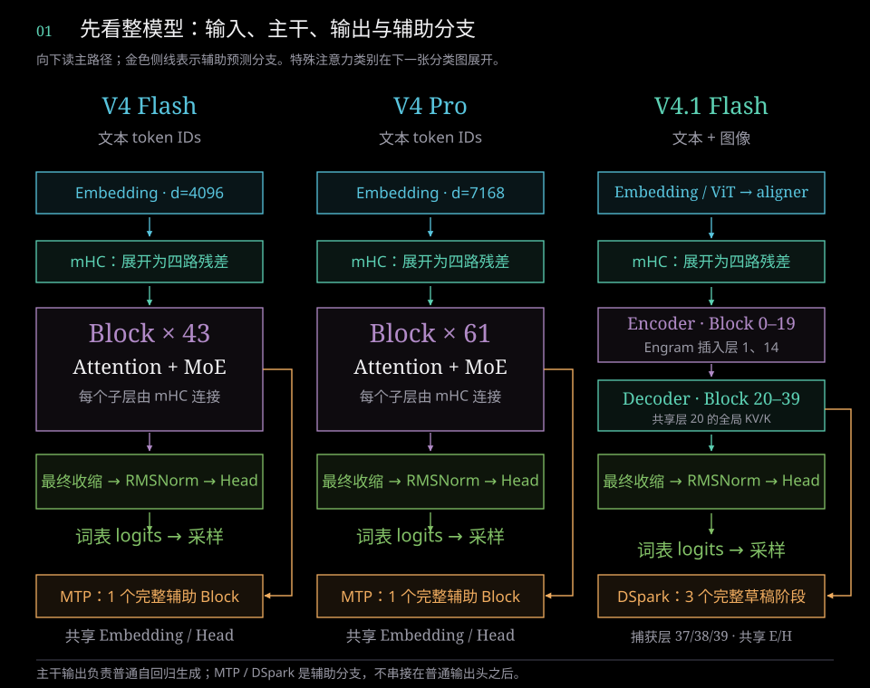

主路径按实线向下读；金色侧线接到 MTP/DSpark 辅助分支。总图中的“最终收缩”把 [b,s,4,d] 变回 [b,s,d]，Head 再映射到 129,280 维词表。参数量包含多少组件，是另一种统计口径，见第 7 章。

### 1.2 标准 Block：Attention 与 MoE 如何相接

**为什么同一个 token 要保存四路残差？** 普通残差连接保存一个 d 维状态，每个子层把计算结果加回这个状态。这里先将同一个 embedding 复制成四个 d 维向量，给信息提供多条可学习的保留与混合路径。初始四路相同，后续不同的混合、回写权重让它们逐渐形成不同表示；四路没有预先指定的“语义、语法、知识、推理”分工。

Attention 或 MoE 仍只计算一次：先加权收缩成一个 d 维输入，完成子层计算后，再把结果按不同权重写回四路。mHC 的受约束残差混合用于控制多路径的信息传播；它增加残差状态与混合开销，不能把整个模型的计算或参数量直接乘四。这里的四路来自配置 `hc_mult=4`，是架构选择，配置本身不能证明四路在所有场景下都是最优。

以 V4 Flash 为例，一个 token 的状态从 4096 个数扩展为 4×4096=16,384 个数，但每次 Attention/MoE 入口仍是 4096 维。最终输出头前再收缩回单路。

先把一个 Block 看成两个连续子层：**mHC 收缩 → RMSNorm → Attention → mHC 回写 → mHC 收缩 → RMSNorm → MoE → mHC 回写**。输入和输出都保持四路残差；每个 Attention/MoE 运算的输入是收缩后的单路隐藏向量。MoE 中每 token 执行 6 个路由专家和 1 个共享专家。

**图 2：模型主路径与残差连接**

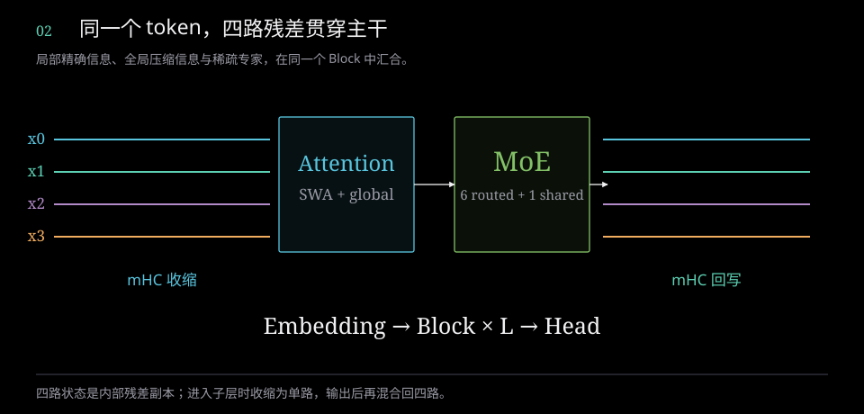

<!-- figure-explanation:1 -->

**读图：从四路状态到两类子层**

从左向右读：四条彩线是同一个 token 的四个残差副本，中央依次执行 Attention 和 MoE，右侧恢复四路状态。底部链条说明这个 Block 在主干中重复 L 次。

**机制解析**

Embedding 先得到 [b,s,d]，复制为 [b,s,4,d]。每个子层用 mHC 收缩成 [b,s,d] 后计算，再把结果写回四路残差。因此四条线表示状态通道，子层计算仍处理一个 d 维输入。

**状态形状**

$$
X\in\mathbb{R}^{b\times s\times4\times d}\;\longrightarrow\;h\in\mathbb{R}^{b\times s\times d}\;\longrightarrow\;X^{\prime}\in\mathbb{R}^{b\times s\times4\times d}
$$

图中的直线是主路径概括；注意力和 MoE 各有一次 mHC 收缩与回写，细节见第 2.2 节的 mHC 图。

<!-- /figure-explanation -->

### 1.3 特殊注意力 Block：先区分两种分类依据

**V4 的 SWA、CSA、HCA 按层内历史处理方式分类。** SWA 只读最近 128 个位置；CSA 在局部窗口之外加入 ratio 4 的重叠压缩 KV，并用 Indexer 选择全局位置；HCA 在局部窗口之外加入 ratio 128 的非重叠压缩 KV，读取全部已完成的高压缩位置。三类仍然执行相同骨架中的 MoE 和 mHC。

**V4.1 的 Full、Reindex、Reuse 按跨层全局状态职责分类。** Full 生成 KV/K 和索引；Reindex 使用已有 KV/K、用自己的 query 更新索引；Reuse 同时复用 KV/K 和最近的索引结果。V4.1 前两层仍为纯 SWA，其余层的 ratio 2/1 与跨层职责共同决定运行方式。压缩粒度和状态共享职责是两条不同的分类轴。

**图 3：特殊注意力分支在标准 Block 中的位置**

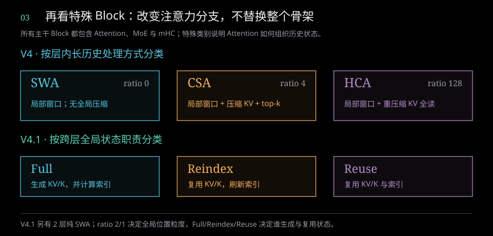

读分类图时，先看“局部窗口之外是否还有全局状态”，再看“全局状态由本层生成还是从前层复用”。Full/Reindex/Reuse 都保留本层的局部 SWA、Q 和 O 投影；Reuse 不是跳过该层。后续第 2 章解释 V4 的层内运算，第 3 章解释 V4.1 的跨层组织。

### 1.4 三个模型的规模与关键配置

先从用途理解这些组件，再看数值配置：

| 组件 | 所处位置 | 主要作用与代价 |
|---|---|---|
| mHC | Attention、MoE 周围的残差路径 | 提供可学习的多路信息流；增加残差状态与混合计算 |
| SWA / CSA / HCA | V4 Block 的注意力分支 | 局部精确历史与全局压缩历史结合；压缩与筛选改变可读取的信息 |
| Full / Reindex / Reuse | V4.1 的跨层注意力组织 | 减少重复生成全局 KV 与索引；各层仍执行本层注意力 |
| CED + bounded replay | V4.1 前后两段主干的执行方式 | 长提示词的 decoder 只计算有限尾部；涉及近似重建与运行时支持 |
| Engram | V4.1 层 1、14 的注意力前 | 用条件查表加入局部词组记忆；大型表占用存储并产生读取开销 |
| MTP / DSpark | 主干旁的辅助预测分支 | 生成草稿供主模型校验；收益取决于草稿成本与接受率 |
| ViT + aligner | V4.1 输入侧 | 将图像转换为语言维度的序列特征；增加视觉计算与序列位置 |

这里的 **Block** 是一个完整主干层，**子层** 是其中的 Attention 或 MoE。**KV** 是主注意力读取的 key/value 表示，**Indexer K** 是用于筛选历史的索引特征；两者用途不同。**Prefill** 处理输入提示词，**decode** 在已有状态上逐步生成新 token；两种阶段的执行成本不同。


| 维度 | V4 Flash | V4 Pro | V4.1 Flash |
|---|---:|---:|---:|
| 隐藏维度 `d` | 4096 | 7168 | 5120 |
| 主干层数 | 43 | 61 | 40 |
| 注意力头数 | 64 | 128 | 64 |
| 每头维度 | 512 | 512 | 512 |
| RoPE 维度 / 非 RoPE 维度 | 64 / 448 | 64 / 448 | 64 / 448 |
| Q 低秩维度 | 1024 | 1536 | 1280 |
| O 分组数 / 每组低秩维度 | 8 / 1024 | 16 / 1024 | 8 / 1024 |
| 路由专家数 | 256 | 384 | 384 |
| 每 token 激活路由专家数 | 6 | 6 | 6 |
| 共享专家数 | 1 | 1 | 1 |
| 专家中间维度 | 2048 | 3072 | 2304 |
| 路由权重缩放 | 1.5 | 2.5 | 1.5 |
| 滑动窗口 | 128 | 128 | 128 |
| Indexer 头数 / 每头维度 | 64 / 128 | 64 / 128 | 32 / 128 |
| 全局索引 top-k | 512 | 1024 | 512 |
| mHC 残差副本数 | 4 | 4 | 4 |
| 辅助预测层 | 1 层 MTP | 1 层 MTP | 3 阶段 DSpark |
| Engram | — | — | 层 1、14 |
| 视觉塔 | 本文所述文本配置未包含 | 本文所述文本配置未包含 | 32 层 ViT |

三个配置的词表均为 129,280。V4 的归一化 epsilon 为 `1e-6`；V4.1 语言主干为 `1e-20`，mHC 数值稳定项与视觉归一化使用各自的 epsilon，不能统一替换。

配置中的上下文扩展基准为 65,536，YaRN 倍率为 16，对应 1,048,576 的模型上下文配置。普通 RoPE 的 theta 为 10,000，压缩分支为 160,000。官方参考构造器还存在独立的 `max_seq_len` 运行时容量，默认值 4096；运行时需显式配置相应缓存，模型上下文声明不会自动扩容数组。

### 1.5 各模型的层分布

本文层号均从 0 开始。`compress_ratio=0` 表示只有 SWA；正数表示每多少原始 token 形成一个全局位置。

| 模型 | 主干层分布 | 辅助层 |
|---|---|---|
| V4 Flash | 0、1：SWA；2、4、…、42：ratio 4，共 21 层；3、5、…、41：ratio 128，共 20 层 | 43：ratio 0 |
| V4 Pro | 0、1：ratio 128；2、4、…、60：ratio 4，共 30 层；3、5、…、59：ratio 128；ratio 128 合计 31 层 | 61：ratio 0 |
| V4.1 Flash | 0、1：SWA；2–19：ratio 2；20–39：ratio 1 | 40–42：ratio 0 |

因此 `compress_ratios` 的长度包含辅助层：Flash 为 44，Pro 为 62，V4.1 为 43。正数 ratio 仅说明该层的全局位置粒度；V4.1 是否实际生成自己的 KV，还取决于跨层共享规则。


### 1.6 算子阅读地图

先沿完整 Block 追踪：输入与四路状态 → Attention 内部的投影/位置/压缩/Indexer/聚合/O → mHC 回写 → FFN 归一化/专家路由/SwiGLU/合并 → mHC 回写 → 下一层；最后才是词表输出。第 2–6 章按机制展开，第 8.6 节解释 MegaMoE，第 11 章把公共算子、量化内核、视觉、记忆、辅助预测、采样和通信放回这条路径中逐项说明。

## 2. V4：张量数据流与核心运算

### 2.1 记号与输入

`b` 为 batch，`s` 为本次输入长度，`S` 为已缓存历史与当前输入的总长度，`d` 为隐藏维度，`h` 为注意力头数，`r_q` 为 Q 低秩维度，`g` 为 O 分组数，`r_o` 为每组 O 低秩维度。形状以未切分的官方参考模型为准；生产框架通常将不同请求的 token 打包为总长度 `T`，并按 tensor parallel 切分头和权重。

Embedding 将 `[b,s]` token IDs 映射为 `[b,s,d]`，随后复制为 `[b,s,4,d]`。各层持续保留四路残差；进入注意力或 MoE 时才收缩为 `[b,s,d]`。

### 2.2 mHC：四路残差的受约束混合

每个子层通过 mHC 生成三组系数：

| 系数 | 形状 | 用途 |
|---|---|---|
| `pre` | `[b,s,4]` | 加权收缩四路残差，得到子层输入 |
| `post` | `[b,s,4]` | 将子层输出注入四路残差 |
| `comb` | `[b,s,4,4]` | 混合原有四路残差 |

系数投影先将残差展平为 `[b,s,4d]`。其权重形状为 `[24,4d]`，因为 `(2+4)×4=24`，分别对应 4 个 pre、4 个 post 和 16 个 comb 系数。`comb` 经 20 轮 Sinkhorn 归一化形成近似双随机矩阵，约束跨副本的信息传播。

收缩和回写可表达为：

```text
子层输入 = Σ_i pre_i × residual_i
新残差_i = post_i × 子层输出 + Σ_j comb_ji × residual_j
```

V4 的注意力和 MoE 子层分别计算自己的混合系数。四路残差不是四套独立专家或四次模型前向，而是同一 token 的内部残差状态。

**图 4：mHC 子层中的收缩、执行与回写**

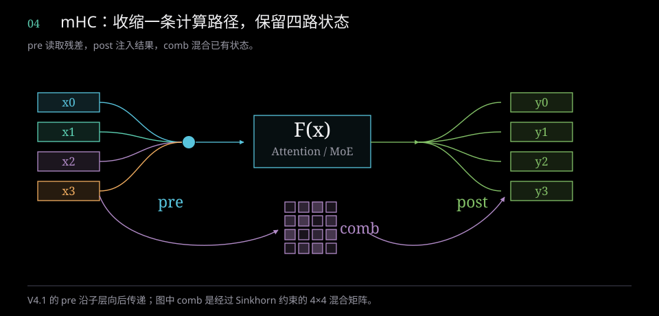

<!-- figure-explanation:2 -->

**读图：mHC 的计算如何对应这张图**

左侧 x₀…x₃ 是四个 d 维残差向量。蓝色 pre 将它们加权合并，中央 F 执行归一化后的 Attention 或 MoE。绿色 post 将同一个子层输出按不同权重注入右侧四路；下方紫色 comb 同时搬运和混合旧残差。

**机制解析**

下面的 h 对应蓝色汇合点，u 对应 F(x) 的输出，X′ᵢ 对应右侧 yᵢ。回写的两个加数分别来自绿色子层分支和紫色残差分支；即使子层输出很小，残差混合仍然存在。

**① 蓝色汇合：pre 收缩**

$$
\color{#58C4DD}{h}=\sum_{j=0}^{3}\color{#58C4DD}{p_j}\,X_j
$$

**② 中央 F：归一化后执行子层**

$$
\color{#83C167}{u}=F\!\left(\operatorname{RMSNorm}(h)\right),\quad F\in\{\operatorname{Attention},\operatorname{MoE}\}
$$

**③ 右侧回写：新输出与旧残差相加**

$$
X_i^{\prime}=\underbrace{\color{#83C167}{q_i\,u}}_{\text{post injection}}+\underbrace{\sum_{j=0}^{3}\color{#B18AC7}{B_{ji}}\,X_j}_{\text{residual mixing}}
$$

**④ 三组系数来自归一化残差的投影**

$$
\begin{aligned}z&=\frac{W_m\operatorname{vec}(X)}{\sqrt{\operatorname{mean}(X^2)+\epsilon_{\rm norm}}}\in\mathbb{R}^{24}\\p&=\sigma(s_pz_p+b_p)+\epsilon_{\rm hc}\\q&=2\sigma(s_qz_q+b_q)\end{aligned}
$$

**⑤ 紫色矩阵：20 轮 Sinkhorn 约束**

$$
\begin{aligned}B&=\operatorname{Sinkhorn}_{20}(s_Bz_B+b_B),\quad B\in\mathbb{R}^{4\times4}\\B_{ji}&\ge0,\quad \sum_i B_{ji}\approx1,\quad\sum_j B_{ji}\approx1\end{aligned}
$$

以上对单个 token 省略 b、s 下标。p 与 q 分别是 pre、post，B 是 comb；B 的第 j 行第 i 列表示旧副本 j 对新副本 i 的贡献。V4 各子层使用自己生成的 pre；V4.1 使用前一子层传下来的 pre，并把本次 pre 留给后续子层。 其中 X 为 [4,d]，h、u 为 [d]，p、q 为 [4]；24 维 z 拆成 4 个 pre、4 个 post 和 16 个 comb 分量，comb 分量重排为 [4,4]。Sinkhorn 先做行 softmax 加稳定项，再交替归一化列与行。

<!-- /figure-explanation -->


### 2.3 Q、KV 与局部注意力

Q 使用两级投影：

```text
x                         [b,s,d]
wq_a(x) → RMSNorm         [b,s,r_q]
wq_b(...)                 [b,s,h×512]
reshape                   [b,s,h,512]
逐头 Q RMSNorm → RoPE     [b,s,h,512]
```

RoPE 作用于最后 64 维，前 448 维不旋转。第一段 Q 的 RMSNorm 与逐头 Q RMSNorm 是两次不同的归一化。

KV 由 `wkv` 生成共享 latent：

```text
RMSNorm(wkv(x))           [b,s,512]
```

这个 latent 同时承担注意力中的 key 和 value 信息，各 Q 头共享它。SWA 保存最近 128 个位置，decode 时写入 `position % 128` 的环形槽位。逻辑位置和物理槽位由注意力下标关联，不能直接把槽位编号当作绝对位置。


V4 的 KV 格式将非 RoPE 的 448 维量化为 FP8，RoPE 的 64 维保留 BF16。参考模型可以用 BF16 数组承载量化后再还原的值；生产缓存则可直接存储打包表示。

### 2.4 SWA、CSA、HCA：同一查询怎样读取历史

下面讨论 V4 Flash/Pro 的三类注意力。它们共享 Q、局部 KV、attention sink 与 O 投影的主流程，区别在于额外的全局状态怎样生成、怎样选择。动态图演示逐 token 的 decode 状态变化；prefill 则批量处理输入，并为每个 query 施加对应的因果可见范围。

在这三类中，每个主注意力头都是 512 维，其中 64 维应用 RoPE。参考 `Attention` 对纯 SWA 使用 theta=10,000 并关闭 YaRN；对正 ratio 的 CSA/HCA 使用压缩分支的 theta=160,000 与上下文扩展配置，同一层的 Q、局部 KV、全局 KV 共用该层的位置编码设置。不能将 CSA/HCA 的局部路径误解为仍单独沿用纯 SWA 的 RoPE 配置。

**SWA：最近原始位置的直接读取**

SWA（Sliding Window Attention，滑动窗口注意力）的 `compress_ratio=0`。令当前 query 的位置为 t、窗口 W=128，它直接读取的原始位置集合为：

```text
L_t = {max(0, t−W+1), …, t}
|L_t| = min(W, t+1)
```

这里包括当前 token。每个位置的隐藏向量经 `wkv → RMSNorm → RoPE` 生成一个 512 维共享 latent，各查询头读取同一份 KV；最近的位置保持逐 token 表示，没有经过全局压缩。Decode 把新 KV 写入 `t % W` 的环形槽，因此容量固定，旧物理槽会被覆盖。读取时根据逻辑位置构造下标，不能按槽号 0、1、2……直接解释历史顺序。Prefill 的当前输入 KV 可以按完整输入暂存参与计算，但每个 query 的 mask 仍只允许读自己的局部窗口。

纯 SWA 没有 compressor 和 learned Indexer。它限制的是该层对历史 KV 的直接访问范围；多层隐藏态仍可传递更早信息，窗口外历史并非在整个模型中立即消失。

<!-- attention-motion:swa -->

**CSA：细粒度压缩历史，再按 query 选择**

CSA（Compressed Sparse Attention，压缩稀疏注意力）在 SWA 外增加 ratio 4 全局分支。压缩器从该子层的输入隐藏态生成内容向量和逐维 gate，经加权池化形成 512 维主 KV；它并非把已经生成的局部 KV 做固定平均。

把原始序列按 4 个 token 划成块 B₀、B₁……，全局槽 Cⱼ 在块 Bⱼ 完成时提交。Cⱼ 使用上一块 Bⱼ₋₁ 的“重叠半支”和当前块 Bⱼ 的“当前半支”，合计最多 8 个 token 的投影信息；第一个块没有上一块，缺失部分通过无效 gate 排除。每个 token 的投影宽度为 2×512，两半各服务不同的块角色，不能把它理解为同一组 512 维向量被机械重复使用。

```text
C₀ ← B₀                         完成位置 3，位置编码锚点 0
C₁ ← B₀ 的重叠半支 + B₁ 的当前半支  完成位置 7，锚点 4
C₂ ← B₁ 的重叠半支 + B₂ 的当前半支  完成位置 11，锚点 8
```

压缩前 gate 加入块内可学习位置项，沿块内 token 轴、对每个特征维分别 softmax，再加权求和；之后执行 RMSNorm、压缩位置 RoPE 和量化。对已组装好的有效贡献集合 Uⱼ，逐维池化可写成：

```text
v_i = 内容投影(x_i)
g_i = gate 投影(x_i) + 块内位置项
α_i,c = exp(g_i,c) / Σ[l ∈ U_j] exp(g_l,c)
c_j,c = Σ[i ∈ U_j] α_i,c × v_i,c
全局 latent = RoPE(RMSNorm(c_j))，随后按对应格式量化
```

c 是特征维编号；每个维度各自得到一组块内权重。CSA 的 Uⱼ 包含上一块和当前块各自对应半支的贡献，HCA 的 Uⱼ 只包含当前 128-token 块。这种压缩不同于主注意力按 query 对历史位置求 softmax。

只有完成的块会成为全局 KV，未完成块保留在 compressor state 中，不能提前当作摘要读取。位置 t 已完成的全局槽数为 `floor((t+1)/4)`。

独立 Indexer 使用 128 维索引特征：自己的重叠压缩器生成 Indexer K，查询由低秩 Q 特征投影而来。其打分可概括为：

```text
s_tj = Σ_h α_th × ReLU(q_index[t,h] · k_index[j])
I_t  = TopK(s_tj, 已完成且因果可见的全局位置)
A_t  = L_t ∪ {C_j : j ∈ I_t}
```

`α_th` 由当前隐藏态投影产生，包含参考实现的维度与头数缩放；它不是主注意力的 softmax 概率。Flash 的全局 top-k 上限为 512，Pro 为 1024。Indexer 只决定读哪些主 KV，最终 value 聚合使用 512 维主注意力查询与 latent，不能用 Indexer 的 128 维打分直接代替。没有被选中的压缩槽仍留在缓存中，可以被下一 query 选中。

<!-- attention-motion:csa -->

**HCA：更粗的压缩，全读已完成摘要**

HCA（Heavily Compressed Attention，高压缩注意力）也保留 SWA，但全局分支的 ratio 为 128。每个 token 的内容/gate 投影宽度为 512，压缩块互不重叠；逐维门控池化、归一化和位置编码仍参与摘要生成。

```text
C₀ ← token 0–127      到位置 127 才提交，位置编码锚点 0
C₁ ← token 128–255    到位置 255 才提交，位置编码锚点 128
G_t = {C₀, …, C_(floor((t+1)/128)−1)}
A_t = L_t ∪ G_t
```

HCA 不设置 learned Indexer，不做 CSA 式的 query-dependent top-k；本次主注意力读取全部已完成全局槽。它减少的是全局位置的密度，读取数量仍随上下文长度增长，不能说长历史部分具有固定成本。尚未完成的当前 128-token 块保存在 state 中；该块的近期原始 token 仍可以经局部窗口被读取。

<!-- attention-motion:hca -->

**两条历史路径怎样合并？** 局部原始位置与全局压缩位置一起进入同一次主注意力打分、softmax 分母和 value 聚合，再经过逆 RoPE 与分组 O 投影。不是先做两个独立 softmax，再将结果简单相加。全局摘要可能包含局部窗口内 token 的投影信息；它是另一个压缩表示，不要求在原始 token 覆盖范围上与局部窗口完全去重。Attention sink 也进入这个分母，但不提供 value。

以 t=4095、W=128 为例，忽略 padding 槽而按可见记录计数：

| 类型 | 局部原始位置 | 已完成全局槽 | 实际读入的全局槽 | 主注意力读入记录总数 |
|---|---:|---:|---:|---:|
| SWA | 128 | 0 | 0 | 128 |
| CSA / Flash | 128 | 1024 | 最多 512 | 最多 640 |
| CSA / Pro | 128 | 1024 | 最多 1024 | 最多 1152 |
| HCA | 128 | 32 | 32 | 160 |

上述数量是主注意力读取预算，不包括 Indexer 的扫描/打分、压缩器计算、写缓存和投影成本。CSA 的主注意力全局读取有 top-k 上限，但 Indexer 仍需选择候选；HCA 的摘要更少、粒度更粗，不能仅凭表中记录数断言它的质量或整层运行速度更优。

### 2.5 压缩器：ratio 4 与 ratio 128

压缩器对隐藏态做内容投影和 gate 投影，以 gate 权重聚合一个压缩块，随后归一化、施加压缩位置编码并量化。块内 learned positional term 参与门控，不能将其简化成固定平均池化。

| 分支 | 池化结构 | 投影特征宽度 | 全局位置数 |
|---|---|---:|---:|
| ratio 4 | 相邻两个 4-token 块重叠聚合 | `2×512` | 约 `S/4` |
| ratio 128 | 单个 128-token 块聚合，无重叠 | `512` | 约 `S/128` |

例如，一个已有 4096 个位置的 Flash 序列，ratio 4 分支形成约 1024 个全局位置，Indexer 最多选 512 个；ratio 128 分支形成约 32 个全局位置，主注意力读取全部已完成位置。两类分支都另外保留最近 128 个原始位置。这里是完整历史的数量示例，逐个 query 的实际可见数仍受因果位置与已完成块数限制。

ratio 4 的重叠让新压缩位置同时利用前一块和当前块的信息。ratio 128 保留更粗的长距离摘要，历史位置更少。

Prefill 按完整块生成结果，末尾未完成块保留在 compressor state 中。Decode 每写入一个 token 更新状态，到 `(start_pos+1) % ratio == 0` 时提交新压缩位置。该位置的 RoPE 以块起点 `start_pos+1-ratio` 为基准。缓存中已完成的全局 KV 与尚未完成块的 state 是两类不同状态。

### 2.6 Indexer 与稀疏注意力

Indexer 是 Attention 内部的一条轻量索引分支，selector 是其选择历史位置的阶段。它先筛选全局位置，再让主注意力读取这些位置的 512 维 KV；不是 Attention 后面的另一个模型层。纯 SWA 不需要它，HCA 按完成块直接构造全读索引，V4 的 CSA 才执行 learned Indexer。

**索引 Q、K 与头权重从哪里来？** 对 Attention 入口的归一化隐藏态 x，先计算主 Q 的低秩特征 `qr=RMSNorm(wq_a(x))`。主 Q 和索引 Q 分别使用自己的 `wq_b`；索引 Q 的输出是每头 128 维，Flash/Pro 都有 64 个索引头。V4 索引 K 由独立的 ratio 4 重叠压缩器产生，特征维为 128、块内投影宽度为 256；主 KV 压缩器则输出 512 维，它们参数与缓存分开。

```text
索引 Q = FP4模拟(Hadamard(RoPE(wq_b_index(qr))))  [b,s,H_i,128]
索引 K = FP4模拟(Hadamard(RoPE(索引压缩器(x))))   [b,N,128]
α = weights_proj(x) / √(128 × H_i)               [b,s,H_i]
D[b,t,h,j] = dot(Q_index[b,t,h], K_index[b,j])      [b,s,H_i,N]
S[b,t,j] = Σ_h α[b,t,h] × max(D[b,t,h,j],0)        [b,s,N]
```

这里 `H_i=64`、N 为缓存中完成的压缩位置数；按 tensor parallel 切分头时，各设备算自己的头贡献，再对 S 做 all-reduce。ReLU 只作用于 QK 点积，α 来自线性投影，没有 softmax/sigmoid，也不保证非负；它是索引打分的头权重，不能解释成注意力概率。

**Selector 怎样把打分变成下标？** 对当前绝对位置 t，只允许 `j < floor((t+1)/4)`；prefill 中 batch 化的 score 张量可能包含较晚 query 才能使用的槽，先把当前 query 不可见的 S 置为 `−∞`，再取 top-k。有效索引上限是 `min(配置 top-k, 当前 query 完成的槽数)`；不足部分或无效选择以 `−1` 表示，实际 kernel 会忽略它。

```text
I_t = TopK(S_t 经因果 mask 后的值)
物理全局下标 = I_t + offset
主注意力下标 = concat(局部窗口下标, 物理全局下标)
```

prefill 的 offset 对应当前局部 KV 输入区长度；decode 的 offset 为固定局部池长度 128。Top-k 选择的是“槽的位置”，不能直接使用槽内最大分数作为主注意力权重。主注意力会重新用自己的 512 维 Q/K 打分、softmax、聚合 value。

**图 5：Indexer 的逐头评分、因果 mask 与 selector**

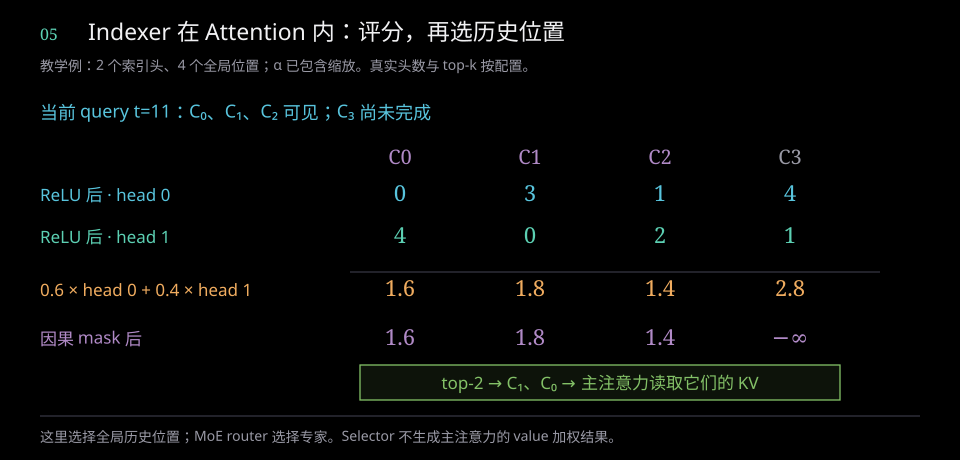

教学例中两头原始点积分别是 `[-2,3,1,4]` 和 `[4,-1,2,1]`。ReLU 后按 α=(0.6,0.4) 汇总得 `[1.6,1.8,1.4,2.8]`；在 t=11，C₃ 尚未完成，mask 后变成 `[1.6,1.8,1.4,−∞]`。演示 top-2 因此选 C₁、C₀。真实 Flash 的 k=512，这里用 2 是为了展示选择过程。

ratio 4 层有独立 Indexer：Q 投影成多头 128 维查询，K 由自己的压缩器产生；K 压缩器的重叠投影宽度为 256。索引路径使用 Hadamard 变换及低比特表示，以较小特征判断哪些压缩位置值得主注意力读取。

Indexer 对每头 QK 分数进行 ReLU，再按 query-dependent 权重汇总，选取全局 top-k。有效数量受已完成压缩块数限制：

```text
有效 top-k ≤ min(index_topk, 已完成压缩位置数)
```

因果掩码限制可见历史，无效项以 `-1` 标识。Prefill 和 decode 的 KV 拼接布局不同：prefill 可使用当前局部序列长度作为全局索引偏移，decode 使用固定窗口长度 128。偏移必须和实际缓存布局一致。

ratio 128 层不使用 learned Indexer，而是读取全部已完成的高压缩位置。每层注意力的可见集合都包括 SWA 的局部位置，再加该层选择的全局位置；短距离精确信息与长距离压缩信息共同参与计算。

主注意力使用缩放 QK 分数和 softmax 聚合，还为每个头设置可学习的 attention sink：sink 项加入 softmax 分母，不贡献 value，相当于允许该头保留一部分注意力概率而不读入具体历史内容。

**图 6：V4 注意力的 Q、局部 KV 与全局 KV**

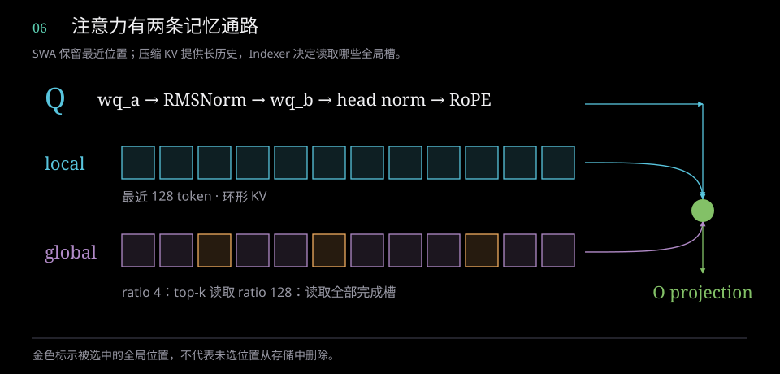

<!-- figure-explanation:3 -->

**读图：查询怎样合并局部与全局记忆**

先看顶部 Q 投影，再看中部 local 与底部 global。蓝色窗口保存最近 128 个原始位置；紫色槽是长历史的压缩表示，金色槽表示被 Indexer 选中。三条路径在右侧汇合，再进入 O 投影。

**机制解析**

每个 query 用局部位置和选中的全局位置共同计算注意力。ratio 4 层用 learned top-k，ratio 128 层读全部已完成压缩槽；未选中槽仍留在缓存中。图中绿色汇合点概括了 QK 打分、softmax 与 value 聚合。

**选中位置的 attention 聚合**

$$
o_{t,h}=\frac{\sum_{j\in\mathcal A_t}\exp(\beta q_{t,h}^{\top}k_j)\,v_j}{\exp(a_h)+\sum_{j\in\mathcal A_t}\exp(\beta q_{t,h}^{\top}k_j)}
$$

公式中的 t 是当前序列位置，h 是注意力头编号；q、k、v 分别是查询、键和值，o 是该头的聚合输出。Aₜ 是可见的局部与全局位置集合，β=1/√512 是分数缩放，aₕ 是仅进入分母的可学习 attention sink。这里用标准 Q/K/V 记号表达聚合；参考实现的 K/V 共用 512 维 latent。此图对应 V4；V4.1 移除逐头 Q norm。

<!-- /figure-explanation -->

### 2.7 输出投影

注意力输出先做逆 RoPE，再进行分组低秩 O 投影：

```text
attention output          [b,s,h,512]
按 g 组展开               [b,s,g,h×512/g]
每组 wo_a                 [b,s,g,r_o]
合并                      [b,s,g×r_o]
wo_b                      [b,s,d]
```

`wo_a` 的权重可记为 `[g×r_o,h×512/g]`，计算按组组织；`wo_b` 为 `[d,g×r_o]`。这一结构避免直接使用完整的 `[d,h×512]` 输出矩阵，同时保持组内头信息融合。

### 2.8 MoE 路由与专家

**Attention 之后的完整衔接**：O 投影属于 Attention 的末尾，把多头结果恢复为 `[b,s,d]`。Block 先使用 Attention 子层之前保存的四路 residual 和该子层的 post/comb 做 mHC 回写，得到更新的 `[b,s,4,d]`；再从这份更新状态收缩出单路，经过独立的 `ffn_norm`，送入 MoE。不会把未回写的 Attention 向量直接当成 MoE 的完整输入。

```text
u_attn = Attention(RMSNorm_attn(collapse(X)))      [b,s,d]
Y_i = post_attn[i] × u_attn + Σ_j comb_attn[j,i] X_j
x_ffn = RMSNorm_ffn(collapse_ffn(Y))              [b,s,d]
u_ffn = MoE(x_ffn)                               [b,s,d]
Z_i = post_ffn[i] × u_ffn + Σ_j comb_ffn[j,i] Y_j  [b,s,4,d]
下一层接收 Z
```

两次 RMSNorm 使用各自可学习的权重；两次残差混合也有各自的参数。V4 在各子层入口生成自己的 pre；V4.1 的 Attention 使用上一子层传来的 pre，MoE 使用当前 Attention 生成的 pre，并将 MoE 生成的 pre 传给下一层。post/comb 仍用于本子层回写。

**图 7：Attention 到 MoE，再到下一层的执行顺序**

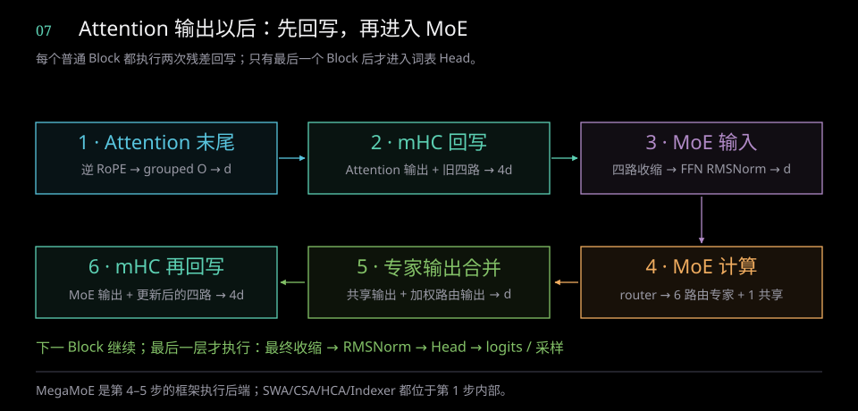

**MoE 做什么？** Attention 读取不同序列位置；MoE 的 FFN 对每个 token 的当前向量进行特征变换。它不再沿序列轴做 QK 注意力，也不另建历史 KV。路由器根据每个 token 的特征决定哪些专家执行，选中的专家分别做相同类型、不同权重的前馈计算。

路由使用 `sqrtsoftplus`：

```text
score = sqrt(softplus(x × W_gate))
选择分数 = score + selection_bias
选择 6 个专家
weight = 被选专家的原始 score / 其 score 总和 × route_scale
```

选出的专家输出还要合并，形成一个 d 维的 MoE 子层结果：

```text
E = 当前 token 选中的 6 个路由专家
MoE(x) = shared_expert(x) + Σ[e ∈ E] weight_e × expert_e(x)
```

每个专家接收同一个收缩后的 x，分别完成自己的 gate/up/down 投影；共享专家的输出单独相加。得到的 MoE(x) 随后经 mHC 回写到四路残差。

选择偏置只影响选中谁，最终混合权重取原始 score。因此路由不是 softmax；六个路由权重之和为 Flash 的 1.5 或 Pro 的 2.5。每个 token 还执行一个共享专家。

V4 前三层使用 token ID 到专家 ID 的 hash 路由表 `tid2eid`，形状为 `[129280,6]`，类型为 int32。它固定专家选择，混合权重仍由当前隐藏态的路由分数生成。后续层按分数 top-k 选择。

单个专家包含 SwiGLU 的 gate/up 两个输入投影和一个输出投影，逻辑权重形状为 `[I,d]`、`[I,d]`、`[d,I]`，其中 `I` 为专家中间维度。`swiglu_limit=10` 用于控制激活范围。大多数专家虽不参与一个 token 的计算，仍占据模型权重存储。

**单个专家内部的算子**：先做两次 `d → I` 的线性投影，gate 支和 up 支经过范围控制，再执行 SiLU 与逐元素乘法，最后 `I → d` 投影。这叫 SwiGLU，不是仅做一次线性变换。

```text
gate = W1 x                       [I]
up   = W3 x                       [I]
gate = min(gate, 10)
up   = clip(up, −10, 10)
a = SiLU(gate) × up                [I]
expert(x) = W2 a                  [d]
SiLU(z) = z × sigmoid(z)
```

这里给出 `swiglu_limit=10` 的参考路径；gate 只限制上界，up 同时限制上下界，不能写成两支都对称 clip。路由标量可在 down 投影前乘入 a，等价于对该专家输出加权。Flash 的 I=2048、Pro 的 I=3072、V4.1 的 I=2304；输出都会回到各模型的 d。

**两个 top-k 的区别**：Indexer 在 Attention 内选历史位置；MoE router 在 FFN 内选专家。前者的输出是历史下标，后者同时输出专家 ID 和专家混合权重。每层每 token 的 6 个路由专家与 1 个共享专家共同形成一个 d 维结果，再进入第二次 mHC 回写。MegaMoE 负责这一专家执行路径，具体见第 8.6 节。

### 2.9 词表 Head 与 MTP

最终四路残差经专用 head 混合收缩、归一化，再投影到词表。官方普通生成路径只返回最后位置的 logits：`[b,129280]`。全位置 logits 是单独的调用口径。

词表输出只出现在主干末尾，不是每个 Block 都把 hidden 转成 token。以普通生成为例，最后一个 Block 的四路状态先收缩为 `[b,s,d]`，最终 RMSNorm 后由 `[129280,d]` 权重映射到 logits；下一 token 由生成逻辑采样，再作为下一轮输入。Logits 是词表分数，softmax 后才是概率；温度、停止条件与草稿校验由对应生成路径处理。

V4 MTP 继承完整 Block，包含注意力和完整 MoE，并增加 token embedding 与前层 hidden 的投影、归一化等组件；它共享主干 embedding 和词表 head。MTP 参数不能只按额外投影矩阵估算。

参考 `generate.py` 使用普通自回归采样，未将 MTP 接入完整的 speculative draft/verify 循环。生产框架使用辅助模块时，还需要草稿采样、主模型校验、接受或拒绝以及对应的缓存维护。

## 3. V4.1：跨层共享与 CED

### 3.1 四类注意力层

V4.1 保留 40 个主干 Block，但不再由每层独立维护全局 KV 和 Indexer K。

```text
KV 源层：     2、8、14、20
Index 源层：  2、8、14、20、24、28、32、36
候选池源层：  20
```

| 类型 | 层号 | 数量 | 全局状态职责 |
|---|---|---:|---|
| SWA | 0、1 | 2 | 只处理局部窗口 |
| Full | 2、8、14、20 | 4 | 生成全局 KV、Indexer K 和选择结果 |
| Reindex | 24、28、32、36 | 4 | 复用全局 KV/K，重新生成查询与选择结果 |
| Reuse | 其余非 SWA 层 | 30 | 复用源层 KV 与最近的索引结果 |

KV 的共享关系为：3–7 使用层 2，9–13 使用层 8，15–19 使用层 14，21–39 使用层 20。层 24、28、32、36 刷新索引，各自后续层复用刷新结果。

Reuse 仍执行该层 Q 投影、局部 SWA、稀疏注意力和 O 投影；省掉的是重复全局状态生成和索引计算。

**图 8：V4.1 四个 KV 源与八个索引源**

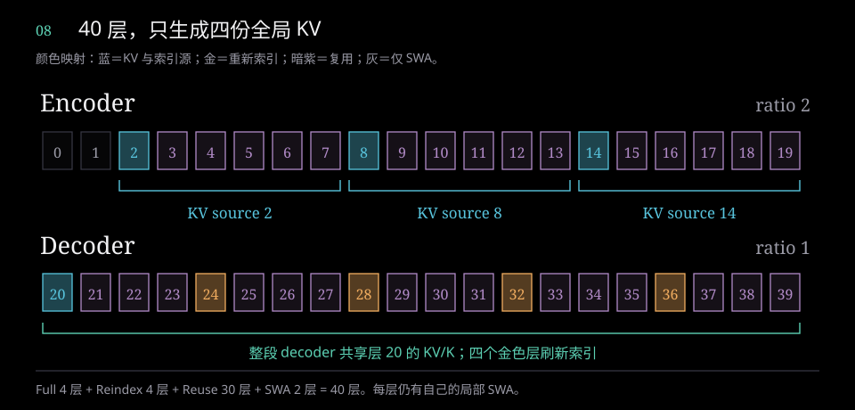

<!-- figure-explanation:4 -->

**读图：一层的颜色表示它负责生成什么**

横向依次读层号，上排是 encoder，下排是 decoder。蓝色层 2、8、14、20 生成全局 KV/K 和索引；金色层 24、28、32、36 只重新索引；紫色层复用状态。括号把同一 KV 源的使用范围连在一起。

**机制解析**

例如层 9–13 读取层 8 的全局 KV/K；层 24 虽然更新自己的 top-k，却继续读取层 20 的 KV/K，层 25–27 再复用层 24 的选择。KV 共享和索引共享因此具有不同的刷新周期。

**以 decoder 第 24 层为例**

$$
\operatorname{KV}_{24}=\operatorname{KV}_{20},\quad \mathcal I_{24}=\operatorname{TopK}(Q_{24},K_{20}),\quad\mathcal I_{25:27}=\mathcal I_{24}
$$

共享的是全局状态；每层仍有自己的 Q、局部 SWA、attention 和 O 投影。4 Full + 4 Reindex + 30 Reuse + 2 SWA = 40。

<!-- /figure-explanation -->


### 3.2 CED 的前后半部分

CED 将层 0–19 组织为 encoder，层 20–39 为 decoder。Encoder 的三个 KV 源层使用 ratio 2，decoder 源层 20 使用 ratio 1。


层 20 的全局 latent 来自该层经过 `hc_pre` 和 `attn_norm` 的输入。层 19 输出仍是 `[b,s,4,d]` 残差，不能直接作为已经收缩的 `[b,s,d]` KV 源输入。

官方生产实现结合 bounded decoder replay，在长序列 prefill 中让后半部分仅处理尾部窗口；官方给出的约 8B prefill / 16B decode 活跃参数口径与这一执行方式相关。参考 `Transformer.forward` 则对完整输入循环执行全部 40 层，仅有跨层共享并不自动产生这项 prefill 省算。

### 3.3 Bounded replay 与前缀复用

Bounded replay 分为两种用途：

- Encoder replay：长期复用以全局 KV 为中心，重新计算命中边界附近的有限尾部，以恢复后续计算所需的局部状态。
- Decoder replay：利用 encoder 已产生的全局信息，只执行 decoder 尾部窗口，减少长提示词的后半部分 prefill 计算。

两者都是近似重建。多层局部注意力的间接感受野超过单层 128-token 窗口，只重算一个有限尾部不能保证与完整历史前向逐位相同；前缀命中边界也可能改变 suffix 的 encoder 状态。模型通过后训练适配这种运行方式，报告中的较小质量影响来自作者实验。[V4.1 技术报告 §3.2.2](https://huggingface.co/deepseek-ai/DeepSeek-V4.1-Flash/blob/main/DeepSeek_V41_Tech_Report.pdf)

当输入长度远大于窗口时，减少 decoder prefill token 数能显著降低计算；短输入、缓存命中方式、执行后端和额外状态维护都会影响实际收益。

**图 9：CED 的 encoder、decoder 与共享全局状态**

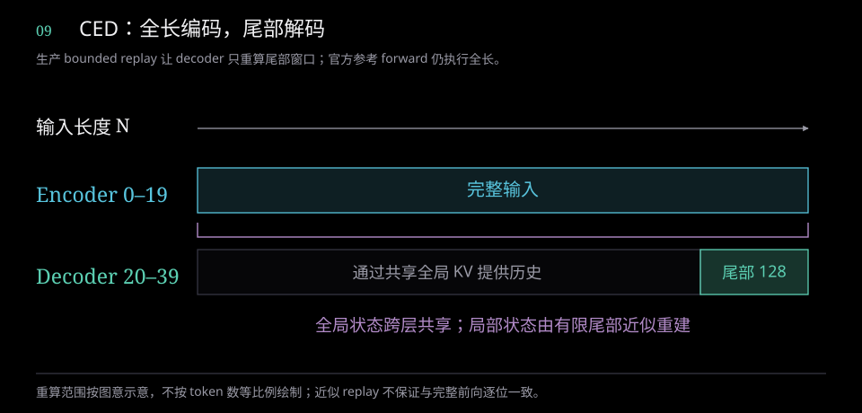

<!-- figure-explanation:5 -->

**读图：为什么长输入可以只解码尾部**

蓝色长条表示 encoder 对整个输入计算；灰色 decoder 区域表示历史不再逐 token 完整重算，青色尾段表示 decoder 实际执行的有限窗口。中间括号表示可供 decoder 读取的全局历史。

**机制解析**

前半部分先生成长上下文表示，再由层 20 的源投影生成 decoder 共享 KV/K。后半部分仍能通过这份全局状态读取历史，只把当前局部计算限制在尾部。计算减少来自处理的 decoder token 数减少。

**按执行 token 数概括长输入成本**

$$
\underbrace{20N+20\min(N,128)}_{\text{bounded decoder work}}\quad\text{vs.}\quad\underbrace{40N}_{\text{full-length work}}
$$

图示针对生产 bounded replay；官方参考 forward 仍遍历全长。成本公式只概括 token 数与层数，未计投影、索引和注意力差异；尾部 replay 属于近似重建。

<!-- /figure-explanation -->

### 3.4 压缩器与 Q 归一化的变化

V4.1 ratio 2 使用 FP32 gate 聚合两个 token，没有 V4 ratio 4 的重叠结构和 learned positional term。ratio 1 直接投影、归一化生成 latent，不需要块内池化和未完成块 state。

V4.1 保留 `wq_a` 后的 Q 低秩 RMSNorm，移除 V4 的逐头 Q RMSNorm。其主注意力头仍为 512 维，RoPE 仍使用其中 64 维。

Indexer K 由全局 512 维 latent 经 `[128,512]` 的 `wk` 投影和归一化生成，不再另建 V4 式独立压缩器。Reindex 层不拥有独立的 `wk` 或 K cache，复用源层生成的 K，只更新自己的查询和位置选择。

### 3.5 分层候选池

层 20 将历史分成 8 个位置一组的 block，以块内最大索引分数选择最多 2048 个块，候选上限为：

```text
2048 × 8 = 16384 个位置
```

最新的不完整块会强制纳入；不可达历史块仍需过滤，块内未发生的位置还要通过 token 级因果掩码排除。强制纳入一个 block 不表示可以读取其未来位置。

更深 Reindex 层在这个候选集合内重排，最终 top-k 为至多 512 个位置。层 20 的 ratio 为 1，其候选 mask 的历史维度为 `S`；ratio 2 源层的历史粒度则不同。

生产 sparse backend 可以只在候选集合上计算更深层索引，限制这些层随上下文增长的工作量。官方参考 Indexer 使用 dense einsum 对全历史打分，再施加 candidate mask；其选择范围受限，实际打分复杂度仍随历史长度增长。默认 BF16 输入下，该 dense score 张量为 BF16。

**图 10：分层候选池与最终 top-k**

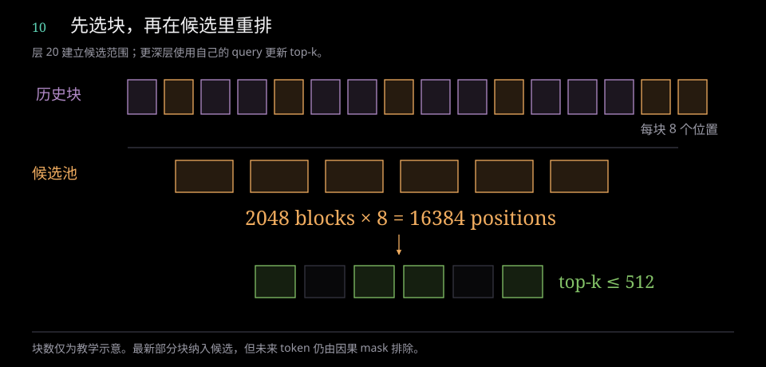

<!-- figure-explanation:6 -->

**读图：两次筛选分别缩小什么范围**

上排每个小块代表 8 个历史位置，金色为选中的候选块；中排把这些块收集成候选池，底部绿色位置是更深层 query 重新评分后实际读取的 top-k。

**机制解析**

层 20 先按块内最大分数选最多 2048 块，因此候选位置上限是 16384。层 24、28、32、36 再按各自 query 在候选范围内选择最多 512 个全局位置。块级选择负责缩小搜索范围，位置级选择负责精细读取。

**块级候选与位置级选择**

$$
|\mathcal C_t|\le2048\times8=16384,\qquad |\mathcal I_t|\le\min(512,|\mathcal C_t|)
$$

示意图缩小了块数。最新部分块会被保留，但块中未来位置仍被因果 mask 排除；参考 dense 路径不会因 mask 自动减少打分工作量。

<!-- /figure-explanation -->


### 3.6 mHC 与 MoE 的变化

V4.1 将 pre 系数沿子层传递：注意力使用上一个子层留下的 pre，本次注意力产生的 pre 供当前 MoE 使用，MoE 产生的 pre 供下一层注意力使用。初始 one-hot pre 选择第一路副本；初始四路副本相同。最后使用末层 MoE 返回的 pre 收缩，不再设置 V4 的独立 mHC head 参数。

MoE 仍使用 sqrtsoftplus、6 个路由专家和 1 个共享专家。V4.1 移除前三层 hash 专家路由，并按文本与图像使用相应的专家选择偏置；偏置作用于选择分数，混合权重仍取原始 score。

## 4. Engram：条件记忆

Engram 位于 V4.1 的层 1 和层 14，在该 Block 的注意力之前向四路残差加入条件记忆。它根据 token 的局部 n-gram 查表，提供独立于主干专家计算的词组记忆。

### 4.1 Hash 与查表

原始 token 先通过归一化映射到 99,092 的压缩词表。每层对 2、3、4-gram 分别使用 8 个 hash head，合计 24 个查表索引。层间使用不同质数与 hash 参数，各 head 使用独立 bucket 偏移；上下文 token 通过 XOR 等运算组合。

```text
token IDs                  [b,s]
压缩词表映射与 n-gram hash [b,s,24]
lookup                     [b,s,24,256]
flatten                    [b,s,6144]
```

两个表分别有 384,006,168 和 384,016,682 行，合计 768,022,850 行，每行 256 维。原始词表大小、压缩词表大小、配置中的基础 bucket 参数与最终查表行数是不同概念。

图像位置用 `DEAD=-1` 形成 n-gram 边界，阻止文本 n-gram 跨越图像；图像 token 的记忆 gate 被屏蔽。

### 4.2 记忆投影与门控

查表结果经过 `[25600,6144]` 的投影，拆成四路各 5120 维 key 与一个 5120 维 value。当前四路残差和记忆 key 各自按 RMS 归一化，在点积中使用两组可学习逐维权重，并按维度缩放；结果经带符号平方根和 sigmoid 得到四路 gate，value 加权后写入残差。

**图 11：Engram 从 n-gram 到四路记忆注入**

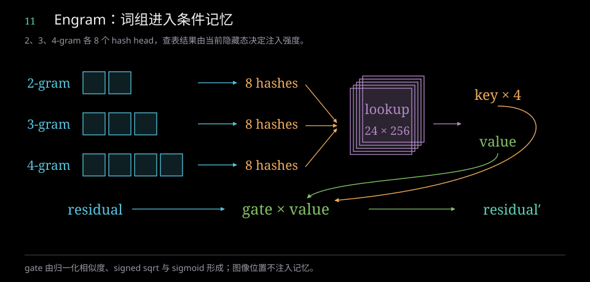

<!-- figure-explanation:7 -->

**读图：记忆表如何由当前上下文决定注入**

左侧三行对应 2、3、4-gram，各产生 8 个 hash；中间紫色表取出 24×256 的特征。右侧投影拆成四路 key 和共享 value，底部把门控 value 加回当前 residual。

**机制解析**

key 与四路 residual 计算归一化相似度，经 signed sqrt 和 sigmoid 形成四个 gate。相同的 lookup value 可以对不同残差副本产生不同强度的注入，因此查表并不等同于直接替换隐藏态。

**门控记忆回写**

$$
\begin{aligned}g_i&=\sigma\!\left(\operatorname{copysign}\!\left(\sqrt{\max(|a_i|,10^{-6})},a_i\right)\right)\\X_i^{\prime}&=X_i+g_i\,v\end{aligned}
$$

公式省略 b、s 下标，gᵢ 是第 i 路 gate，v 是共享 value；图像 token 的 gate 为零，n-gram 不跨越图像边界。

<!-- /figure-explanation -->


Engram lookup 表本身约 196.614B 逻辑参数。FP8 数据与 scale 合计约 202.758GB；计入投影及门控后，整个模块约 196.929B、203.073GB。

每个文本 token 在两层合计读取 48 行。按每行 256B 数据和 8B scale 计算，未计复用时的名义读取量为 12,672B/token。实际内存流量还受缓存命中、batch 中重复 n-gram、查表布局与部署位置影响。

## 5. DSpark：并行草稿与顺序采样

DSpark 是 V4.1 的三个完整草稿 Block，每阶段有 128 个路由专家、激活 3 个，保留注意力、mHC 与 MoE。它与主模型共享 embedding 和词表 head。

### 5.1 主干特征与草稿输入

主模型在层 37、38、39 捕获进入 Block 前的四路残差，先对四路求均值，再拼接：

```text
各层 residual              [b,s,4,5120]
mean over hc               [b,s,5120]
三层 concat                [b,s,15360]
main_proj + norm           [b,s,5120]
```

这些特征尚未经过对应 Block 的 `hc_pre` 或 `attn_norm`。

一次草稿使用 5 个位置：首位为 anchor token，其余位置用 noise token `128799` 初始化。三个 stage 并行更新位置 hidden，再由 rank 256 的 Markov head 引入顺序依赖，依次采样 5 个未来 token，并产生置信度。

| 输出 | 形状 | 含义 |
|---|---|---|
| IDs | `[b,6]` | 1 个 anchor + 5 个新 token |
| logits | `[b,5,129280]` | 5 个草稿位置的词表分数 |
| confidence | `[b,5]` | 5 个新 token 的置信度 |

框架里的 draft tokens 为 6 时，需看是否把 anchor 计入其中。参考 `forward_spec` 在 prefill 时只预热 SWA、不返回草稿结果；普通 `generate.py` 未调用完整 DSpark 接受/拒绝流程。

**图 12：DSpark 的特征融合、并行 hidden 更新与顺序采样**

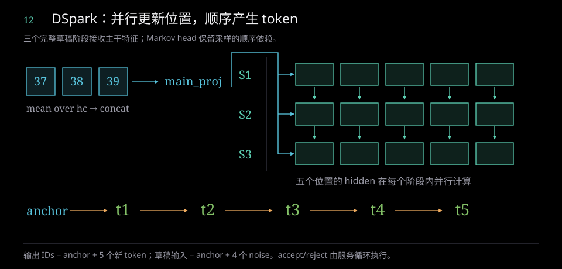

<!-- figure-explanation:8 -->

**读图：“并行”发生在哪一步**

左侧 37、38、39 表示三个主干捕获点；各自对 hc 求均值后拼接，再由 main_proj 融合。右侧每行是一个完整 DSpark stage，每列是一个草稿位置；同一行中的五个位置并行更新，三行依次执行。

**机制解析**

顶部蓝色分支把主干特征提供给各 stage，绿色竖箭头表示草稿 hidden 向下一 stage 传递。底部 anchor→t₁→…→t₅ 是 Markov 条件采样顺序：hidden 的并行更新并未消除输出 token 的顺序依赖。

**捕获特征融合**

$$
m=\operatorname{Norm}\!\left(W_{\rm main}\,[\operatorname{mean}_{\rm hc}(X_{37});\operatorname{mean}_{\rm hc}(X_{38});\operatorname{mean}_{\rm hc}(X_{39})]\right)
$$

草稿输入是 anchor + 4 个 noise，输出 IDs 是 anchor + 5 个新 token。主模型验证与接受/拒绝循环由 serving 另行组织，图中未画出。

<!-- /figure-explanation -->


### 5.2 辅助模型成本

三个完整 stage 加上额外投影和 heads，共约 14.225B 逻辑参数、8.100GB 参考构造器权重存储。主模型捕获特征、草稿缓存与校验批次也有运行成本；草稿长度和接受率共同决定吞吐收益。

## 6. 视觉输入与编码协议

### 6.1 视觉塔与连接器

V4.1 视觉塔为 32 层 ViT，隐藏维度 1024、16 头、FFN 中间维度 2816、patch size 14，使用二维 RoPE。视觉特征经 `3×3` spatial unshuffle 降低 token 数，再经过两层 MLP aligner 映射到语言模型的 5120 维空间。

ViT 约 0.411843B 参数；aligner 约 0.073411B。视觉塔的归一化 epsilon 为 `1e-6`，与语言主干不同。

**图 13：视觉特征进入语言序列**

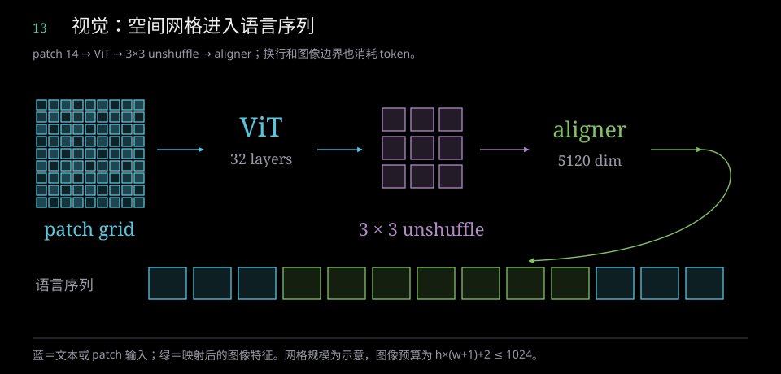

<!-- figure-explanation:9 -->

**读图：空间特征怎样成为语言 token**

从左侧细 patch 网格向右读：ViT 建模二维空间，3×3 unshuffle 把相邻空间特征合并并降低位置数，aligner 将特征映射到 5120 维，绿色路径把图像特征放入底部语言序列。

**机制解析**

底部蓝色位置表示文本，绿色位置表示图像特征。两者进入同一个语言主干 prefill；图像网格还要加入每行换行和首尾标记，所以预算不仅取决于网格面积。

**图像位置与附加标记的预算**

$$
N_{\rm image}=\underbrace{hw}_{\text{grid}}+\underbrace{h}_{\text{newlines}}+\underbrace{2}_{\text{boundaries}}\le1024
$$

图中网格与 token 数为示意，不代表真实图像输出；1024 是包含换行和边界标记的每图预算。

<!-- /figure-explanation -->

### 6.2 图像 token 布局

图像缩放和 patch 网格安排受 1024 token 预算约束。若最终网格为 `h×w`，计入行末换行与首尾标记，总 token 数为：

```text
h × (w+1) + 2
```

因此分辨率预算需要把换行与边界 token 算入，不能只限制 `h×w`。序列中的图像占位 ID 为 `129264`，像素输入、图像 token mask 与特殊标记分别承担不同职责。

官方参考模型只在 `start_pos=0` 的 prefill 接收图像。后续 decode 使用已经形成的语言与 KV 状态；生产多模态框架还负责图像预处理、特征缓存、占位长度一致性与批处理。


### 6.3 消息编码与 reasoning effort

消息序列的特殊标记、角色、thinking 模式和 generation 边界以官方 `encoding.py` 为依据。官方模型卡没有提供官方 Jinja 模板；由 Python 编码器移植的模板属于兼容实现，需要覆盖工具多轮、特殊边界和 tokenizer ID 等协议语义。

V4.1 effort 使用 1–100 的数值条件，公开 API 预设为 `low=50`、`high=75`、`max=100`。训练使用有限档位，部署时支持插值；第三方模板自定义的别名不能直接作为官方接口档位。[V4.1 模型卡](https://huggingface.co/deepseek-ai/DeepSeek-V4.1-Flash/blob/main/README.md)

## 7. 缓存、参数与存储预算

### 7.1 三种数量

逻辑参数量表示模型中的数值个数，包含未被某个 token 激活的专家与记忆表。权重存储包括量化数据及 scale。运行内存还包含 KV、激活、workspace、通信 buffer、分配器对齐等。

下表使用 `B=10^9` 参数、`GB=10^9` 字节。逻辑参数不包含量化 scale 和整数路由表；权重存储包含 scale。共享 embedding/head 只计一次，FP4 的两个逻辑值按打包格式展开计数。数值来自官方参考构造器的张量布局，四舍五入到六位小数。

| 组件 | 逻辑参数 B | 权重存储 GB |
|---|---:|---:|
| V4 Flash 主干及 embedding/head | 284.332240 | 159.117270 |
| V4 Flash MTP 额外部分 | 6.610049 | 3.627384 |
| V4 Flash 含 MTP 合计 | 290.942289 | 162.744655 |
| V4 Pro 主干及 embedding/head | 1572.997202 | 858.243816 |
| V4 Pro MTP 额外部分 | 25.840146 | 14.023768 |
| V4 Pro 含 MTP 合计 | 1598.837348 | 872.267584 |
| V4.1 主干、Engram、视觉及 embedding/head | 748.979953 | 505.049433 |
| V4.1 DSpark 额外部分 | 14.225363 | 8.099642 |
| V4.1 全部组件 | 763.205316 | 513.149074 |

从 V4.1 非 DSpark 总量扣除整个 Engram 模块，剩约 552.051B；只扣 lookup 表则约 552.366B。二者都与官方约 552B 主体模型的量级一致，但定义不同。

参考实现默认将部分线性层用 FP8 存储、路由专家用 FP4；head 为 FP32，`wo_a` 为 BF16，部分 compressor 参数为 FP32，共享专家跟随默认 FP8。V4 Pro-Base 配置的专家为 FP8，不能套用上表 Pro FP4 配置的存储数值。构造器存储也不同于 safetensors 文件体积或实际 GPU 常驻内存。

### 7.2 生产 KV 的单位置格式

| 缓存类型 | 数据组成 | 字节 / 位置 |
|---|---|---:|
| V4 主 KV | 448 维 FP8 + 64 维 BF16 + 8B scale/补齐 | 584 |
| V4.1 SWA | 512 维 FP8 + 16B scale | 528 |
| V4.1 全局 KV | 512 维 FP4 + 32B scale | 288 |
| FP4 Indexer K | 128 维 FP4 + 4B scale | 68 |

这些是对应后端格式的 payload，不含请求尾页浪费和全部元数据。页对齐还会改变分配量：例如 V4 的某种布局在 64/128 页大小下约为 585B/位置；高压缩池若按两个位置成页并按 576B 对齐，两个 584B 记录会占 1728B。

### 7.3 V4.1 的 890 B/token

V4.1 全局缓存只有四个 KV/K 源：三个 ratio 2 源和一个 ratio 1 源。按上述 FP4 格式：

```text
主 KV：288 × (3/2+1) = 720 B/原始 token
Index K：68 × (3/2+1) = 170 B/原始 token
全局 payload 合计：890 B/原始 token
```

890 不包含 SWA、压缩 state、allocator metadata 和页尾空隙。它描述指定打包格式下的全局状态密度。

**图 14：890 B/token 的组成与边界**

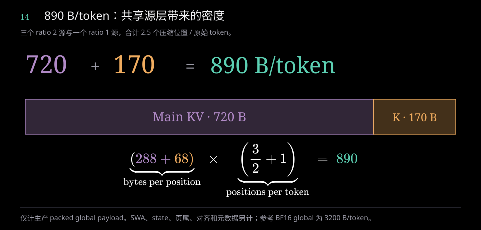

<!-- figure-explanation:10 -->

**读图：条形宽度对应哪一项缓存**

紫色长段是主 KV 的 720B，金色短段是 Indexer K 的 170B，两者按实际字节比例绘制；上方相加得到 890B，下方公式解释每项为何乘以 2.5。

**机制解析**

每个压缩位置存 288B 主 KV 和 68B Indexer K。层 2、8、14 各每两原始 token 产生一位置，层 20 每 token 产生一位置，因此位置密度为 3/2+1。层间复用避免为其他层再存完整全局副本。

**单位置大小 × 每 token 的位置密度**

$$
(\color{#B18AC7}{288}+\color{#F0AC5F}{68})\times\left(\frac{3}{2}+1\right)=\color{#5CD0B3}{890}\;\text{B/token}
$$

890 B/token 是指定 FP4 格式的 global payload；SWA、state、页尾与元数据另计。参考 BF16 global 为 3200 B/token。

<!-- /figure-explanation -->


官方参考模型以 BF16 数组保存主 KV 与 Indexer K，其全局密度为：

```text
(512+128) × 2 × (3/2+1) = 3200 B/原始 token
SWA：40 × 128 × 512 × 2 = 5 MiB/序列
```

实际存储格式决定这两种数字的适用场景；fake quant 后写回 BF16 不会将数组本身变成 FP4 容量。

### 7.4 V4 Flash 的缓存预算

Flash 的 21 个 ratio 4 层与 20 个 ratio 128 层使用各自全局缓存。若 Indexer K 为 FP4，全局 payload 为：

```text
584 × (21/4+20/128) + 68 × 21/4 = 3514.25 B/token
```

若 Indexer K 使用 132B 的 FP8 格式，则为 3850.25B/token。与 V4.1 的 890 相比，分别约为 3.949 倍与 4.326 倍；具体部署还受分页与格式选择影响。

参考 BF16 数组在 65,536 token、单序列情况下的 Flash KV/state 分项如下，不含模型权重与 forward 激活：

| 分项 | 字节 |
|---|---:|
| 43 层 SWA | 5,636,096 |
| ratio 4 主 KV | 352,321,536 |
| ratio 128 主 KV | 10,485,760 |
| ratio 4 Indexer K | 88,080,384 |
| Indexer compressor state | 344,064 |
| ratio 4 主 compressor state | 1,376,256 |
| ratio 128 主 compressor state | 10,485,760 |
| 合计 | 468,729,856，即 447.015625 MiB |

这份预算包含固定窗口和未完成块状态，因此不能将整个合计视为可长期共享的全局 KV。

### 7.5 计算成本的主要来源

Prefill 的主要成本包括投影与专家矩阵运算、大量 query 的索引及注意力，以及长输入的状态写入。Decode 每次处理少量 query，权重搬运、专家通信、长历史 KV 读取与调度开销更突出。

V4 通过压缩和选取降低历史读取量；V4.1 进一步通过跨层共享减少重复状态与索引，通过 bounded replay 减少 decoder prefill token 数。Engram 增加大型条件查表，DSpark 用额外草稿工作换取更少的主模型顺序步骤。这些机制的收益需要结合实际 backend、batch、上下文长度和草稿接受率衡量。

### 7.6 V4 量化组件与官方选择

V4 Flash / Pro 的后训练模型采用混合精度：路由专家为 MXFP4 权重、FP8 激活；主要投影为 FP8；CSA Indexer Q/K 为 FP4；主 KV 非 RoPE 448 维为 FP8、RoPE 64 维为 BF16。残差通常为 BF16，Router、Norm、mHC 关键计算与参考 LM Head 保留 FP32。共享专家在默认参考构造器中为 FP8。

<!-- v4-precision-map -->

**读图与解析。** 沿 BF16 hidden → Attention → MoE → BF16 残差读主干，Attention 下方展开 KV/Indexer，MoE 下方展开两类专家；无箭头分支表示组件归属。点击模块可查看其权重、激活与累加路径。FP4 专家的 W4A8、Indexer 的 FP4 Q/K 和主 KV 混合精度分别对应不同对象。参考 KV/Indexer 用 quant→dequant 写回 BF16 数组；生产打包存储使用独立布局。

| 官方选择 | 对象与含义 |
|---|---|
| 原版 Flash / Pro：FP4 + FP8 Mixed | 后训练权重；MXFP4 路由专家与通用 FP8 |
| Flash-Base / Pro-Base：FP8 Mixed | 预训练 Base 权重，模型行为与后训练版本不同 |
| 官方转换器 `--expert-dtype fp8` | 把既有 FP4 路由专家重编码为 FP8，参考 config 同时移除 `expert_dtype=fp4` |
| 0731 / 0813 官方服务示例 | FP8 KV、FP4 Indexer cache，以及 MegaMoE / FlashInfer MXFP4 后端；这些是缓存或执行选项 |

完整的逐组件表、FP4/FP8 scale 公式、QAT、官方配置与转换命令见 [DeepSeek V4：量化组件与官方选择](deepseek-v4-quantization.html)。主要依据：[官方模型卡](https://huggingface.co/deepseek-ai/DeepSeek-V4-Flash)、[官方推理说明](https://huggingface.co/deepseek-ai/DeepSeek-V4-Flash/blob/main/inference/README.md)、[官方报告 §5.2.1](https://arxiv.org/html/2606.19348#S5.SS2.SSS1)。

## 8. 参考实现与推理框架

### 8.1 官方参考代码

V4 Flash/Pro 的主要类关系是：

```text
Transformer
  ├─ Embedding
  ├─ Block × L
  │    ├─ mHC + RMSNorm
  │    ├─ Attention
  │    │    ├─ Q / KV projections
  │    │    ├─ Compressor
  │    │    ├─ Indexer（ratio 4）
  │    │    └─ sparse attention / O projections
  │    └─ Gate + routed Experts + shared Expert
  ├─ MTP
  └─ Head
```

V4.1 增加共享 KV/index 状态、Engram、视觉塔和 DSpark。压缩块状态、历史下标和因果关系在模型内显式处理，量化与部分注意力操作调用 TileLang 等算子。

参考代码适合理解数学结构、张量形状与状态更新。在线服务还需要请求生命周期、动态 batching、paged cache、取消、输出流和分布式执行等设施。

### 8.2 Transformers V4

Transformers 5.18.0 的 V4 实现位于 `models/deepseek_v4`，配置、模块化源文件和生成的 modeling 文件分开组织。模型入口采用 `DeepseekV4ForCausalLM`，将 embedding、Block、缓存、MoE 与词表输出接入标准 Transformers 调用方式。

缓存中 `DeepseekV4HCACache` 处理高压缩分支，`DeepseekV4CSACache` 扩展其功能以支持带索引的压缩稀疏分支；SWA 保留窗口状态。旧式 `compress_ratios` 会映射为主干 layer types，并排除辅助层配置。

此版本的 V4 ratio 映射支持 0、4、128，不能直接用 ratio 1、2 加 V4.1 字段构造原生 V4.1 模型。HF 的 `num_hash_layers` 与官方参考的 `n_hash_layers` 等字段需要按各自配置接口解释。

### 8.3 vLLM 模型接入

vLLM 通过模型 registry 对架构名选择实现，再由平台条件选择具体模型与后端。V4 路径位于 `vllm/models/deepseek_v4`；V4.1 位于独立的 `vllm/models/deepseek_v41`。

V4.1 以 `DeepseekV41ForCausalLM` 接入多模态 wrapper，内部使用 `DeepseekV41LLMForCausalLM` 文本模型，并复用公共视觉部件。共享 attention 位于 `deepseek_v41/attention.py`，NVIDIA 模型、状态、DSpark、attention backend 与融合算子在相应平台目录中组织。

执行时，多请求 token 通常打包为 `[T,4,d]` 残差。框架提供 position、slot mapping、block table 和 attention metadata，将逻辑序列位置关联到物理 cache；TP 切分头、O 分组和矩阵权重，专家执行与通信也按并行配置组织。

NVIDIA mega 路径包含 SM100 家族等能力 gate；具体 FP4、稀疏 attention 和融合算子的可用性由设备代际、shape、dtype 和依赖共同决定。

### 8.4 SGLang 模型接入

SGLang 用模块扫描和 `EntryClass` 注册模型。V4.1 的 nested text/vision 配置先被规范化：文本字段提升，视觉字段按运行时约定重命名，架构名映射为 `DeepseekV4ForCausalLM`，再进入包含 V4.1 分支的 V4 主模型实现。

该路径的 `DeepseekV41Config` 继承 V3 配置类；模型类名、配置继承关系与实际执行架构是不同层面的接口。运行时设置包括 `q_head_norm=False`、`hc_pre_from_prev_sublayer=True`，分别对应 V4.1 的 Q 和 mHC 变化。

V4.1 sparse attention、Indexer、Engram 和 ViT 有专门模块。模型主路径通常分成多个 `op_*` 步骤，把残差处理、投影、cache 写入、索引和注意力衔接到 forward batch、内存池及 graph runner。生产 cache 由 pool/allocator 管理，不沿用参考模型的每层大型 BF16 数组。

### 8.5 实现方式对照

| 方面 | 官方参考 | Transformers | vLLM / SGLang |
|---|---|---|---|
| 输入组织 | 明确的 `[b,s,...]` | 通用模型与生成接口 | 多请求 token 打包，常用 `[T,...]` |
| cache | 模型内部数组和 state | Cache 对象与生成生命周期 | paged pool、allocator、prefix reuse |
| 注意力 | 数学逻辑与参考算子 | 模型模块和适配算子 | 平台 sparse backend 与融合算子 |
| 并行 | 参考权重切分和 collective | 依具体调用栈 | worker、TP/EP 等运行时集成 |
| 服务调度 | 普通生成脚本 | 上层另行组织 | continuous batching 与请求调度 |
| 辅助预测 | 提供 MTP/DSpark 模块 | 按实现支持范围 | 与 draft/verify、接受率和缓存集成 |

### 8.6 MegaMoE：MoE 在设备上的执行后端

<!-- mega-source-guide-start -->

**buffer 之后的源码。** 先用 `transform_weights_for_mega_moe()` 对 L1 gate/up 做八行交错，并转换 L1/L2 packed scale；转换结果由各层保存。每轮填入输入与路由、提供 `y[T,H]`，`fp8_fp4_mega_moe()` 再将参数交给 C++。host 建立 TMA descriptor、选择 tile 与 kernel 模板；设备内的 scheduler、loader、MMA、epilogue 消费任务，执行 BF16 舍入 → clamp → FP32 SwiGLU × route weight → G32 FP8 → down → BF16 贡献 → FP32 combine。

[继续阅读：MegaMoE 源码导读——权重布局、前向入口、host launch、调度与 epilogue](../reference/mega-moe-source-guide.html)。导读含调用链、行重排图和对应计算公式，可交互查看 scale 行号映射。

<!-- mega-source-guide-end -->

<!-- vllm-v4-ops-start -->

**vLLM 实际算子清单。** 本手册第 11.13 节沿 NVIDIA V4 前向整理通用量化 GEMM、mHC、Attention、Compressor、Indexer、MoE、输出与采样、并行通信及可选视觉/draft 路径，包含实际函数、数据作用、启用条件和源码行号。

[跳至本手册的完整算子清单](#vllm-v4-operators)。

<!-- vllm-v4-ops-end -->

<!-- mega-moe-full -->

[交互动画：完整通信、计算与 overlap](mega-moe-full.html)

固定 DeepGEMM `057ca5964a` 的 SM100/NVLink 路径按以下闭环执行。对称布局和 peer 地址映射在初始化时建立；本轮路由结果与输入写入 buffer 后，来源卡按“专家＋source rank”发布索引和计数，并同步元数据。专家 owner 依据索引 **pull** 来源卡的 FP8 hidden、scale 和路由权重到本地工作环，保存回程来源信息，整块就绪后计算。

```text
metadata push → owner pull x/scale/weight → 工作环块就绪
→ L1（gate/up）→ clamp / SwiGLU / 路由权重 / FP8 → L2（down）
→ owner push contribution 到 source 的本地 combine[topk_slot][token]
→ owner 全部本地 L2 写回结束 + grid sync → release 本轮 ready
→ source 完成自身本地 L2 同步 + acquire 选中 owner 的本轮 ready
→ source 本地 FP32 sum 各槽 → BF16 y[T,H]
```

同一个 persistent kernel 的 dispatch、装载、MMA、调度与 epilogue 角色让不同 block/tile 重叠：后续块拉取、当前块计算与前一块写回可共同推进。同一块遵守依赖：L1 等整个输入 M 块，L2 只等当前需要的 L1 特征/K 分块。动画阶段长度仅说明逻辑顺序，没有给出 GPU 实测耗时或加速比。

C 的回写直接落入 A/B 的独立 combine 区，原始 x 保留；来源随后读取本地贡献，不再远程读取 C 的输出。每个 top-k slot 存一份已加权贡献，combine 不重复乘路由权重。最终 ready 的粒度是 **owner rank / 本次 launch**，某个 token 或块先写完不会单独触发最终合并。A/B 也先完成自己的本地 L2 epilogue 同步，再只等待各 token 选中的 owner ranks。

本轮工作区清理会重置专家/任务计数与使用过的 ring full/empty/mask，可以与本地 combine 重叠，dispatch 末尾还有全 rank NVLink cleanup barrier，该屏障可与 combine 重叠；下一轮要等整个 kernel 结束。buffer 分配与 peer 映射继续保留，通常不会把整块输入/输出 payload 全部擦零；下轮写入有效 T 行并使用新的就绪标记。动画展示路由分支，未启用共享专家融合；独立共享分支由模型侧相加，融合需满足后端条件。

实现入口：[DeepGEMM MegaMoE kernel](https://github.com/deepseek-ai/DeepGEMM/blob/057ca5964aae0879ff2e0eb71ee05a3cb0ba3df7/deep_gemm/include/deep_gemm/impls/sm100_fp8_fp4_mega_moe.cuh)；[对称地址映射](https://github.com/deepseek-ai/DeepGEMM/blob/057ca5964aae0879ff2e0eb71ee05a3cb0ba3df7/deep_gemm/include/deep_gemm/layout/sym_buffer.cuh)。

MegaMoE 是本地 vLLM 快照中的 MoE 执行路径。它接收已选中的专家 ID、路由权重和 token hidden，把专家并行的数据搬运、量化与分组专家矩阵计算等工作交给对应后端；在模型结构中仍位于 MoE 子层，不在 Attention 与 MoE 之间增加新层。

```text
MoE router → topk_ids [T,6]、topk_weights [T,6]
    → 准备激活/scale/路由与对称缓冲
    → 按专家并行执行路由专家：gate/up → SwiGLU → down
    → 加权合并回 token 的 [T,d]
    → 共享专家输出（融合在后端内，或另算后相加）
    → mHC 回写
```

本地 NVIDIA DeepGEMM 路径调用 `prepare_megamoe_inputs` 和 `deep_gemm.fp8_fp4_mega_moe`；框架包装还包含 FlashInfer 的 `stage_inputs/compute` 路径。逻辑专家 ID 可能经过负载平衡映射成物理副本 ID，padding token 也需在路由准备中处理；这些是运行时组织，不改变“按当前 token 选专家再合并”的模型含义。

共享专家是否融合，取决于后端 API、权重/scale 布局、并行方式和开关。未融合时，框架计算 `shared_output` 并加回路由专家输出。不能把“MegaMoE”解释成所有专家都被激活，或把共享专家漏掉。

该 NVIDIA 模型路径要求 expert parallel，并检查 FP4 路由专家、sqrtsoftplus 与选中权重归一化等条件。它们是本文固定框架快照的后端约束；不同平台或其他后端可以采用不同执行路径，普通 MoE 数学结构仍成立。这里说明源码路径与约束，实际 GPU 性能需对应设备和运行配置测量。

源码：[DeepseekV4MoE.forward](https://github.com/vllm-project/vllm/blob/c91dccc08044b1269f351ceec13070fe8f075e10/vllm/models/deepseek_v4/nvidia/model.py#L1038)、[DeepseekV4MegaMoEExperts.forward](https://github.com/vllm-project/vllm/blob/c91dccc08044b1269f351ceec13070fe8f075e10/vllm/models/deepseek_v4/nvidia/model.py#L682)、[FlashInfer wrapper](https://github.com/vllm-project/vllm/blob/c91dccc08044b1269f351ceec13070fe8f075e10/vllm/models/deepseek_v4/nvidia/fi_moe.py#L314)。

## 9. vLLM 与 SGLang 的服务请求路径

### 9.1 vLLM V1

```text
API launcher / OpenAI router
  → AsyncLLM：输入处理、请求注册、输出汇聚
  → EngineCoreClient：引擎进程通信
  → EngineCore：执行循环
  → Scheduler.schedule：安排 token 与 KV slots
  → Executor.execute_model：worker 执行
  → Scheduler 更新状态
  → 输出处理与 collector
  → HTTP / 流式响应
```

该快照的 server app/engine 构造入口为 `entrypoints/launchers/api_server/entry.py`。`entrypoints/openai/api_server.py` 是 deprecated compatibility shim。

Scheduler 以 token progress 组织每步执行：已计算 token 数向请求当前 token 数及 speculative token 数推进，同时受 token budget 与 KV slot 预算约束。这种组织方式将 prefill、decode、chunking 与 speculative 执行接入统一的进度管理。

KVCacheManager 与 BlockPool 管理 block 分配、引用和复用。Prefix caching 以完整 token block 的 hash 关联缓存；资源不足时，调度器按策略推迟或抢占请求。EngineCoreClient、Executor 和 worker 提供进程与设备执行边界。

### 9.2 SGLang SRT

```text
FastAPI HTTP / 协议 route
  → TokenizerManager：规范化、tokenize、创建 RID 状态
  → typed request / IPC
  → Scheduler：waiting/running queue、prefix 命中、KV 预算
  → worker / model runner：执行 batch
  → batch result 处理
  → Detokenizer / TokenizerManager：按 RID 回流
  → HTTP / SSE 响应
```

Scheduler 的 normal loop 执行接收、选 batch、运行、处理结果；overlap loop 用队列、stream/event 和依赖控制重叠 CPU 工作与 GPU 执行。新 prefill、running decode 与 chunked request 在循环中衔接。

RadixCache 用 token key 查最长公共前缀，并通过引用保护、插入与淘汰管理状态。命中长度进入 SchedulePolicy 和 PrefillAdder，与缺失 token、chunk 大小、优先级及 KV 预算一起决定准入。实际顺序取决于策略、队列规模和资源条件。

### 9.3 主要抽象边界

| 维度 | vLLM V1 | SGLang SRT |
|---|---|---|
| 前端 | AsyncLLM / EngineClient，按请求汇聚输出 | TokenizerManager、RID 状态与 typed IPC |
| 调度中心 | token progress、显式 token budget | waiting/running batch 与 prefill/decode 衔接 |
| 前缀复用 | block hash、引用与 cache manager | radix longest-prefix 与 admission/policy 联动 |
| 执行隔离 | EngineCore、Executor、worker | Scheduler、worker、model runner |
| 异步组织 | 前端/引擎边界与执行机制 | normal/overlap runtime loop |
| 主要复杂性 | 进程接口、cache groups 与执行边界 | batch 生命周期、cache policy 与 overlap 依赖 |

两个框架都支持前缀缓存、异步执行和分块 prefill。差异主要在抽象边界和状态组织，不能由此推导某个模型的吞吐排名。

**图 15：两种 serving 请求闭环**

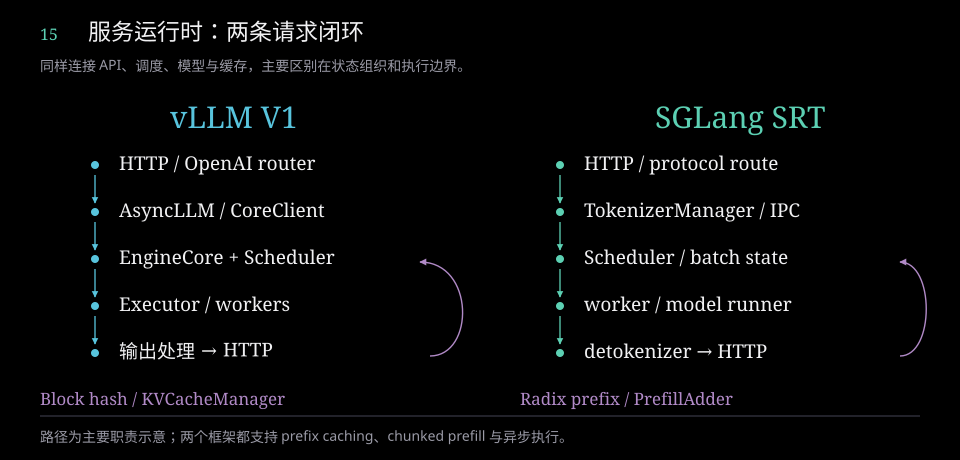

<!-- figure-explanation:11 -->

**读图：请求在哪一步变成执行批次**

两列都从 HTTP 向下到模型执行与输出。左列 vLLM 在 AsyncLLM、EngineCoreClient、EngineCore 和 Executor 间划分职责；右列 SGLang 通过 TokenizerManager、typed IPC、Scheduler 和 worker 组织请求。

**机制解析**

调度器把请求转化为本轮 token 或 batch 工作，并向 KV 管理器申请可用空间。模型结果回到调度状态后再形成 HTTP 输出；图中弯箭头表示结果推动下一轮调度，不表示 HTTP handler 直接运行模型。

vLLM 的 block hash 与 SGLang 的 radix prefix 都参与前缀复用，缓存组织不同并不意味着另一方缺少同类能力。

<!-- /figure-explanation -->


### 9.4 硬件适配

两者都按平台识别、设备能力、运行时后端和算子 dispatch 分层适配。

vLLM 使用 `Platform`、platform plugin、attention backend registry 和按平台组织的线性 kernel 候选。SGLang 使用 `SRTPlatform`、设备接口与运行时工厂，同时保留厂商专用 `hardware_backend`、fused-op 分派和平台条件分支。

平台能被识别只是适配起点。模型能否运行取决于 attention、MoE、量化、KV、graph capture、通信与构建依赖的组合；不同平台可能采用独立 runner。这里的多平台适配与单个平台上的 TP 多卡切分是两件事。

## 10. 预训练与后训练

本章整理官方报告披露的训练流程与数值，架构代码本身不包含完整训练工程。

### 10.1 V4 预训练

V4 报告披露预训练语料超过 32T token，覆盖数学、代码、网页、长文档及多语言数据。数据处理包括样本级质量筛选，编码体系包含约 128K 词表、特殊协议 token 与 FIM 等代码任务支持。长上下文结构与低比特执行共同服务于训练、推理效率。[V4 技术报告 §4](https://arxiv.org/html/2606.19348)

### 10.2 V4 后训练

V4 先对不同领域分别开展 SFT/RL，形成专长不同的 teacher，再通过多 teacher、全词表 reverse-KL on-policy distillation（OPD）整合能力。报告用 OPD 替代最终的 mixed-RL 整合阶段，并在后训练对专家权重及 Indexer Q/K 使用 FP4 quantization-aware training，使能力适应实际低比特执行。[V4 技术报告 §5](https://arxiv.org/html/2606.19348)

### 10.3 V4.1 数据与上下文扩展

V4.1 总训练量为 45T token，text-only 与 multimodal token 的混合比例为 7:1。64K 上下文从训练初期使用，在累计 34T token 时扩展至 1M；34T 是扩展节点，不是额外增加的训练量。

多模态预训练主要利用原生网页、PDF 等内容，并处理与文本语料的重叠。数据流程包括图文清洗、alt-text 与图像语义处理、去重和视觉质量筛选，补充 OCR、grounding、代码图像及计算机交互轨迹等领域数据。预训练的原生多模态来源与后训练的合成 Agent 任务需要按阶段理解。[V4.1 技术报告 §4.1](https://huggingface.co/deepseek-ai/DeepSeek-V4.1-Flash/blob/main/DeepSeek_V41_Tech_Report.pdf)

### 10.4 V4.1 优化器与 schedule

| 项目 | 报告配置 |
|---|---|
| 矩阵参数 | Muon；momentum 0.95，weight decay 0.1，RMS update 0.18 |
| norm / 非矩阵参数 | AdamW；β=(0.9,0.95)，epsilon `1e-20`，weight decay 0.1 |
| embedding / head | Sinkhorn-balanced 更新；11 次迭代，τ=`1e-3`，epsilon=`1e-20` |
| Engram 学习率 | 相应基准的 5 倍 |
| batch | 固定 100.6M token |
| warmup | 2000 step |
| warmup 后至 28T | 学习率 `2.6e-4` |
| 28T–40T | cosine 衰减至 `2.6e-5` |
| 40T–45T | 维持 `2.6e-5` |
| 34T 节点 | 上下文 64K → 1M |
| 专家负载平衡 | 选择偏置更新率 0.001；小权重序列平衡项 0.0001 |

视觉塔先独立进行 SigLIP 式对比预训练和 autoregressive fine-tuning，再与语言主干集成。报告中的“从头训练”不意味着视觉塔省略独立的前置训练阶段。[V4.1 技术报告 §4.2.2](https://huggingface.co/deepseek-ai/DeepSeek-V4.1-Flash/blob/main/DeepSeek_V41_Tech_Report.pdf)

**图 16：V4.1 训练阶段与上下文扩展**

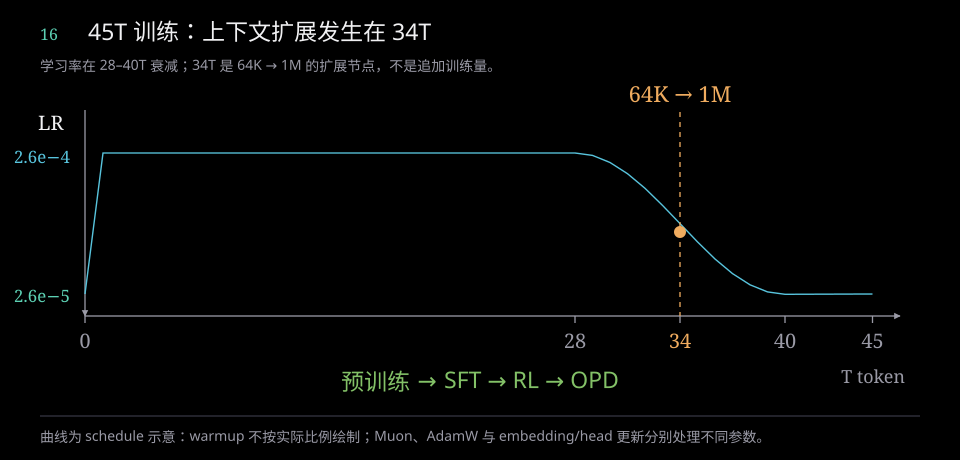

<!-- figure-explanation:12 -->

**读图：学习率曲线与上下文节点怎样对应**

横轴是累计训练 token，纵轴是学习率。蓝线在 warmup 后维持至 28T，在 28–40T 按 cosine 衰减，40–45T 保持低学习率；金色竖线穿过 34T，表示上下文长度在衰减阶段中扩展。

**机制解析**

34T 节点改变的是上下文从 64K 到 1M，不是把预训练总量再增加 34T。底部 SFT→RL→OPD 表示预训练结束后的能力对齐与整合阶段，阶段间箭头不是学习率曲线的一部分。

**28T–40T 的 cosine 衰减**

$$
\eta(T)=2.6\!\times\!10^{-5}+\frac{2.6\!\times\!10^{-4}-2.6\!\times\!10^{-5}}{2}\left[1+\cos\!\left(\pi\frac{T-28}{12}\right)\right]
$$

45T 是累计总量。warmup 的横向宽度被放大用于展示，不按真实 token 比例绘制。

<!-- /figure-explanation -->

### 10.5 V4.1 后训练与训练系统

后训练主流程为 SFT → RL → OPD。重点包括构造任务问题、可交互环境和结果验证器，通过过滤、去重、难度校准和课程组织提高任务质量，再逐步扩大采样计算和执行 scaffolds。

Effort 条件影响推理长度和 token penalty，让模型在同一能力体系下响应不同计算预算。有限训练档位与部署插值一起提供更细粒度的控制。

系统以 sample 为单位异步派发采样任务，减少整组 rollout 的等待。Rollout 与训练可共置、分时使用资源，训练会抢占 rollout；保留 KV 状态支持恢复，并通过跨 checkpoint 的 routing replay 等机制处理样本延续。系统还处理长度偏置、数据并发与 off-policy 约束，避免将吞吐优化与训练分布改变混为一谈。[V4.1 技术报告 §5.1–5.2](https://huggingface.co/deepseek-ai/DeepSeek-V4.1-Flash/blob/main/DeepSeek_V41_Tech_Report.pdf)


## 11. 完整前向算子：从输入到输出

本章按模型执行路径覆盖逻辑算子族、状态更新和关键参考内核。同一种加法、reshape 或 GEMM 在多个模块出现时，结合其输入输出说明；生产框架可以将多个步骤融合成一个设备 kernel。阅读时先看组件归属，再看数学计算与数据布局。

### 11.1 输入查表、布局与归一化

**Embedding/gather。** Token ID `[b,s]` 在 `[V,d]` 表中查行，输出 `[b,s,d]`。它是查表，不是对词表做矩阵 softmax。词表分片时，本卡区间外的行输出置零，各卡 all-reduce 求和得到完整 embedding。随后 `unsqueeze + repeat` 将状态复制为 `[b,s,4,d]`；复制的是内部状态，序列长度不变。

**RMSNorm。** 在最后一维上计算均方和倒平方根，不减去均值：

```text
r = 1 / sqrt(mean(x², last_dim) + ε)
y = γ × x × r
```

参考路径先转 FP32 做均方、rsqrt、缩放，再转回输入 dtype。γ 是逐维可学习权重；V4 的语言主干 ε=1e−6，V4.1 为 1e−20，视觉塔仍为 1e−6。V4 在主 Q 展开后另做一次逐头 512 维、没有 γ 的 RMS 标准化；V4.1 不做这一额外步骤。

**布局算子。** `view/reshape/unflatten` 把投影结果解释成头、组或四路维度，`transpose` 改变维度次序，`flatten/concat/split` 合并或拆分特征。布局变化本身不等于增加参数或完成新的特征变换；是否需要实际复制取决于存储连续性。`cast` 则会改变数值表示，应与纯布局变化区分。

### 11.2 mHC 的四组计算与最终收缩

对单个 token 的 X `[4,d]`，系数投影在整个 4d 上使用一个 RMS 统计量：

```text
z = W_hc vec(X) / sqrt(mean(vec(X)²) + ε_norm)     [24]
(z_p, z_q, z_B) = split(z, 4, 4, 16)
p = sigmoid(s_p z_p + b_p) + ε_hc                [4]
q = 2 × sigmoid(s_q z_q + b_q)                   [4]
B = Sinkhorn20(reshape(s_B z_B + b_B, 4, 4))      [4,4]
h = Σ_j p_j X_j                                 [d]
X'_i = q_i × 子层输出 + Σ_j B[j,i] X_j            [4,d]
```

仅 B 做 Sinkhorn；p/q 不要求总和为 1。B 先做稳定行 softmax 加 ε，再做一次列归一化，之后重复 19 次“行归一化 → 列归一化”。配置中的 20 轮和稳定项形成近似双随机混合，不保证浮点下严格的行列和 1。

V4 的 Attention/FFN 各立即使用自己生成的 p；V4.1 将 p 传给下一子层，初始 p=(1,0,0,0)。两者的 post=q 与 comb=B 都用于当前子层回写。最终输出前，V4 另做专用 `hc_head` 投影、sigmoid+ε 和收缩；V4.1 直接使用最后 FFN 返回的 p 收缩。Engram 的各路 RMS 统计量与这里对 4d 的联合统计量不同。

### 11.3 RoPE、YaRN 与 Hadamard

**RoPE。** 每对实数按位置相位旋转，主语言注意力只处理最后 64 维：

```text
φ = position × frequency_j
(a', b') = (a cosφ − b sinφ, a sinφ + b cosφ)
frequency_j = θ^(−2j / d_rope)
```

纯 SWA 使用 θ=10000 并禁用 YaRN；正 ratio 的层使用 θ=160000 与扩展设置。YaRN 在频率维上使用 ramp r_j 混合原频率和缩放频率：`ω'_j=ω_j(1−r_j)+(ω_j/f)r_j`，本配置 f=16。压缩槽 j 的位置锚点是 j×ratio，提交时间是块尾。注意力输出的尾部 64 维按当前 query 位置做逆旋转，再进入 O 投影。

**Hadamard。** V4 的 Indexer Q/K 使用同一个归一化变换 `x̃=H x / √128`。成对应用时在量化前保持内积，分散各维幅值；后续量化会引入误差。参考代码没有逐 token 生成随机符号矩阵。主注意力 Q/KV 不使用这一步，V4.1 Indexer 也不使用它。

### 11.4 Linear、量化、反量化与 GEMM

**线性计算。** 逻辑公式为 `Y=XWᵀ+b`；参考语言模型的 `linear()` 路径要求 b=None，视觉投影中部分层有 bias。按权重 dtype，语言 Linear 选择普通 `F.linear`、FP8×FP8 GEMM 或 FP8 激活×FP4 权重 GEMM。FP4 专家不意味着输入激活也为 FP4。

**量化。** 对每个分组 g，取幅值上界 a 与 scale s，再限制范围、转换到目标格式；反量化乘回 scale：

```text
a = max(abs(x_i), i∈g)
x_q = cast_Q(clip(x/s_g, −Qmax, Qmax))
x_hat = s_g × x_q
E8M0 scale: s_g = 2^ceil(log2(a/Qmax))
FP8 E4M3: Qmax=448；FP4 E2M1: Qmax=6
```

FP8 的 a 使用至少 1e−4 的下限，未启用 scale rounding 时直接取 a/448。FP4 E8M0 的 a 下限为 `6×2^−126`；V4.1 压缩 KV 使用 E4M3 scale，取 `cast_E4M3(max(a,6×2^−9)/6)`，不能套用 E8M0 的幂次公式。两个 FP4 数打包在一个字节内；scale 是另一组张量。

| 量化位置 | V4 Flash / Pro | V4.1 Flash |
|---|---|---|
| Linear 激活 | FP8，沿 K 每 128 个值一组 | FP8，每 32 个值一组 |
| FP8 Linear 权重 | 128×128 scale tile | 32×32 scale tile |
| FP4 路由专家权重 | 每行 K 方向 32 值一组，E8M0 scale | 同左 |
| 局部 KV | 非 RoPE 448 维按 64 分组 FP8；64 维尾部保留 BF16 | 完整 512 维按 32 分组 FP8，包含 RoPE 尾部 |
| 全局 KV | 非 RoPE 448 维按 64 分组 FP8 | 完整 512 维按 16 分组 FP4，E4M3 scale |
| Indexer Q/K | 128 维按 32 分组 FP4，E8M0；先 Hadamard | 128 维按 32 分组 FP4，E8M0；无 Hadamard |

`inplace=True` 的参考算子执行量化→反量化，再写回 BF16；它模拟低比特数值，不把 BF16 cache tensor 变成物理 FP4 数组。生产格式的容量见缓存章节。

**GEMM 的 scale 补偿。** 按量化块累积：`Y_mn=Σ_g Σ_(k∈g) A_q[m,k] B_q[n,k] s_A[m,g] s_B[n,g]`。参考内核用 FP32 累加并输出 BF16；FP4 权重子块在 kernel 内转换后参与计算。量化 block 不是 attention 历史压缩 block，也不是 allocator 的 KV 页。

### 11.5 Attention 内部的状态、选择与聚合

完整语言 Attention 路径为：低秩 Q 投影/归一化 → 展开主 Q → 位置处理 → 局部 KV 投影/归一化/写缓存 → 全局 KV 生成或复用 → Indexer 评分/selector 或全读下标 → sparse attention → 输出逆 RoPE → 分组低秩 O。

| 步骤 | 输入 → 输出 | 计算与状态 |
|---|---|---|
| Q 两级投影 | `[b,s,d] → [b,s,r_q] → [b,s,H,512]` | `wq_a → q_norm → wq_b`；V4 再做逐头无权 RMS |
| 局部 latent | `[b,s,d] → [b,s,512]` | `wkv → RMSNorm → RoPE → KV 量化`；decode 写 `t%128` |
| 压缩内容/gate | `[b,s,d] → 块内 value/score → [b,N,512]` | 对每维沿块内位置 softmax；池化、norm、RoPE、量化；未完成块留在 state |
| V4 索引 K | `[b,s,d] → [b,N,128]` | 独立 ratio4 重叠压缩器，位置处理/Hadamard/FP4 |
| V4.1 索引 K | `[b,N,512] → [b,N,128]` | KV 源层在主 latent 被 RoPE/量化改写之前执行 `wk → norm → RoPE → FP4` |
| Indexer/selector | 索引 Q/K → score `[b,s,N]` → ID 列表 | `Σ_h α_h ReLU(Q_h·K_j)`；因果 mask、top-k、offset；V4.1 选中后按位置排序 |
| V4.1 候选池 | position score → block score → bool mask | 每 8 位置 amax；最多 2048 块，最新有效块强制保留；repeat_interleave 展回位置 mask |
| Sparse attention | Q、KV、下标列表 → `[b,s,H,512]` | gather 选中 KV，缩放点积、统一 softmax、value 聚合、sink |
| Grouped O | `[b,s,H,512] → [b,s,G,r_o] → [b,s,d]` | 每组 wo_a 只处理自身头，concat 后 wo_b；三模型每组都是 8 个头 |

V4.1 的 Full 发布 KV/K 和索引，Reindex 用自己的 query/α 重评共享 K，Reuse 复用索引。候选 mask 限制选择范围；参考 dense einsum 仍计算全历史 score，不能据 mask 自动推导其计算量缩为常数。

**Sparse attention 的数学与内核。** 共享 latent 同时充当 K 和 V；局部与全局记录共同归一化：

```text
a_hj = dot(Q_h, KV_j) / √512
O_h = Σ_j exp(a_hj) KV_j / (exp(sink_h) + Σ_j exp(a_hj))
```

无效 ID=−1 对应零 value 与 −∞ logit。Sink 只增加分母，等价于一个 zero-value 槽。在线 softmax 在每批索引上维护运行最大值 m、分母 l、分子 r：

```text
m_new = max(m_old, max(a))
l_new = exp(m_old−m_new) l_old + Σ exp(a−m_new)
r_new = exp(m_old−m_new) r_old + Σ exp(a−m_new) KV
O = r / (l + exp(sink−m))
```

这样无需保存完整注意力矩阵。参考 kernel 按 64 个索引处理；本地头数不足 16 时封装会补头再裁剪，这是执行布局处理。位置列表的拼接和 gather 不改变此前的因果约束。

### 11.6 MoE 的路由、专家与残差衔接

MoE 位于 Attention 完成 O 投影和第一次 mHC 回写之后。更新后的四路状态再收缩并经 FFN RMSNorm，得到每 token 的 x `[d]`。普通主干用 6 个路由专家和 1 个共享专家，DSpark 草稿 stage 用 3 个路由专家和 1 个共享专家。

```text
score_e = sqrt(softplus((W_router x)_e))
选专家：TopK(score + selection_bias)，或 V4 前三层 tid2eid 查表
weight_e = route_scale × score_e / Σ_selected score
专家：W1/W3 → gate 上界 clamp、up 双侧 clamp → SiLU × up → W2
MoE(x) = shared_expert(x) + Σ_selected weight_e expert_e(x)
结果经本子层 post/comb 与 FFN 入口保存的四路状态混合
```

选择 bias 不进入最终权重；V4.1 按文本/图像选对应 bias，移除 hash 路由。`softplus(z)=log(1+exp(z))` 在实现中使用稳定计算；它与 Attention 的 softmax 是不同算子。SiLU 为 `z sigmoid(z)`；参考专家 gate 只截上界 10，up 截到 [−10,10]。路由权重在 down GEMM 前乘入中间激活，有限精度下不应承诺与任意重排后的计算逐位相等。

MegaMoE/FusedMoE 是这些逻辑步骤的生产执行后端，可改变打包、通信、融合方式；每 token 选择的专家数量并未因此变成全部专家。共有专家单算或融合的条件见第 8.6 节。

### 11.7 Engram：整数哈希、查表与门控

Engram 在 V4.1 第 1、14 层 Attention 之前写入四路状态，包含以下完整路径：

```text
token_map 查表 → 历史 cache 写入/gather → pad/DEAD 边界
→ 层专属乘数 × 压缩 token ID → 逐项 XOR → prime 取模 + bucket offset
→ 2/3/4-gram 各8头：[b,s,2,24] hash ID
→ 当前层24行 FP8 lookup + scale lookup → 分组反量化
→ [b,s,24,256] flatten为6144 → Linear 6144→25600
→ key [b,s,4,5120]、共享value [b,s,5120]
→ 各路归一化点积 → signed sqrt → sigmoid → mask → 广播残差加法
```

层 ℓ、长度 n、hash head h 的索引为 `j=(XOR_i(a_(ℓ,i)×c_(t−i))) mod p_(ℓ,n,h)+offset_(ℓ,n,h)`。乘数固定且分层；不足历史使用 pad，遇到图像 DEAD 后停止向过去延伸。查表行按设备分片，越界输出置零、all-reduce 合并。每 32 个 FP8 值乘对应 scale，转 BF16，不是把整个大表先反量化。

对每个副本 i 独立计算，令 learned 逐维权重 w=q_weight×k_weight：

```text
a_i = Σ_c X_i,c w_i,c K_i,c
      / (√d × √(mean(X_i²)+ε) × √(mean(K_i²)+ε))
g_i = sigmoid(copysign(sqrt(max(abs(a_i),1e−6)),a_i))
X'_i = X_i + g_i V
```

四路的 key/gate 各自不同，value 共享；图像位置的 gate=0。这个算子没有第五路状态，也没有对 24 行记忆另做注意力 softmax。Token 字符串归一化、素数与 bucket 布局在初始化阶段构建，前向执行使用已经构建的 map/整数张量。

### 11.8 视觉预处理、ViT 与 aligner

视觉输入先转 RGB、按预算确定分辨率、resize/边缘补齐、归一化像素到 [−1,1]，再切成 `[N,3,14,14]` patches。每 patch 的 588 个值经带 bias 的 Linear 变为 1024 维。32 层 ViT 使用单路残差，不使用语言主干的 mHC：

```text
x1 = x + VisionAttention(RMSNorm1(x))
x2 = x1 + VisionMLP(RMSNorm2(x1))
最后再做 Vision RMSNorm
```

VisionAttention 一次投影 QKV `1024→3072`，拆成 16 个 64 维头；Q/K 在全部 64 维上应用由 patch 行列生成的 2D RoPE，V 不旋转。随后执行整幅图像的双向 SDPA：`softmax(QKᵀ/√64)V → O Linear`。它没有语言因果 mask、SWA、全局压缩器和 learned Indexer。

视觉 MLP 使用无 bias 的 `1024→2×2816`，拆 gate/up 后执行 SwiGLU，再无 bias 地映射 `2816→1024`；没有语言专家路径的 clamp。Patch、QKV 和 O 投影带 bias，所有视觉 RMSNorm ε=1e−6。

Aligner 先将视觉序列恢复为二维网格，右/下补零至 3 的倍数，`unfold(kernel=3,stride=3)` 拼接每个 3×3 区域为 9216 维，再执行：

```text
9216 → Linear+bias → 5120 → GELU → Linear+bias → 5120
```

GELU 默认使用精确 erf 形式 `0.5z(1+erf(z/√2))`，不同于 ViT MLP 的 SiLU。Unfold 是九个位置的特征拼接，不是平均池化。语言序列中 IMAGE 特征由这些结果替换；start/end/newline 向量和行末位置另计。融合后和文本一起进入四路主干。

### 11.9 MTP、DSpark 与 Markov/confidence heads

**V4 MTP。** 共享主 embedding 与词表矩阵，拥有自己的输入投影、norm、完整 Block 和输出收缩：`Z_i=W_e RMSNorm_e(embedding(token))+W_h RMSNorm_h(X_i)`。第一项广播到四路；经过 MTP 自己的 Attention、MoE、mHC，再做专用 HC-head、norm、共享词表 Head。普通生成不会在主 Head 后串行运行它。

**V4.1 DSpark。** 层 37/38/39 在执行该 Block 前捕获四路状态，各自 mean 得 5120 维、concat 成 15360，再 `main_proj→main_norm` 得 main_x。草稿输入为 anchor+4个 noise，查共享 embedding 并展开四路，依次运行三个完整 stage。

DSpark Attention 在历史 128 槽窗口外加入完整的五位置草稿块；草稿块内部非因果、各位置都可读整块，没有 learned Indexer。main_x 生成并更新历史窗口 KV，草稿本身生成 Q/KV，之后仍有 sparse attention、逆 RoPE、分组 O、mHC 与 MoE。首次 prefill 只预热窗口 cache。

最后 stage 收缩后得到五位置基础 logits。Markov 用独立 rank256 embedding/head 加入前一已确定 token 的词表 bias，再逐位置采样：

```text
e_i = E_M[y_i]                                [256]
b_i = W_M e_i                                [129280]
logits_i += b_i
y_(i+1) = Sample(logits_i)
confidence_i = Linear_FP32(concat(h_i,e_i))   [1]
```

h_i 是收缩后的、尚未最终 RMSNorm 的 5120 维 hidden，confidence 输入为 5376 维。参考 confidence head 没有 sigmoid，返回原始分数，不是直接的 0–1 接受概率。草稿 hidden 可并行计算，Markov 采样仍按顺序进行。返回 IDs `[b,6]`、logits `[b,5,129280]`、confidence `[b,5]`。

这些源码提供辅助前向；完整推测解码的主模型校验、接受/拒绝、回滚和补采样由 serving 组织，普通参考生成脚本没有接入该循环。

### 11.10 词表输出、采样与生成控制

最终四路收缩、RMSNorm 后，词表矩阵 `[V,d]` 产生 logits。普通输出为最后位置 `[b,V]`，辅助全位置调用得到 `[b,k,V]`；词表分片时 all-gather 后按词表维 concat。

V4.1 温度 T=0 选 argmax；T>0 时参考采样为：

```text
p = softmax(logits / max(T,1e−5))
e_v ~ Exp(1)
next_id = argmax_v(p_v / e_v)
```

这是类别分布的 exponential-race 采样。V4 生成循环在温度不大于 0 时使用 argmax，正温度走相同类型采样。参考路径没有额外的词表 top-p/top-k 筛选；Attention 历史 top-k 和 MoE 专家 top-k 也不属于输出采样。

生成控制还包括 prompt mask 的 where 覆盖、token 写入、EOS 比较、finished mask 的逻辑或以及 all() 停止。终止条件负责控制循环，不是模型 Block 内的神经网络层。

### 11.11 并行通信与服务执行算子

| 操作 | 参考前向里的用途 |
|---|---|
| all-reduce / sum | 分片 embedding、Engram 查表、RowParallelLinear 部分和、Indexer 头贡献、分卡专家结果 |
| all-gather + concat | 将分片词表 logits 恢复成完整词表 |
| mask/where/gather/scatter | 越界查表置零、因果位置过滤、top-k 对应 ID、token 到专家的 dispatch 与输出归位 |
| cache copy / ring write | 窗口尾段保存、decode `t%128` 写入、compressor value/score state、完成块提交 |
| publish/reuse | V4.1 KV/K、候选 mask、位置列表沿层传递 |
| page allocate / slot mapping | 生产框架将逻辑位置映射到物理 KV 页，维护引用与前缀复用 |
| draft/verify 与 rollback | 生产推测解码组织草稿、校验批次、接受/拒绝后的状态维护 |

RowParallelLinear 在 FP32 做输出 all-reduce；参考 MoE 用 FP32 累加本卡专家后归约。Indexer 的 score 则按原张量 dtype 归约，源码没有统一先转 FP32。参考模型没有显式 all-to-all；生产专家并行的 dispatch/combine 与 MegaMoE 内部通信属于另一执行层。

训练相关算子在第 10 章按官方披露说明；本文的完整前向覆盖包含输入/布局、投影、归一化、位置、残差、状态、选择、注意力、专家、量化、视觉、记忆、辅助预测与输出控制。GPU 内核的 tile、线程和厂商私有调度不各自当作新的模型算子。

### 11.12 各算子的源码入口

| 算子族 | 本地源码入口 |
|---|---|
| V4 Linear / RMSNorm / RoPE / Hadamard | [flash_model.py](https://huggingface.co/deepseek-ai/DeepSeek-V4-Flash/blob/60d8d70770c6776ff598c94bb586a859a38244f1/inference/model.py#L108) |
| V4 Compressor / Indexer / Attention | [flash_model.py](https://huggingface.co/deepseek-ai/DeepSeek-V4-Flash/blob/60d8d70770c6776ff598c94bb586a859a38244f1/inference/model.py#L279) |
| V4 Gate / Expert / MoE / mHC / Head / MTP | [flash_model.py](https://huggingface.co/deepseek-ai/DeepSeek-V4-Flash/blob/60d8d70770c6776ff598c94bb586a859a38244f1/inference/model.py#L546) |
| V4 quant / GEMM / sparse attention / Sinkhorn kernels | [flash_kernel.py](https://huggingface.co/deepseek-ai/DeepSeek-V4-Flash/blob/60d8d70770c6776ff598c94bb586a859a38244f1/inference/kernel.py#L105) |
| V4.1 Linear / Engram / positions / Attention | [inference_model.py](https://huggingface.co/deepseek-ai/DeepSeek-V4.1-Flash/blob/2cba9e42aa026125f3ed06c6d98c1db82f7ca027/inference/model.py#L181) |
| V4.1 Indexer 与两级 selector | [inference_model.py](https://huggingface.co/deepseek-ai/DeepSeek-V4.1-Flash/blob/2cba9e42aa026125f3ed06c6d98c1db82f7ca027/inference/model.py#L485) |
| V4.1 Gate / Expert / mHC / DSpark / heads / sample | [inference_model.py](https://huggingface.co/deepseek-ai/DeepSeek-V4.1-Flash/blob/2cba9e42aa026125f3ed06c6d98c1db82f7ca027/inference/model.py#L788) |
| V4.1 核心 quant / GEMM / sparse attention / Sinkhorn kernels | [inference_kernel.py](https://huggingface.co/deepseek-ai/DeepSeek-V4.1-Flash/blob/2cba9e42aa026125f3ed06c6d98c1db82f7ca027/inference/kernel.py#L98) |
| Engram token map / prime / hash / history | [inference_engram.py](https://huggingface.co/deepseek-ai/DeepSeek-V4.1-Flash/blob/2cba9e42aa026125f3ed06c6d98c1db82f7ca027/inference/engram.py#L17) |
| Patch / 2D RoPE / ViT / Aligner | [inference_vision.py](https://huggingface.co/deepseek-ai/DeepSeek-V4.1-Flash/blob/2cba9e42aa026125f3ed06c6d98c1db82f7ca027/inference/vision.py#L9) |
| Image resize / pad / normalize / patches / token types | [inference_image_processor.py](https://huggingface.co/deepseek-ai/DeepSeek-V4.1-Flash/blob/2cba9e42aa026125f3ed06c6d98c1db82f7ca027/inference/image_processor.py#L101) |
| 普通生成与 prompt/EOS 控制 | [inference_generate.py](https://huggingface.co/deepseek-ai/DeepSeek-V4.1-Flash/blob/2cba9e42aa026125f3ed06c6d98c1db82f7ca027/inference/generate.py#L54)、[flash_generate.py](https://huggingface.co/deepseek-ai/DeepSeek-V4-Flash/blob/60d8d70770c6776ff598c94bb586a859a38244f1/inference/generate.py#L19) |


<!-- vllm-v4-manual-start -->

<a id="vllm-v4-operators"></a>

### 11.13 vLLM 实际算子与后端调用

依据本地 vLLM **c91dccc08044b1269f351ceec13070fe8f075e10**，以 NVIDIA 文本主干为主，附可选路径与其他平台概览。相关源码在本次阅读时无本地修改。这里总结的是从forward追到的实际调用入口及其可达分支；没有运行GPU profiler，具体部署的一次执行子集仍由硬件、配置、shape与安装扩展决定。

#### 11.13.1 先把算子放回模型

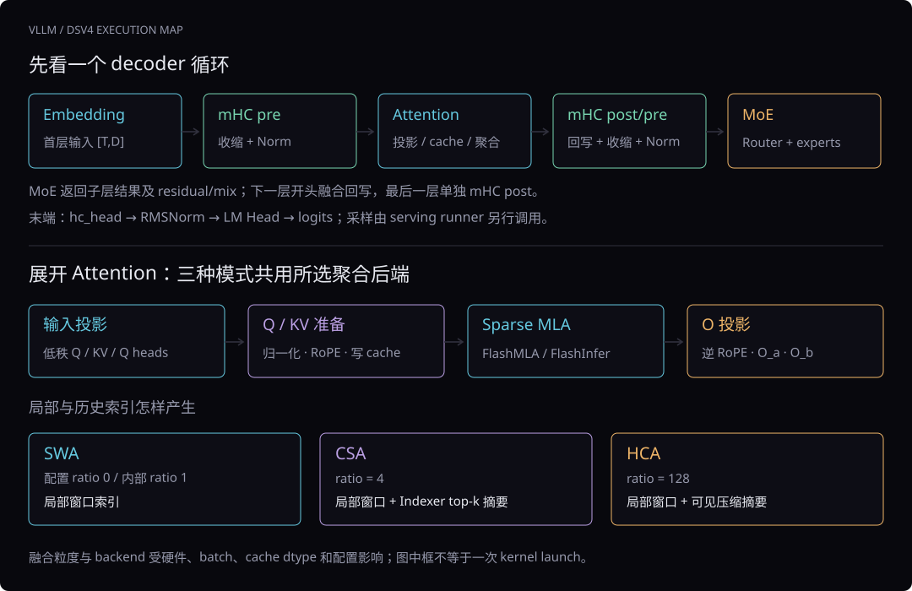

**读图。** 首层先把embedding作为重复C路残差的来源；mHC pre收缩并融合子层输入Norm。Attention输出经post/pre进入MoE；MoE结果携带residual/mix返回，交给下一层开头回写。最后一层独立post，然后hc_head收束、最终Norm，compute_logits再投词表。图中每个框可能包含多个kernel，也可能与相邻步骤部分融合。

记号：T是该调用实际token行数（可含padding，SP下可能是本rank shard）；D为hidden，C=hc_mult，I为expert intermediate，E为专家数，K_e为每token激活专家数，K_i为Indexer选择的历史压缩数。主Q/KV head_dim=512、RoPE尾部64；Flash/Pro使用同一实现，具体层数和宽度从config读取。

| 架构模式 | 本实现的ratio | 实际增加的工作 | 聚合入口 |
|---|---|---|---|
| SWA | 配置0映射到内部1 | 局部因果窗口索引 | 所选sparse MLA后端 |
| CSA / C4A | 4 | 主KV压缩、Indexer K压缩、Q评分、历史top-k | 同一后端，增加压缩候选 |
| HCA / C128A | 128 | 粗粒度KV压缩、枚举全部可见摘要 | 同一后端，增加粗摘要候选 |

CSA的Indexer是Attention内部步骤；MoE Router选择专家；Sampler选择词表token。这三个top-k处理不同对象。[源码](https://github.com/vllm-project/vllm/blob/c91dccc08044b1269f351ceec13070fe8f075e10/vllm/models/deepseek_v4/attention.py#L733)

#### 11.13.2 按模块检索实际入口

每行按一个入口或功能组整理，复合函数可以启动多个kernel。搜索与模块按钮会筛选本节的主干、条件分支及可选路径表；它们不是“同一次前向全部运行”的launch数量。

<!-- ops-toolbar -->

##### [通用] Embedding、动态量化与普通 Linear

普通 Linear 经 quant_method.apply 进入所选实现。以下是主流 block-FP8 可达路径；ignored / unquantized 层走普通矩阵乘法。候选后端按硬件、shape、配置及可用扩展选择。

| 算子组 | 实际入口 | 数据与计算作用 | 启用条件 | 定位 |
|---|---|---|---|---|
| 词表查表 | `VocabParallelEmbedding.forward` / `F.embedding` / `ops.vocab_parallel_embedding` | token IDs → [T,D]；TP 时 mask 或融合查表，再归约各 shard。 | 首个 PP rank；inputs_embeds 已给定时可跳过查表。 | [源码](https://github.com/vllm-project/vllm/blob/c91dccc08044b1269f351ceec13070fe8f075e10/vllm/model_executor/layers/vocab_parallel_embedding.py#L518) |
| 动态 FP8 量化 | `QuantFP8` / `per_token_group_quant_fp8` / `per_token_group_quant_fp8_packed_for_deepgemm` | 激活 → FP8 data + scale；普通 block128 Linear 常按 K 每128值分组。 | 由所选 GEMM 决定是否外置量化，以及 scale packing。 | [源码](https://github.com/vllm-project/vllm/blob/c91dccc08044b1269f351ceec13070fe8f075e10/vllm/model_executor/layers/quantization/input_quant_fp8.py#L83) |
| DeepGEMM Linear | `fp8_gemm_nt_op` / `fp8_gemm_nt` | FP8 A[T,K] × FP8 W[N,K]，补 scale，输出 BF16 [T,N]。 | DeepGemmFp8BlockScaledMMKernel 获选；支持 dtype、shape 与设备。 | [源码](https://github.com/vllm-project/vllm/blob/c91dccc08044b1269f351ceec13070fe8f075e10/vllm/model_executor/kernels/linear/scaled_mm/deep_gemm.py#L112) |
| 动态 FI / DG Linear | `dynamic_flashinfer_deepgemm_blockscale_gemm` | 小 T 使用 FlashInfer 内部量化；大 T 外置量化后调用 DeepGEMM。 | 该动态类获选且双方支持；通常 T<32 选 FI，batch-invariant 强制 DG。 | [源码](https://github.com/vllm-project/vllm/blob/c91dccc08044b1269f351ceec13070fe8f075e10/vllm/model_executor/kernels/linear/scaled_mm/flashinfer.py#L229) |
| CUTLASS Linear | `CutlassFp8BlockScaledMMKernel` / `ops.cutlass_scaled_mm` | 动态 FP8 量化后做 block-scaled GEMM。 | selector 选中该 block-FP8 实现。 | [源码](https://github.com/vllm-project/vllm/blob/c91dccc08044b1269f351ceec13070fe8f075e10/vllm/model_executor/kernels/linear/scaled_mm/cutlass.py#L276) |
| Triton Linear | `TritonFp8BlockScaledMMKernel` / `w8a8_triton_block_scaled_mm_func` | FP8 block-scaled GEMM，输出恢复为调用层 shape。 | selector 选中 Triton fallback。 | [源码](https://github.com/vllm-project/vllm/blob/c91dccc08044b1269f351ceec13070fe8f075e10/vllm/model_executor/kernels/linear/scaled_mm/triton.py#L159) |

实际选择器是 [源码](https://github.com/vllm-project/vllm/blob/c91dccc08044b1269f351ceec13070fe8f075e10/vllm/model_executor/kernels/linear/__init__.py#L701)。CUDA 注册表还含 B12x、Marlin、Humming、Torch 等按资格选择的 fallback；注册存在本身不能证明某次前向执行了它。

##### [mHC] 四路残差、系数生成与融合

记 C=hc_mult，X 为 [T,C,D]；系数投影输出 C(C+2) 个值，拆成 pre、post 与 C×C residual mix。NVIDIA decoder 直接使用下面的 TileLang 封装。

| 算子组 | 实际入口 | 数据与计算作用 | 启用条件 | 定位 |
|---|---|---|---|---|
| 首层广播 pre | `mhc_pre_broadcast_tilelang` | [T,D] → 保存 C 路 residual，并生成已 RMSNorm 的 [T,D] 子层输入。 | 首个 PP rank 首次 2D 输入；预合并广播投影权重。 | [源码](https://github.com/vllm-project/vllm/blob/c91dccc08044b1269f351ceec13070fe8f075e10/vllm/model_executor/kernels/mhc/tilelang.py#L698) |
| prenorm 投影 | `tf32_hc_prenorm_gemm` / `_HC_PRENORM_GEMM_TILELANG_KERNEL` | 计算 v·Fᵀ 和平方和；用于归一化系数投影。 | 普通 pre：DG 可用用 TF32 helper，否则 TileLang；广播 pre 强制 DG helper。 | [源码](https://github.com/vllm-project/vllm/blob/c91dccc08044b1269f351ceec13070fe8f075e10/vllm/model_executor/kernels/mhc/tilelang.py#L22) |
| gate / Sinkhorn / 收缩 | `_MHC_PRE_BIG_FUSE_TILELANG_KERNEL` | inverse RMS → sigmoid pre/post gates → Sinkhorn → C路加权收缩 → layer-input RMSNorm。 | pre 及 post/pre 后续步骤；decoder 传入 Norm 权重以融合归一化。 | [源码](https://github.com/vllm-project/vllm/blob/c91dccc08044b1269f351ceec13070fe8f075e10/vllm/model_executor/kernels/mhc/tilelang.py#L542) |
| post/pre 复合调用 | `mhc_fused_post_pre_tilelang` / `_MHC_FUSED_TILELANG_KERNEL` | 旧子层输出回写 residual，并准备下一子层的 pre；之后仍运行 big_fuse。 | 本 rank T≤32 且 D%128=0 用融合前段；否则拆成 post + prenorm GEMM。 | [源码](https://github.com/vllm-project/vllm/blob/c91dccc08044b1269f351ceec13070fe8f075e10/vllm/model_executor/kernels/mhc/tilelang.py#L814) |
| 独立 post | `mhc_post_tilelang` / `_MHC_POST_TILELANG_KERNEL` | X_new[j] = post[j]·u + Σ_i mix[i,j]·X_old[i]，输出 [T,C,D]。 | 最后一个本地 decoder；aux hidden 重建；post/pre 的拆分分支。 | [源码](https://github.com/vllm-project/vllm/blob/c91dccc08044b1269f351ceec13070fe8f075e10/vllm/model_executor/kernels/mhc/tilelang.py#L791) |

mHC 中 residual 为 BF16，系数/关键统计为 FP32，prenorm 可用 TF32 GEMM。FFN 的 post 留给下一层开头；本地循环末尾才独立重建。[源码](https://github.com/vllm-project/vllm/blob/c91dccc08044b1269f351ceec13070fe8f075e10/vllm/models/deepseek_v4/nvidia/model.py#L1320)

##### [Attention] 投影、Q/KV 准备、索引与稀疏聚合

主 latent/head_dim=512，尾部64维为 RoPE。低秩 Q/KV 的 learned RMSNorm 与投影后逐 query head 的无权 RMSNorm 是两次不同计算。

| 算子组 | 实际入口 | 数据与计算作用 | 启用条件 | 定位 |
|---|---|---|---|---|
| 主输入投影 | `fused_wqa_wkv` / `wq_b` | [T,D] → q_low + KV；q_low 再投影成 [T,Nq,512]。 | 每个 attention；底层由 Linear 量化方法决定。 | [源码](https://github.com/vllm-project/vllm/blob/c91dccc08044b1269f351ceec13070fe8f075e10/vllm/models/deepseek_v4/attention.py#L471) |
| 低秩 Q/KV Norm | `fused_q_kv_rmsnorm` / `FusedQKVRMSNormKernel` | 两路各自做 learned RMSNorm，保持各自 shape。 | 主 fused projection 拆分之后。 | [源码](https://github.com/vllm-project/vllm/blob/c91dccc08044b1269f351ceec13070fe8f075e10/vllm/models/deepseek_v4/attention.py#L519) |
| packed Q/KV 准备 | `fused_deepseek_v4_qnorm_rope_kv_rope_quant_insert` | Q逐头无权Norm + RoPE；KV RoPE + 448维G64 FP8 / 64维BF16尾部，写 SWA cache。 | packed uint8 fp8_ds_mla cache；含 query head padding。 | [源码](https://github.com/vllm-project/vllm/blob/c91dccc08044b1269f351ceec13070fe8f075e10/vllm/models/deepseek_v4/attention.py#L793) |
| 完整 BF16 cache 准备 | `fused_deepseek_v4_qnorm_rope_kv_rope_full_cache_bf16_insert` | Q norm/RoPE，KV 以完整512维 BF16写cache。 | plain BF16 cache 分支。 | [源码](https://github.com/vllm-project/vllm/blob/c91dccc08044b1269f351ceec13070fe8f075e10/vllm/models/deepseek_v4/attention.py#L819) |
| 完整 FP8 cache 准备 | `fused_deepseek_v4_qnorm_rope_kv_rope_full_cache_fp8_insert` | Q/KV 按 per-tensor scale 输出 FP8；完整512维cache。 | plain per-tensor FP8 分支，区别于 packed 混合格式。 | [源码](https://github.com/vllm-project/vllm/blob/c91dccc08044b1269f351ceec13070fe8f075e10/vllm/models/deepseek_v4/attention.py#L832) |
| SWA 可见地址 | `_compute_swa_indices_and_lens_kernel` | 逻辑因果窗口 → 分页物理 slots 与有效长度；无效位置 -1。 | 各层 SWA metadata；图片跨度和 DSpark 有专用可见规则。 | [源码](https://github.com/vllm-project/vllm/blob/c91dccc08044b1269f351ceec13070fe8f075e10/vllm/v1/attention/backends/mla/sparse_swa.py#L1008) |
| HCA 压缩地址 | `build_c128a_topk_metadata` / `BuildC128ATopkMetadataKernel` | 枚举 floor((position+1)/128) 个可见压缩项。 | ratio=128；名称含 topk，但不运行 learned score top-k。 | [源码](https://github.com/vllm-project/vllm/blob/c91dccc08044b1269f351ceec13070fe8f075e10/vllm/models/deepseek_v4/sparse_mla.py#L229) |
| 压缩逻辑ID转地址 | `compute_global_topk_indices_and_lens` | 压缩记录 ID → compressed cache 物理slot，并统计有效长度。 | CSA decode 等地址转换；不重新按score排序。 | [源码](https://github.com/vllm-project/vllm/blob/c91dccc08044b1269f351ceec13070fe8f075e10/vllm/models/deepseek_v4/common/ops/cache_utils.py#L591) |
| prefill KV gather | `dequantize_and_gather_k_cache` / `DequantGatherKCacheKernel` | 分页 packed KV → BF16连续workspace，补回对应scale。 | FlashMLA prefill；CuTe DSL可用则CuTe，否则Triton。 | [源码](https://github.com/vllm-project/vllm/blob/c91dccc08044b1269f351ceec13070fe8f075e10/vllm/models/deepseek_v4/nvidia/flashmla.py#L326) |
| prefill 候选合并 | `combine_topk_swa_indices` / `CombineTopkSwaIndicesKernel` | 压缩局部ID + SWA位置 → gathered workspace中的 combined indices。 | FlashMLA prefill；两类候选随后共用一次softmax。 | [源码](https://github.com/vllm-project/vllm/blob/c91dccc08044b1269f351ceec13070fe8f075e10/vllm/models/deepseek_v4/nvidia/flashmla.py#L356) |
| FI 混合索引 | `build_flashinfer_mixed_sparse_indices` | SWA与compressed候选组成混合storage-offset索引，并处理页stride。 | FlashInfer SM100类；SM120保留两组indices。 | [源码](https://github.com/vllm-project/vllm/blob/c91dccc08044b1269f351ceec13070fe8f075e10/vllm/models/deepseek_v4/common/ops/cache_utils.py#L1286) |
| FlashMLA decode | `flash_mla_with_kvcache` | Q读取paged SWA + optional compressed cache，含sink，输出attention向量。 | FlashMLA获选，decode部分。 | [源码](https://github.com/vllm-project/vllm/blob/c91dccc08044b1269f351ceec13070fe8f075e10/vllm/models/deepseek_v4/nvidia/flashmla.py#L248) |
| FlashMLA prefill | `flash_mla_sparse_fwd` | BF16 gathered KV + combined indices → sparse attention输出。 | FlashMLA获选，prefill部分，按至多4请求分chunk。 | [源码](https://github.com/vllm-project/vllm/blob/c91dccc08044b1269f351ceec13070fe8f075e10/vllm/models/deepseek_v4/nvidia/flashmla.py#L390) |
| FlashInfer sparse MLA | `trtllm_batch_decode_sparse_mla_dsv4` | 读SWAcache与compressed cache、索引、sink，计算稀疏聚合。 | FI SM100或SM120；prefill/decode都调用该API，布局与参数分支不同。 | [源码](https://github.com/vllm-project/vllm/blob/c91dccc08044b1269f351ceec13070fe8f075e10/vllm/models/deepseek_v4/nvidia/flashinfer_sparse.py#L492) |
| 逆RoPE / 输出量化 | `fused_inv_rope_fp8_quant` / `FusedInvRopeFP8QuantKernel` | attention输出尾部逆旋转，按O分组重排；FP8 wo_a时同时量化。 | 普通O路径；FI SM100的RopeQuant epilogue满足条件时已在attention内完成。 | [源码](https://github.com/vllm-project/vllm/blob/c91dccc08044b1269f351ceec13070fe8f075e10/vllm/models/deepseek_v4/nvidia/ops/o_proj.py#L61) |
| 分组 O_a | `fp8_einsum` / `torch.bmm` | 每组attention向量 → BF16低秩 z[T,G,r_o]。 | FP8 wo_a用DG fp8_einsum；非FP8 wo_a用bmm。 | [源码](https://github.com/vllm-project/vllm/blob/c91dccc08044b1269f351ceec13070fe8f075e10/vllm/models/deepseek_v4/nvidia/ops/o_proj.py#L89) |
| O_b 输出投影 | `wo_b` / `RowParallelLinear` | flatten z后投影回[T,D]，按TP/SP配置归约。 | 每个attention的最后一步。 | [源码](https://github.com/vllm-project/vllm/blob/c91dccc08044b1269f351ceec13070fe8f075e10/vllm/models/deepseek_v4/nvidia/ops/o_proj.py#L106) |

稀疏聚合的数学主体为 score=Q·KV/√512，SWA与压缩候选一起归一化；learned sink增加softmax分母。SWA/CSA/HCA改变候选生成，不是把三次独立attention输出相加。[源码](https://github.com/vllm-project/vllm/blob/c91dccc08044b1269f351ceec13070fe8f075e10/vllm/models/deepseek_v4/nvidia/flashmla.py#L174)

##### [Compressor] 历史状态与压缩 KV

只有 ratio>1 的层运行主 Compressor；CSA 同时为 Indexer 运行128维K Compressor。C4压缩使用相邻两块、共8个token；C128使用128个token。

| 算子组 | 实际入口 | 数据与计算作用 | 启用条件 | 定位 |
|---|---|---|---|---|
| 压缩输入投影 | `fused_wkv_wgate` / `torch.mm(out_dtype=torch.float32)` | hidden → FP32 KV与逐坐标score。 | 主Compressor或Indexer Compressor启用；projection可放aux stream。 | [源码](https://github.com/vllm-project/vllm/blob/c91dccc08044b1269f351ceec13070fe8f075e10/vllm/models/deepseek_v4/attention.py#L672) |
| 保存部分状态 | `_SAVE_PARTIAL_STATES_KERNEL` / `SavePartialStatesKernel` | KV与score+APE写分页FP32 state；未到压缩边界也要保存。 | Compressor每轮有效输入。 | [源码](https://github.com/vllm-project/vllm/blob/c91dccc08044b1269f351ceec13070fe8f075e10/vllm/models/deepseek_v4/compressor.py#L354) |
| C4主KV融合压缩 | `SparseAttnCompressNormRopeStoreC4Kernel` / `SparseAttnCompressNormRopeStoreFullC4Kernel` | 逐latent坐标softmax压缩 → RMSNorm → RoPE → cache。 | 主head512、ratio4；按packed/full cache二选一；每4token完成一项。 | [源码](https://github.com/vllm-project/vllm/blob/c91dccc08044b1269f351ceec13070fe8f075e10/vllm/models/deepseek_v4/nvidia/ops/sparse_attn_compress_cutedsl.py#L2398) |
| C128压缩第一阶段 | `SparseAttnCompressC128Block8Kernel` | 从分页历史读取128token，逐坐标压缩到FP32 temporary。 | 主head512、ratio128；到边界才输出压缩项。 | [源码](https://github.com/vllm-project/vllm/blob/c91dccc08044b1269f351ceec13070fe8f075e10/vllm/models/deepseek_v4/nvidia/ops/sparse_attn_compress_cutedsl.py#L2436) |
| C128第二阶段 | `SparseAttnNormRopeStoreKernel` / `SparseAttnNormRopeStoreFullKernel` | temporary → Norm / RoPE / packed或full cache。 | C128第一阶段后；非FULL graph且无边界时可提前跳过。 | [源码](https://github.com/vllm-project/vllm/blob/c91dccc08044b1269f351ceec13070fe8f075e10/vllm/models/deepseek_v4/nvidia/ops/sparse_attn_compress_cutedsl.py#L2461) |
| Indexer K压缩 | `compress_norm_rope_store_triton` / `FusedKVCompressNormRopeInsertIndexerTritonKernel` | 128维Indexer K做C4压缩、Norm、RoPE、FP8或MXFP4量化写cache。 | CSA Indexer；默认FP8，显式mxfp4配置走FP4device分支。 | [源码](https://github.com/vllm-project/vllm/blob/c91dccc08044b1269f351ceec13070fe8f075e10/vllm/models/deepseek_v4/compressor.py#L470) |

压缩门控可写为：k̄[d]=Σ_j softmax_j(score[j,d]+APE[j,d])·KV[j,d]，随后Norm与块起点RoPE。每个坐标有自己的权重，不能简化成每token只有一个门控标量。[源码](https://github.com/vllm-project/vllm/blob/c91dccc08044b1269f351ceec13070fe8f075e10/vllm/models/deepseek_v4/common/ops/fused_compress_quant_cache.py#L711)

##### [Indexer] CSA 的评分与历史 top-k

仅 ratio=4 创建 learned Indexer。它位于 Attention 内，输出压缩位置；MoE Router 另外选择专家，词表采样则选择 token。

| 算子组 | 实际入口 | 数据与计算作用 | 启用条件 | 定位 |
|---|---|---|---|---|
| Q与head权重投影 | `indexer.wq_b` / `indexer.weights_proj` | q_low→Q[T,Ni,128]；hidden→各Indexer head评分权重。 | CSA；短上下文shortcut可能跳过Q投影。 | [源码](https://github.com/vllm-project/vllm/blob/c91dccc08044b1269f351ceec13070fe8f075e10/vllm/models/deepseek_v4/attention.py#L1109) |
| Indexer Q融合准备 | `fused_indexer_q_rope_quant` / `IndexerQFp8Kernel` / `IndexerQMxFp4Kernel` | Q尾部RoPE + BF16舍入 + FP8或G32 MXFP4；输出缩放后的head权重。 | CuTe DSL可用选CuTe，否则对应Triton；FP4要求SM100 family与显式配置。 | [源码](https://github.com/vllm-project/vllm/blob/c91dccc08044b1269f351ceec13070fe8f075e10/vllm/models/deepseek_v4/common/ops/fused_indexer_q.py#L547) |
| 短上下文直接全选 | `_fill_short_context_topk_indices` | 填所有已完成压缩位置，其余-1，跳过Q评分与top-k。 | 最大压缩长度≤index_topk，且不在CUDA stream capture中；K Compressor仍执行。 | [源码](https://github.com/vllm-project/vllm/blob/c91dccc08044b1269f351ceec13070fe8f075e10/vllm/models/deepseek_v4/attention.py#L1085) |
| prefill Indexer K gather | `cp_gather_indexer_k_quant_cache` | 分页量化K与scale → 连续chunk工作区，保留FP8/FP4表示。 | Indexer prefill评分前；不是主KV反量化gather。 | [源码](https://github.com/vllm-project/vllm/blob/c91dccc08044b1269f351ceec13070fe8f075e10/vllm/model_executor/layers/sparse_attn_indexer.py#L484) |
| prefill Indexer评分 | `fp8_fp4_mqa_logits` | Q·K→ReLU→head加权求和，输出FP32候选logits。 | CSA prefill；Q/K格式由indexer_kv_dtype决定。 | [源码](https://github.com/vllm-project/vllm/blob/c91dccc08044b1269f351ceec13070fe8f075e10/vllm/model_executor/layers/sparse_attn_indexer.py#L484) |
| prefill top-k | `ops.top_k_per_row_prefill` / `topKPerRowPrefill` | 对有效候选区间选压缩记录ID，写int32 top-k buffer。 | prefill评分后。 | [源码](https://github.com/vllm-project/vllm/blob/c91dccc08044b1269f351ceec13070fe8f075e10/vllm/model_executor/layers/sparse_attn_indexer.py#L625) |
| decode分页评分 | `fp8_fp4_paged_mqa_logits` | 直接读paged量化K，结合context_lens与schedule metadata输出logits。 | CSA decode；spec decode可有next_n维和ragged pack/unpack。 | [源码](https://github.com/vllm-project/vllm/blob/c91dccc08044b1269f351ceec13070fe8f075e10/vllm/model_executor/layers/sparse_attn_indexer.py#L643) |
| decode top-k | `get_indexer_topk` / `cooperative_topk` / `persistent_topk` / `top_k_per_row_decode` | 按资格选择并写top-k IDs。 | auto依次尝试cooperative、persistent、per-row；另有显式DeepSelect/FI/Torch选择。 | [源码](https://github.com/vllm-project/vllm/blob/c91dccc08044b1269f351ceec13070fe8f075e10/vllm/model_executor/layers/indexer_topk.py#L236) |

评分主体为 score[t,j]=Σ_h weight[t,h]·ReLU(Q[t,h]·K[j])，随后按候选区间选K_i项。[源码](https://github.com/vllm-project/vllm/blob/c91dccc08044b1269f351ceec13070fe8f075e10/tests/model_executor/layers/test_mla_short_prefill_indexer.py#L1038) 该NVIDIA前向的Q/K融合kernel执行RoPE和量化，未显式调用Hadamard；不能把官方参考实现里的Hadamard直接列成本checkout的运行算子。FP8 Q的scale折进head权重，MXFP4 Q则另传packed scales。[源码](https://github.com/vllm-project/vllm/blob/c91dccc08044b1269f351ceec13070fe8f075e10/vllm/models/deepseek_v4/nvidia/ops/fused_indexer_q_cutedsl.py#L34)

##### [MoE] 路由、专家执行与共享专家

模型先按moe_backend选择原生MegaMoE、FlashInfer EP或普通FusedMoE。前两类共用模型专用mega routing，随后专家forward不同。

| 算子组 | 实际入口 | 数据与计算作用 | 启用条件 | 定位 |
|---|---|---|---|---|
| 路由元数据 | `prepare_mega_gate_routing_metadata` | 为hash层准备safe token IDs、hash/image mask；图像sentinel走视觉bias。 | mega家族模型每轮准备一次。 | [源码](https://github.com/vllm-project/vllm/blob/c91dccc08044b1269f351ceec13070fe8f075e10/vllm/models/deepseek_v4/nvidia/model.py#L107) |
| Router投影 | `GateLinear` / `bf16_mega_gate` | hidden[T,D]→FP32专家logits或直接top-k IDs/weights。 | mega家族：E=128时T≤1、其他E时T≤16用GateLinear；更大T用mega_gate。 | [源码](https://github.com/vllm-project/vllm/blob/c91dccc08044b1269f351ceec13070fe8f075e10/vllm/models/deepseek_v4/nvidia/model.py#L1054) |
| sqrtsoftplus / hash top-k | `fused_topk_bias` / `dsv4_topk` / `ops.topk_hash_softplus_sqrt` | sqrt(softplus(logit))；bias辅助选ID，原score归一化并乘routed_scaling_factor。 | 小T mega路由和普通router可达；dsv4_topk仅其E/K/dtype等资格满足时。 | [源码](https://github.com/vllm-project/vllm/blob/c91dccc08044b1269f351ceec13070fe8f075e10/vllm/model_executor/layers/fused_moe/router/fused_topk_bias_router.py#L146) |
| EPLB映射 | `eplb_map_to_physical_and_record` | logical expert ID→physical replica ID，并记录负载。 | 原生路径按EPLB配置启用；FI EP拒绝EPLB。 | [源码](https://github.com/vllm-project/vllm/blob/c91dccc08044b1269f351ceec13070fe8f075e10/vllm/models/deepseek_v4/nvidia/model.py#L710) |
| 原生输入staging | `prepare_megamoe_inputs` | BF16 hidden→G32 FP8 + packed UE8M0，并写top-k IDs/weights及可选shared scale。 | 原生DeepGEMM MegaMoE；FI override不调用此Triton入口。 | [源码](https://github.com/vllm-project/vllm/blob/c91dccc08044b1269f351ceec13070fe8f075e10/vllm/models/deepseek_v4/nvidia/ops/prepare_megamoe.py#L163) |
| 原生融合专家 | `deep_gemm.fp8_fp4_mega_moe` | EP通信 + gate/up GEMM + clamp/SwiGLU×route + down GEMM + 写回/combine。 | deep_gemm_mega_moe；当前模型分支要求EP、FP4专家、SM10x及兼容shape。 | [源码](https://github.com/vllm-project/vllm/blob/c91dccc08044b1269f351ceec13070fe8f075e10/vllm/models/deepseek_v4/nvidia/model.py#L762) |
| FlashInfer EP专家 | `MoEEpMegaLayer.forward` / `kernel.stage_inputs` / `kernel.compute` | 将输入路由送入FI专用megakernel；DeepGEMM或NVFP4 CuTeDSL family。 | 两个flashinfer_moe_ep_mega_*配置；SM100/103及对应通信runtime。 | [源码](https://github.com/vllm-project/vllm/blob/c91dccc08044b1269f351ceec13070fe8f075e10/vllm/models/deepseek_v4/nvidia/fi_moe.py#L313) |
| 普通FusedMoE专家 | `MoERunner` / `quant_method.apply` / `quant_method.apply_monolithic` | runner内生成gate logits，modular或monolithic kernel完成专家计算及通信。 | 非mega家族；expert_dtype fp4→MXFP4，显式NVFP4 override→ModelOpt；fp8→FP8方法。 | [源码](https://github.com/vllm-project/vllm/blob/c91dccc08044b1269f351ceec13070fe8f075e10/vllm/model_executor/layers/fused_moe/runner/moe_runner.py#L865) |
| 共享专家MLP | `gate_up_proj` / `SiluAndMulWithClamp` / `SiluAndMul` / `down_proj` | D→2SI→SwiGLU→SI→D，再与routed输出相加。 | 独立共享路径；原生MegaMoE满足完整资格时可融合shared，FI使用独立shared。 | [源码](https://github.com/vllm-project/vllm/blob/c91dccc08044b1269f351ceec13070fe8f075e10/vllm/models/deepseek_v4/nvidia/model.py#L185) |

路由专家的理想计算为 a=SiLU(xW_gateᵀ)⊙(xW_upᵀ)，贡献为 w·aW_downᵀ。原生MegaMoE把w放在L2前，并在加权后量化中间激活；最终combine不再乘w。详细流程见[源码导读](../reference/mega-moe-source-guide.html)。

##### [输出] 主干收束、LM Head 与采样

主模型forward产hidden；compute_logits和Sampler属于之后的独立调用。runner通常只选择需要出token的hidden行投词表。

| 算子组 | 实际入口 | 数据与计算作用 | 启用条件 | 定位 |
|---|---|---|---|---|
| 多流head收缩 | `hc_head_fused_kernel_tilelang` | [T,C,D]→learned sigmoid权重→[T,D]，FP32关键统计。 | 最后PP rank；完成最后mHC post之后。 | [源码](https://github.com/vllm-project/vllm/blob/c91dccc08044b1269f351ceec13070fe8f075e10/vllm/model_executor/kernels/mhc/tilelang.py#L1041) |
| 最终Norm | `RMSNorm` / `ir.ops.rms_norm` | 最后一维RMS归一化；保持[T,D]。 | hc_head之后；batch-invariant时选专用实现。 | [源码](https://github.com/vllm-project/vllm/blob/c91dccc08044b1269f351ceec13070fe8f075e10/vllm/model_executor/layers/layernorm.py#L74) |
| 词表投影 | `ParallelLMHead` / `LogitsProcessor._apply_head` | [T_selected,D]→词表logits；TP普通路径gather并去padding。 | generation默认model dtype；显式FP32 head_dtype时可torch.mm(out_dtype=FP32)。 | [源码](https://github.com/vllm-project/vllm/blob/c91dccc08044b1269f351ceec13070fe8f075e10/vllm/model_executor/layers/logits_processor.py#L136) |
| 采样与logprobs | `Sampler` / `TopKTopPSampler` / `argmax` | logits转FP32；按配置做penalty、temperature、top-k/top-p与随机或greedy采样。 | serving runner调用；speculation则进入验证/rejection路径。 | [源码](https://github.com/vllm-project/vllm/blob/c91dccc08044b1269f351ceec13070fe8f075e10/vllm/v1/sample/sampler.py#L73) |

compute_logits_local(skip_gather=True)返回本rank带padding的词表shard，不是完整全词表。采样前cast FP32也不意味着LM Head矩阵乘法默认FP32。[源码](https://github.com/vllm-project/vllm/blob/c91dccc08044b1269f351ceec13070fe8f075e10/vllm/models/deepseek_v4/nvidia/model.py#L1999)

##### [通信] SP / TP / EP 的数据动作

通信可在模型层、runner或融合后端内部发生。按output_is_reduced等条件决定归约，不能把所有collective无条件叠加。

| 算子组 | 实际入口 | 数据与计算作用 | 启用条件 | 定位 |
|---|---|---|---|---|
| 本地token分片 | `sp_shard` / `sp_padding_mask` | padding + token维本地slice；本身不通信。 | PP=1、EP开启、TP>1，且mega家族或DP>1时启用本模型SP。 | [源码](https://github.com/vllm-project/vllm/blob/c91dccc08044b1269f351ceec13070fe8f075e10/vllm/models/common/ops/sequence_parallel.py#L42) |
| SP gather | `sp_all_gather` | Attention前收集token shard；模型末尾收集完整C路hidden。 | 本模型SP启用；优先custom collective，否则TP all_gather。 | [源码](https://github.com/vllm-project/vllm/blob/c91dccc08044b1269f351ceec13070fe8f075e10/vllm/models/common/ops/sequence_parallel.py#L23) |
| SP求和并分片 | `sp_reduce_scatter` | Attention TP partial结果求和并按token分片。 | SP启用；对应wo_b.reduce_results=False，避免再独立all_reduce。 | [源码](https://github.com/vllm-project/vllm/blob/c91dccc08044b1269f351ceec13070fe8f075e10/vllm/models/common/ops/sequence_parallel.py#L30) |
| 普通MoE通信/归约 | `dispatch_router_logits` / `combine` / `tensor_model_parallel_all_reduce` | 按EP runner或internal MoE kernel完成token交换及输出归约。 | 受DP/SP、supports_internal_mk、output_is_reduced等条件控制；原生/FI mega内部执行专用通信。 | [源码](https://github.com/vllm-project/vllm/blob/c91dccc08044b1269f351ceec13070fe8f075e10/vllm/model_executor/layers/fused_moe/runner/moe_runner.py#L774) |

PP边界交付已重建的[T,C,D] IntermediateTensors，send/recv由执行器安排，model.py没有直接launch这些网络操作。[源码](https://github.com/vllm-project/vllm/blob/c91dccc08044b1269f351ceec13070fe8f075e10/vllm/models/deepseek_v4/nvidia/model.py#L1626)

##### [可选] MTP、DSpark 与图片输入

下面是按模型类/请求触发的路径。普通纯文本主模型forward不会依次运行ViT、MTP、DSpark和confidence head。

| 算子组 | 实际入口 | 数据与计算作用 | 启用条件 | 定位 |
|---|---|---|---|---|
| classic MTP输入 | `_FUSED_MTP_INPUT_RMSNORM_KERNEL` / `e_proj` / `h_proj` | embedding与上一轮C路hidden各自Norm/投影后相加，进入draft V4 decoder。 | DeepSeekV4MTP；position=0只屏蔽embedding分支。 | [源码](https://github.com/vllm-project/vllm/blob/c91dccc08044b1269f351ceec13070fe8f075e10/vllm/models/deepseek_v4/nvidia/mtp.py#L152) |
| classic MTP输出 | `mhc_post_tilelang` / `hc_head_fused_kernel_tilelang` / `_MTP_SHARED_HEAD_RMSNORM_KERNEL` | forward保留flatten C路hidden；compute_logits才collapse、Norm和head。 | classic MTP投机解码；spec_step_idx选择对应predictor层。 | [源码](https://github.com/vllm-project/vllm/blob/c91dccc08044b1269f351ceec13070fe8f075e10/vllm/models/deepseek_v4/nvidia/mtp.py#L276) |
| DSpark target处理 | `combine_hidden_states` / `precompute_and_store_context_kv` | target aux streams mean后的特征→main_proj/Norm；预算各draft层context KV并写cache。 | DSpark独立draft；与classic MTP保存的全C路buffer不同。 | [源码](https://github.com/vllm-project/vllm/blob/c91dccc08044b1269f351ceec13070fe8f075e10/vllm/models/deepseek_v4/nvidia/dspark.py#L184) |
| DSpark heads | `DSparkMarkovHead` / `compute_confidence` | 前token的低秩Markov bias修正base logits；可选linear+sigmoid估计confidence。 | DSpark query块主干并行；小Markov head与采样依序推进。 | [源码](https://github.com/vllm-project/vllm/blob/c91dccc08044b1269f351ceec13070fe8f075e10/vllm/models/deepseek_v4/nvidia/dspark.py#L424) |
| 图片patch投影 | `DeepseekV4PatchEmbed.forward` | [N,3,p,p]→flatten→带bias Linear→[N,Dv]。 | vision_n_layers>0、允许图片且请求有image input。 | [源码](https://github.com/vllm-project/vllm/blob/c91dccc08044b1269f351ceec13070fe8f075e10/vllm/models/deepseek_v4/common/vision.py#L81) |
| 视觉Attention | `DeepseekV4VisionAttention` / `MMEncoderAttention` | QKV→2D RoPE→图内双向dense Attention→O投影。 | 视觉塔启用；不是语言CSA/HCA或MoE。 | [源码](https://github.com/vllm-project/vllm/blob/c91dccc08044b1269f351ceec13070fe8f075e10/vllm/models/deepseek_v4/common/vision.py#L97) |
| 视觉MLP与Norm | `DeepseekV4VisionMLP` / `SiluAndMul` | RMSNorm + dense gated MLP + 普通residual。 | ViT block；视觉Linear显式quant_config=None。 | [源码](https://github.com/vllm-project/vllm/blob/c91dccc08044b1269f351ceec13070fe8f075e10/vllm/models/deepseek_v4/common/vision.py#L154) |
| 视觉对齐与合并 | `DeepseekV4Aligner` / `F.unfold` / `GELU` / `embed_input_ids` | spatial merge→Linear/GELU/Linear→语言D维；按perm放入prompt的图块位置。 | 当前V4 wrapper逐图调用ViT/Aligner；不把V4.1 packed graph入口当成本路径。 | [源码](https://github.com/vllm-project/vllm/blob/c91dccc08044b1269f351ceec13070fe8f075e10/vllm/models/deepseek_v4/common/vision.py#L341) |


#### 11.13.3 Prefill 与 Decode 的具体变化

| 模块 | Prefill | Decode |
|---|---|---|
| 主输入投影 | 大T GEMM；满足阈值可多stream并行投影 | 小T可能选择低延迟GEMM |
| Compressor | 先保存本次各token state；仅完整C4/C128边界产生摘要 | 一般追加少量state，跨边界时才写新摘要 |
| Indexer评分 | gather量化K到连续chunk，fp8_fp4_mqa_logits | fp8_fp4_paged_mqa_logits直接读分页K；可含next_n |
| Indexer top-k | top_k_per_row_prefill | cooperative / persistent / per-row等selector |
| FlashMLA聚合 | 反量化gather主KV→合并索引→flash_mla_sparse_fwd | flash_mla_with_kvcache直接读paged cache |
| FlashInfer聚合 | 调同一DSV4 API的prefill分支；SM120按至多4请求分chunk | 调同一DSV4 API的decode分支 |
| mHC | 大T通常拆post和prenorm投影 | 本rank T≤32且D%128=0可融合前段 |
| MoE | backend不因名字prefill自动改变；staging/GEMM依T选择配置 | 专用mega routing小T阈值可能选择GateLinear+top-k |

短上下文CSA可直接全选压缩历史，但CUDA capture时保留固定评分路径。prefill的token总量取决本轮调度/chunk，不受示例buffer容量1024永久限制。

#### 11.13.4 后端和精度怎样决定算子

| 配置/硬件 | 实际路径与关键条件 |
|---|---|
| CUDA attention未显式指定 | major12默认FlashInfer SM120，其他CUDA默认FlashMLA |
| FLASHINFER_MLA_SPARSE_DSV4 | major12→SM120类，其余→SM100类；仍须满足依赖/硬件资格 |
| FLASHMLA_SPARSE / FLASHMLA_SPARSE_DSV4 | FlashMLA类，packed V4 cache；prefill和decode入口不同 |
| FlashInfer SM100 | plain BF16或per-tensor FP8 cache；mixed storage-offset indices |
| FlashInfer SM120 | packed V4 cache；SWA与extra两套indices；不沿用SM100 RopeQuant融合 |
| deep_gemm_mega_moe | 专用EP融合路径；当前模型分支要求normalized sqrtsoftplus routing与FP4专家，SM10x及兼容shape |
| flashinfer_moe_ep_mega_deep_gemm | FI EP的deep_gemm_mega family；不是直接复用原生Triton staging |
| flashinfer_moe_ep_mega_cutedsl | FI EP的nvfp4_cutedsl family；对应runtime与权重pack要求 |
| 普通FusedMoE | quant_config按expert_dtype选择MXFP4或FP8；显式moe_quant_algo=NVFP4有独立覆盖；selector再选具体kernel |
| Indexer默认 | FP8；indexer_kv_dtype=mxfp4才走MXFP4，NVIDIA要求SM100 family |

选择入口：[源码](https://github.com/vllm-project/vllm/blob/c91dccc08044b1269f351ceec13070fe8f075e10/vllm/models/deepseek_v4/nvidia/model.py#L1146)、[源码](https://github.com/vllm-project/vllm/blob/c91dccc08044b1269f351ceec13070fe8f075e10/vllm/models/deepseek_v4/nvidia/model.py#L965)、[源码](https://github.com/vllm-project/vllm/blob/c91dccc08044b1269f351ceec13070fe8f075e10/vllm/models/deepseek_v4/quant_config.py#L173)。

**三个融合条件需要单独看。** mHC post/pre的融合前段要求本rank T≤32且D%128=0，后面仍有big_fuse；FlashInfer SM100把逆RoPE/输出量化融进attention要求128个实际local heads、per-tensor FP8 cache与FP8 wo_a；原生MegaMoE共享专家融合还要求非FI、SP或TP=1、开关允许以及兼容API/权重/scale。资格失败时保留对应的拆分路径。[源码](https://github.com/vllm-project/vllm/blob/c91dccc08044b1269f351ceec13070fe8f075e10/vllm/model_executor/kernels/mhc/tilelang.py#L814) [源码](https://github.com/vllm-project/vllm/blob/c91dccc08044b1269f351ceec13070fe8f075e10/vllm/models/deepseek_v4/nvidia/ops/o_proj.py#L115) [源码](https://github.com/vllm-project/vllm/blob/c91dccc08044b1269f351ceec13070fe8f075e10/vllm/models/deepseek_v4/nvidia/model.py#L955)

**精度与存储对应不同对象。** 通用block-FP8 Linear常用G128激活；原生MegaMoE staging是G32 FP8，路由专家通常W4A8；主packed KV是448维G64 FP8+64维BF16尾部；Indexer FP8 cache每128维向量一个FP32 scale，MXFP4则每32维UE8M0 scale。mHC/Router的FP32统计或输出，也不代表全部参数与矩阵乘法都采用FP32。

#### 11.13.5 其他平台与模型边界

| 平台入口 | 当前V4主要实现 | 适用边界 |
|---|---|---|
| NVIDIA | TileLang mHC、CUDA/Triton/CuTe融合、FlashMLA/FI、所选MoE | 上述详细清单的主体 |
| ROCm | AMD模型、AITER sparse MLA、AITER/其他MoE与mHC分支 | 独立硬件实现；不能套NVIDIA DeepGEMM/NVLink执行细节 |
| XPU | XPU Q/KV insert、FP8 decode dequant+sparse attention、xpu_fp8_bmm、_xpu_C mHC | VL入口当前为NotImplemented stub |
| CPU | CPU fused cache/compressor/indexer/MLA、BF16 packed O BMM、CPU mHC | Indexer为FP8-only；VL入口当前为NotImplemented stub |

平台入口按is_rocm→is_xpu→is_cpu→默认NVIDIA分支导出。[源码](https://github.com/vllm-project/vllm/blob/c91dccc08044b1269f351ceec13070fe8f075e10/vllm/models/deepseek_v4/__init__.py#L17)

本篇针对**V4**。V4也有DSpark；classic MTP、DSpark是两种独立draft路径。V4.1自己的Full/Reindex/Reuse、Engram、candidate selector、hc_collapse及视觉packed graph接入不应并入普通V4清单。当前V4视觉wrapper逐图eager调用共享ViT/Aligner；共享文件中存在的packed/DP helper不等于该wrapper已调用它。[源码](https://github.com/vllm-project/vllm/blob/c91dccc08044b1269f351ceec13070fe8f075e10/vllm/models/deepseek_v4/common/vl_model.py#L200)

#### 11.13.6 源码定位与执行范围

源码快照：`vllm-project/vllm @ c91dccc0`。本篇按调用点追踪到vLLM自有CUDA、Triton、CuTe DSL、TileLang以及外部库native API，未把warmup注册、fake/meta实现、权重加载转换当成每轮算子。

| 阅读顺序 | 文件/入口 | 看什么 |
|---|---|---|
| 1 | [源码](https://github.com/vllm-project/vllm/blob/c91dccc08044b1269f351ceec13070fe8f075e10/vllm/models/deepseek_v4/nvidia/model.py#L1320) | decoder的mHC→Attention→mHC→MoE与延迟post |
| 2 | [源码](https://github.com/vllm-project/vllm/blob/c91dccc08044b1269f351ceec13070fe8f075e10/vllm/models/deepseek_v4/attention.py#L471) | 投影、Q/KV准备、Indexer、聚合、O |
| 3 | [源码](https://github.com/vllm-project/vllm/blob/c91dccc08044b1269f351ceec13070fe8f075e10/vllm/models/deepseek_v4/compressor.py#L354) | state、压缩边界、CuTe/Triton分支 |
| 4 | [源码](https://github.com/vllm-project/vllm/blob/c91dccc08044b1269f351ceec13070fe8f075e10/vllm/model_executor/layers/sparse_attn_indexer.py#L321) | prefill/decode评分及top-k调度 |
| 5 | [源码](https://github.com/vllm-project/vllm/blob/c91dccc08044b1269f351ceec13070fe8f075e10/vllm/models/deepseek_v4/nvidia/model.py#L1038) | mega路由与普通FusedMoE的分界 |
| 6 | [源码](https://github.com/vllm-project/vllm/blob/c91dccc08044b1269f351ceec13070fe8f075e10/vllm/model_executor/kernels/mhc/tilelang.py#L814) | post/pre真正融合资格与多个kernel |
| 7 | [源码](https://github.com/vllm-project/vllm/blob/c91dccc08044b1269f351ceec13070fe8f075e10/vllm/model_executor/layers/logits_processor.py#L136) | head dtype与词表投影 |

外部扩展内部的具体CUDA specialization不由这些Python入口唯一决定。本checkout的CMake固定DeepGEMM为vllm-project/DeepGEMM的e1f418c2、FlashMLA为0eee43b1；生成的FlashMLA接口和FlashInfer native实现不完整存放于当前树。本文确认到可读调用边界，不据此给出GPU实测性能或一次运行的完整launch trace。[源码](https://github.com/vllm-project/vllm/blob/c91dccc08044b1269f351ceec13070fe8f075e10/cmake/external_projects/deepgemm.cmake#L31) [源码](https://github.com/vllm-project/vllm/blob/c91dccc08044b1269f351ceec13070fe8f075e10/cmake/external_projects/flashmla.cmake#L19)

<!-- vllm-v4-manual-end -->

## 12. 资料与源码入口

### 12.1 官方资料

- [DeepSeek V4 技术报告](https://arxiv.org/html/2606.19348)：V4 架构、训练与后训练。
- [DeepSeek V4.1 技术报告](https://huggingface.co/deepseek-ai/DeepSeek-V4.1-Flash/blob/main/DeepSeek_V41_Tech_Report.pdf)：CED、共享缓存、Engram、DSpark、多模态与训练。
- [DeepSeek V4.1 模型卡](https://huggingface.co/deepseek-ai/DeepSeek-V4.1-Flash/blob/main/README.md)：配置、使用与编码约定。

### 12.2 本地参考实现

| 内容 | 入口 |
|---|---|
| V4 Flash 配置 | [Flash_inference_config.json](https://huggingface.co/deepseek-ai/DeepSeek-V4-Flash/blob/60d8d70770c6776ff598c94bb586a859a38244f1/inference/config.json) |
| V4 Pro 配置 | [Pro_inference_config.json](https://huggingface.co/deepseek-ai/DeepSeek-V4-Pro/blob/b5968e9190ef611bbf34a7229255be88a0e937c1/inference/config.json) |
| V4 主模型、压缩器、Indexer、MoE、MTP | [flash_model.py](https://huggingface.co/deepseek-ai/DeepSeek-V4-Flash/blob/60d8d70770c6776ff598c94bb586a859a38244f1/inference/model.py) |
| V4 参考 kernel | [flash_kernel.py](https://huggingface.co/deepseek-ai/DeepSeek-V4-Flash/blob/60d8d70770c6776ff598c94bb586a859a38244f1/inference/kernel.py) |
| V4.1 推理配置 | [inference_config.json](https://huggingface.co/deepseek-ai/DeepSeek-V4.1-Flash/blob/2cba9e42aa026125f3ed06c6d98c1db82f7ca027/inference/config.json) |
| V4.1 主模型、共享状态与 DSpark | [inference_model.py](https://huggingface.co/deepseek-ai/DeepSeek-V4.1-Flash/blob/2cba9e42aa026125f3ed06c6d98c1db82f7ca027/inference/model.py) |
| V4.1 Engram | [inference_engram.py](https://huggingface.co/deepseek-ai/DeepSeek-V4.1-Flash/blob/2cba9e42aa026125f3ed06c6d98c1db82f7ca027/inference/engram.py) |
| V4.1 视觉塔 | [inference_vision.py](https://huggingface.co/deepseek-ai/DeepSeek-V4.1-Flash/blob/2cba9e42aa026125f3ed06c6d98c1db82f7ca027/inference/vision.py) |
| V4.1 图像处理 | [inference_image_processor.py](https://huggingface.co/deepseek-ai/DeepSeek-V4.1-Flash/blob/2cba9e42aa026125f3ed06c6d98c1db82f7ca027/inference/image_processor.py) |
| Transformers V4 | [modeling_deepseek_v4.py](https://github.com/huggingface/transformers/blob/v5.18.0/src/transformers/models/deepseek_v4/modeling_deepseek_v4.py) |

### 12.3 框架固定版本

| 项目 | 固定版本 | 主要目录 |
|---|---|---|
| vLLM | `c91dccc08044b1269f351ceec13070fe8f075e10` | `vllm/models/deepseek_v4`、`deepseek_v41`；`vllm/v1/engine`、`v1/core` |
| SGLang | `bb9a820f09f97480bfc6d07564fb2b691b8857a3` | `python/sglang/srt/models`、`layers`、`mem_cache`、`managers` |
| Transformers | 5.18.0 | `transformers/models/deepseek_v4` |

本地 vLLM 源码位于 `vllm-project/vllm @ c91dccc0`；SGLang 位于 `sgl-project/sglang @ bb9a820f`。配置、参数、缓存与调用路径按这些快照解释；训练设置和质量结论采用官方报告口径。完整模型质量、GPU kernel 数值、吞吐及多卡内存需对应实际权重与运行环境测量。
