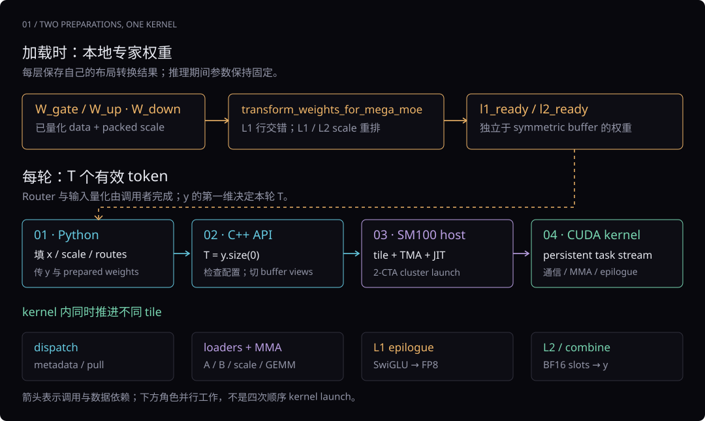
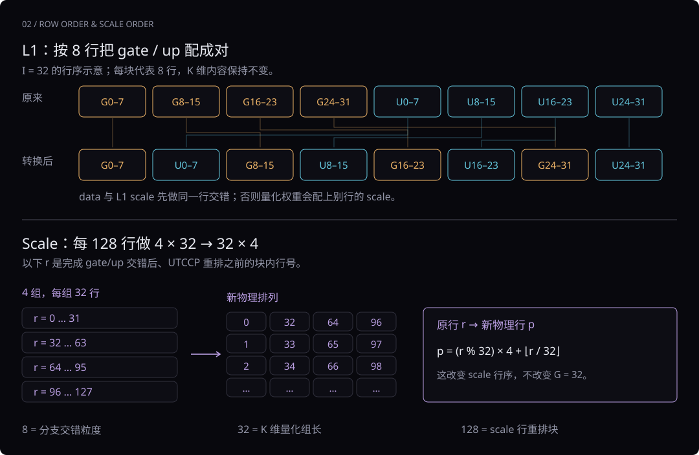

# MegaMoE 源码导读：buffer 之后

固定源码：DeepGEMM `057ca5964aae0879ff2e0eb71ee05a3cb0ba3df7`，SM100 / NVLink 路径。本篇接着 buffer 讲权重布局、前向调用、host launch、调度和 epilogue。

## 1. 下一段源码处在什么位置

buffer 准备完成之后，要让 GPU 高效执行专家计算，还需要准备 **权重布局、本轮输入和输出、tile 描述、任务流以及线程间依赖**。这里的 L1 是合并 gate/up 的第一段专家线性计算，L2 是 down projection；它们不是 GPU 的 L1/L2 cache。



**读图。** 权重转换通常在加载模型时完成；每轮只准备新输入和路由，分配或复用 `y[T,H]`，再调用后端。Python wrapper 转发参数，C++ API 检查配置，SM100 host 选择 tile 并建立 TMA descriptor，CUDA persistent kernel 才开始通信和计算。

记号：`P` 是 rank 数，`E` 是全局路由专家数，`E_local=E/P`；`T` 是本 rank 本轮有效 token 数，`T_cap` 是 buffer 容量，`H` 是 hidden，`I` 是单个专家的 intermediate。top-k 用 `K_top`，与矩阵乘法的 K 维分开。

| 逻辑张量 | 形状 | 作用 |
|---|---|---|
| 输入 `x` | `[T,H]` | 本轮 token 特征 |
| `l1_weights` 数据 | `[E_local,2I,H]` | 合并 gate/up 的专家权重 |
| `l2_weights` 数据 | `[E_local,H,I]` | down 权重 |
| `topk_idx / topk_weights` | `[T,K_top]` | 专家 ID 与每 token 路由系数 |
| 输出 `y` | `[T,H]` | 本 rank token 的最终 MoE 输出 |

权重保存在专家 owner 的本地显存，独立于对称 buffer。一次推理前向不会更新专家参数；同一个 buffer 可以为兼容布局的调用复用，各层传入各层权重。

## 2. `transform_weights_for_mega_moe()` 做什么

调用形式是 `l1_ready, l2_ready = transform_weights_for_mega_moe(l1_weights, l2_weights)`。这个函数准备 GPU 所需的物理布局。低位路径接收 `(data, scale)` tuple，数据应已量化，scale 应已准备为要求的 packed 布局；它不在这里学习权重或计算量化 scale。

把低位分支压缩成下面四行，就能看清处理顺序：

```python
l1_w = _interleave_weights(l1_weights[0])
l1_sf = _transpose_sf_for_utccp(_interleave_weights(l1_weights[1]))
l1_ready = (l1_w, l1_sf)
l2_ready = (l2_weights[0], _transpose_sf_for_utccp(l2_weights[1]))
```

`[0]` 是量化数据，`[1]` 是 scale。L1 同时改变 data 与 scale 行序；L2 不做 gate/up 交错，所以只转换 scale。返回的 tuple 保存起来，供后续前向重复使用。

### 2.1 第一件事：gate/up 按 8 行交错

先看 `_interleave_weights(t, gran=8)`。普通合并权重沿 N/输出维先放完整 gate，再放完整 up：

```text
转换前：[G0 … G(I-1) | U0 … U(I-1)]
转换后：[G0 … G7 | U0 … U7 | G8 … G15 | U8 … U15 | …]
```



**读图。** 图中用 `I=32` 缩略显示 gate/up 的八行分组；这个图只演示行交错，不是完整 GPU 配置。每个橙色块是 8 行 gate，每个蓝色块是对应的 8 行 up。变换保持形状和每行内容，只改变行顺序。

**解析源码中的 reshape / stack。** 对 3D 权重 `[g,n,*rest]`，`half=n/2`：先取前半 gate、后半 up，各自 reshape 为 `[g,half/8,8,*rest]`；在中间插入大小为 2 的分支轴，再展平回原 shape。2D shared 权重先临时补上 group 维，最后去掉。`empty_like(...).copy_(...)` 产生实际重排后的 tensor，原始权重保持原样。

交错布局让 epilogue 直接配对消费 gate/up，计算 `SiLU(gate)*up`。行交错是在为这一消费方式准备数据；L1 的 N tile 同时覆盖两支，SwiGLU 输出宽度缩为一半。[源码：Python helper](https://github.com/deepseek-ai/DeepGEMM/blob/057ca5964aae0879ff2e0eb71ee05a3cb0ba3df7/deep_gemm/mega/__init__.py#L112)

### 2.2 第二件事：scale 必须跟着变，再适配 UTCCP

L1 的数据和 scale 都先做同样的 gate/up 行交错，保持量化数据与原 scale 的对应关系。随后 `_transpose_sf_for_utccp()` 把每个 128 行块视为 `4×32`，转成 `32×4`，再展平。对块内原行号 r：

```text
新物理行位置 = (r % 32) × 4 + floor(r / 32)
新位置读取的原行号：0, 32, 64, 96, 1, 33, 65, 97, …
```

这个函数要求 scale 为 INT32、维数为 2 或 3，MN 能被 128 整除。它重排的是 **scale 行的物理顺序**，没有把 N/K 的逻辑维度对调，也没有改成新的量化分组。kernel 后续通过匹配的 scale 搬运布局使用这些值；不能把重排后的 scale 当作普通逐行 scale 直接相乘。

UTCCP 是这里将 scale 从 shared memory 搬到 Tensor Memory 的相关指令路径。Python 先把 scale 排成该路径需要的格式；真正的复制在 CUDA 内核中发生。[scale helper](https://github.com/deepseek-ai/DeepGEMM/blob/057ca5964aae0879ff2e0eb71ee05a3cb0ba3df7/deep_gemm/mega/__init__.py#L132)、[设备 scale 搬运](https://github.com/deepseek-ai/DeepGEMM/blob/057ca5964aae0879ff2e0eb71ee05a3cb0ba3df7/deep_gemm/include/deep_gemm/impls/sm100_fp8_fp4_mega_moe.cuh#L886)

| 传入对象 | data 怎么处理 | scale 怎么处理 |
|---|---|---|
| 低位 L1 tuple | gate/up 八行交错 | 同样交错，再做 128 行内 UTCCP 重排 |
| 低位 L2 tuple | 保持原 data 对象 | 做 UTCCP 重排 |
| BF16 L1 | gate/up 八行交错 | 没有低位 scale tuple |
| BF16 L2 | 保持原对象 | 没有低位 scale tuple |

BF16 行说明该布局 helper 的另一分支；执行 BF16 权重要使用对应的 `bf16_mega_moe()` 入口。

本机直接执行保存的官方 Python helper，确认了 2D/3D 行顺序、原权重保留、scale 逆重排对应关系，并用 FP32 CPU 矩阵运算确认 gate/up 配对后的 SwiGLU 代数一致。它验证布局关系，没有执行 CUDA GEMM 或量化性能测量。

### 2.3 为什么同时看到 8、32、128

| 数字 | 此处指什么 |
|---|---|
| 8 | gate/up 输出行的交错粒度 |
| 32 | 此 MegaMoE FP8/FP4 路径沿 K 的量化分组长度 |
| 128 行 | scale helper 做 `4×32→32×4` 重排的 MN 块大小 |
| K/128 个 INT32 | 每个 INT32 装 4 个 8 位 UE8M0 scale；4 组×32 值覆盖 128 个数据值 |

这条 MegaMoE 接口的 FP8 激活、FP4/FP8 路由权重都使用组长 32。上一份 V4 官方简化参考模型中通用 Linear 的 FP8 激活组长 128、FP8 权重 tile 128×128，属于另一套参考执行布局，不能直接传入这里。

## 3. 每轮怎样调用 `fp8_fp4_mega_moe()`

以下是省略 shared 分支的调用关系示意。`x_fp8 / x_sf_packed` 应已按本路径的组长和 packing 准备，`l1_ready / l2_ready` 是上一节转换结果：

```python
buffer.x[:T].copy_(x_fp8)
buffer.x_sf[:T].copy_(x_sf_packed)
buffer.topk_idx[:T].copy_(topk_idx)
buffer.topk_weights[:T].copy_(topk_weights)
y = torch.empty((T, H), dtype=torch.bfloat16, device="cuda")

deep_gemm.fp8_fp4_mega_moe(
    y=y,
    l1_weights=l1_ready,
    l2_weights=l2_ready,
    sym_buffer=buffer,
)
```

**函数边界。** Python wrapper 转发权重、原始 buffer、peer 指针列表、当前 group rank、容量、专家数、top-k 和数学配置。它不在此运行 Router、不量化 x、不自动复制输入，也不自动做权重布局转换。输出写入调用者提供的 `y`；该 wrapper 没有返回一个新的输出 tensor。[官方调用测试](https://github.com/deepseek-ai/DeepGEMM/blob/057ca5964aae0879ff2e0eb71ee05a3cb0ba3df7/tests/test_mega_moe.py#L189)

沿 wrapper 往下看，关键参数分成三组：`l1/l2_weights` 告诉后端用哪些本地参数；`sym_buffer.buffer / handle.buffer_ptrs / group.rank()` 告诉后端如何定位各 rank 内存；`num_max_tokens_per_rank / num_experts / num_topk` 描述容量与路由配置。它们一起传给 `_C.fp8_fp4_mega_moe()`，随后进入 C++。[Python wrapper](https://github.com/deepseek-ai/DeepGEMM/blob/057ca5964aae0879ff2e0eb71ee05a3cb0ba3df7/deep_gemm/mega/__init__.py#L168)

### 3.1 本轮 token 数来自 `y.size(0)`

C++ 的执行 API 从输出第一维取得 T，再检查 `T <= T_cap`。因此 buffer.x 的第一维表示容量；调用者填前 T 行，并提供恰好 T 行的 y。不同 rank 可以有不同 T，owner 收到的专家 token 数再由 metadata 统计恢复。[C++ API](https://github.com/deepseek-ai/DeepGEMM/blob/057ca5964aae0879ff2e0eb71ee05a3cb0ba3df7/csrc/apis/mega_moe.hpp#L175)

正确输出契约是本 rank CUDA 上的连续 BF16 `[T,H]`。设备通过 raw pointer 按这个布局写入；本地读到的 API/host 函数没有逐项检查 y 的 dtype、第二维和 stride，所以不能靠任意形状的 tensor 在这里只通过容量检查来保证正确调用。

### 3.2 参数怎么理解

| 参数 | 作用 |
|---|---|
| `l1_weights / l2_weights` | 本地路由专家的 `(data,packed_scale)`；可使用此接口接受的 FP4 或 FP8 权重 |
| `shared_l1_weights / shared_l2_weights` | 成对传入可启用融合 shared 分支；此路径的 shared 权重为 2D FP8 |
| `recipe=(1,1,32)` | 本 API 要求的 scale 粒度组合，代码显式只接受该值 |
| `activation="swiglu"` | 指定内核 epilogue 的激活类型，本版本只接受 SwiGLU |
| `activation_clamp=None` | 在 C++ 中变成 +∞，关闭有限截断；传 0 则是实际的零上限，不是关闭标志 |
| `fast_math=True` | SwiGLU 使用相应的快速 exp / reciprocal 路径；不能假定与关闭时逐位一致 |
| `cumulative_local_expert_recv_stats` | 可选 INT32 本地专家累计接收计数；保留并累加原值 |

权重的数据、scale、shape、物理布局要共同匹配。FP4 data 的物理末维为逻辑 K 的一半，INT32 packed scale 的末维为逻辑 K/128；这两个压缩关系不能当成模型 hidden 变小了。

## 4. C++ API 和 SM100 host 做了什么

### 4.1 API 检查与 buffer view

API 解开两份权重 tuple，检查 L1/L2 的本地专家数一致、H 一致、L1 输出维为 `2I`，权重 dtype 一致，scale 满足打包布局；shared 参数成对提供，并根据其 shape 恢复 shared 数。接着根据 peer 指针数推导 P，检查 `E=E_local×P` 和 raw buffer 字节容量，然后重新切出 tensor views。

重新切 view 使用同一底层 allocation，没有再拷贝一份 x。创建 buffer 时的 H/I/shared 配置应与本轮权重一致；只有字节数足够并不能证明调用者此前通过旧 view 填到了正确区域。该固定执行入口选择 `arch_major==10` 的 SM100 host 路径，其余架构走 Unsupported architecture。[API 检查](https://github.com/deepseek-ai/DeepGEMM/blob/057ca5964aae0879ff2e0eb71ee05a3cb0ba3df7/csrc/apis/mega_moe.hpp#L171)

### 4.2 tile、TMA descriptor 和 JIT

host 根据 P/E、T_cap/T、top-k、H/I 和 ring 容量选择 `BLOCK_M/N/K`、pipeline stages、搬运尺寸与线程数。`BLOCK_M` 是一块处理的 token 行数，`BLOCK_N` 是输出通道 tile，`BLOCK_K` 是每次加载的归约维分块。

TMA descriptor 描述数据基址、全局维度/stride、搬运 tile 和 shared-memory swizzle；此时只是描述搬运方式，GPU 尚未据此完成一次 GEMM。权重和 activation 的 scale 有各自的 descriptor。特别是 **L1 output descriptor 指向 l2_acts**：L1 epilogue 已做完 SwiGLU，直接生成 L2 要读的 `[ring,I]` 激活，不长期保留一个独立 `[ring,2I]` 完整结果数组。

host 将尺寸、tile、stage、clamp、fast_math 和权重 dtype 等实例化进 kernel 模板。T 作为运行时参数传入，同时可以影响 heuristic 选出的配置；不能把每次调用 `jit->compile` 当成每次重新编译，也不能断言变化的 T 永远不会改变模板选择。[SM100 host](https://github.com/deepseek-ai/DeepGEMM/blob/057ca5964aae0879ff2e0eb71ee05a3cb0ba3df7/csrc/jit_kernels/impls/sm100_fp8_fp4_mega_moe.hpp#L37)

### 4.3 launch 怎样安排 CTA

```text
grid = 使用的 SM 数
block_threads = dispatch_threads + 128 + epilogue_threads
cluster = 2 个 CTA
dynamic shared memory = config.smem_size
```

每个 block 持续领取多份任务。这不是一 token 一个 block，也不是一专家一个 block；两个 CTA 组成协作 cluster，按此 SM100 kernel 的 2-CTA MMA 路径运行。线程数量和 tile 的具体取值依所选配置，本文不在缺少 heuristic 实现和 GPU 运行结果时编造某个 batch 的确数。

## 5. persistent kernel 的角色与调度

设 `D=dispatch_threads/32`。每个 CTA 的 warp 按下面的范围分工；MMA 和 scheduler 主循环仅由 cluster leader CTA 发起。

| warp | 角色 | 源码入口 |
|---|---|---|
| `<D` | 发布 metadata、拉取远端 token、末尾清理控制区 | kernel 342 |
| `D` | 本地 activation 与 scale 的 TMA loader | kernel 690 |
| `D+1` | 本地专家权重与 scale 的 TMA loader | kernel 756 |
| `D+2` | MMA issuer，完成归约维计算 | kernel 819 |
| `D+3` | scheduler，产生双缓冲任务信息 | kernel 939 |
| `>=D+4` | epilogue：SwiGLU/量化、L2 写回、最终 combine | kernel 946 |

**任务是 tile。** TaskInfo 标识专家、L1/L2 阶段、M 块、N cluster、逻辑 pool 位置和有效 token 行数。物理 ring 位置由 pool 索引取模得到。一个 N cluster 包含两个相邻的 N tile，分别交给两个 CTA。scheduler 产生同一任务流，activation loader、weight loader、MMA 与 epilogue 各自消费；dispatch 独立推进 metadata 与输入拉取。

任务双缓冲允许准备下一份 TaskInfo，同时消费当前任务。epilogue 等到 MMA 结果后即可释放 TaskInfo 元数据槽；输入 ring、中间激活 ring 与 TMEM 另有各自的复用条件，不能把这次释放理解成所有数据都已写回。

**领取任务与数据就绪分开。** scheduler 先给 routed L1 做 warmup，再组织 L2/L1 的交替领取；它发出 L2 任务时的计数条件描述前序 L1 任务已经被领取，不代表每个 L1 epilogue 已经写完。activation loader 还要检查实际就绪状态：routed L1 等输入 M 块齐备；routed L2 按当前 K 分块等待相应 L1 输出 bitmap。shared L2 使用其对应的全 N 完成计数。[调度器](https://github.com/deepseek-ai/DeepGEMM/blob/057ca5964aae0879ff2e0eb71ee05a3cb0ba3df7/deep_gemm/include/deep_gemm/scheduler/mega_moe.cuh)、[设备角色](https://github.com/deepseek-ai/DeepGEMM/blob/057ca5964aae0879ff2e0eb71ee05a3cb0ba3df7/deep_gemm/include/deep_gemm/impls/sm100_fp8_fp4_mega_moe.cuh#L690)

融合 shared 时，先发 shared L1，它直接读本地输入，不依赖 routed dispatch 的齐备信号。shared L2 的任务量若不超过一波 cluster 则提前发出，否则放在 routed 任务之后。

同一次 kernel 内，设完整 pool 索引为 b、ring 容量为 R，则物理槽是 `b % R`、代际是 `floor(b/R)`。代际状态防止把该槽上一代的 ready 当作当前数据已就绪。调度的“可以领取”、数据的“已经写完”和内存的“消费者可见”是三个相关的条件。

## 6. L1 → SwiGLU → L2 的数值路径

忽略 clamp、量化与浮点舍入，理想公式为：

```text
gate = x · W_gateᵀ
up   = x · W_upᵀ
a    = SiLU(gate) ⊙ up × route_weight
contribution = a · W_downᵀ
```

其中 `SiLU(z)=z/(1+exp(-z))`，`⊙` 是逐元素乘法。下面按实际 kernel 顺序补上舍入、截断和量化。

### 6.1 L1 epilogue 不只是写矩阵乘法结果

本固定 kernel 的实际步骤：

```text
L1 FP32 累加结果
  → gate/up 舍入到 BF16
  → 可选 clamp：gate 只有上界；up 有上下界
  → 转 FP32，计算 SiLU(gate) × up × route_weight
  → 每 token、每 32 个中间通道求 amax
  → UE8M0 scale 与 E4M3 FP8 数据
  → 写 l2_acts / scale，并发布所需就绪状态
```

有限 clamp 为 c 时，gate 用 `min(gate,c)`，up 用 `clamp(up,-c,c)`；它们不是相同的对称截断。普通 routed 分支在这里乘本 token 的路由系数；shared 分支使用系数 1。scale 通过可见的 `get_ue8m0_sf_exp(amax)` helper 与其倒数生成，本篇没有读取该固定版本 helper 的近零边界实现，因而不把其他参考量化公式直接套过来。

**为什么 route weight 可以放在 down 之前？** 理想实数运算、无 bias 的 down Linear 满足 `(w·a)W_downᵀ=w·(aW_downᵀ)`。本 kernel 选择前一种放置，并在加权后量化 a；有限精度和量化会影响舍入，因此不声称与“量化后再在输出乘 w”逐位相同。[L1 epilogue](https://github.com/deepseek-ai/DeepGEMM/blob/057ca5964aae0879ff2e0eb71ee05a3cb0ba3df7/deep_gemm/include/deep_gemm/impls/sm100_fp8_fp4_mega_moe.cuh#L1093)

### 6.2 L2 输出和 source combine

L2 使用 down 权重，把 FP8 中间激活映射回 H 维。epilogue 将贡献转换为 BF16，读取独立 origin metadata，远程写回 source 的对应 `topk_slot/token` 槽。贡献已经包含 route weight，source combine 不再乘一次。

owner 全部本地 L2 写回及 epilogue grid 同步完成后发布本轮 release ready；source 完成本地 L2 同步，并 acquire 等待各 token 选中的 owner ranks，才读本地贡献，用 FP32 求和后转 BF16 写 y。融合 shared 分支时还归并本地 shared contribution；未融合时由上层独立计算并相加。[L2 与 combine](https://github.com/deepseek-ai/DeepGEMM/blob/057ca5964aae0879ff2e0eb71ee05a3cb0ba3df7/deep_gemm/include/deep_gemm/impls/sm100_fp8_fp4_mega_moe.cuh#L1273)

## 7. 怎样把源码和 overlap 动画对应起来

| 动画阶段 | 源码中的主要执行者 | 同时还能做什么 |
|---|---|---|
| metadata / pull | dispatch warps | shared 分支可按其调度条件开始；本地 routed 计算等待输入就绪 |
| L1 / L2 | activation loader、weight loader、MMA | dispatch 拉后续块，epilogue 处理已完成 tile |
| SwiGLU / FP8 | L1 epilogue | 其他 tile 的 MMA；对应 ready 的 L2 K 块可开始加载 |
| 写回 / 本地合并 | L2 与 combine epilogue | 不同块继续推进；清理控制区可与最终 combine 重叠 |

同一数据块仍遵守依赖；重叠依靠不同块、tile、CTA 和专职 warp 的流水。共享资源、带宽与尾部同步会限制重叠，动画时间线只说明机制，没有 GPU 实测加速比。

[查看完整交互动画](mega-moe-full.html)

## 8. 回到源码时的阅读顺序

| 顺序 | 入口 | 重点 |
|---|---|---|
| 1 | [Python 112–166](https://github.com/deepseek-ai/DeepGEMM/blob/057ca5964aae0879ff2e0eb71ee05a3cb0ba3df7/deep_gemm/mega/__init__.py#L112) | gate/up 与 scale 如何排成可消费布局 |
| 2 | [Python 168–190](https://github.com/deepseek-ai/DeepGEMM/blob/057ca5964aae0879ff2e0eb71ee05a3cb0ba3df7/deep_gemm/mega/__init__.py#L168) | 传递权重、raw buffer、peer pointers、配置 |
| 3 | [C++ API 155–282](https://github.com/deepseek-ai/DeepGEMM/blob/057ca5964aae0879ff2e0eb71ee05a3cb0ba3df7/csrc/apis/mega_moe.hpp#L155) | T 从 y 得到，检查约束，重建 views，分派架构 |
| 4 | [SM100 host 37–221](https://github.com/deepseek-ai/DeepGEMM/blob/057ca5964aae0879ff2e0eb71ee05a3cb0ba3df7/csrc/jit_kernels/impls/sm100_fp8_fp4_mega_moe.hpp#L37) | tile、TMA maps、模板和 2-CTA cluster launch |
| 5 | [kernel 690–945](https://github.com/deepseek-ai/DeepGEMM/blob/057ca5964aae0879ff2e0eb71ee05a3cb0ba3df7/deep_gemm/include/deep_gemm/impls/sm100_fp8_fp4_mega_moe.cuh#L690) | loader/MMA/scheduler 消费任务，检查就绪 |
| 6 | [kernel 946–1517](https://github.com/deepseek-ai/DeepGEMM/blob/057ca5964aae0879ff2e0eb71ee05a3cb0ba3df7/deep_gemm/include/deep_gemm/impls/sm100_fp8_fp4_mega_moe.cuh#L946) | BF16 舍入、clamp、SwiGLU、量化、回写、归并 |

主计算阅读线为 `transform_weights → fp8_fp4_mega_moe → C++ checks → TMA/JIT launch → scheduler/loaders/MMA → epilogue`。buffer 的细节可回看动画；本篇把重点放在其后面的消费者。

[返回总文档 MegaMoE 章节](deepseek-v4-framework.html#section-46) · [V4 量化组件与官方选择](deepseek-v4-quantization.html)
